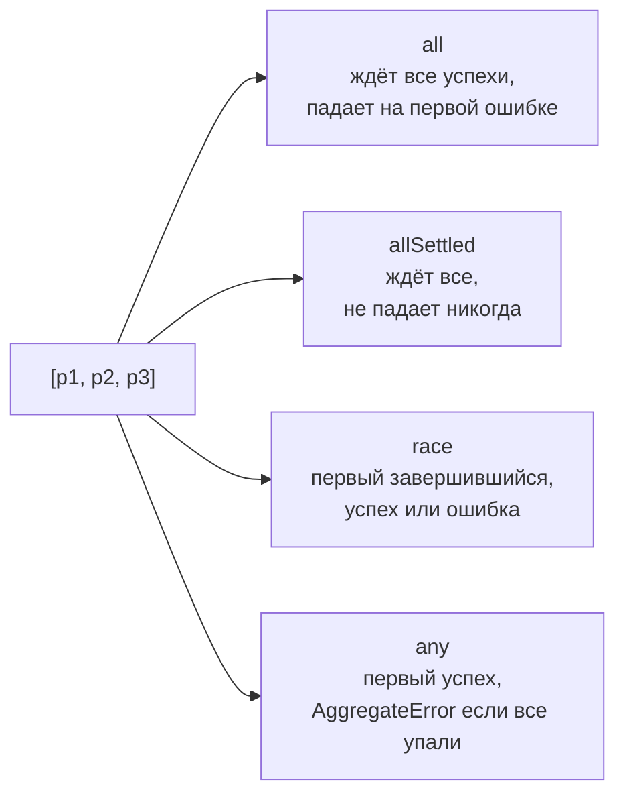

## О чём урок

Несколько асинхронных операций можно ждать по очереди или вместе. Для «вместе» у `Promise` есть четыре статических метода: `all`, `allSettled`, `race` и `any`. Их путают на собеседованиях, а в коде неверный выбор даёт либо лишнюю задержку, либо потерянные ошибки.

## Параллельно, а не по очереди

Промис начинает работу в момент создания, а не в момент `await`. Если запросы не зависят друг от друга, их нужно запустить сразу, а ждать потом.

```js run
const wait = (ms, v) => new Promise((r) => setTimeout(() => r(v), ms))
// Each wait is 100 ms; timers are not exact, so compare with 150 ms rather than 200.
let t = Date.now()
await wait(100, "a")
await wait(100, "b")
console.log("one by one, over 150 ms:", Date.now() - t > 150)

t = Date.now()
await Promise.all([wait(100, "a"), wait(100, "b")])
console.log("together, under 150 ms:", Date.now() - t < 150)
```

```output
one by one, over 150 ms: true
together, under 150 ms: true
```

## Сравнение



| Метод | Выполняется, когда | Отклоняется, когда | Результат |
|---|---|---|---|
| `Promise.all` | выполнены **все** | отклонён **первый** | массив значений в порядке входа |
| `Promise.allSettled` | завершены **все**, как угодно | никогда | массив `{ status, value }` или `{ status, reason }` |
| `Promise.race` | **первый** завершился успешно | **первый** завершился ошибкой | значение или ошибка первого |
| `Promise.any` | **первый** успешный | отклонены **все** | значение первого успешного, иначе `AggregateError` |

Все четыре принимают любой iterable, а обычные значения в нём считаются уже выполненными промисами.

## all: всё или ничего

`Promise.all` нужен, когда без любого из результатов дальше идти нельзя: профиль, права и настройки для одной страницы. Результаты идут в порядке входа, а не в порядке ответа. Ошибка одного запроса отклоняет общий промис сразу, но **остальные запросы не отменяются**: они продолжают работу, просто их результат никому не нужен. Для настоящей отмены нужен `AbortController` из [урока про отмену](/learn/async-cancellation).

## allSettled: каждому свой результат

Когда частичный успех лучше, чем ничего (виджеты дашборда, пакетная загрузка файлов), используйте `allSettled` и разберите статусы.

```js run
const results = await Promise.allSettled([
  Promise.resolve("profile"),
  Promise.reject(new Error("stats down")),
  Promise.resolve("news"),
])
for (const r of results) console.log(r.status, r.status === "fulfilled" ? r.value : r.reason.message)
```

```output
fulfilled profile
rejected stats down
fulfilled news
```

## race: первый завершившийся

`race` учитывает и успех, и ошибку: кто первый, тот и победил. Классическое применение это таймаут.

```js run
const wait = (ms, v) => new Promise((r) => setTimeout(() => r(v), ms))
const timeout = (ms) => new Promise((_, reject) => setTimeout(() => reject(new Error(`timeout ${ms} ms`)), ms))

console.log(await Promise.race([wait(10, "fast"), timeout(50)]))
await Promise.race([wait(100, "slow"), timeout(20)]).catch((e) => console.log(e.message))
```

```output
fast
timeout 20 ms
```

Но таймаут через `race` только перестаёт ждать: медленный запрос продолжает работать и тратить сеть. Для `fetch` правильнее `AbortSignal.timeout(ms)`, он действительно прерывает запрос. Пустой `race([])` никогда не завершится.

## any: первый успешный

`any` игнорирует ошибки, пока есть шанс на успех. Подходит для зеркал: взять ответ с того CDN, который ответил первым и без ошибки. Если отклонены все, `any` отклоняется `AggregateError`, где в поле `errors` причины **в порядке входа**, а не в порядке ошибок.

```js run
const fail = (ms, msg) => new Promise((_, reject) => setTimeout(() => reject(new Error(msg)), ms))
try {
  await Promise.any([fail(30, "a"), fail(10, "b"), fail(20, "c")])
} catch (e) {
  console.log(e.name, e.errors.map((x) => x.message))
}
```

```output
AggregateError [ 'a', 'b', 'c' ]
```

## Главное

- Запускайте независимые операции сразу, ждите вместе; `await` в цикле это последовательное выполнение.
- `all`: все или первая ошибка. `allSettled`: каждый результат. `race`: первый любой. `any`: первый успешный или `AggregateError`.
- Порядок результатов всегда совпадает с порядком входа.
- Ни один метод не отменяет проигравшие операции; для отмены нужен `AbortController`.
