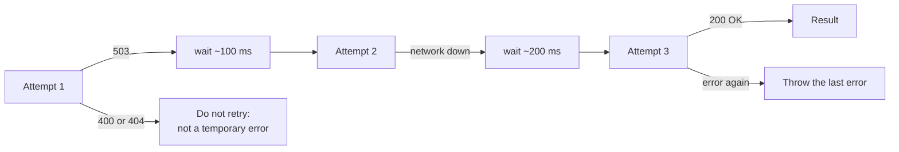
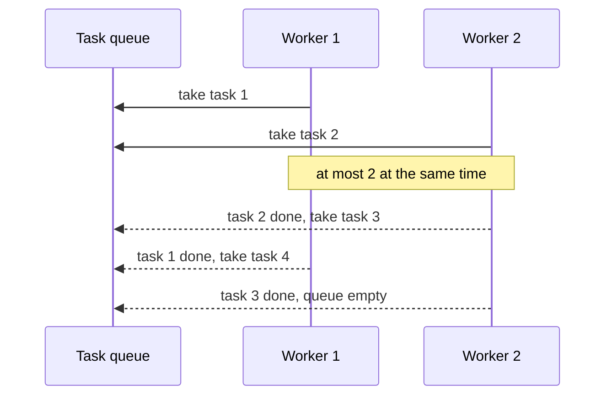

## What this lesson covers

Ready-made techniques on top of promises, written in interviews and in real code: retry with exponential backoff, timeouts, a concurrency limit, a serial queue, "latest request wins", batching small requests and a deferred promise with `Promise.withResolvers`.

## Retry with exponential backoff

Networks and servers sometimes fail temporarily. Retrying immediately and forever is bad: a server under load gets even more requests. The right way: a limited number of attempts, a growing delay (100, 200, 400 ms) with random jitter added so that thousands of clients do not retry at the same moment, and retries only for temporary errors.



```js run
async function retry(task, { retries = 3, baseMs = 100, shouldRetry = () => true, signal, sleep } = {}) {
  for (let attempt = 0; ; attempt++) {
    try {
      return await task(attempt)
    } catch (error) {
      if (attempt >= retries || !shouldRetry(error) || signal?.aborted) throw error
      const delay = baseMs * 2 ** attempt * (0.5 + Math.random() / 2) // exponential + jitter
      await sleep(delay)
    }
  }
}

const delays = []
const fakeSleep = async (ms) => delays.push(ms) // a real sleep in production code
let calls = 0
const result = await retry(
  async () => {
    calls++
    if (calls < 3) throw Object.assign(new Error('busy'), { status: 503 })
    return 'ok'
  },
  { shouldRetry: (e) => e.status >= 500, sleep: fakeSleep },
)
console.log(result, 'after', calls, 'calls,', delays.length, 'waits')

try {
  await retry(async () => { throw Object.assign(new Error('not found'), { status: 404 }) }, { shouldRetry: (e) => e.status >= 500, sleep: fakeSleep })
} catch (e) {
  console.log('no retry for', e.status)
}
```

```output
ok after 3 calls, 2 waits
no retry for 404
```

Retry only **idempotent** operations: `GET` is safe, but retrying `POST /payments` without an idempotency key may charge twice.

## Timeouts

`fetch` has no timeout by default: a request can hang for minutes. The modern way is `AbortSignal.timeout(ms)`, combined with user cancellation through `AbortSignal.any([...])` (the cancellation lesson).

```js
const response = await fetch('/api/report', { signal: AbortSignal.any([AbortSignal.timeout(5000), userController.signal]) })
```

For a promise that cannot be cancelled, a timeout through `Promise.race` with a timer only stops **waiting**: the operation itself goes on in the background.

## A concurrency limit

Uploading 500 files with `Promise.all(files.map(upload))` opens 500 connections at once. A pool of N "workers" takes tasks from a shared queue:



```js run
async function mapLimit(items, limit, fn) {
  const results = new Array(items.length)
  let next = 0
  let active = 0
  let peak = 0
  async function worker() {
    while (next < items.length) {
      const index = next++ // synchronous: no two workers take the same index
      active++
      peak = Math.max(peak, active)
      results[index] = await fn(items[index], index)
      active--
    }
  }
  await Promise.all(Array.from({ length: Math.min(limit, items.length) }, worker))
  return { results, peak }
}

const sleep = (ms) => new Promise((r) => setTimeout(r, ms))
const { results, peak } = await mapLimit([30, 10, 20, 10, 5], 2, async (ms, i) => (await sleep(ms), `#${i}`))
console.log(results, 'max in flight:', peak)
```

```output
[ '#0', '#1', '#2', '#3', '#4' ] max in flight: 2
```

The results are in input order, although the tasks finished out of order. A task with tests: [mapLimit](/code/map-limit).

## A serial queue

Sometimes operations must run strictly one at a time: draft saves, writes to one file, animations. Keeping the tail of a promise chain is enough:

```js run
function createQueue() {
  let tail = Promise.resolve()
  return (task) => {
    const run = tail.then(task)
    tail = run.catch(() => {}) // one failure must not stop the queue
    return run
  }
}

const enqueue = createQueue()
const sleep = (ms) => new Promise((r) => setTimeout(r, ms))
const log = []
await Promise.allSettled([
  enqueue(async () => (await sleep(20), log.push('save 1'))),
  enqueue(async () => { throw new Error('save 2 failed') }),
  enqueue(async () => log.push('save 3')),
])
console.log(log)
```

```output
[ 'save 1', 'save 3' ]
```

## Latest request wins

Search as you type: responses arrive in random order, and the response for "re" may come after the one for "react". Solutions: cancel the previous request with an `AbortController` or ignore stale responses by request number.

```js run
function latestOnly(fn) {
  let current = 0
  let controller
  return async (...args) => {
    const id = ++current
    controller?.abort() // cancel the previous request
    controller = new AbortController()
    const result = await fn(...args, controller.signal)
    if (id !== current) throw new DOMException('Superseded', 'AbortError') // a newer call started
    return result
  }
}

const sleep = (ms) => new Promise((r) => setTimeout(r, ms))
const search = latestOnly(async (q) => (await sleep(q === 're' ? 30 : 10), `results for ${q}`))
const shown = []
await Promise.allSettled([search('re').then((r) => shown.push(r)), search('react').then((r) => shown.push(r))])
console.log(shown)
```

```output
[ 'results for react' ]
```

React and Vue do the same with a flag in the effect or watcher cleanup (the `useEffect` and `watch` lessons), and TanStack Query does it for you.

## Request batching

Twenty components in one render ask for `getUser(id)` with different `id`s. Instead of twenty requests, collect all `id`s requested within one tick and send a single `GET /users?ids=...` (this is how DataLoader works in GraphQL):

```js run
function batcher(loadMany) {
  let pending = null
  return (key) => {
    if (!pending) {
      pending = { keys: [], resolvers: [] }
      queueMicrotask(async () => {
        const { keys, resolvers } = pending
        pending = null
        const values = await loadMany(keys) // one request for the whole tick
        resolvers.forEach((r, i) => r.resolve(values[i]))
      })
    }
    const deferred = Promise.withResolvers()
    pending.keys.push(key)
    pending.resolvers.push(deferred)
    return deferred.promise
  }
}

const requests = []
const getUser = batcher(async (ids) => (requests.push(ids), ids.map((id) => ({ id, name: `user ${id}` }))))
const users = await Promise.all([getUser(1), getUser(2), getUser(3)])
console.log(users.map((u) => u.name), 'requests:', requests)
```

```output
[ 'user 1', 'user 2', 'user 3' ] requests: [ [ 1, 2, 3 ] ]
```

`Promise.withResolvers()` (ES2024) returns `{ promise, resolve, reject }`: a handy "deferred" promise settled from outside. Before it, `resolve` was moved out of the constructor into a variable.

## Key points

- Retry: limited attempts, exponential delay with jitter, only temporary errors and only idempotent operations.
- A timeout for `fetch` through `AbortSignal.timeout`; `Promise.race` with a timer only stops waiting.
- A pool of N workers limits concurrency and keeps the results in order.
- A queue is the tail of a promise chain, and one failed task does not stop the rest.
- "Latest wins": cancel the previous request or check a request number.
- Batching: collect keys within a tick, one request, hand out results through `Promise.withResolvers`.
