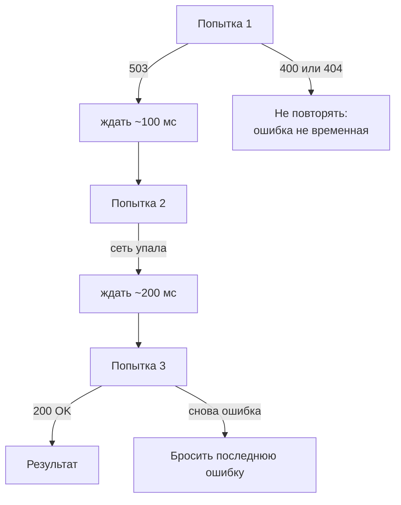
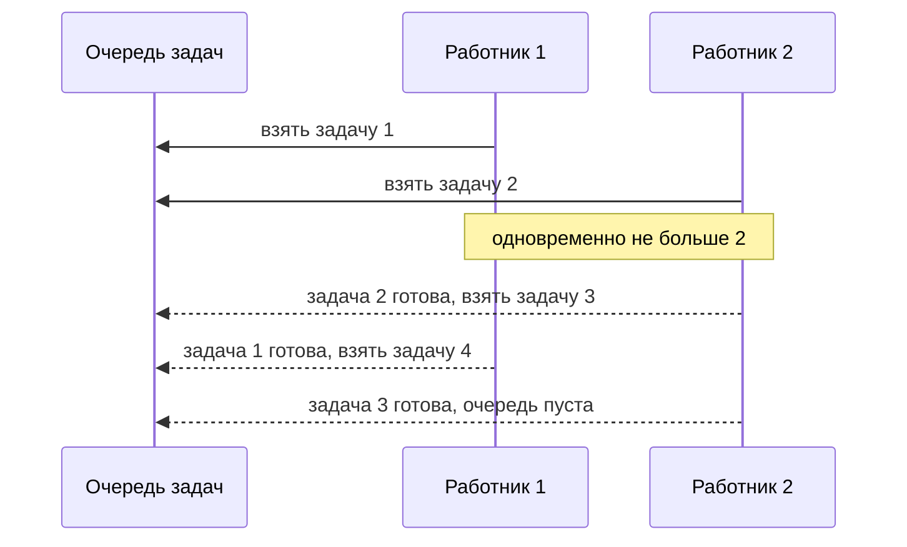

## О чём урок

Готовые приёмы поверх промисов, которые пишут на собеседованиях и в реальном коде: повтор с экспоненциальной задержкой, таймаут, ограничение параллельности, последовательная очередь, «побеждает последний запрос», объединение мелких запросов в пачку и отложенный промис через `Promise.withResolvers`.

## Повтор с экспоненциальной задержкой

Сеть и серверы иногда отвечают ошибкой временно. Повторять сразу и бесконечно плохо: сервер под нагрузкой получит ещё больше запросов. Правильно: ограниченное число попыток, задержка растёт (100, 200, 400 мс), к ней добавляется случайный разброс (jitter), чтобы тысячи клиентов не повторили запрос одновременно, и повтор только для временных ошибок.



```js run
async function retry(task, { retries = 3, baseMs = 100, shouldRetry = () => true, signal, sleep } = {}) {
  for (let attempt = 0; ; attempt++) {
    try {
      return await task(attempt)
    } catch (error) {
      if (attempt >= retries || !shouldRetry(error) || signal?.aborted) throw error
      const delay = baseMs * 2 ** attempt * (0.5 + Math.random() / 2) // exponential + jitter
      await sleep(delay)
    }
  }
}

const delays = []
const fakeSleep = async (ms) => delays.push(ms) // a real sleep in production code
let calls = 0
const result = await retry(
  async () => {
    calls++
    if (calls < 3) throw Object.assign(new Error('busy'), { status: 503 })
    return 'ok'
  },
  { shouldRetry: (e) => e.status >= 500, sleep: fakeSleep },
)
console.log(result, 'after', calls, 'calls,', delays.length, 'waits')

try {
  await retry(async () => { throw Object.assign(new Error('not found'), { status: 404 }) }, { shouldRetry: (e) => e.status >= 500, sleep: fakeSleep })
} catch (e) {
  console.log('no retry for', e.status)
}
```

```output
ok after 3 calls, 2 waits
no retry for 404
```

Повторяют только **идемпотентные** операции: `GET` безопасно, а повтор `POST /payments` без ключа идемпотентности может списать деньги дважды.

## Таймаут

У `fetch` нет таймаута по умолчанию: запрос может висеть минутами. Современный способ: `AbortSignal.timeout(ms)`, а вместе с отменой от пользователя `AbortSignal.any([...])` (урок об отмене).

```js
const response = await fetch('/api/report', { signal: AbortSignal.any([AbortSignal.timeout(5000), userController.signal]) })
```

Для промиса, который нельзя отменить, таймаут через `Promise.race` с таймером только перестаёт **ждать**: сама операция продолжается в фоне.

## Ограничение параллельности

Загрузить 500 файлов через `Promise.all(files.map(upload))` значит открыть 500 соединений сразу. Пул из N «работников» берёт задачи из общей очереди:



```js run
async function mapLimit(items, limit, fn) {
  const results = new Array(items.length)
  let next = 0
  let active = 0
  let peak = 0
  async function worker() {
    while (next < items.length) {
      const index = next++ // synchronous: no two workers take the same index
      active++
      peak = Math.max(peak, active)
      results[index] = await fn(items[index], index)
      active--
    }
  }
  await Promise.all(Array.from({ length: Math.min(limit, items.length) }, worker))
  return { results, peak }
}

const sleep = (ms) => new Promise((r) => setTimeout(r, ms))
const { results, peak } = await mapLimit([30, 10, 20, 10, 5], 2, async (ms, i) => (await sleep(ms), `#${i}`))
console.log(results, 'max in flight:', peak)
```

```output
[ '#0', '#1', '#2', '#3', '#4' ] max in flight: 2
```

Результаты в порядке входа, хотя задачи завершались вразнобой. Задача с тестами: [mapLimit](/code/map-limit).

## Последовательная очередь

Иногда операции должны идти строго по одной: сохранения черновика, запись в один файл, анимации. Достаточно хранить хвост цепочки промисов:

```js run
function createQueue() {
  let tail = Promise.resolve()
  return (task) => {
    const run = tail.then(task)
    tail = run.catch(() => {}) // one failure must not stop the queue
    return run
  }
}

const enqueue = createQueue()
const sleep = (ms) => new Promise((r) => setTimeout(r, ms))
const log = []
await Promise.allSettled([
  enqueue(async () => (await sleep(20), log.push('save 1'))),
  enqueue(async () => { throw new Error('save 2 failed') }),
  enqueue(async () => log.push('save 3')),
])
console.log(log)
```

```output
[ 'save 1', 'save 3' ]
```

## Побеждает последний запрос

Поиск по мере ввода: ответы приходят в случайном порядке, и ответ на «re» может прийти после ответа на «react». Решения: отменять предыдущий запрос через `AbortController` или игнорировать устаревшие ответы по номеру запроса.

```js run
function latestOnly(fn) {
  let current = 0
  let controller
  return async (...args) => {
    const id = ++current
    controller?.abort() // cancel the previous request
    controller = new AbortController()
    const result = await fn(...args, controller.signal)
    if (id !== current) throw new DOMException('Superseded', 'AbortError') // a newer call started
    return result
  }
}

const sleep = (ms) => new Promise((r) => setTimeout(r, ms))
const search = latestOnly(async (q) => (await sleep(q === 're' ? 30 : 10), `results for ${q}`))
const shown = []
await Promise.allSettled([search('re').then((r) => shown.push(r)), search('react').then((r) => shown.push(r))])
console.log(shown)
```

```output
[ 'results for react' ]
```

В React и Vue то же самое делают флагом в очистке эффекта или наблюдателя (уроки о `useEffect` и `watch`), а TanStack Query делает это сам.

## Пачки запросов

Двадцать компонентов в одном рендере просят `getUser(id)` для разных `id`. Вместо двадцати запросов можно собрать все `id`, запрошенные за один такт, и отправить один `GET /users?ids=...` (так работает DataLoader в GraphQL):

```js run
function batcher(loadMany) {
  let pending = null
  return (key) => {
    if (!pending) {
      pending = { keys: [], resolvers: [] }
      queueMicrotask(async () => {
        const { keys, resolvers } = pending
        pending = null
        const values = await loadMany(keys) // one request for the whole tick
        resolvers.forEach((r, i) => r.resolve(values[i]))
      })
    }
    const deferred = Promise.withResolvers()
    pending.keys.push(key)
    pending.resolvers.push(deferred)
    return deferred.promise
  }
}

const requests = []
const getUser = batcher(async (ids) => (requests.push(ids), ids.map((id) => ({ id, name: `user ${id}` }))))
const users = await Promise.all([getUser(1), getUser(2), getUser(3)])
console.log(users.map((u) => u.name), 'requests:', requests)
```

```output
[ 'user 1', 'user 2', 'user 3' ] requests: [ [ 1, 2, 3 ] ]
```

`Promise.withResolvers()` (ES2024) возвращает `{ promise, resolve, reject }`: удобный «отложенный» промис, который выполняют снаружи. Раньше для этого выносили `resolve` из конструктора в переменную.

## Главное

- Повтор: ограниченное число попыток, экспоненциальная задержка с разбросом, только временные ошибки и только идемпотентные операции.
- Таймаут для `fetch` через `AbortSignal.timeout`; `Promise.race` с таймером только перестаёт ждать.
- Пул из N работников ограничивает параллельность и сохраняет порядок результатов.
- Очередь это хвост цепочки промисов, ошибка одной задачи не останавливает остальные.
- «Побеждает последний»: отмена предыдущего запроса или проверка номера.
- Пачки: собрать ключи за такт, один запрос, раздать результаты через `Promise.withResolvers`.
