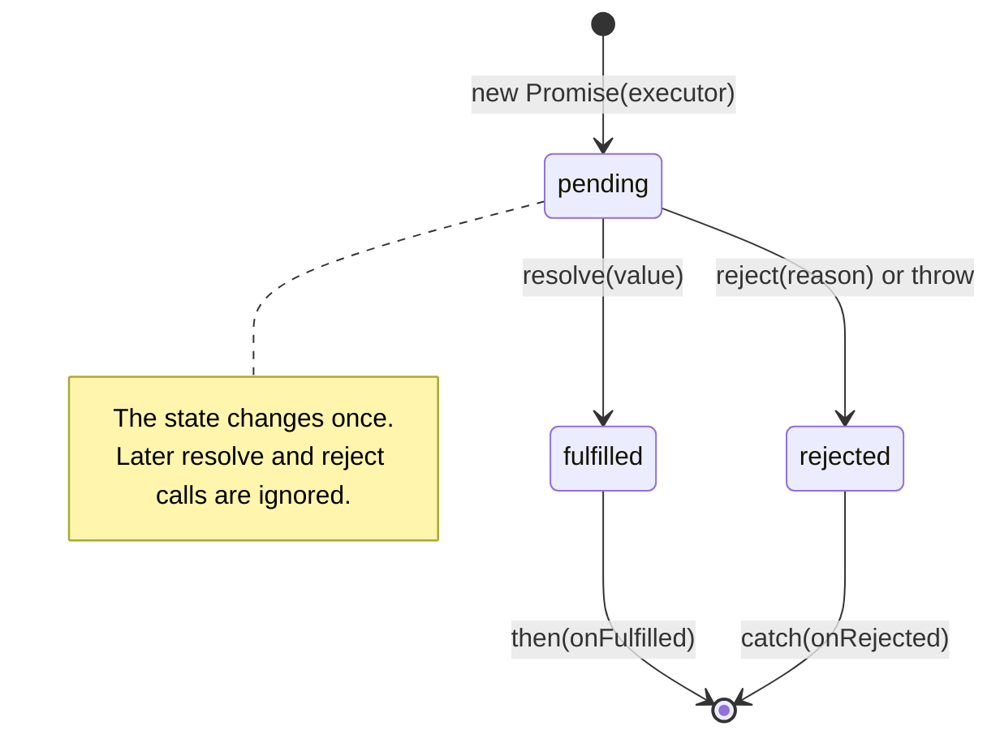

## What this lesson covers

A promise is an object standing for a result that arrives later: a server response, a file read, an expired timer. Almost everything async on the frontend (`fetch`, `import()`, Web Crypto, waiting for an animation) returns promises, and `async`/`await` from [the next lessons](/learn/async-await) is built on them. Here we look at how a promise and a `then` chain work, because both "what does it print" tasks and real error-handling bugs are built on that.

## Three states



A promise is in one of these states:

- `pending`: no result yet;
- `fulfilled`: done with a value;
- `rejected`: failed with a reason (usually an `Error`).

From `pending` a promise moves to one of the other two **once** and never changes again. It is then **settled**. Later calls to `resolve` and `reject` are ignored.

```js run
const p = new Promise((resolve, reject) => {
  resolve("first")
  resolve("second")
  reject(new Error("too late"))
})
p.then((value) => console.log(value))
```

```output
first
```

The executor passed to `new Promise` runs **synchronously**, right in the constructor. If it throws, the promise is rejected. `then` callbacks, on the other hand, are always called asynchronously, as microtasks, even when the promise is already fulfilled. The [event loop lesson](/learn/async-event-loop) explains why.

## The then chain

`then(onFulfilled, onRejected)` returns a **new** promise. What happens to it depends on the callback:

| The callback | The new promise |
|---|---|
| returns a value | is fulfilled with that value |
| returns a promise | follows its state once it settles |
| throws | is rejected with that exception |
| is missing for this case | passes the value or error on unchanged |

That is why chains are written flat, returning the next promise from the callback instead of nesting `then` inside `then`.

```js run
Promise.resolve(2)
  .then((x) => x * 10)
  .then((x) => Promise.resolve(x + 1))
  .then((x) => {
    throw new Error(`bad ${x}`)
  })
  .then(() => console.log("skipped"))
  .catch((e) => {
    console.log("caught:", e.message)
    return "recovered"
  })
  .then((x) => console.log(x))
```

```output
caught: bad 21
recovered
```

An error skips every `then` without an error handler until the nearest `catch`. And `catch` returns a regular promise: if its handler does not throw, the chain continues as a success.

## catch and finally

- `catch(fn)` is `then(undefined, fn)`.
- `finally(fn)` runs in either case but gets no value and does not change the result: the value or error passes through. The exception: if `finally` itself throws, that error replaces the result.

```js run
Promise.reject(new Error("boom"))
  .finally(() => console.log("cleanup"))
  .catch((e) => console.log("still rejected:", e.message))
```

```output
cleanup
still rejected: boom
```

The difference between `then(ok, fail)` and `then(ok).catch(fail)` is a popular question. In the second form `fail` also catches an error thrown inside `ok`. In the first it does not: the two handlers of one `then` do not see each other.

## The forgotten return

The most common chain bug: an async operation is started inside `then`, but its promise is not returned. The chain does not wait for it, and its error goes nowhere.

```js run
const wait = (ms, v) => new Promise((r) => setTimeout(() => r(v), ms))
wait(10, 1)
  .then((x) => {
    wait(20, x + 1).then((y) => console.log("inner", y))
  })
  .then((x) => console.log("next got", x))
```

```output
next got undefined
inner 2
```

## Unhandled rejection

If nobody handles a rejected promise, the browser fires an `unhandledrejection` event on `window` and logs the error. In Node.js the process exits with an error by default. So every chain needs a `catch` at the end, and every `await` needs a `try`/`catch` somewhere up the call chain.

## Thenables and Promise.resolve

Promises accept any object with a `then` method (a thenable): `Promise.resolve(thenable)`, `await thenable` and returning one from `then` all call its `then`. That is how old promise libraries interoperate with native promises. `Promise.resolve(p)` where `p` is a native promise returns that same `p`.

## Newer methods

- `Promise.withResolvers()` (ES2024) returns `{ promise, resolve, reject }`. Handy when a promise must be settled from outside: from an event handler, from a request queue.
- `Promise.try(fn)` (ES2025) calls `fn` and always returns a promise: a synchronous error also becomes a rejected promise.

```js run
const { promise, resolve } = Promise.withResolvers()
setTimeout(() => resolve("done"), 5)
console.log(await promise)

await Promise.try(() => {
  throw new Error("sync error")
}).catch((e) => console.log("caught:", e.message))
```

```output
done
caught: sync error
```

## Key points

- States: `pending`, then once `fulfilled` or `rejected`.
- The executor is synchronous; `then` callbacks are always asynchronous (microtasks).
- `then` returns a new promise; return the next promise from the callback, or the chain will not wait for it.
- An error travels down the chain to the nearest `catch`; `finally` does not change the result.
- An unhandled rejection is a bug; put a `catch` at the end of a chain.
