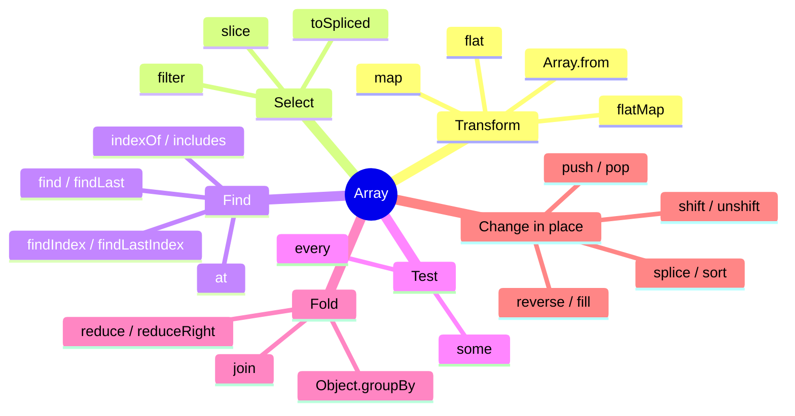
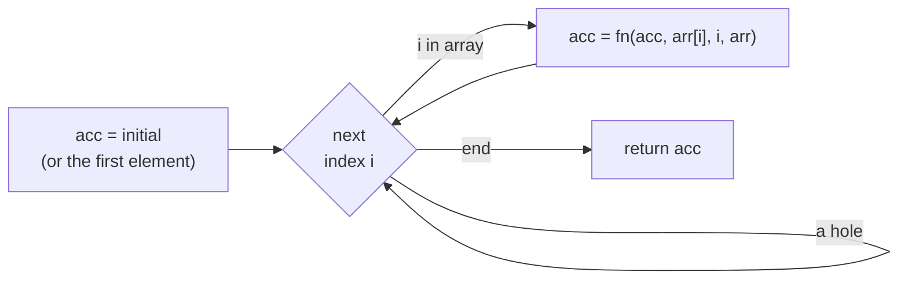

## What this lesson covers

Interviews check arrays from two sides: do you know the methods and which ones change the original array, and can you write `map`, `filter` and `reduce` yourself. A map of methods, mutating methods and their ES2023 copying pairs, `sort`, `reduce` and sparse-array pitfalls, grouping, `Set` methods and polyfills.

## A map of methods



## What changes the original array

| Mutates | Copying pair (ES2023) | What it does |
|---|---|---|
| `sort(fn)` | `toSorted(fn)` | Sorting |
| `reverse()` | `toReversed()` | Reverse order |
| `splice(i, n, ...items)` | `toSpliced(i, n, ...items)` | Remove and insert |
| `arr[i] = x` | `with(i, x)` | Replace an element |
| `push`, `pop`, `shift`, `unshift`, `fill`, `copyWithin` | spread, `slice`, `concat` | Add and remove |

Immutable updates matter wherever changes are tracked by reference: React and Redux state, `OnPush` in Angular, memoized selectors. `arr.sort()` in a reducer changes the state in place and the component will not re-render; `toSorted()` returns a new array.

```js run
const state = [3, 1, 2]
const sorted = state.toSorted((a, b) => a - b)
console.log(state, sorted, state.with(0, 9), state.toSpliced(1, 1))

console.log([10, 1, 2, 25].sort(), [10, 1, 2, 25].sort((a, b) => a - b))
console.log(['b', 'a', 'C'].sort(), ['b', 'a', 'C'].sort((a, b) => a.localeCompare(b)))
```

```output
[ 3, 1, 2 ] [ 1, 2, 3 ] [ 9, 1, 2 ] [ 3, 2 ]
[ 1, 10, 2, 25 ] [ 1, 2, 10, 25 ]
[ 'C', 'a', 'b' ] [ 'a', 'b', 'C' ]
```

- `sort()` without a function compares **strings** by code units: `10` before `2`, capitals before lowercase. Numbers need `(a, b) => a - b`, text needs `localeCompare` or `Intl.Collator`.
- The comparator returns a negative number, zero or a positive number, not `true`/`false`.
- Sorting is stable (elements with equal keys keep their order) by the spec since ES2019.

## Pitfalls

```js run
console.log([NaN].indexOf(NaN), [NaN].includes(NaN))
console.log([1, 2, 3].at(-1), [1, [2, [3, [4]]]].flat(), [1, [2, [3, [4]]]].flat(Infinity))

try {
  [].reduce((a, b) => a + b)
} catch (e) {
  console.log(e.message)
}
console.log([].reduce((a, b) => a + b, 0))

const sparse = [1, , 3]
console.log(sparse.length, sparse.map((x) => x * 2), Object.keys(sparse))
console.log(Array.from({ length: 3 }, (_, i) => i * i), new Array(3).map(() => 0))

const found = [1, 2, 3].forEach((x) => x === 2)
console.log(found)
```

```output
-1 true
3 [ 1, 2, [ 3, [ 4 ] ] ] [ 1, 2, 3, 4 ]
Reduce of empty array with no initial value
0
3 [ 2, <1 empty item>, 6 ] [ '0', '2' ]
[ 0, 1, 4 ] [ <3 empty items> ]
undefined
```

- `indexOf` compares with `===` and does not find `NaN`; `includes` uses SameValueZero and does.
- `reduce` without an initial value takes the first element and throws on an empty array. Always pass the initial value.
- **Sparse arrays** (holes): `[1, , 3]` and `new Array(3)` have empty slots that `map`, `forEach` and `filter` skip. For an array of a given length use `Array.from({ length: n }, fn)` or `new Array(n).fill(0)`.
- `forEach` always returns `undefined` and does not stop on `break` or `return`. Searching uses `find` and `some`, stopping early uses a `for...of` loop.
- `at(-1)` reads from the end; `arr[-1]` looks up a property named `"-1"` and gives `undefined`.

## Grouping and sets

```js run
const orders = [
  { id: 1, status: 'paid', total: 30 },
  { id: 2, status: 'new', total: 10 },
  { id: 3, status: 'paid', total: 15 },
]
const byStatus = Object.groupBy(orders, (o) => o.status)
console.log(Object.keys(byStatus), byStatus.paid.map((o) => o.id))

const a = new Set(['js', 'ts', 'css'])
const b = new Set(['ts', 'html'])
console.log(a.union(b), a.intersection(b), a.difference(b), new Set(['ts']).isSubsetOf(a))
console.log([...new Set([3, 1, 3, 2, 1])])
```

```output
[ 'paid', 'new' ] [ 1, 3 ]
Set(4) { 'js', 'ts', 'css', 'html' } Set(1) { 'ts' } Set(2) { 'js', 'css' } true
[ 3, 1, 2 ]
```

- `Object.groupBy` (ES2024) returns an object without a prototype, `Map.groupBy` returns a `Map` (when the group key is an object).
- `Set` methods (`union`, `intersection`, `difference`, `symmetricDifference`, `isSubsetOf`, `isSupersetOf`, `isDisjointFrom`) are in every browser since 2024.
- `[...new Set(arr)]` removes duplicates and keeps the order of first appearance.

## Polyfills for map, filter, reduce

A classic task. The real methods respect `thisArg`, skip holes and pass the callback `(element, index, array)`; `reduce` without an initial value takes the first existing element.



```js run
Array.prototype.myMap = function (fn, thisArg) {
  if (typeof fn !== 'function') throw new TypeError(`${fn} is not a function`)
  const result = new Array(this.length)
  for (let i = 0; i < this.length; i++) if (i in this) result[i] = fn.call(thisArg, this[i], i, this)
  return result
}

Array.prototype.myFilter = function (fn, thisArg) {
  const result = []
  for (let i = 0; i < this.length; i++) if (i in this && fn.call(thisArg, this[i], i, this)) result.push(this[i])
  return result
}

Array.prototype.myReduce = function (fn, ...init) {
  let i = 0
  let acc
  if (init.length) acc = init[0]
  else {
    while (i < this.length && !(i in this)) i++ // skip leading holes
    if (i >= this.length) throw new TypeError('Reduce of empty array with no initial value')
    acc = this[i++]
  }
  for (; i < this.length; i++) if (i in this) acc = fn(acc, this[i], i, this)
  return acc
}

console.log([1, , 3].myMap((x) => x * 2), [1, 2, 3, 4].myFilter((x) => x % 2 === 0))
console.log([1, 2, 3].myReduce((s, x) => s + x), [[1], [2]].myReduce((all, x) => all.concat(x), []))
console.log([1, 2].myMap(function (x) { return x * this.k }, { k: 10 }))
```

```output
[ 2, <1 empty item>, 6 ] [ 2, 4 ]
6 [ 1, 2 ]
[ 10, 20 ]
```

The details interviewers check: verifying the callback is a function; `thisArg` (so the callback is invoked with `call`, and an arrow function ignores it); `i in this` to skip holes; the difference between "no initial value" and "initial value `undefined`" (hence `...init`, not a default parameter). Real code does not extend built-in prototypes; polyfills come from `core-js` and only for the browsers that need them. A task with tests: [your own reduce](/code/array-reduce).

## Key points

- `sort`, `reverse`, `splice`, `push`/`pop`, `shift`/`unshift`, `fill` mutate; state uses `toSorted`, `toReversed`, `toSpliced`, `with`.
- `sort()` compares strings by default; numbers sort with `(a, b) => a - b`.
- `includes` finds `NaN`, `indexOf` does not; `reduce` always with an initial value; `forEach` cannot be stopped.
- Methods skip holes; an array of a given length comes from `Array.from({ length })`.
- `Object.groupBy`, `Set` methods and `[...new Set(arr)]` for grouping and sets.
- A polyfill: check the callback, `thisArg` via `call`, `i in this`, and a separate case for `reduce` without an initial value.
