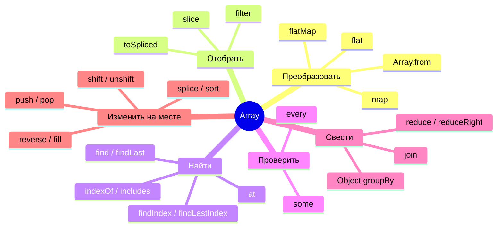
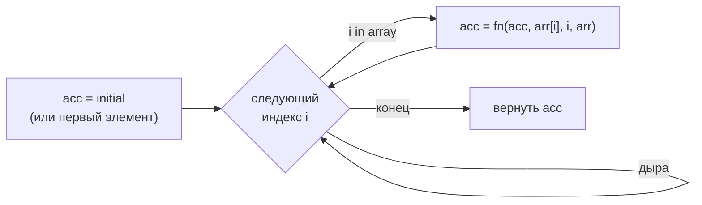

## О чём урок

Массивы на собеседовании проверяют с двух сторон: знаете ли вы методы и какие из них меняют исходный массив, и сможете ли написать `map`, `filter` и `reduce` сами. Здесь карта методов, мутирующие методы и их копирующие пары из ES2023, ловушки `sort`, `reduce` и дырявых массивов, группировка, методы `Set` и полифилы.

## Карта методов



## Что меняет исходный массив

| Мутирует | Копирующая пара (ES2023) | Что делает |
|---|---|---|
| `sort(fn)` | `toSorted(fn)` | Сортировка |
| `reverse()` | `toReversed()` | Обратный порядок |
| `splice(i, n, ...items)` | `toSpliced(i, n, ...items)` | Удалить и вставить |
| `arr[i] = x` | `with(i, x)` | Заменить элемент |
| `push`, `pop`, `shift`, `unshift`, `fill`, `copyWithin` | spread, `slice`, `concat` | Добавить и удалить |

Неизменяемые обновления нужны там, где изменения отслеживаются по ссылке: состояние React и Redux, `OnPush` в Angular, мемоизированные селекторы. `arr.sort()` в редьюсере меняет состояние на месте, и компонент не перерисуется; `toSorted()` возвращает новый массив.

```js run
const state = [3, 1, 2]
const sorted = state.toSorted((a, b) => a - b)
console.log(state, sorted, state.with(0, 9), state.toSpliced(1, 1))

console.log([10, 1, 2, 25].sort(), [10, 1, 2, 25].sort((a, b) => a - b))
console.log(['b', 'a', 'C'].sort(), ['b', 'a', 'C'].sort((a, b) => a.localeCompare(b)))
```

```output
[ 3, 1, 2 ] [ 1, 2, 3 ] [ 9, 1, 2 ] [ 3, 2 ]
[ 1, 10, 2, 25 ] [ 1, 2, 10, 25 ]
[ 'C', 'a', 'b' ] [ 'a', 'b', 'C' ]
```

- `sort()` без функции сравнивает **строки** по кодовым единицам: `10` раньше `2`, заглавные раньше строчных. Для чисел нужен `(a, b) => a - b`, для текста `localeCompare` или `Intl.Collator`.
- Компаратор возвращает отрицательное, ноль или положительное число, а не `true`/`false`.
- Сортировка устойчивая (элементы с равным ключом сохраняют порядок) по спецификации с ES2019.

## Ловушки

```js run
console.log([NaN].indexOf(NaN), [NaN].includes(NaN))
console.log([1, 2, 3].at(-1), [1, [2, [3, [4]]]].flat(), [1, [2, [3, [4]]]].flat(Infinity))

try {
  [].reduce((a, b) => a + b)
} catch (e) {
  console.log(e.message)
}
console.log([].reduce((a, b) => a + b, 0))

const sparse = [1, , 3]
console.log(sparse.length, sparse.map((x) => x * 2), Object.keys(sparse))
console.log(Array.from({ length: 3 }, (_, i) => i * i), new Array(3).map(() => 0))

const found = [1, 2, 3].forEach((x) => x === 2)
console.log(found)
```

```output
-1 true
3 [ 1, 2, [ 3, [ 4 ] ] ] [ 1, 2, 3, 4 ]
Reduce of empty array with no initial value
0
3 [ 2, <1 empty item>, 6 ] [ '0', '2' ]
[ 0, 1, 4 ] [ <3 empty items> ]
undefined
```

- `indexOf` сравнивает через `===` и не находит `NaN`; `includes` использует SameValueZero и находит.
- `reduce` без начального значения берёт первый элемент и падает на пустом массиве. Начальное значение передают всегда.
- **Дырявые массивы** (holes): `[1, , 3]` и `new Array(3)` имеют пустые слоты, которые `map`, `forEach`, `filter` пропускают. Для массива нужной длины используют `Array.from({ length: n }, fn)` или `new Array(n).fill(0)`.
- `forEach` всегда возвращает `undefined` и не останавливается по `break` или `return`. Для поиска есть `find` и `some`, для ранней остановки цикл `for...of`.
- `at(-1)` читает с конца; `arr[-1]` ищет свойство с ключом `"-1"` и вернёт `undefined`.

## Группировка и множества

```js run
const orders = [
  { id: 1, status: 'paid', total: 30 },
  { id: 2, status: 'new', total: 10 },
  { id: 3, status: 'paid', total: 15 },
]
const byStatus = Object.groupBy(orders, (o) => o.status)
console.log(Object.keys(byStatus), byStatus.paid.map((o) => o.id))

const a = new Set(['js', 'ts', 'css'])
const b = new Set(['ts', 'html'])
console.log(a.union(b), a.intersection(b), a.difference(b), new Set(['ts']).isSubsetOf(a))
console.log([...new Set([3, 1, 3, 2, 1])])
```

```output
[ 'paid', 'new' ] [ 1, 3 ]
Set(4) { 'js', 'ts', 'css', 'html' } Set(1) { 'ts' } Set(2) { 'js', 'css' } true
[ 3, 1, 2 ]
```

- `Object.groupBy` (ES2024) возвращает объект без прототипа, `Map.groupBy` возвращает `Map` (если ключ группы объект).
- Методы `Set` (`union`, `intersection`, `difference`, `symmetricDifference`, `isSubsetOf`, `isSupersetOf`, `isDisjointFrom`) есть во всех браузерах с 2024 года.
- `[...new Set(arr)]` удаляет дубликаты и сохраняет порядок первого появления.

## Полифилы map, filter, reduce

Классическая задача. Настоящие методы учитывают `thisArg`, пропускают дыры и передают колбэку `(элемент, индекс, массив)`; `reduce` без начального значения берёт первый существующий элемент.



```js run
Array.prototype.myMap = function (fn, thisArg) {
  if (typeof fn !== 'function') throw new TypeError(`${fn} is not a function`)
  const result = new Array(this.length)
  for (let i = 0; i < this.length; i++) if (i in this) result[i] = fn.call(thisArg, this[i], i, this)
  return result
}

Array.prototype.myFilter = function (fn, thisArg) {
  const result = []
  for (let i = 0; i < this.length; i++) if (i in this && fn.call(thisArg, this[i], i, this)) result.push(this[i])
  return result
}

Array.prototype.myReduce = function (fn, ...init) {
  let i = 0
  let acc
  if (init.length) acc = init[0]
  else {
    while (i < this.length && !(i in this)) i++ // skip leading holes
    if (i >= this.length) throw new TypeError('Reduce of empty array with no initial value')
    acc = this[i++]
  }
  for (; i < this.length; i++) if (i in this) acc = fn(acc, this[i], i, this)
  return acc
}

console.log([1, , 3].myMap((x) => x * 2), [1, 2, 3, 4].myFilter((x) => x % 2 === 0))
console.log([1, 2, 3].myReduce((s, x) => s + x), [[1], [2]].myReduce((all, x) => all.concat(x), []))
console.log([1, 2].myMap(function (x) { return x * this.k }, { k: 10 }))
```

```output
[ 2, <1 empty item>, 6 ] [ 2, 4 ]
6 [ 1, 2 ]
[ 10, 20 ]
```

Детали, которые проверяют: проверка, что колбэк это функция; `thisArg` (поэтому колбэк вызывают через `call`, и стрелочная функция его проигнорирует); `i in this` для пропуска дыр; различие между «начального значения нет» и «начальное значение `undefined`» (поэтому `...init`, а не параметр по умолчанию). В реальном коде встроенные прототипы не расширяют, полифилы подключают из `core-js` только для нужных браузеров. Задача с тестами: [свой reduce](/code/array-reduce).

## Главное

- Мутируют `sort`, `reverse`, `splice`, `push`/`pop`, `shift`/`unshift`, `fill`; для состояния берут `toSorted`, `toReversed`, `toSpliced`, `with`.
- `sort()` по умолчанию строковый; числа сортируют с `(a, b) => a - b`.
- `includes` находит `NaN`, `indexOf` нет; `reduce` всегда с начальным значением; `forEach` не прерывается.
- Дыры пропускаются методами; массив нужной длины создают `Array.from({ length })`.
- `Object.groupBy`, методы `Set` и `[...new Set(arr)]` для группировки и множеств.
- Полифил: проверка колбэка, `thisArg` через `call`, `i in this`, отдельный случай `reduce` без начального значения.
