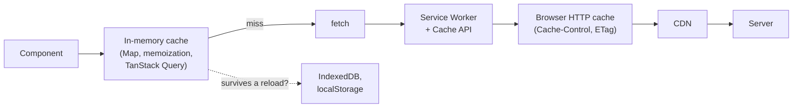
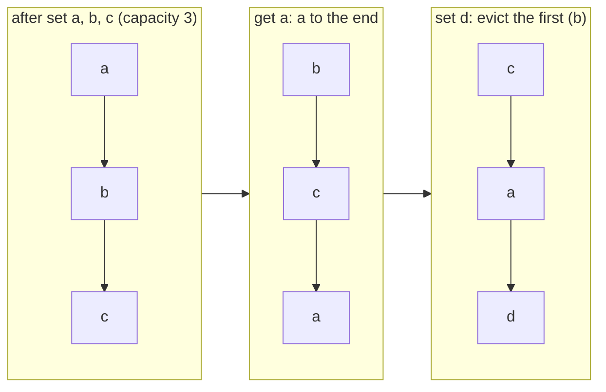
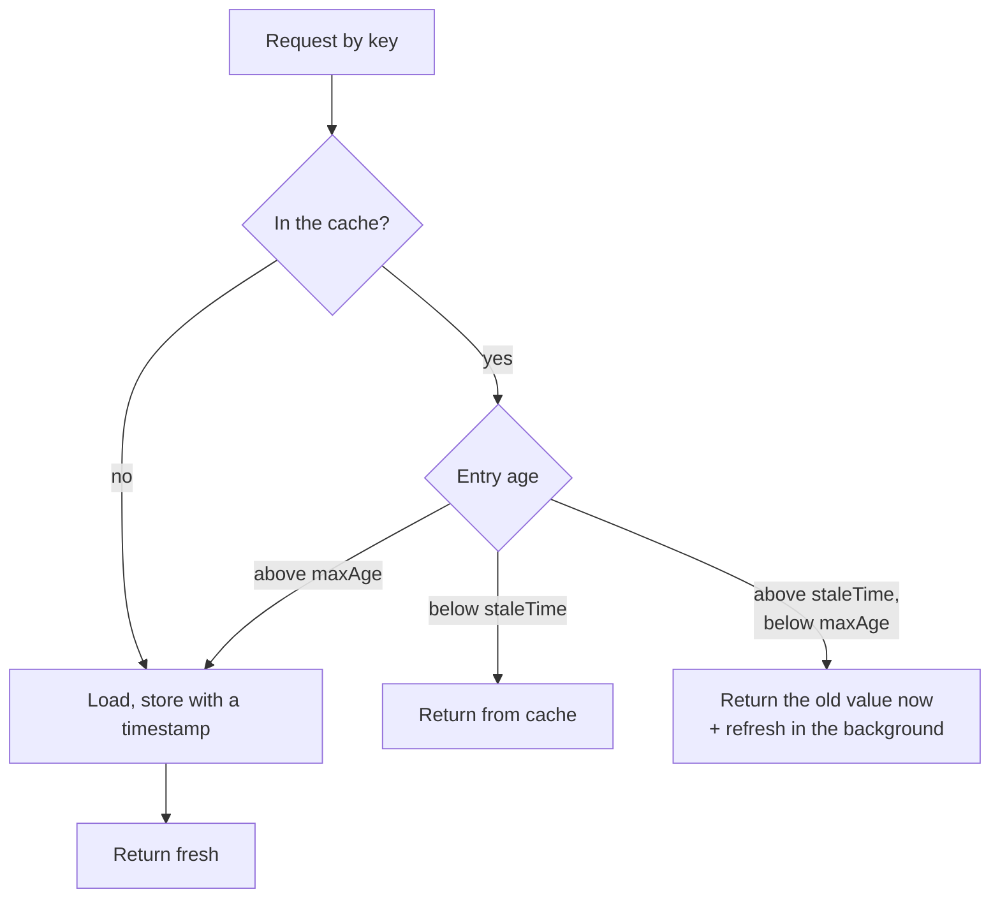

## What this lesson covers

A cache keeps the result of an expensive operation so you do not repeat it. Memoizing functions and choosing a key, eviction strategies (LRU, LFU, FIFO) with an LRU on a `Map`, time to live (TTL), "show the old value and refresh in the background" (stale-while-revalidate), merging identical requests and where caches live on the front end at all.

## Where caches live



| Level | How long it lives | Who controls it |
|---|---|---|
| JavaScript memory | While the tab is open | Your code or a library |
| `localStorage`, IndexedDB | Across sessions | Your code |
| Cache API in a Service Worker | Across sessions, works offline | Your code in the worker |
| Browser HTTP cache | By response headers | The server via `Cache-Control` |

This lesson covers the first level. The HTTP cache, ETag and Service Worker are covered in the caching lesson of the Network track.

## Memoization

Memoization is a cache for a **pure** function: the same arguments always give the same result, so the result can be remembered by arguments.

```js run
function memoize(fn, { key = (...args) => JSON.stringify(args) } = {}) {
  const cache = new Map()
  return function (...args) {
    const k = key(...args)
    if (cache.has(k)) return cache.get(k) // has(), not get(): undefined can be a valid result
    const result = fn.apply(this, args)
    cache.set(k, result)
    return result
  }
}

let calls = 0
const slowSquare = memoize((n) => (calls++, n * n))
slowSquare(4)
slowSquare(4)
console.log(slowSquare(4), 'computed', calls, 'time(s)')

const fib = memoize((n) => (n < 2 ? n : fib(n - 1) + fib(n - 2)))
console.log(fib(90))
```

```output
16 computed 1 time(s)
2880067194370816000
```

- **The key**. `JSON.stringify(args)` is simple but expensive for big arguments, loses `undefined`, functions and `Map`, and confuses different objects with equal content. For a single object argument the object itself is the key in a `WeakMap` (the entry vanishes with the object); for primitives a `Map` by value.
- **Pure functions only**. You cannot memoize `fetchUser(id)` without a time to live: server data changes.
- **Recursion**. The memoized `fib` calls the memoized version of itself, so each value is computed once: exponential time became linear.
- A cache without limits grows while the page lives. Hence eviction strategies.

## Eviction strategies

When the cache is full, something has to go.

| Strategy | What it evicts | Pros | Cons | Where it fits |
|---|---|---|---|---|
| LRU (least recently used) | What was accessed longest ago | Simple, works well in most cases | One scan over lots of data evicts useful entries | Data and computation caches by default |
| LFU (least frequently used) | What was accessed least often | Keeps "hot" entries | Needs counters; old popular entries get stuck | Catalogs, popular articles |
| FIFO | The oldest by insertion time | The simplest | Evicts popular entries just because they are old | Queues, buffers |
| TTL | Everything that expired | Predictable freshness | Many entries expire at once (cache stampede) | Exchange rates, weather, tokens |

## LRU on a Map

A `Map` remembers insertion order, so LRU takes a few lines: on read, delete the entry and insert it again (it becomes the "freshest" at the end), and on overflow delete the first one.



```js run
class LRUCache {
  #map = new Map()
  constructor(capacity) {
    this.capacity = capacity
  }
  get(key) {
    if (!this.#map.has(key)) return undefined
    const value = this.#map.get(key)
    this.#map.delete(key) // move to the end: most recently used
    this.#map.set(key, value)
    return value
  }
  set(key, value) {
    this.#map.delete(key)
    this.#map.set(key, value)
    if (this.#map.size > this.capacity) this.#map.delete(this.#map.keys().next().value) // oldest is first
  }
  keys() {
    return [...this.#map.keys()]
  }
}

const lru = new LRUCache(3)
lru.set('a', 1)
lru.set('b', 2)
lru.set('c', 3)
lru.get('a')
lru.set('d', 4)
console.log(lru.keys(), lru.get('b'))
```

```output
[ 'c', 'a', 'd' ] undefined
```

Both operations are O(1). The classic implementation without an insertion-ordered `Map` is a hash table plus a doubly linked list. A task with tests: [LRU cache](/code/lru-cache).

## TTL and stale-while-revalidate



```js run
function swrCache(load, { staleMs, maxAgeMs, now = () => Date.now() }) {
  const entries = new Map() // key → { value, at, refreshing }
  return async function get(key) {
    const entry = entries.get(key)
    const age = entry ? now() - entry.at : Infinity
    if (age < staleMs) return entry.value // fresh
    if (age < maxAgeMs) {
      if (!entry.refreshing) {
        entry.refreshing = load(key).then((value) => entries.set(key, { value, at: now() }))
      }
      return entry.value // stale: answer now, refresh in the background
    }
    const value = await load(key) // missing or too old: wait
    entries.set(key, { value, at: now() })
    return value
  }
}

let t = 0
let version = 0
const get = swrCache(async (k) => `${k}@v${++version}`, { staleMs: 10, maxAgeMs: 100, now: () => t })
console.log(await get('user'))
t = 5
console.log(await get('user')) // fresh
t = 50
console.log(await get('user')) // stale: old value, refresh starts
await Promise.resolve()
console.log(await get('user')) // the refreshed value
```

```output
user@v1
user@v1
user@v1
user@v2
```

- **TTL** gives predictable freshness, but the user waits for a load every time an entry expires.
- **Stale-while-revalidate** answers instantly with old data and quietly refreshes it. TanStack Query (`staleTime`, `gcTime`), SWR and the `Cache-Control: stale-while-revalidate` header work this way.
- **Cache stampede**: many clients see an expired entry at once and all go to the server. Defenses: one background load per key (the `refreshing` field above), random spread of TTLs, merging requests.

## Merging identical requests

If three components ask for `/api/me` at the same time, one request should go out: the second and third get **the same promise** while it is in flight. The implementation with a `Map` of promises and deletion in `finally` is in the caching lesson of the Network track. It caches not the result but the "in-flight" request, and it combines well with a TTL.

## Invalidation

"There are only two hard things in computer science: cache invalidation and naming things." Options: a time to live; explicit reset after a change (`invalidateQueries(['todos'])` after a mutation); a version in the key (`user:42:v3`); subscribing to server events (a WebSocket reports that data changed). The cache key must include **everything** the result depends on: filter parameters, language, user.

## Key points

- Caches live in memory, in browser storage, in a Service Worker and in the HTTP cache; this lesson is about memory.
- Memoize only pure functions; choose the key deliberately, `WeakMap` fits object keys; use `has` instead of checking `get` for `undefined`.
- LRU by default; LFU for "hot" data; FIFO is the simplest; TTL for freshness.
- LRU on a `Map`: delete and re-insert on read, delete the first key on overflow.
- Stale-while-revalidate answers at once and refreshes in the background; against a stampede, one load per key.
- Identical simultaneous requests share one promise; invalidate with a TTL, an explicit reset or a version in the key.
