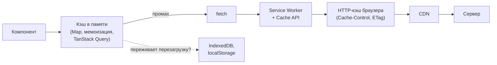
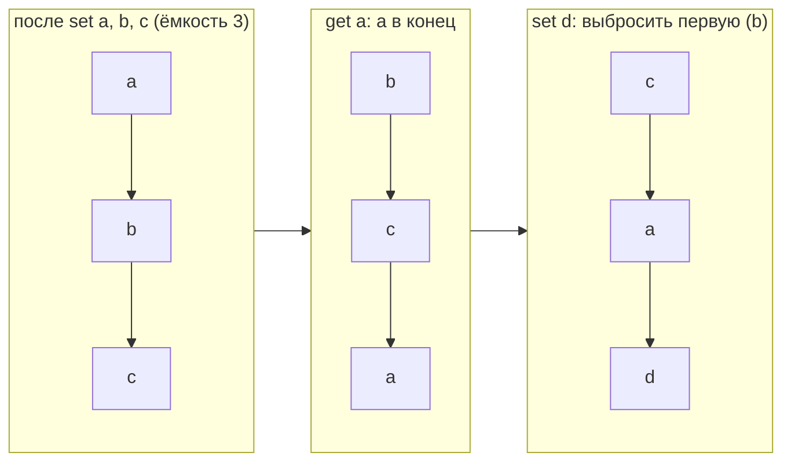
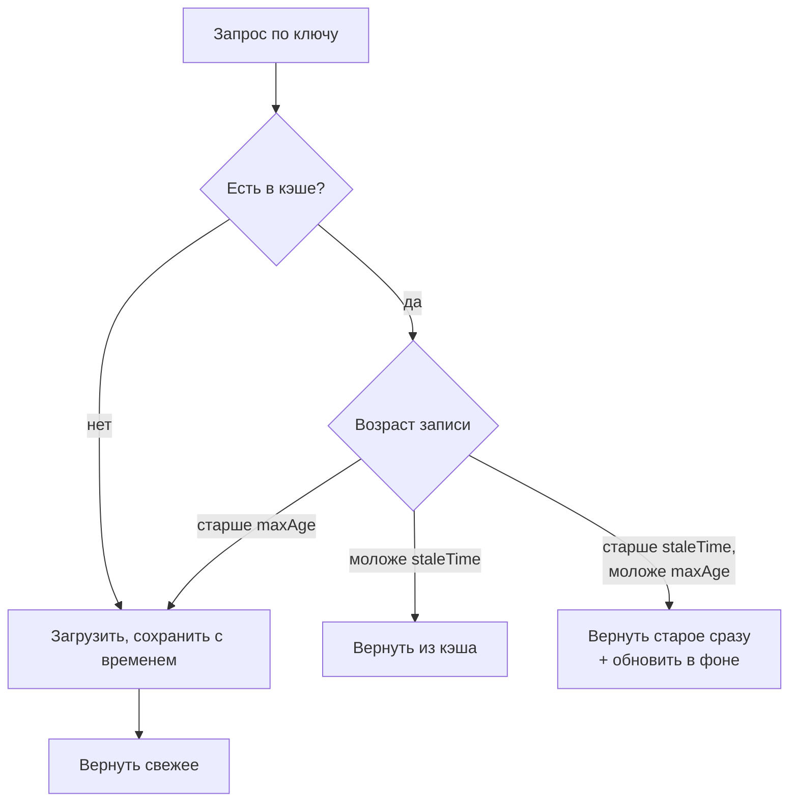

## О чём урок

Кэш хранит результат дорогой операции, чтобы не делать её снова. Здесь мемоизация функций и выбор ключа, стратегии вытеснения (LRU, LFU, FIFO) с реализацией LRU на `Map`, срок жизни (TTL), «показать старое и обновить в фоне» (stale-while-revalidate), объединение одинаковых запросов и где во фронтенде вообще живут кэши.

## Где живут кэши



| Уровень | Сколько живёт | Кто управляет |
|---|---|---|
| Память JavaScript | Пока открыта вкладка | Ваш код или библиотека |
| `localStorage`, IndexedDB | Между сессиями | Ваш код |
| Cache API в Service Worker | Между сессиями, работает офлайн | Ваш код в воркере |
| HTTP-кэш браузера | По заголовкам ответа | Сервер через `Cache-Control` |

Здесь разобран первый уровень. HTTP-кэш, ETag и Service Worker разобраны в уроке о кэшировании в треке «Сеть».

## Мемоизация

Мемоизация это кэш для **чистой** функции: одинаковые аргументы всегда дают одинаковый результат, поэтому результат можно запомнить по аргументам.

```js run
function memoize(fn, { key = (...args) => JSON.stringify(args) } = {}) {
  const cache = new Map()
  return function (...args) {
    const k = key(...args)
    if (cache.has(k)) return cache.get(k) // has(), not get(): undefined can be a valid result
    const result = fn.apply(this, args)
    cache.set(k, result)
    return result
  }
}

let calls = 0
const slowSquare = memoize((n) => (calls++, n * n))
slowSquare(4)
slowSquare(4)
console.log(slowSquare(4), 'computed', calls, 'time(s)')

const fib = memoize((n) => (n < 2 ? n : fib(n - 1) + fib(n - 2)))
console.log(fib(90))
```

```output
16 computed 1 time(s)
2880067194370816000
```

- **Ключ**. `JSON.stringify(args)` прост, но дорог для больших аргументов, теряет `undefined`, функции, `Map` и путает разные объекты с одинаковым содержимым. Для одного аргумента-объекта ключом служит сам объект в `WeakMap` (запись исчезнет вместе с объектом), для примитивов `Map` по значению.
- **Только чистые функции**. Мемоизировать `fetchUser(id)` нельзя без срока жизни: данные на сервере меняются.
- **Рекурсия**. Мемоизированный `fib` вызывает мемоизированную версию себя, поэтому каждое значение считается один раз: из экспоненциального времени получилось линейное.
- Кэш без ограничений растёт, пока жива страница. Отсюда стратегии вытеснения.

## Стратегии вытеснения

Когда кэш заполнен, нужно решить, что выбросить.

| Стратегия | Что выбрасывает | Плюсы | Минусы | Где уместна |
|---|---|---|---|---|
| LRU (least recently used) | То, к чему дольше всего не обращались | Простая, хорошо работает в большинстве случаев | Разовый проход по большому объёму вытеснит полезное | Кэш данных и вычислений по умолчанию |
| LFU (least frequently used) | То, к чему обращались реже всего | Держит «горячие» записи | Нужны счётчики; старые популярные записи застревают | Каталоги, популярные статьи |
| FIFO | Самое старое по времени добавления | Проще всех | Выбросит популярное только потому, что оно старое | Очереди, буферы |
| TTL | Всё, у чего истёк срок | Предсказуемая свежесть | Много записей истекают разом (cache stampede) | Курсы валют, погода, токены |

## LRU на Map

`Map` помнит порядок вставки, поэтому LRU пишется в несколько строк: при чтении запись удаляют и вставляют заново (она становится «самой свежей» в конце), а при переполнении удаляют первую.



```js run
class LRUCache {
  #map = new Map()
  constructor(capacity) {
    this.capacity = capacity
  }
  get(key) {
    if (!this.#map.has(key)) return undefined
    const value = this.#map.get(key)
    this.#map.delete(key) // move to the end: most recently used
    this.#map.set(key, value)
    return value
  }
  set(key, value) {
    this.#map.delete(key)
    this.#map.set(key, value)
    if (this.#map.size > this.capacity) this.#map.delete(this.#map.keys().next().value) // oldest is first
  }
  keys() {
    return [...this.#map.keys()]
  }
}

const lru = new LRUCache(3)
lru.set('a', 1)
lru.set('b', 2)
lru.set('c', 3)
lru.get('a')
lru.set('d', 4)
console.log(lru.keys(), lru.get('b'))
```

```output
[ 'c', 'a', 'd' ] undefined
```

Обе операции O(1). Классическая реализация без `Map` с порядком вставки это хеш-таблица плюс двусвязный список. Задача с тестами: [LRU-кэш](/code/lru-cache).

## TTL и stale-while-revalidate



```js run
function swrCache(load, { staleMs, maxAgeMs, now = () => Date.now() }) {
  const entries = new Map() // key → { value, at, refreshing }
  return async function get(key) {
    const entry = entries.get(key)
    const age = entry ? now() - entry.at : Infinity
    if (age < staleMs) return entry.value // fresh
    if (age < maxAgeMs) {
      if (!entry.refreshing) {
        entry.refreshing = load(key).then((value) => entries.set(key, { value, at: now() }))
      }
      return entry.value // stale: answer now, refresh in the background
    }
    const value = await load(key) // missing or too old: wait
    entries.set(key, { value, at: now() })
    return value
  }
}

let t = 0
let version = 0
const get = swrCache(async (k) => `${k}@v${++version}`, { staleMs: 10, maxAgeMs: 100, now: () => t })
console.log(await get('user'))
t = 5
console.log(await get('user')) // fresh
t = 50
console.log(await get('user')) // stale: old value, refresh starts
await Promise.resolve()
console.log(await get('user')) // the refreshed value
```

```output
user@v1
user@v1
user@v1
user@v2
```

- **TTL** даёт предсказуемую свежесть, но пользователь ждёт загрузку каждый раз, когда запись истекла.
- **Stale-while-revalidate** отвечает мгновенно старыми данными и тихо обновляет их. Так работают TanStack Query (`staleTime`, `gcTime`), SWR и заголовок `Cache-Control: stale-while-revalidate`.
- **Cache stampede**: много клиентов одновременно видят истёкшую запись и все идут на сервер. Защита: одна фоновая загрузка на ключ (поле `refreshing` выше), случайный разброс TTL, объединение запросов.

## Объединение одинаковых запросов

Если три компонента одновременно запрашивают `/api/me`, уйти должен один запрос: второй и третий получают **тот же промис**, пока он в полёте. Реализация с `Map` промисов и удалением в `finally` разобрана в уроке о кэшировании в треке «Сеть». Это не кэш результата, а кэш «летящего» запроса, и он хорошо сочетается с TTL.

## Инвалидация

«В информатике две сложные вещи: инвалидация кэша и придумывание имён». Варианты: срок жизни; явный сброс после изменения (`invalidateQueries(['todos'])` после мутации); версия в ключе (`user:42:v3`); подписка на события сервера (WebSocket сообщает, что данные изменились). Ключ кэша должен включать **всё**, от чего зависит результат: параметры фильтра, язык, пользователя.

## Главное

- Кэши живут в памяти, в хранилищах браузера, в Service Worker и в HTTP-кэше; этот урок о памяти.
- Мемоизируют только чистые функции; ключ выбирают осознанно, для объектов подходит `WeakMap`; `has` вместо проверки `get` на `undefined`.
- LRU по умолчанию; LFU для «горячих» данных; FIFO простейший; TTL для свежести.
- LRU на `Map`: удалить и вставить при чтении, удалить первый ключ при переполнении.
- Stale-while-revalidate отвечает сразу и обновляет в фоне; против stampede одна загрузка на ключ.
- Одинаковые одновременные запросы объединяют общим промисом; инвалидация через TTL, явный сброс или версию в ключе.
