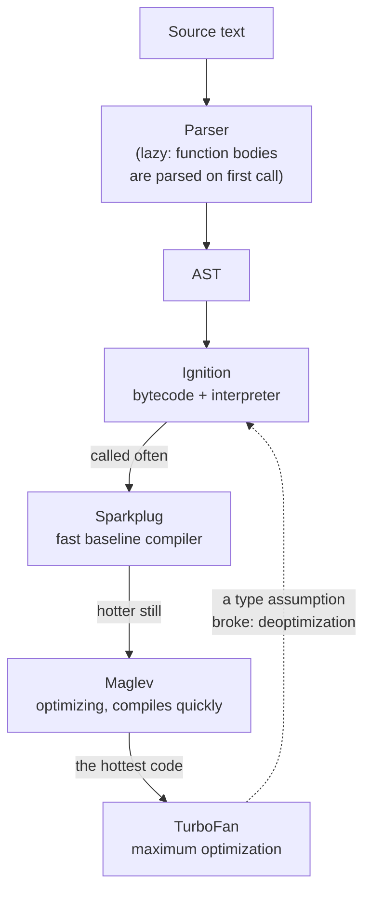
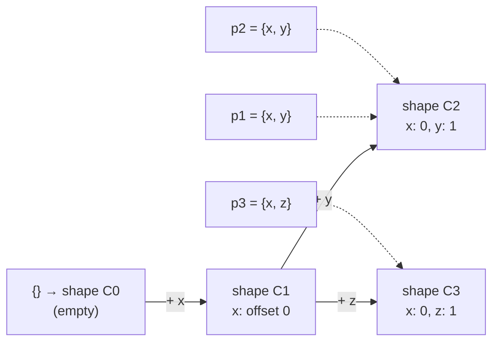

## What this lesson covers

What happens to a `.js` file from download to execution: parsing into a tree, bytecode, the interpreter and several tiers of JIT compilation in V8, hidden classes and inline caches that make "same-shaped" objects faster. At the end, strict mode in full and why `eval` and `new Function` are considered dangerous.

## The path of code in V8



1. **Loading and parsing.** The browser gets the bytes, decodes the text and hands it to the engine (V8 in Chrome and Node.js, SpiderMonkey in Firefox, JavaScriptCore in Safari). The parser builds an abstract syntax tree (AST). Functions that are not called right away are parsed lazily: first only a syntax check, full parsing on the first call. That is why a large bundle costs time even before it runs.
2. **Bytecode.** Ignition turns the AST into compact bytecode and runs it. The interpreter starts fast and collects **type feedback**: which object shapes and value types appear at each operation.
3. **JIT tiers.** Hot functions are compiled to machine code: Sparkplug with almost no optimization but very quickly; Maglev (since 2023) with optimizations based on the collected types; TurboFan for the hottest code.
4. **Deoptimization.** Optimized code relies on assumptions ("always a number here", "the object always has this shape"). When an assumption breaks, the engine discards the optimized code and falls back to bytecode.

Running the script does not end there: the event loop takes over (a lesson in the "JavaScript: async" track).

## Hidden classes and inline caches

An object in JavaScript looks like a dictionary, but the engine stores objects of the same shape compactly: each object points to a **hidden class** (called a Map in V8, a Shape in other engines) that describes which properties exist and at which offset they live.



- Objects created the same way (the same properties in the same order) share one shape.
- An **inline cache** remembers at the access site (`point.x`): "for shape C2, `x` is at offset 0". While one shape appears there (monomorphic access), the read is almost free. Two to four shapes (polymorphic access) are slower, many shapes (megamorphic) turn into a dictionary lookup.
- `delete obj.prop` and adding properties in random order create many shapes and can switch an object into slow dictionary mode.

Practical takeaways for hot code (rendering big lists, animations, data processing):

- initialize all fields at once, in the constructor or a literal, in one order;
- do not delete properties: assign `undefined` or create a new object;
- keep values of one type in an array and avoid holes: arrays have "elements kinds" too (integers only, numbers only, any values), and mixing downgrades the kind;
- do not change a variable's type halfway through a function.

For ordinary UI code these are micro-optimizations: profile first, guess later.

## Strict mode

Strict mode (`'use strict'`) removes dangerous features of old JavaScript. It is on automatically in **ES modules and classes**, that is, in practically all modern code; the directive is written by hand only in classic scripts and CommonJS.

```js run
// new Function creates sloppy-mode code even inside a module: handy for the comparison
const sloppy = new Function('leaked = 1; return [typeof leaked, this === globalThis]')
console.log('sloppy:', sloppy())

const strict = new Function('"use strict"; try { leaked2 = 1 } catch (e) { return [e.name, this] }')
console.log('strict:', strict())

try {
  Object.freeze({ a: 1 }).a = 2 // module code is strict
} catch (e) {
  console.log(e.constructor.name, '(write to a frozen object)')
}
delete globalThis.leaked
```

```output
sloppy: [ 'number', true ]
strict: [ 'ReferenceError', undefined ]
TypeError (write to a frozen object)
```

| Sloppy mode | Strict mode |
|---|---|
| Assigning an undeclared variable creates a global | `ReferenceError` |
| `this` in a plain function call is the global object | `this` is `undefined` |
| Writing to a read-only property or a frozen object is silently ignored | `TypeError` |
| `delete` of a non-deletable property returns `false` | `TypeError` |
| Duplicate parameter names are allowed | `SyntaxError` |
| `with` is allowed | `SyntaxError` |
| `arguments` is linked to the parameters | Not linked |
| `eval` can declare a variable in the surrounding scope | `eval` gets its own scope |
| Octal literals `010` | `SyntaxError` (write `0o10`) |

Functions declared in a block are visible only inside the block in strict mode; in sloppy mode the behavior historically differed between browsers.

## eval and new Function

`eval(string)` runs a string as code in the current scope, `new Function(args, body)` creates a function from a string in the global scope. Why they are avoided:

- **Security.** If user data gets into the string, an attacker runs their code with the page's privileges (XSS). A strict CSP without `'unsafe-eval'` forbids `eval`, `new Function` and `setTimeout('a string')`.
- **Optimization.** A direct `eval` can read and change any local variable, so the engine cannot optimize the surrounding function and the minifier cannot rename its variables.
- **Debugging and analysis.** Linters, bundlers and tree-shaking cannot see code inside a string.

There is almost always a replacement: `JSON.parse` for data, an object or `Map` instead of "dynamic variable names", computed keys `obj[key]`, dynamic `import()` to load code. Legitimate exceptions are rare: task sandboxes (like the runner in this app, which runs your code in an isolated iframe), template engines that compile a template once at build time. Node.js's `vm` module is **not** a security sandbox, and the `vm2` library was discontinued because of vulnerabilities.

## Key points

- Code goes through parsing (lazy) → AST → Ignition bytecode → JIT tiers Sparkplug, Maglev, TurboFan; broken type assumptions cause deoptimization.
- Objects of the same shape share a hidden class; inline caches keep property access fast while there is one shape.
- In hot code: all fields at once and in one order, no `delete`, arrays of one type without holes.
- Modules and classes are always strict: an undeclared variable and a write to a frozen object throw, `this` in a plain call is `undefined`.
- `eval` and `new Function` are dangerous (XSS, CSP) and block optimization and analysis; replace them with `JSON.parse`, `Map`, `obj[key]`, `import()`.
