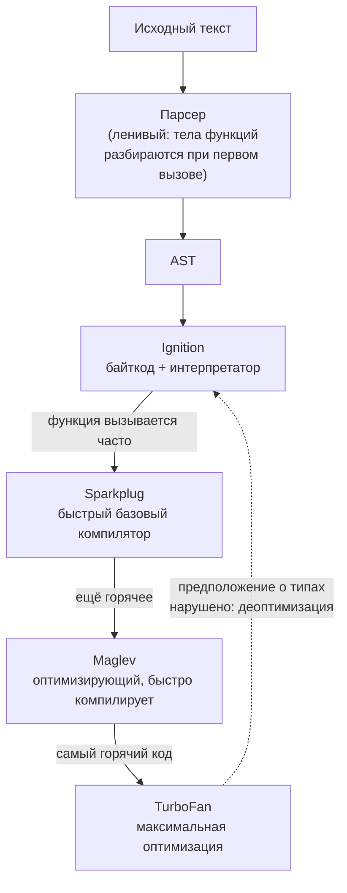
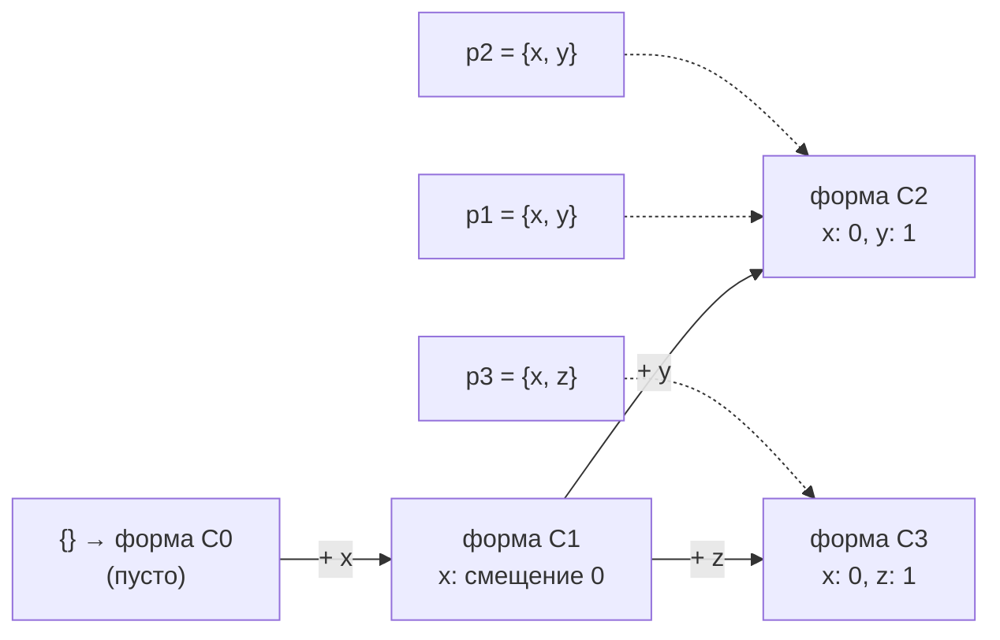

## О чём урок

Что происходит с файлом `.js` от загрузки до выполнения: разбор в дерево, байткод, интерпретатор и несколько уровней JIT-компиляции в V8, скрытые классы и inline-кэши, из-за которых «одинаковые» объекты работают быстрее. В конце строгий режим целиком и почему `eval` и `new Function` считаются опасными.

## Путь кода в V8



1. **Загрузка и разбор.** Браузер получает байты, декодирует текст и передаёт движку (V8 в Chrome и Node.js, SpiderMonkey в Firefox, JavaScriptCore в Safari). Парсер строит абстрактное синтаксическое дерево (AST). Функции, которые не вызываются сразу, разбираются лениво: сначала только проверка синтаксиса, полный разбор при первом вызове. Поэтому большой бандл стоит времени даже до выполнения.
2. **Байткод.** Ignition превращает AST в компактный байткод и выполняет его. Интерпретатор стартует быстро и собирает **обратную связь о типах**: какие формы объектов и типы значений встречаются в каждой операции.
3. **JIT-уровни.** Горячие функции компилируются в машинный код: Sparkplug почти без оптимизаций, но очень быстро; Maglev (с 2023 года) с оптимизациями по собранным типам; TurboFan для самого горячего кода.
4. **Деоптимизация.** Оптимизированный код опирается на предположения («здесь всегда число», «у объекта всегда такая форма»). Когда предположение нарушено, движок выбрасывает оптимизированный код и возвращается к байткоду.

Выполнение скрипта на этом не заканчивается: дальше работает цикл событий (урок в треке «JavaScript: асинхронность»).

## Скрытые классы и inline-кэши

Объект в JavaScript выглядит как словарь, но движок хранит объекты одинаковой формы компактно: у каждого объекта есть ссылка на **скрытый класс** (в V8 он называется Map, в других движках Shape), который описывает, какие свойства есть и по какому смещению они лежат.



- Объекты, созданные одинаково (те же свойства в том же порядке), делят одну форму.
- **Inline-кэш** запоминает в месте обращения (`point.x`): «для формы C2 свойство `x` лежит по смещению 0». Пока в этом месте встречается одна форма (мономорфный доступ), чтение почти бесплатное. Две-четыре формы (полиморфный доступ) медленнее, много форм (мегаморфный) превращаются в поиск по словарю.
- `delete obj.prop` и добавление свойств в случайном порядке плодят формы и могут перевести объект в медленный словарный режим.

Практические выводы для горячего кода (рендер больших списков, анимации, обработка данных):

- инициализируйте все поля сразу, в конструкторе или литерале, в одном порядке;
- не удаляйте свойства, присваивайте `undefined` или создавайте новый объект;
- держите в массиве значения одного типа и не создавайте дыры: у массивов тоже есть «виды элементов» (только целые, только числа, любые значения), и смешивание понижает вид;
- не меняйте тип переменной по ходу функции.

Для обычного кода интерфейса это микрооптимизации: сначала профилировщик, потом догадки.

## Строгий режим

Строгий режим (`'use strict'`) убирает опасные особенности старого JavaScript. Он включён автоматически в **ES-модулях и классах**, то есть практически во всём современном коде; директиву вручную пишут только в классических скриптах и CommonJS.

```js run
// new Function creates sloppy-mode code even inside a module: handy for the comparison
const sloppy = new Function('leaked = 1; return [typeof leaked, this === globalThis]')
console.log('sloppy:', sloppy())

const strict = new Function('"use strict"; try { leaked2 = 1 } catch (e) { return [e.name, this] }')
console.log('strict:', strict())

try {
  Object.freeze({ a: 1 }).a = 2 // module code is strict
} catch (e) {
  console.log(e.constructor.name, '(write to a frozen object)')
}
delete globalThis.leaked
```

```output
sloppy: [ 'number', true ]
strict: [ 'ReferenceError', undefined ]
TypeError (write to a frozen object)
```

| Нестрогий режим | Строгий режим |
|---|---|
| Присваивание необъявленной переменной создаёт глобальную | `ReferenceError` |
| `this` в обычном вызове функции равен глобальному объекту | `this` равен `undefined` |
| Запись в свойство только для чтения или в замороженный объект молча игнорируется | `TypeError` |
| `delete` неудаляемого свойства возвращает `false` | `TypeError` |
| Повторяющиеся имена параметров допустимы | `SyntaxError` |
| `with` разрешён | `SyntaxError` |
| `arguments` связан с параметрами | Не связан |
| `eval` может объявить переменную в окружающей области | `eval` получает свою область |
| Восьмеричные литералы `010` | `SyntaxError` (пишут `0o10`) |

Функции, объявленные в блоке, в строгом режиме видны только внутри блока; в нестрогом поведение исторически расходилось между браузерами.

## eval и new Function

`eval(string)` выполняет строку как код в текущей области видимости, `new Function(args, body)` создаёт функцию из строки в глобальной области. Почему их избегают:

- **Безопасность.** Если в строку попадают данные пользователя, атакующий выполняет свой код с правами страницы (XSS). Строгая политика CSP без `'unsafe-eval'` запрещает и `eval`, и `new Function`, и `setTimeout('строка')`.
- **Оптимизация.** Прямой `eval` может прочитать и изменить любые локальные переменные, поэтому движок не может оптимизировать окружающую функцию и минификатор не переименует в ней переменные.
- **Отладка и анализ.** Линтеры, сборщики и tree-shaking не видят код внутри строки.

Почти всегда есть замена: `JSON.parse` для данных, объект или `Map` вместо «динамических имён переменных», вычисляемые ключи `obj[key]`, динамический `import()` для загрузки кода. Законные исключения редки: песочницы задач (как раннер в этом приложении, который выполняет ваш код в изолированном iframe), шаблонизаторы, которые компилируют шаблон один раз при сборке. Модуль `vm` в Node.js **не** является защищённой песочницей, а библиотека `vm2` закрыта из-за уязвимостей.

## Главное

- Код проходит путь: разбор (ленивый) → AST → байткод Ignition → JIT-уровни Sparkplug, Maglev, TurboFan; нарушенные предположения о типах вызывают деоптимизацию.
- Объекты одинаковой формы делят скрытый класс; inline-кэши делают доступ к свойствам быстрым, пока форма одна.
- В горячем коде: поля сразу и в одном порядке, без `delete`, массивы однородные и без дыр.
- Модули и классы всегда строгие: необъявленная переменная и запись в замороженный объект дают ошибку, `this` в обычном вызове `undefined`.
- `eval` и `new Function` опасны (XSS, CSP), мешают оптимизации и анализу; замены: `JSON.parse`, `Map`, `obj[key]`, `import()`.
