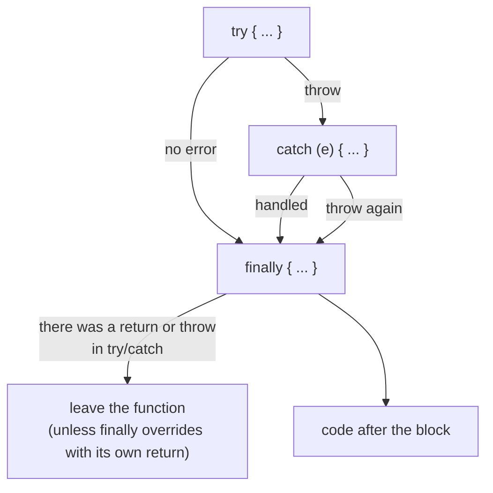
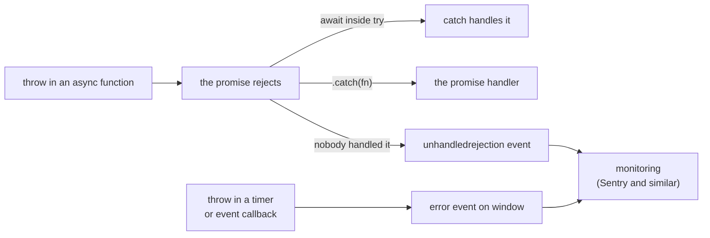

## What this lesson covers

How errors appear, propagate and where to catch them. Built-in error types, the order of `try`, `catch` and `finally` (and the trap with `return` in `finally`), custom error classes and `cause`, errors in async code, global browser handlers and error boundaries in frameworks.

## Built-in errors

| Type | When it happens | Example |
|---|---|---|
| `SyntaxError` | Code does not parse; `JSON.parse` with an invalid string | `JSON.parse("{a:1}")` |
| `ReferenceError` | An undeclared variable, or `let`/`const` before its declaration | `x` never declared |
| `TypeError` | The operation does not fit the value | `null.x`, calling a non-function, writing to a frozen object |
| `RangeError` | A value out of the allowed range | `new Array(-1)`, stack overflow |
| `URIError` | A bad string for `decodeURIComponent` | `decodeURIComponent('%')` |
| `AggregateError` | Several errors at once | `Promise.any` when all reject |
| `DOMException` | Web API errors, told apart by `name` | `AbortError`, `TimeoutError`, `QuotaExceededError` |

`throw` can throw anything, but throw `Error` objects: only they carry a `stack` with the call stack. A thrown string will not tell where it came from.

## try, catch, finally



```js run
function read(json) {
  try {
    return JSON.parse(json)
  } catch (e) {
    if (!(e instanceof SyntaxError)) throw e // rethrow what you cannot handle
    return null
  } finally {
    console.log('finally runs even after return')
  }
}
console.log(read('{"a":1}'), read('{a:1}'))

function overridden() {
  try {
    throw new Error('lost')
  } finally {
    return 'finally wins' // swallows the error: avoid return in finally
  }
}
console.log(overridden())
```

```output
finally runs even after return
finally runs even after return
{ a: 1 } null
finally wins
```

- `finally` always runs: after a successful `try`, after `catch`, after `return` and after a rethrow. Releasing resources goes there (hide a spinner, close a file).
- `return` in `finally` overrides both the result and the error: the error is silently lost. Linters forbid it with the `no-unsafe-finally` rule.
- Catch only what you can handle and rethrow the rest. An empty `catch {}` hides errors; a `catch` without a variable (`catch { ... }`) is fine when the error is not needed.
- `try/catch` catches only synchronous errors of its own block: an error in a `setTimeout` callback started inside `try` happens later, when the block has already finished.

## Custom errors and cause

```js run
class HttpError extends Error {
  constructor(status, url, options) {
    super(`HTTP ${status} for ${url}`, options)
    this.name = 'HttpError' // shown in stack traces and logs
    this.status = status
  }
}

async function loadUser(id) {
  try {
    throw new HttpError(404, `/api/users/${id}`)
  } catch (e) {
    throw new Error(`Cannot open profile ${id}`, { cause: e }) // keep the original
  }
}

try {
  await loadUser(7)
} catch (e) {
  console.log(e.message)
  console.log(e.cause instanceof HttpError, e.cause.status, e.cause.name)
}
```

```output
Cannot open profile 7
true 404 HttpError
```

- Extending `Error` gives a `stack` and a working `instanceof`; set `name` explicitly.
- `{ cause }` (ES2022) keeps the original error when wrapping: logs show the whole chain, not just the top message.
- Errors split into **expected** (validation, 404, access denied: show to the user, handle) and **unexpected** (bugs: log and show a generic screen). For expected ones, a result `{ ok: false, error }` is sometimes returned instead of an exception, so the caller cannot forget to handle it.
- `Error.isError(value)` is more reliable than `instanceof` for errors from other windows and iframes, but as of November 2026 Safari does not have it.

## Async errors



- In an `async` function, `throw` rejects the returned promise. It is caught by `try/catch` around `await` or by `.catch()`. A promise with neither `await` nor `.catch()` ends up in `unhandledrejection` (details in the promises lesson).
- `window.addEventListener('error', ...)` gets uncaught synchronous errors, including those in event handlers and timers; `unhandledrejection` gets unhandled rejections. This is the last line for sending errors to monitoring, not a way to handle them.
- `reportError(error)` sends an error to the same global handlers without interrupting the current code: a library can report an error in a user callback and keep working.
- For errors in scripts from another origin the browser hides the details (`Script error.`) unless the script is loaded with `crossorigin` and a CORS header.

## Errors in the interface

An error during rendering breaks the whole component tree, so frameworks provide **error boundaries**:

- React: a boundary component (`componentDidCatch` and `getDerivedStateFromError`, usually through `react-error-boundary`) shows a fallback UI for its subtree; a boundary does not catch errors in event handlers and async code.
- Angular: a global `ErrorHandler`, and since 22.2 the `@boundary` block (developer preview).
- Vue: `onErrorCaptured` in a parent and `app.config.errorHandler`.

Good practice: a boundary around every independent area of the page (a widget, a route), a clear message with a "Retry" button, and the error sent to monitoring with `cause` and context.

## Key points

- Throw `Error` and its subclasses: they have a `stack`; `TypeError`, `ReferenceError`, `SyntaxError`, `RangeError` occur on their own.
- `finally` always runs, and `return` inside it swallows the error.
- Catch what you can handle and rethrow the rest; wrappers keep the original error in `cause`.
- `try/catch` catches async errors only around `await`; unhandled ones land in `unhandledrejection` and `error`.
- Error boundaries in frameworks keep one failure from taking down the whole page.
