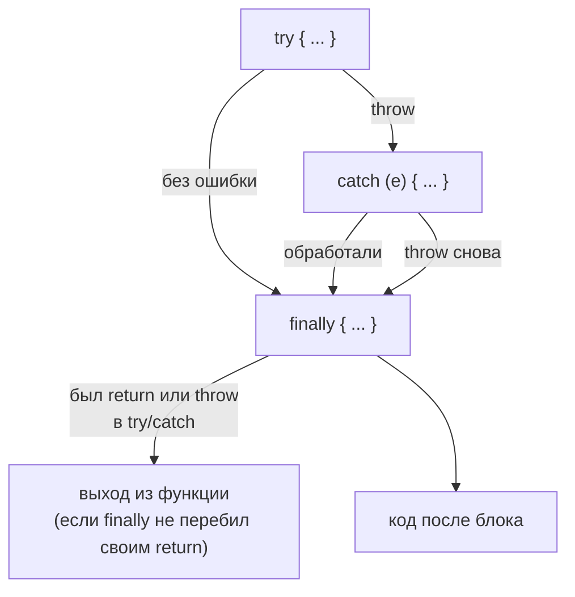
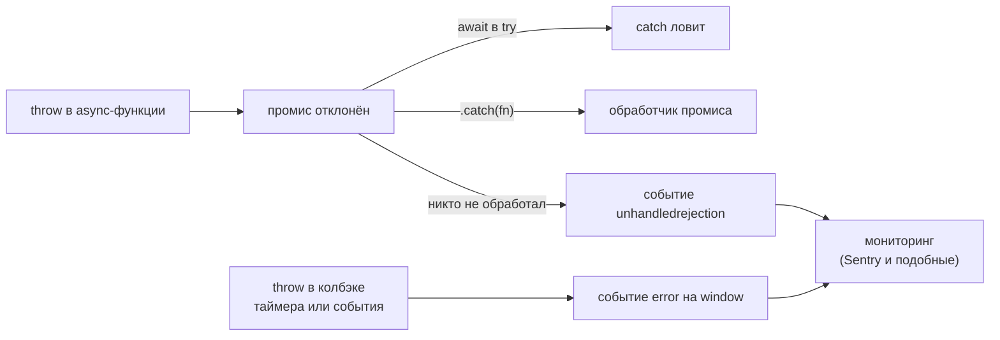

## О чём урок

Как ошибки появляются, распространяются и где их ловить. Здесь встроенные типы ошибок, порядок `try`, `catch` и `finally` (и ловушка с `return` в `finally`), свои классы ошибок и `cause`, ошибки в асинхронном коде, глобальные обработчики браузера и границы ошибок во фреймворках.

## Встроенные ошибки

| Тип | Когда возникает | Пример |
|---|---|---|
| `SyntaxError` | Код не разбирается; `JSON.parse` с невалидной строкой | `JSON.parse("{a:1}")` |
| `ReferenceError` | Обращение к необъявленной переменной или к `let`/`const` до объявления | `x` без объявления |
| `TypeError` | Операция не подходит значению | `null.x`, вызов не функции, запись в замороженный объект |
| `RangeError` | Значение вне допустимого диапазона | `new Array(-1)`, переполнение стека |
| `URIError` | Неверная строка для `decodeURIComponent` | `decodeURIComponent('%')` |
| `AggregateError` | Несколько ошибок сразу | `Promise.any`, когда все отклонены |
| `DOMException` | Ошибки веб-API, различаются по `name` | `AbortError`, `TimeoutError`, `QuotaExceededError` |

`throw` может бросить что угодно, но бросают объекты `Error`: только у них есть `stack` со стеком вызовов. Брошенная строка не скажет, откуда пришла.

## try, catch, finally



```js run
function read(json) {
  try {
    return JSON.parse(json)
  } catch (e) {
    if (!(e instanceof SyntaxError)) throw e // rethrow what you cannot handle
    return null
  } finally {
    console.log('finally runs even after return')
  }
}
console.log(read('{"a":1}'), read('{a:1}'))

function overridden() {
  try {
    throw new Error('lost')
  } finally {
    return 'finally wins' // swallows the error: avoid return in finally
  }
}
console.log(overridden())
```

```output
finally runs even after return
finally runs even after return
{ a: 1 } null
finally wins
```

- `finally` выполняется всегда: после успешного `try`, после `catch`, после `return` и после повторного `throw`. Туда кладут освобождение ресурсов (скрыть индикатор загрузки, закрыть файл).
- `return` в `finally` перебивает и результат, и ошибку: ошибка молча теряется. Линтеры запрещают это правилом `no-unsafe-finally`.
- Ловите только то, что умеете обработать, и бросайте остальное дальше. Пустой `catch {}` прячет ошибки; `catch` без переменной (`catch { ... }`) допустим, когда ошибка не нужна.
- `try/catch` ловит только синхронные ошибки своего блока: ошибка в колбэке `setTimeout`, запущенном внутри `try`, произойдёт позже, когда блок уже завершён.

## Свои ошибки и cause

```js run
class HttpError extends Error {
  constructor(status, url, options) {
    super(`HTTP ${status} for ${url}`, options)
    this.name = 'HttpError' // shown in stack traces and logs
    this.status = status
  }
}

async function loadUser(id) {
  try {
    throw new HttpError(404, `/api/users/${id}`)
  } catch (e) {
    throw new Error(`Cannot open profile ${id}`, { cause: e }) // keep the original
  }
}

try {
  await loadUser(7)
} catch (e) {
  console.log(e.message)
  console.log(e.cause instanceof HttpError, e.cause.status, e.cause.name)
}
```

```output
Cannot open profile 7
true 404 HttpError
```

- Наследование от `Error` даёт `stack` и работу `instanceof`; `name` задают явно.
- `{ cause }` (ES2022) сохраняет исходную ошибку при обёртке: в логах видна вся цепочка, а не только верхнее сообщение.
- Ошибки разделяют на **ожидаемые** (валидация, 404, отказ в доступе: показать пользователю, обработать) и **неожиданные** (баги: залогировать и показать общий экран). Для ожидаемых иногда вместо исключения возвращают результат `{ ok: false, error }`, чтобы вызывающий код не мог забыть обработку.
- `Error.isError(value)` надёжнее `instanceof` для ошибок из других окон и iframe, но на ноябрь 2026 его нет в Safari.

## Асинхронные ошибки



- В `async`-функции `throw` отклоняет возвращённый промис. Его ловят `try/catch` вокруг `await` или `.catch()`. Промис без `await` и без `.catch()` уйдёт в `unhandledrejection` (подробно в уроке о промисах).
- `window.addEventListener('error', ...)` получает непойманные синхронные ошибки, включая ошибки в обработчиках событий и таймерах, `unhandledrejection` получает необработанные отклонения. Это последний рубеж для отправки ошибок в мониторинг, а не способ их обработать.
- `reportError(error)` отправляет ошибку в те же глобальные обработчики, не прерывая текущий код: так библиотека может сообщить об ошибке в колбэке пользователя и продолжить работу.
- Для ошибок скриптов с другого домена браузер скрывает подробности (`Script error.`), пока скрипт не загружен с `crossorigin` и заголовком CORS.

## Ошибки в интерфейсе

Ошибка во время рендера ломает всё дерево компонентов, поэтому фреймворки дают **границы ошибок**:

- React: компонент-граница (`componentDidCatch` и `getDerivedStateFromError`, обычно через `react-error-boundary`) показывает запасной интерфейс для своего поддерева; ошибки в обработчиках событий и асинхронном коде граница не ловит.
- Angular: глобальный `ErrorHandler`, а с 22.2 блок `@boundary` (developer preview).
- Vue: `onErrorCaptured` в родителе и `app.config.errorHandler`.

Хорошая практика: граница вокруг каждой независимой области страницы (виджет, маршрут), понятное сообщение с кнопкой «Повторить» и отправка ошибки в мониторинг с `cause` и контекстом.

## Главное

- Бросают `Error` и наследников: у них есть `stack`; `TypeError`, `ReferenceError`, `SyntaxError`, `RangeError` возникают сами.
- `finally` выполняется всегда, `return` в нём глотает ошибку.
- Ловят то, что умеют обработать, остальное бросают дальше; обёртки сохраняют исходную ошибку в `cause`.
- `try/catch` ловит асинхронные ошибки только вокруг `await`; необработанные попадают в `unhandledrejection` и `error`.
- Границы ошибок во фреймворках не дают одной поломке уронить всю страницу.
