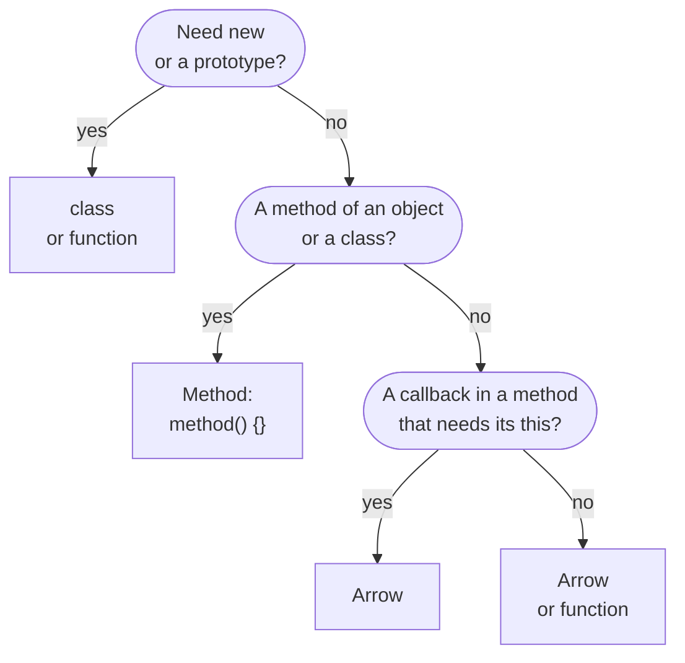
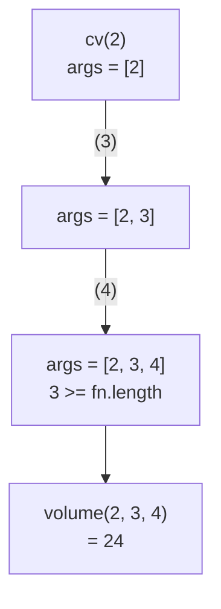
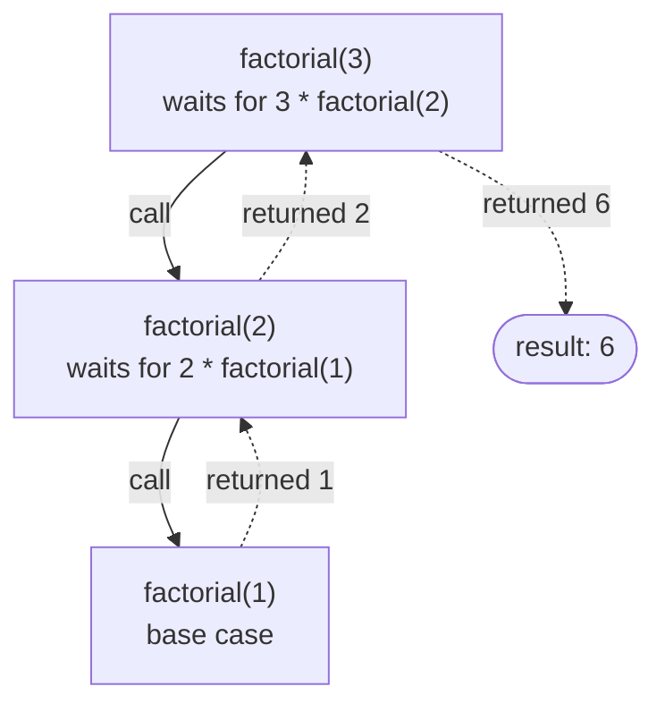

## What this lesson covers

Functions in JavaScript are objects you can pass, return and store. This lesson covers the kinds of functions and how an arrow differs from a regular function (asked in almost every interview), parameters, higher-order functions, pure functions, currying, composition and recursion.

## Declaration, expression, arrow

```js
function declared(a, b) { return a + b }        // function declaration
const expressed = function named(a, b) { return a + b } // function expression (name is optional)
const arrow = (a, b) => a + b                    // arrow function
const obj = { method(a, b) { return a + b } }    // method shorthand
class Calc { add(a, b) { return a + b } }        // class method
```

A declaration is hoisted whole: you can call it above its line. An expression and an arrow are assigned to a variable, so before the assignment line the function does not exist yet (for `const` and `let` that is the temporal dead zone).

```js run
console.log(declared(2, 3))
try {
  expressed(2, 3)
} catch (e) {
  console.log(e.name + ': ' + e.message)
}
function declared(a, b) { return a + b }
const expressed = (a, b) => a + b
```

```output
5
ReferenceError: Cannot access 'expressed' before initialization
```

The name of a function expression (`function named() {}`) is visible only inside the function itself: that is how recursion is written in an expression, and the name shows up in the call stack while debugging.

## How an arrow function differs from a regular one

| | Regular function | Arrow function |
|---|---|---|
| `this` | Depends on how it is called | Taken from the surrounding code (lexical) |
| `arguments` | Has its own | None, taken from the outer function; use `...args` |
| `new` | Can be called as a constructor | `TypeError: … is not a constructor` |
| `prototype` | Has one | None |
| `super`, `new.target` | Its own | From the surrounding code |
| `call`, `apply`, `bind` | Change `this` | Do not change `this`, only pass arguments |
| Generator (`function*`) | Possible | Impossible |

```js run
function regular() {
  return { args: arguments.length, hasPrototype: 'prototype' in regular }
}
const arrow = () => 'arrow'

console.log(regular(1, 2, 3))
console.log('prototype' in arrow)
try {
  new arrow()
} catch (e) {
  console.log(e.message)
}

function outer() {
  const inner = () => arguments[0] // arguments of outer
  return inner('ignored')
}
console.log(outer('from outer'))
```

```output
{ args: 3, hasPrototype: true }
false
arrow is not a constructor
from outer
```

How to choose the kind of function:



The main difference, `this`, is covered in the lesson on `this`. A practical rule: arrows for callbacks and short functions inside methods (they need the method's `this`), regular functions and method shorthand for object methods and anything called with `new`.

## Parameters

- **Default values** are evaluated on every call and only for `undefined` (not for `null`): with `function f(x = 1)`, `f(null)` gives `null`.
- **Rest parameters** `...args` collect the remaining arguments into a real array. They replaced `arguments`, which looks like an array but is not one.
- `fn.length` counts the parameters before the first one with a default value or `...rest`. Currying and some libraries rely on it.
- Arguments are passed by value, but the value of an object is a reference: a function can change the fields of a passed object, but not the outer variable itself.

```js run
function f(a, b = 2, ...rest) {
  return [a, b, rest]
}
console.log(f(1), f(1, null), f(1, undefined, 3, 4), f.length)

function rename(user) {
  user.name = 'Bob' // visible outside: same object
  user = { name: 'Eve' } // not visible: only the local variable changes
}
const u = { name: 'Ann' }
rename(u)
console.log(u.name)
```

```output
[ 1, 2, [] ] [ 1, null, [] ] [ 1, 2, [ 3, 4 ] ] 1
Bob
```

## Higher-order functions and pure functions

A higher-order function takes a function or returns one: `map`, `filter`, `addEventListener`, `debounce`, `memoize`. This works because functions are first-class values in JavaScript.

A **pure function** returns the same result for the same arguments and has no side effects (it does not change outer variables or its arguments, does not go to the network, does not write to the DOM). It is easy to test and safe to cache. Redux reducers, `computed` in Vue and Angular, and React component rendering are expected to be pure.

An **IIFE** (immediately invoked function expression) `(() => { ... })()` used to give a private scope. Modules and blocks with `let` and `const` solve that now; IIFEs remain in old code and in bundles.

## Currying and partial application

**Currying** turns `f(a, b, c)` into `f(a)(b)(c)`. **Partial application** fixes some of the arguments: `bind(null, a)` or a wrapper. A generic `curry` relies on `fn.length`:

```js run
function curry(fn) {
  return function curried(...args) {
    if (args.length >= fn.length) return fn.apply(this, args)
    return (...more) => curried.apply(this, [...args, ...more])
  }
}

const volume = (l, w, h) => l * w * h
const cv = curry(volume)
console.log(cv(2)(3)(4), cv(2, 3)(4), cv(2)(3, 4))

const double = (x) => x * 2
const inc = (x) => x + 1
const pipe = (...fns) => (x) => fns.reduce((acc, fn) => fn(acc), x)
const compose = (...fns) => (x) => fns.reduceRight((acc, fn) => fn(acc), x)
console.log(pipe(double, inc)(5), compose(double, inc)(5))
```

```output
24 24 24
11 12
```

How `curry` collects arguments until there are as many as the original function has parameters:



`pipe` applies the functions left to right, `compose` right to left (as in mathematics). Currying is handy when a function is passed on with some arguments already known: `items.map(multiplyBy(2))`. A task with tests: [curry](/code/curry).

## Recursion

A recursive function calls itself. It always has a **base case** that stops the recursion and a **recursive step** that moves towards it. Recursion fits trees naturally: the DOM, JSON, menus, a file system.

What happens on the call stack for `factorial(3)`: calls pile up down to the base case, then the results return upwards.



```js run
const tree = { name: 'root', children: [{ name: 'a', children: [{ name: 'a1' }] }, { name: 'b' }] }

function names(node) {
  return [node.name, ...(node.children ?? []).flatMap(names)] // base case: no children
}
console.log(names(tree))

function depth(n) {
  return n === 0 ? 0 : 1 + depth(n - 1)
}
try {
  depth(1e6)
} catch (e) {
  console.log(e.name + ': ' + e.message)
}

function depthLoop(n) {
  let d = 0
  while (n-- > 0) d++
  return d
}
console.log(depthLoop(1e6))
```

```output
[ 'root', 'a', 'a1', 'b' ]
RangeError: Maximum call stack size exceeded
1000000
```

- Each call takes a frame on the call stack, and the stack is limited (in V8 around ten thousand frames, depending on the frame size). Deep recursion is rewritten as a loop with an explicit stack or queue.
- Tail call optimization (TCO) is in the ES2015 standard, but among major engines only JavaScriptCore in Safari implements it. In V8 and SpiderMonkey tail recursion overflows the stack too.
- Recursion with repeated subproblems (Fibonacci numbers) takes exponential time without a cache; memoization is covered in the caching lesson.

## Key points

- A function declaration is hoisted whole, an expression and an arrow are not.
- An arrow has lexical `this`, no `arguments`, no `prototype` and no `new`. Object methods use regular functions.
- Default values apply only to `undefined`; `...rest` instead of `arguments`; objects are passed as a reference value.
- Pure functions are predictable and cacheable; higher-order functions take or return functions.
- Currying through `fn.length`, `pipe` and `compose` through `reduce`.
- Recursion has a base case and a limited stack; V8 has no TCO, so deep recursion becomes a loop.
