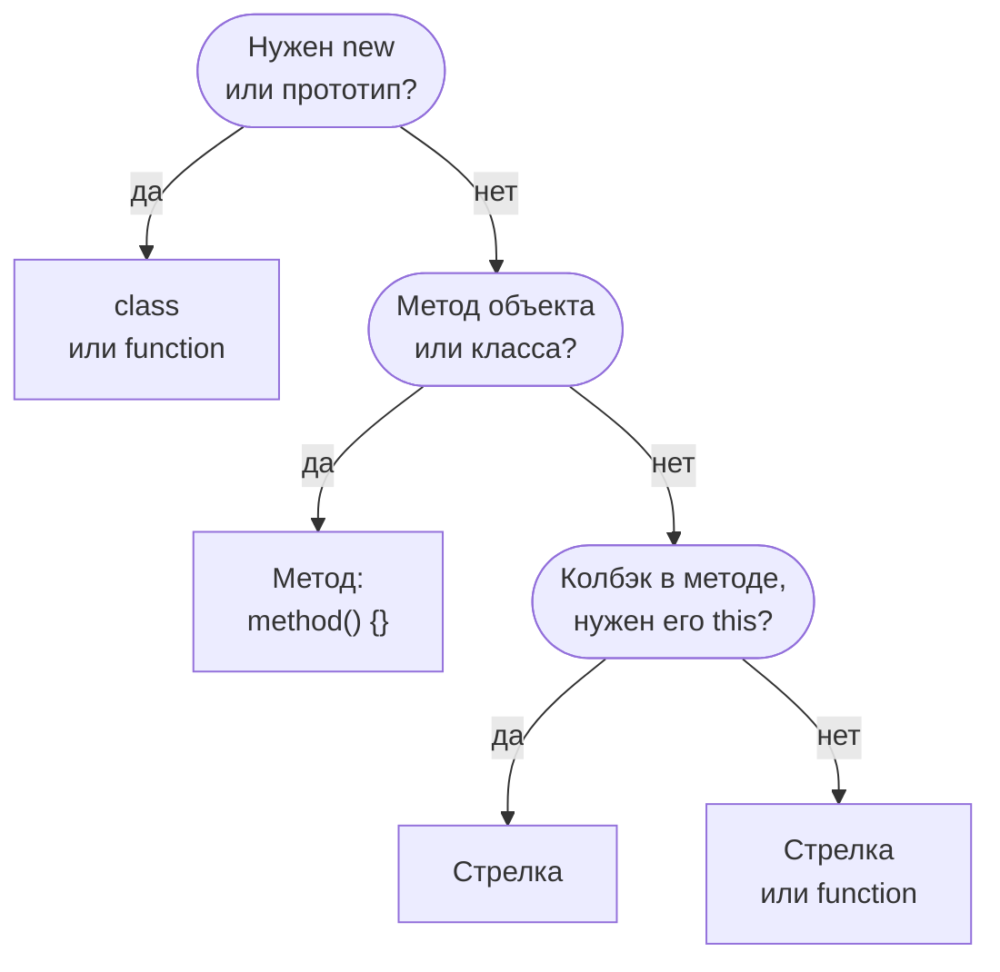
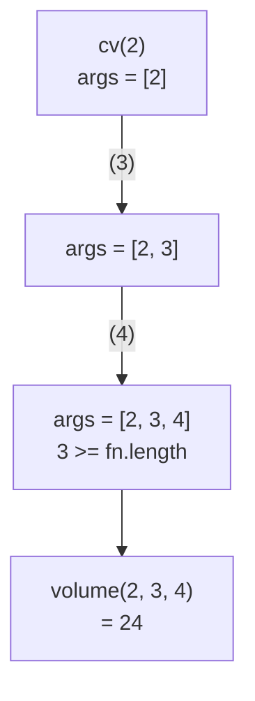
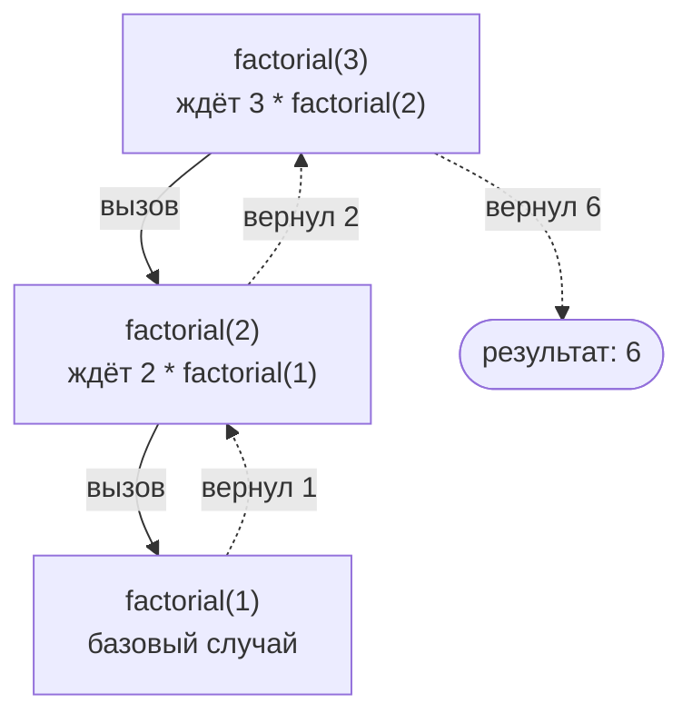

## О чём урок

Функции в JavaScript это объекты, которые можно передавать, возвращать и хранить. Здесь разобраны виды функций и чем стрелочная отличается от обычной (на собеседовании спрашивают почти всегда), параметры, функции высшего порядка, чистые функции, каррирование, композиция и рекурсия.

## Объявление, выражение, стрелка

```js
function declared(a, b) { return a + b }        // function declaration
const expressed = function named(a, b) { return a + b } // function expression (name is optional)
const arrow = (a, b) => a + b                    // arrow function
const obj = { method(a, b) { return a + b } }    // method shorthand
class Calc { add(a, b) { return a + b } }        // class method
```

Объявление (declaration) всплывает целиком: его можно вызвать выше по коду. Выражение и стрелка присваиваются переменной, поэтому до строки присваивания функции ещё нет (для `const` и `let` это временная мёртвая зона).

```js run
console.log(declared(2, 3))
try {
  expressed(2, 3)
} catch (e) {
  console.log(e.name + ': ' + e.message)
}
function declared(a, b) { return a + b }
const expressed = (a, b) => a + b
```

```output
5
ReferenceError: Cannot access 'expressed' before initialization
```

Имя у функционального выражения (`function named() {}`) видно только внутри самой функции: так пишут рекурсию в выражении, и имя появляется в стеке вызовов при отладке.

## Чем стрелочная функция отличается от обычной

| | Обычная функция | Стрелочная функция |
|---|---|---|
| `this` | Зависит от способа вызова | Берётся из окружающего кода (лексический) |
| `arguments` | Есть | Нет, берётся из внешней функции; вместо него `...args` |
| `new` | Можно вызвать как конструктор | `TypeError: … is not a constructor` |
| `prototype` | Есть | Нет |
| `super`, `new.target` | Свои | Из окружающего кода |
| Методы `call`, `apply`, `bind` | Меняют `this` | `this` не меняют, только передают аргументы |
| Генератор (`function*`) | Можно | Нельзя |

```js run
function regular() {
  return { args: arguments.length, hasPrototype: 'prototype' in regular }
}
const arrow = () => 'arrow'

console.log(regular(1, 2, 3))
console.log('prototype' in arrow)
try {
  new arrow()
} catch (e) {
  console.log(e.message)
}

function outer() {
  const inner = () => arguments[0] // arguments of outer
  return inner('ignored')
}
console.log(outer('from outer'))
```

```output
{ args: 3, hasPrototype: true }
false
arrow is not a constructor
from outer
```

Как выбрать вид функции:



Главное отличие, `this`, разобрано в уроке о `this`. Практическое правило: стрелки для колбэков и коротких функций внутри методов (им нужен `this` метода), обычные функции и сокращённые методы для методов объектов и всего, что вызывается с `new`.

## Параметры

- **Значения по умолчанию** вычисляются при каждом вызове и только для `undefined` (не для `null`): `function f(x = 1)`, `f(null)` даст `null`.
- **Остаточные параметры** `...args` собирают оставшиеся аргументы в настоящий массив. Они заменили `arguments`, который похож на массив, но им не является.
- `fn.length` считает параметры до первого параметра со значением по умолчанию или `...rest`. На этом держатся каррирование и некоторые библиотеки.
- Аргументы передаются по значению, но значение объекта это ссылка: функция может изменить поля переданного объекта, но не саму переменную снаружи.

```js run
function f(a, b = 2, ...rest) {
  return [a, b, rest]
}
console.log(f(1), f(1, null), f(1, undefined, 3, 4), f.length)

function rename(user) {
  user.name = 'Bob' // visible outside: same object
  user = { name: 'Eve' } // not visible: only the local variable changes
}
const u = { name: 'Ann' }
rename(u)
console.log(u.name)
```

```output
[ 1, 2, [] ] [ 1, null, [] ] [ 1, 2, [ 3, 4 ] ] 1
Bob
```

## Функции высшего порядка и чистые функции

Функция высшего порядка принимает функцию или возвращает функцию: `map`, `filter`, `addEventListener`, `debounce`, `memoize`. Это возможно, потому что функции в JavaScript это значения первого класса.

**Чистая функция** при одних и тех же аргументах возвращает один и тот же результат и не имеет побочных эффектов (не меняет внешние переменные и аргументы, не ходит в сеть, не пишет в DOM). Её легко тестировать и безопасно кэшировать. Редьюсеры Redux, `computed` в Vue и Angular и рендер компонента в React ожидаются чистыми.

**IIFE** (немедленно вызываемое выражение функции) `(() => { ... })()` раньше давало приватную область видимости. Сейчас эту задачу решают модули и блоки с `let` и `const`, IIFE встречается в старом коде и в сборках.

## Каррирование и частичное применение

**Каррирование** превращает `f(a, b, c)` в `f(a)(b)(c)`. **Частичное применение** фиксирует часть аргументов: `bind(null, a)` или обёртка. Универсальный `curry` опирается на `fn.length`:

```js run
function curry(fn) {
  return function curried(...args) {
    if (args.length >= fn.length) return fn.apply(this, args)
    return (...more) => curried.apply(this, [...args, ...more])
  }
}

const volume = (l, w, h) => l * w * h
const cv = curry(volume)
console.log(cv(2)(3)(4), cv(2, 3)(4), cv(2)(3, 4))

const double = (x) => x * 2
const inc = (x) => x + 1
const pipe = (...fns) => (x) => fns.reduce((acc, fn) => fn(acc), x)
const compose = (...fns) => (x) => fns.reduceRight((acc, fn) => fn(acc), x)
console.log(pipe(double, inc)(5), compose(double, inc)(5))
```

```output
24 24 24
11 12
```

Как `curry` копит аргументы, пока их не станет столько, сколько параметров у исходной функции:



`pipe` применяет функции слева направо, `compose` справа налево (как в математике). Каррирование удобно, когда функция передаётся дальше с частью уже известных аргументов: `items.map(multiplyBy(2))`. Задача с тестами: [curry](/code/curry).

## Рекурсия

Рекурсивная функция вызывает саму себя. У неё всегда есть **базовый случай**, который останавливает рекурсию, и **рекурсивный шаг**, который приближает к нему. Рекурсия естественна для деревьев: DOM, JSON, меню, файловая система.

Что происходит в стеке вызовов при `factorial(3)`: вызовы складываются вниз до базового случая, затем результаты возвращаются вверх.



```js run
const tree = { name: 'root', children: [{ name: 'a', children: [{ name: 'a1' }] }, { name: 'b' }] }

function names(node) {
  return [node.name, ...(node.children ?? []).flatMap(names)] // base case: no children
}
console.log(names(tree))

function depth(n) {
  return n === 0 ? 0 : 1 + depth(n - 1)
}
try {
  depth(1e6)
} catch (e) {
  console.log(e.name + ': ' + e.message)
}

function depthLoop(n) {
  let d = 0
  while (n-- > 0) d++
  return d
}
console.log(depthLoop(1e6))
```

```output
[ 'root', 'a', 'a1', 'b' ]
RangeError: Maximum call stack size exceeded
1000000
```

- Каждый вызов занимает кадр в стеке вызовов, и стек ограничен (в V8 порядка десяти тысяч кадров, зависит от размера кадра). Глубокую рекурсию переписывают на цикл с явным стеком или очередью.
- Оптимизация хвостовых вызовов (TCO) есть в стандарте ES2015, но из крупных движков её реализует только JavaScriptCore в Safari. В V8 и SpiderMonkey хвостовая рекурсия тоже переполняет стек.
- Рекурсия с повторяющимися подзадачами (числа Фибоначчи) без кэша работает экспоненциально долго; мемоизация разобрана в уроке о кэшировании.

## Главное

- Объявление функции всплывает целиком, выражение и стрелка нет.
- Стрелка: лексический `this`, нет `arguments`, `prototype` и `new`. Для методов объектов используют обычные функции.
- Значения по умолчанию только для `undefined`; `...rest` вместо `arguments`; объекты передаются по ссылке на значение.
- Чистые функции предсказуемы и кэшируются; функции высшего порядка принимают или возвращают функции.
- Каррирование через `fn.length`, `pipe` и `compose` через `reduce`.
- У рекурсии базовый случай и ограниченный стек; TCO в V8 нет, глубокую рекурсию заменяют циклом.
