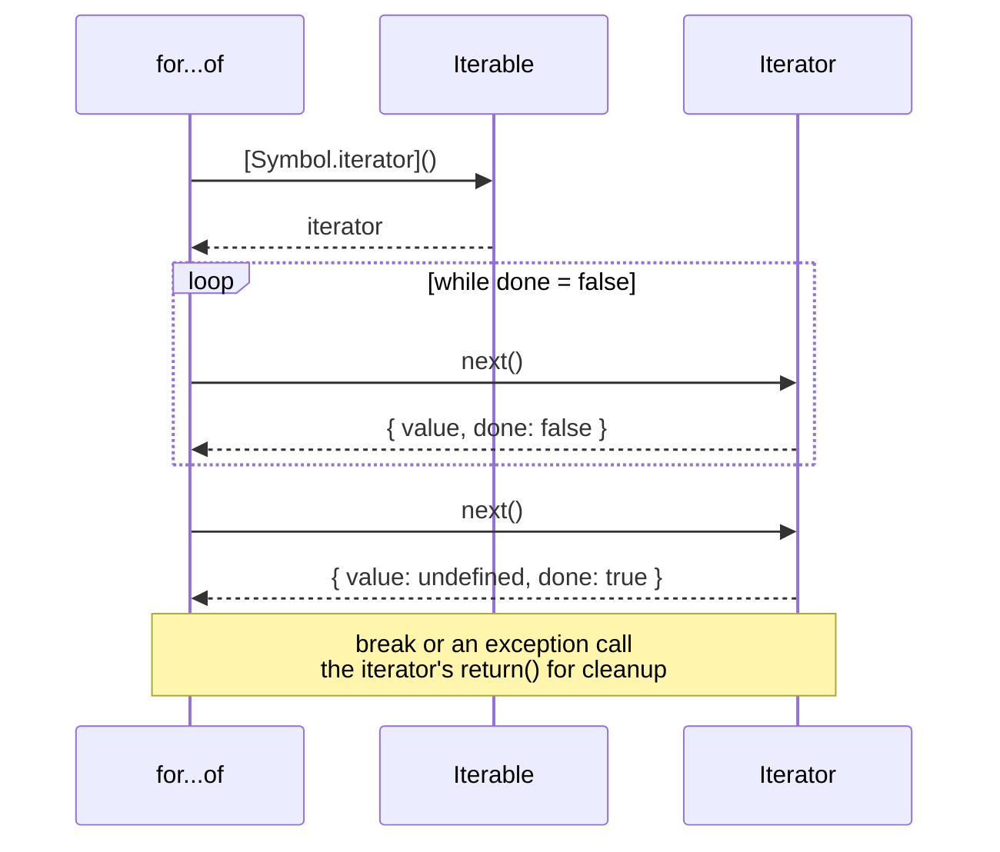
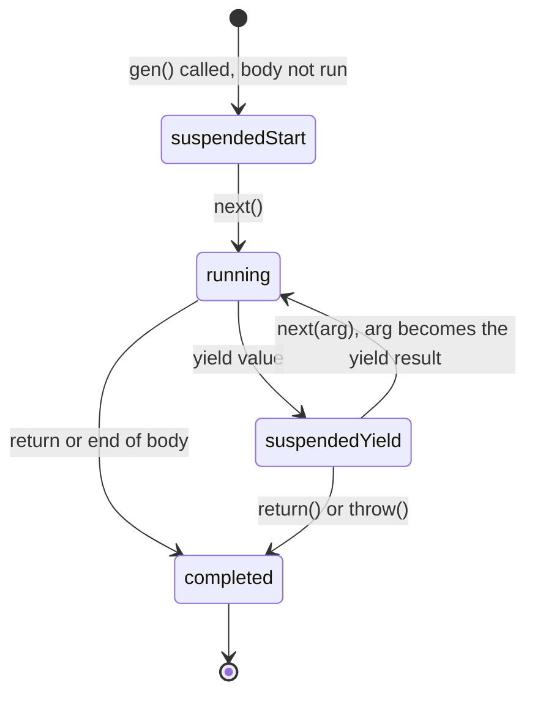

## What this lesson covers

Why `for...of` works with an array, a string, a `Map` and a `Set`, but not with a plain object. The iteration protocol, custom iterables, generators and lazy sequences, the ES2025 iterator helpers and async iteration with `for await`.

## The iteration protocol

An iterable has a `[Symbol.iterator]()` method that returns an **iterator**: an object with a `next()` method. Each `next()` call gives `{ value, done }`.



The protocol is used by `for...of`, spread `[...x]`, destructuring `const [a, b] = x`, `Array.from`, `new Map(x)`, `new Set(x)`, `Promise.all(x)`, `yield*`. Built-in iterables: arrays, strings (by code point), `Map`, `Set`, `arguments`, `NodeList`, typed arrays. A plain object is not iterable: it has `Object.keys`, `Object.values` and `Object.entries`.

```js run
const range = {
  from: 1,
  to: 4,
  [Symbol.iterator]() {
    let current = this.from
    const last = this.to
    return {
      next: () => (current <= last ? { value: current++, done: false } : { value: undefined, done: true }),
    }
  },
}
console.log([...range], Math.max(...range))
const [first, , third] = range
console.log(first, third)
try {
  for (const x of { a: 1 }) console.log(x)
} catch (e) {
  console.log(e.message)
}
```

```output
[ 1, 2, 3, 4 ] 4
1 3
{(intermediate value)} is not iterable
```

## Generators

A generator (`function*`) writes the iterator for you. Calling a generator does not run its body but returns a generator object; the body runs piece by piece up to the next `yield` on every `next()`.



```js run
function* ids(prefix) {
  let n = 1
  while (true) yield `${prefix}-${n++}` // infinite but lazy
}
const gen = ids('user')
console.log(gen.next().value, gen.next().value)

function* take(iterable, count) {
  if (count <= 0) return
  for (const x of iterable) {
    yield x
    if (--count === 0) return // return() closes the source iterator too
  }
}
console.log([...take(ids('order'), 3)])

function* dialog() {
  const name = yield 'What is your name?'
  const age = yield `Hi, ${name}! Age?`
  return `${name} is ${age}`
}
const d = dialog()
console.log(d.next().value)
console.log(d.next('Ann').value)
console.log(d.next(30))
```

```output
user-1 user-2
[ 'order-1', 'order-2', 'order-3' ]
What is your name?
Hi, Ann! Age?
{ value: 'Ann is 30', done: true }
```

- Generators are **lazy**: values are computed on demand, so an infinite sequence does not hang until someone asks for all of it.
- `next(arg)` passes a value in: it becomes the result of the `yield` expression. The first `next()` only starts the body up to the first `yield`, and its argument is lost.
- `yield*` delegates to another iterable: handy for walking trees.
- A generator is both an iterator and an iterable, but **single-use**: after it finishes, another `for...of` yields nothing.
- Where you meet them: walking trees and graphs, pagination, redux-saga (effects as `yield`), parsing data streams.

## Iterator helpers

Since ES2025 iterators have lazy methods like arrays: `map`, `filter`, `take`, `drop`, `flatMap`, and terminal `reduce`, `toArray`, `some`, `every`, `find`, `forEach`. `Iterator.from(x)` turns an iterable into an iterator with these methods. Support: Chrome 122+, Firefox 131+, Safari 18.4+.

```js run
function* naturals() {
  let n = 1
  while (true) yield n++
}
const firstSquaresOfEven = naturals()
  .filter((n) => n % 2 === 0)
  .map((n) => n * n)
  .take(3)
  .toArray()
console.log(firstSquaresOfEven)

const evaluated = []
const lazy = [1, 2, 3, 4].values().map((n) => (evaluated.push(n), n * 10))
console.log(lazy.next().value, evaluated)
```

```output
[ 4, 16, 36 ]
10 [ 1 ]
```

Unlike a chain of array methods, no intermediate arrays are created, and elements are computed only as needed: three values were taken from an infinite sequence, and the `map` over the array ran for one element only.

## Async iteration

An async iterable returns from `[Symbol.asyncIterator]()` an iterator whose `next()` returns a promise. It is consumed with `for await...of`; the easiest way to write one is an async generator `async function*`.

```js run
async function* pages(total) {
  for (let page = 1; page <= total; page++) {
    await new Promise((r) => setTimeout(r, 10)) // a network request in real code
    yield [`item ${page}.1`, `item ${page}.2`]
  }
}

for await (const items of pages(3)) {
  console.log(items.join(', '))
  if (items[0] === 'item 2.1') break // stops the generator: page 3 is never fetched
}
console.log(await Array.fromAsync(pages(2)))
```

```output
item 1.1, item 1.2
item 2.1, item 2.2
[ [ 'item 1.1', 'item 1.2' ], [ 'item 2.1', 'item 2.2' ] ]
```

- Uses: paginated loading, reading streams (`ReadableStream` works with `for await` in every browser since Safari 27, and in Node.js for a long time), WebSocket events, reading files line by line in Node.js.
- `for await` waits for each element in turn. If the elements are independent and speed matters, start the promises at once and wait with `Promise.all`.
- `Array.fromAsync` collects an async iterable into an array.

## Key points

- An iterable has `[Symbol.iterator]()`, an iterator has `next()` with `{ value, done }`.
- The protocol is used by `for...of`, spread, destructuring, `Array.from`, `Map`, `Set`, `Promise.all`. A plain object is not iterable.
- A generator pauses at `yield`, is lazy and single-use; `next(arg)` passes a value in.
- ES2025: lazy `map`, `filter`, `take` and more directly on iterators.
- `async function*` and `for await` for async sequences; `break` stops the source.
