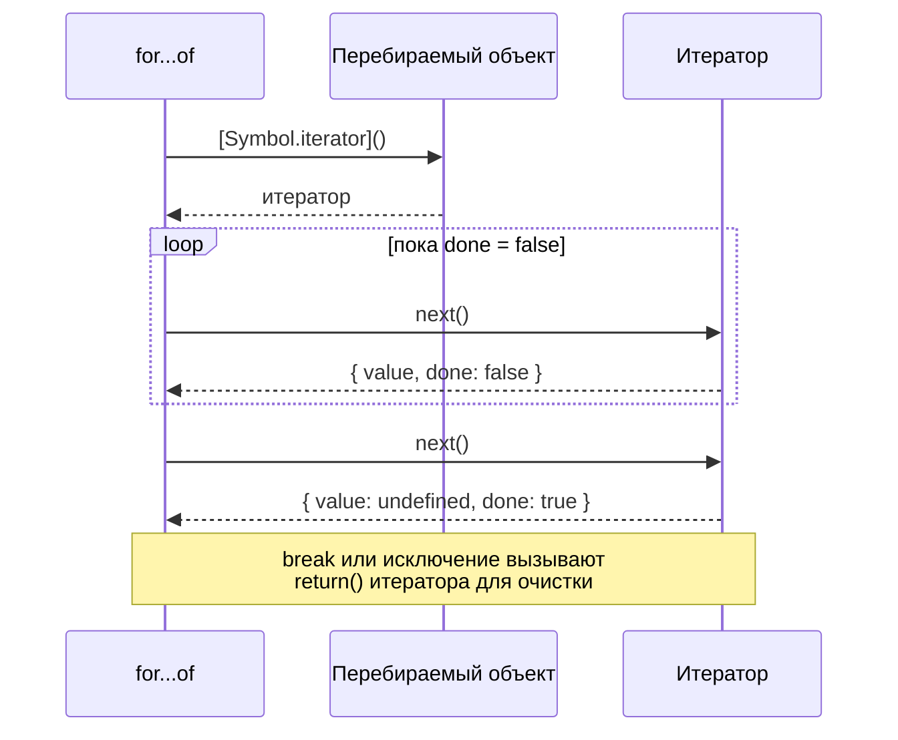
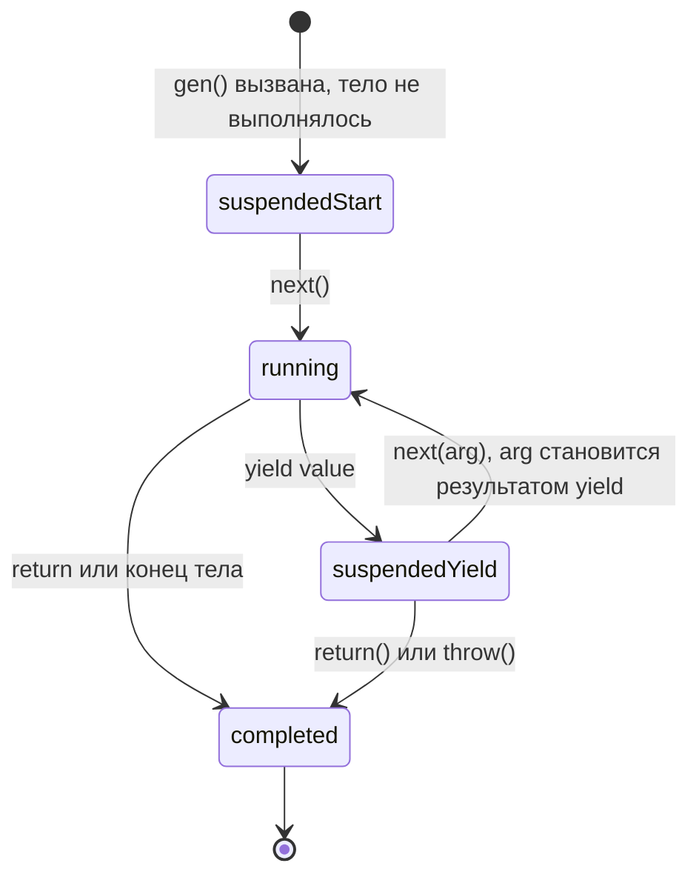

## О чём урок

Почему `for...of` работает с массивом, строкой, `Map` и `Set`, но не с обычным объектом. Здесь протокол итерации, свои перебираемые объекты, генераторы и ленивые последовательности, вспомогательные методы итераторов из ES2025 и асинхронная итерация с `for await`.

## Протокол итерации

Перебираемый объект (iterable) имеет метод `[Symbol.iterator]()`, который возвращает **итератор**: объект с методом `next()`. Каждый вызов `next()` отдаёт `{ value, done }`.



Этот протокол используют `for...of`, spread `[...x]`, деструктуризация `const [a, b] = x`, `Array.from`, `new Map(x)`, `new Set(x)`, `Promise.all(x)`, `yield*`. Встроенные перебираемые: массивы, строки (по кодовым точкам), `Map`, `Set`, `arguments`, `NodeList`, типизированные массивы. Обычный объект не перебираем: для него есть `Object.keys`, `Object.values`, `Object.entries`.

```js run
const range = {
  from: 1,
  to: 4,
  [Symbol.iterator]() {
    let current = this.from
    const last = this.to
    return {
      next: () => (current <= last ? { value: current++, done: false } : { value: undefined, done: true }),
    }
  },
}
console.log([...range], Math.max(...range))
const [first, , third] = range
console.log(first, third)
try {
  for (const x of { a: 1 }) console.log(x)
} catch (e) {
  console.log(e.message)
}
```

```output
[ 1, 2, 3, 4 ] 4
1 3
{(intermediate value)} is not iterable
```

## Генераторы

Генератор (`function*`) пишет итератор за вас. Вызов генератора не выполняет тело, а возвращает объект-генератор; тело выполняется по кускам до очередного `yield` при каждом `next()`.



```js run
function* ids(prefix) {
  let n = 1
  while (true) yield `${prefix}-${n++}` // infinite but lazy
}
const gen = ids('user')
console.log(gen.next().value, gen.next().value)

function* take(iterable, count) {
  if (count <= 0) return
  for (const x of iterable) {
    yield x
    if (--count === 0) return // return() closes the source iterator too
  }
}
console.log([...take(ids('order'), 3)])

function* dialog() {
  const name = yield 'What is your name?'
  const age = yield `Hi, ${name}! Age?`
  return `${name} is ${age}`
}
const d = dialog()
console.log(d.next().value)
console.log(d.next('Ann').value)
console.log(d.next(30))
```

```output
user-1 user-2
[ 'order-1', 'order-2', 'order-3' ]
What is your name?
Hi, Ann! Age?
{ value: 'Ann is 30', done: true }
```

- Генераторы **ленивые**: значения считаются по запросу, поэтому бесконечная последовательность не зависает, пока её не попросят целиком.
- `next(arg)` передаёт значение внутрь: оно становится результатом выражения `yield`. Первый `next()` только запускает тело до первого `yield`, его аргумент теряется.
- `yield*` делегирует другому перебираемому объекту: так удобно обходить деревья.
- Генератор это одновременно итератор и перебираемый объект, но **одноразовый**: после завершения повторный `for...of` ничего не выдаст.
- Где встречается: обход деревьев и графов, пагинация, redux-saga (эффекты как `yield`), разбор потоков данных.

## Вспомогательные методы итераторов

С ES2025 у итераторов есть ленивые методы, как у массивов: `map`, `filter`, `take`, `drop`, `flatMap`, а также завершающие `reduce`, `toArray`, `some`, `every`, `find`, `forEach`. `Iterator.from(x)` превращает перебираемый объект в итератор с этими методами. Поддержка: Chrome 122+, Firefox 131+, Safari 18.4+.

```js run
function* naturals() {
  let n = 1
  while (true) yield n++
}
const firstSquaresOfEven = naturals()
  .filter((n) => n % 2 === 0)
  .map((n) => n * n)
  .take(3)
  .toArray()
console.log(firstSquaresOfEven)

const evaluated = []
const lazy = [1, 2, 3, 4].values().map((n) => (evaluated.push(n), n * 10))
console.log(lazy.next().value, evaluated)
```

```output
[ 4, 16, 36 ]
10 [ 1 ]
```

В отличие от цепочки методов массива, промежуточные массивы не создаются, а элементы считаются только по мере надобности: из бесконечной последовательности взяли три значения, а `map` над массивом выполнился лишь для одного элемента.

## Асинхронная итерация

Асинхронный перебираемый объект возвращает из `[Symbol.asyncIterator]()` итератор, у которого `next()` возвращает промис. Перебирают его через `for await...of`; пишут проще всего асинхронным генератором `async function*`.

```js run
async function* pages(total) {
  for (let page = 1; page <= total; page++) {
    await new Promise((r) => setTimeout(r, 10)) // a network request in real code
    yield [`item ${page}.1`, `item ${page}.2`]
  }
}

for await (const items of pages(3)) {
  console.log(items.join(', '))
  if (items[0] === 'item 2.1') break // stops the generator: page 3 is never fetched
}
console.log(await Array.fromAsync(pages(2)))
```

```output
item 1.1, item 1.2
item 2.1, item 2.2
[ [ 'item 1.1', 'item 1.2' ], [ 'item 2.1', 'item 2.2' ] ]
```

- Применение: постраничная загрузка, чтение потоков (`ReadableStream` перебирается через `for await` во всех браузерах начиная с Safari 27, в Node.js давно), события WebSocket, чтение файлов построчно в Node.js.
- `for await` ждёт каждый элемент по очереди. Если элементы независимы и нужна скорость, промисы запускают сразу и ждут через `Promise.all`.
- `Array.fromAsync` собирает асинхронный перебираемый объект в массив.

## Главное

- Перебираемый объект имеет `[Symbol.iterator]()`, итератор имеет `next()` с `{ value, done }`.
- Протокол используют `for...of`, spread, деструктуризация, `Array.from`, `Map`, `Set`, `Promise.all`. Обычный объект не перебираем.
- Генератор приостанавливается на `yield`, ленив, одноразов; `next(arg)` передаёт значение внутрь.
- ES2025: ленивые `map`, `filter`, `take` и другие прямо на итераторах.
- `async function*` и `for await` для асинхронных последовательностей; `break` останавливает источник.
