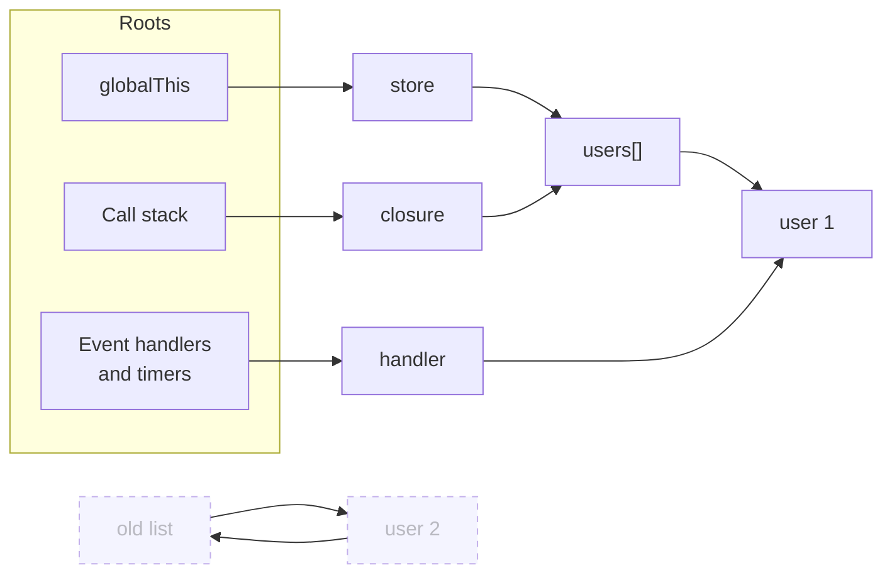
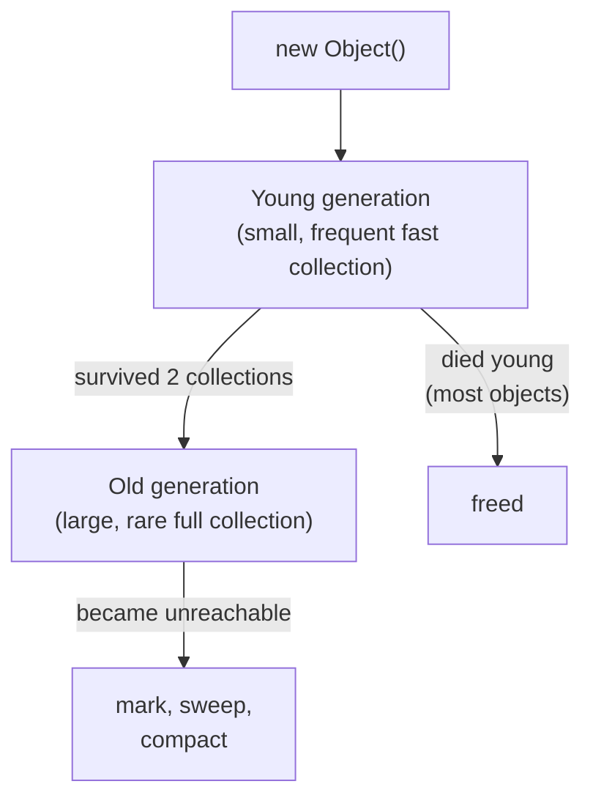

## What this lesson covers

How JavaScript frees memory and why it leaks anyway. Reachability and the marking algorithm, generations in V8, typical front-end leaks and how to find them in DevTools, and weak references: `WeakMap`, `WeakSet`, `WeakRef`, `FinalizationRegistry`, plus deterministic cleanup with `using`.

## Reachability

Memory is freed by the **garbage collector** (GC). It removes objects that cannot be reached by references from the **roots**: the global object, variables on the current call stack, live closures, handlers registered with the browser (events, timers, observers).



The dashed objects are unreachable: only they reference each other. The **mark-and-sweep** algorithm walks the graph from the roots, marks everything reachable and frees the rest, so circular references do not prevent collection. Old reference counting did not free such cycles, hence the Internet Explorer leaks that interviews sometimes ask about.

**A leak in JavaScript** is not "forgot to free memory" but "accidentally kept a path from a root to an object you no longer need".

## How V8 collects garbage



- **The generational hypothesis**: most objects die young (temporary arrays, intermediate strings). The young generation is collected often and cheaply (the Scavenger copies survivors), the old one rarely with full marking and compaction.
- V8's collector (Orinoco) does most of its work in parallel and on background threads, so pauses are short but not zero: thousands of temporary objects in an animation loop still cause jank.
- The moment of collection is undefined: code can neither trigger GC nor learn when an object was freed. `globalThis.gc()` exists only in Node.js with `--expose-gc`; DevTools has a Collect garbage button.

## Typical front-end leaks

| Source | What it keeps | Fix |
|---|---|---|
| `addEventListener` on `window`/`document` | The handler and everything it captured | `removeEventListener` or `{ signal }` from an `AbortController` on unmount |
| `setInterval`, a `requestAnimationFrame` loop | The callback and its closure | `clearInterval`, a stop flag for the loop |
| Subscriptions (RxJS, a store, WebSocket) | The subscriber and the component | `unsubscribe`, `takeUntilDestroyed`, cleanup in `useEffect` |
| A cache in a module-level `Map` or array | Every value ever put there | A size limit (LRU), TTL, a `WeakMap` keyed by object |
| Detached DOM | A node removed from the page but kept in a variable | Null the references, do not keep nodes in long-lived structures |
| A closure over big data | The whole environment the function references | Do not capture extra, move data out of the closure |
| `console.log(obj)` with DevTools open | The object while the console is open | Do not log big objects in production |
| An accidental global | The value forever | Modules and strict mode (assigning an undeclared variable throws) |

```js
// Leak: the listener and the component it captured live as long as window
function mountWidget(widget) {
  window.addEventListener('resize', () => widget.layout())
}

// Fix: one AbortController removes every listener registered with its signal
function mountWidgetFixed(widget) {
  const controller = new AbortController()
  window.addEventListener('resize', () => widget.layout(), { signal: controller.signal })
  return () => controller.abort() // call on unmount
}
```

**Finding a leak**: on the Memory tab in DevTools take a heap snapshot, run the scenario several times (open and close a modal), take a second snapshot and compare (Comparison): growing constructors and the `Detached` filter show what accumulates, and the Retainers panel shows the path from a root that keeps the object alive. The allocation timeline shows which allocations are never freed. The deprecated `performance.memory` exists only in Chromium; its replacement `performance.measureUserAgentSpecificMemory()` is also Chromium-only and only on cross-origin isolated pages.

## WeakMap and WeakSet

A regular `Map` keeps its keys: while an entry is in the `Map`, the key object stays alive. A `WeakMap` holds keys **weakly**: if nothing else references the object, the collector removes it together with the entry.

| | `Map` | `WeakMap` |
|---|---|---|
| Keys | Any values | Objects and non-registered symbols |
| Keeps the key alive | Yes | No |
| Iteration, `size`, `clear()` | Yes | No: the content depends on GC |
| Use | Dictionaries, bounded caches | Data "attached" to an object: DOM node metadata, a cache per object, private data |

```js run
const cache = new WeakMap()
function area(shape) {
  if (!cache.has(shape)) {
    console.log('compute')
    cache.set(shape, shape.w * shape.h)
  }
  return cache.get(shape)
}
let rect = { w: 3, h: 4 }
console.log(area(rect), area(rect))
rect = null // the entry can now be collected together with the object

const visited = new WeakSet()
function walk(node) {
  if (visited.has(node)) return 'cycle'
  visited.add(node)
  return node.next ? walk(node.next) : 'end'
}
const a = { next: null }
a.next = { next: a }
console.log(walk(a))
```

```output
compute
12 12
cycle
```

A `WeakSet` marks objects as "already processed" without keeping them alive: walking graphs with cycles, guarding against double initialization. You cannot iterate a `WeakMap` or `WeakSet` precisely because the result would depend on whether GC has run.

## WeakRef

`new WeakRef(obj)` holds a weak reference; `ref.deref()` returns the object or `undefined` if it has been collected. An object obtained through `deref()` or passed to the constructor stays alive at least until the end of the current synchronous job, so within one synchronous piece of code the result of `deref()` will not "vanish".

```js
// Cache of large decoded images: keep them while memory allows, rebuild otherwise
const images = new Map() // url → WeakRef<ImageBitmap>
async function getImage(url) {
  const cached = images.get(url)?.deref()
  if (cached) return cached
  const bitmap = await createImageBitmap(await (await fetch(url)).blob())
  images.set(url, new WeakRef(bitmap))
  return bitmap
}
```

The `Map` entries themselves (the key and an empty `WeakRef`) remain; they are removed on a miss or through a `FinalizationRegistry`. MDN explicitly advises avoiding `WeakRef` when a `WeakMap` or explicit cleanup does the job: the behavior depends on the engine, the load and the version.

## FinalizationRegistry

The registry calls a callback some time after a registered object has been collected:

```js
const registry = new FinalizationRegistry((url) => images.delete(url)) // heldValue, not the object
registry.register(bitmap, url, bitmap) // target, heldValue, unregister token
registry.unregister(bitmap) // when cleaned up explicitly
```

- The call is **not guaranteed**: if the tab closes or GC never reaches the object, the callback never happens. So a registry suits auxiliary work (removing empty cache entries, finding leaks while debugging), not closing connections, saving data or releasing external resources.
- `heldValue` cannot be the object itself (that would make it reachable); pass an identifier.
- An object with a strong reference somewhere else (in the same `Map`, for example) is never collected, and the callback never runs.

## Deterministic cleanup: using

For resources that must be released exactly when a block exits, the language added **explicit resource management**: a `using` declaration calls `[Symbol.dispose]()` when the block exits, in reverse order, even on an exception (the async form is `await using` with `Symbol.asyncDispose`).

```js run
function open(name) {
  console.log('open', name)
  return { [Symbol.dispose]: () => console.log('close', name) }
}
{
  using a = open('db')
  using b = open('file')
  console.log('work')
}
```

```output
open db
open file
work
close file
close db
```

As of November 2026 `using` is supported in Chrome 134+, Firefox 141+ and Node.js 24, while Safari has it only in a preview, so browser code does not use it yet without transpiling. TypeScript compiles `using` since 5.2.

## Key points

- GC frees objects unreachable from the roots; cycles do not matter. A leak is an extra path from a root.
- V8 splits the heap into generations: young objects are collected often and cheaply, old ones rarely.
- The main leaks: listeners, timers and subscriptions left behind, growing caches, detached DOM. Find them by comparing heap snapshots and reading Retainers.
- `WeakMap` and `WeakSet` do not keep their keys alive and therefore cannot be iterated.
- `WeakRef` and `FinalizationRegistry` are nondeterministic: only for optional work.
- Exact cleanup comes from `try/finally`, unsubscribing and `using` with `Symbol.dispose`.
