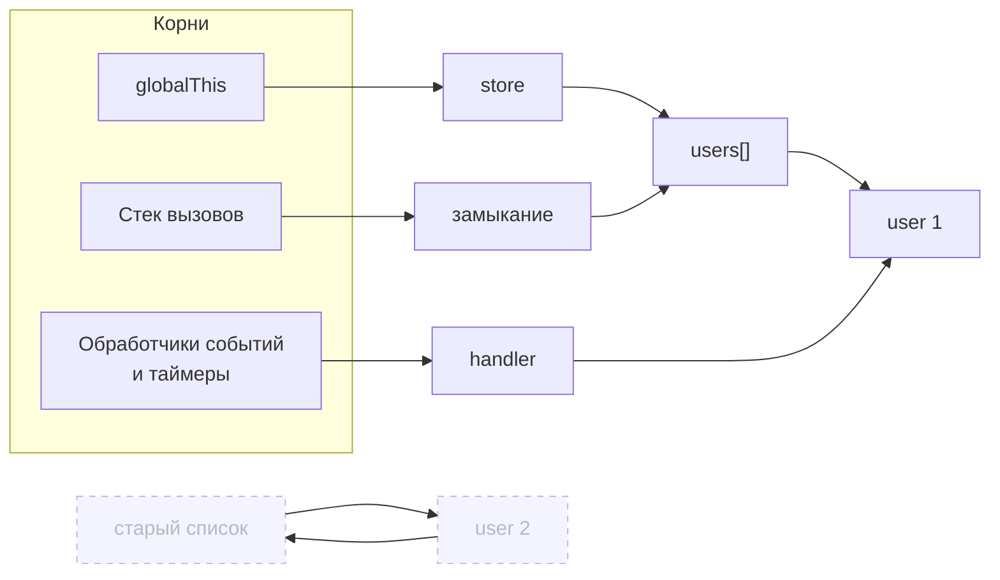
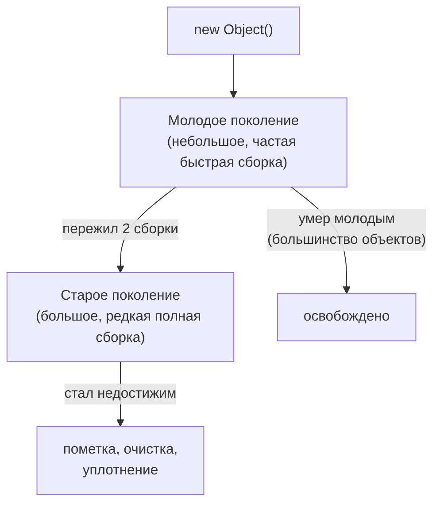

## О чём урок

Как JavaScript освобождает память и почему она всё равно утекает. Здесь достижимость и алгоритм пометки, поколения в V8, типичные утечки во фронтенде и как их найти в DevTools, а также слабые ссылки: `WeakMap`, `WeakSet`, `WeakRef`, `FinalizationRegistry` и детерминированная очистка через `using`.

## Достижимость

Память освобождает **сборщик мусора** (garbage collector, GC). Он удаляет объекты, до которых нельзя добраться по ссылкам от **корней**: глобального объекта, переменных в текущем стеке вызовов, активных замыканий, обработчиков, зарегистрированных в браузере (события, таймеры, наблюдатели).



Пунктирные объекты недостижимы: на них ссылаются только они сами. Алгоритм **пометки и очистки** (mark-and-sweep) обходит граф от корней, помечает всё достижимое и освобождает остальное, поэтому циклические ссылки не мешают сборке. Старый подсчёт ссылок такие циклы не освобождал, отсюда утечки в Internet Explorer, о которых иногда спрашивают.

**Утечка в JavaScript** это не «забыли освободить память», а «случайно оставили путь от корня до ненужного объекта».

## Как устроена сборка в V8



- **Гипотеза поколений**: большинство объектов умирает молодыми (временные массивы, промежуточные строки). Молодое поколение собирается часто и быстро (Scavenger копирует выживших), старое реже полной пометкой с уплотнением.
- Сборщик V8 (Orinoco) делает большую часть работы параллельно и в фоновых потоках, поэтому паузы короткие, но не нулевые: тысячи временных объектов в цикле анимации всё равно дают рывки.
- Момент сборки не определён: код не может ни вызвать GC, ни узнать, когда объект освобождён. `globalThis.gc()` есть только в Node.js с флагом `--expose-gc`, в DevTools есть кнопка Collect garbage.

## Типичные утечки во фронтенде

| Источник | Что держит память | Исправление |
|---|---|---|
| `addEventListener` на `window`/`document` | Обработчик и всё, что он замкнул | `removeEventListener` или `{ signal }` от `AbortController` при размонтировании |
| `setInterval`, `requestAnimationFrame`-цикл | Колбэк и его замыкание | `clearInterval`, флаг остановки цикла |
| Подписки (RxJS, стор, WebSocket) | Подписчика и компонент | `unsubscribe`, `takeUntilDestroyed`, очистка в `useEffect` |
| Кэш в `Map` или массиве на уровне модуля | Все когда-либо положенные значения | Ограничение размера (LRU), TTL, `WeakMap` по объекту |
| Отсоединённый DOM | Узел удалён из страницы, но сохранён в переменной | Обнулять ссылки, не хранить узлы в долгоживущих структурах |
| Замыкание с большими данными | Всё окружение, на которое ссылается функция | Не захватывать лишнее, выносить данные из замыкания |
| `console.log(obj)` в DevTools | Объект, пока открыта консоль | Не логировать большие объекты в продакшене |
| Случайная глобальная переменная | Значение навсегда | Модули и строгий режим (присваивание необъявленной переменной бросает ошибку) |

```js
// Leak: the listener and the component it captured live as long as window
function mountWidget(widget) {
  window.addEventListener('resize', () => widget.layout())
}

// Fix: one AbortController removes every listener registered with its signal
function mountWidgetFixed(widget) {
  const controller = new AbortController()
  window.addEventListener('resize', () => widget.layout(), { signal: controller.signal })
  return () => controller.abort() // call on unmount
}
```

**Как найти утечку**: в DevTools на вкладке Memory сделать снимок кучи (heap snapshot), выполнить сценарий несколько раз (открыть и закрыть модалку), сделать второй снимок и сравнить (Comparison): растущие конструкторы и фильтр `Detached` покажут, что накапливается, а панель Retainers покажет путь от корня, который держит объект. Allocation timeline показывает, какие выделения не освобождаются. Устаревший `performance.memory` есть только в Chromium; замена `performance.measureUserAgentSpecificMemory()` тоже есть только в Chromium и только на страницах с cross-origin isolation.

## WeakMap и WeakSet

Обычная `Map` держит ключи: пока запись в `Map`, объект-ключ жив. `WeakMap` держит ключи **слабо**: если на объект нет других ссылок, сборщик удаляет его вместе с записью.

| | `Map` | `WeakMap` |
|---|---|---|
| Ключи | Любые значения | Объекты и незарегистрированные символы |
| Удерживает ключ | Да | Нет |
| Перебор, `size`, `clear()` | Есть | Нет: содержимое зависит от GC |
| Применение | Словари, кэши с ограничением | Данные «при объекте»: метаданные DOM-узлов, кэш по объекту, приватные данные |

```js run
const cache = new WeakMap()
function area(shape) {
  if (!cache.has(shape)) {
    console.log('compute')
    cache.set(shape, shape.w * shape.h)
  }
  return cache.get(shape)
}
let rect = { w: 3, h: 4 }
console.log(area(rect), area(rect))
rect = null // the entry can now be collected together with the object

const visited = new WeakSet()
function walk(node) {
  if (visited.has(node)) return 'cycle'
  visited.add(node)
  return node.next ? walk(node.next) : 'end'
}
const a = { next: null }
a.next = { next: a }
console.log(walk(a))
```

```output
compute
12 12
cycle
```

`WeakSet` помечает объекты «уже обработан» без удержания: обход графов с циклами, защита от повторной инициализации. Перебрать `WeakMap` и `WeakSet` нельзя именно потому, что результат зависел бы от того, успел ли пройти GC.

## WeakRef

`new WeakRef(obj)` хранит слабую ссылку; `ref.deref()` возвращает объект или `undefined`, если его уже собрали. Объект, полученный через `deref()` или переданный в конструктор, живёт как минимум до конца текущей синхронной задачи, поэтому в одном синхронном куске кода результат `deref()` не «исчезнет».

```js
// Cache of large decoded images: keep them while memory allows, rebuild otherwise
const images = new Map() // url → WeakRef<ImageBitmap>
async function getImage(url) {
  const cached = images.get(url)?.deref()
  if (cached) return cached
  const bitmap = await createImageBitmap(await (await fetch(url)).blob())
  images.set(url, new WeakRef(bitmap))
  return bitmap
}
```

Сами записи `Map` (ключ и пустой `WeakRef`) при этом остаются; их убирают при промахе или через `FinalizationRegistry`. MDN прямо советует избегать `WeakRef`, если задачу решает `WeakMap` или явная очистка: поведение зависит от движка, нагрузки и версии.

## FinalizationRegistry

Реестр вызывает колбэк когда-нибудь после того, как зарегистрированный объект собран:

```js
const registry = new FinalizationRegistry((url) => images.delete(url)) // heldValue, not the object
registry.register(bitmap, url, bitmap) // target, heldValue, unregister token
registry.unregister(bitmap) // when cleaned up explicitly
```

- Вызов **не гарантирован**: при закрытии вкладки или если GC не дошёл до объекта колбэк не случится. Поэтому реестр годится для вспомогательной работы (убрать пустые записи кэша, найти утечки в отладке), но не для закрытия соединений, сохранения данных или освобождения внешних ресурсов.
- `heldValue` не может быть самим объектом (иначе он стал бы достижим), передают идентификатор.
- Объект, на который где-то ещё есть сильная ссылка (например, в той же `Map`), никогда не будет собран, и колбэк не вызовется.

## Детерминированная очистка: using

Для ресурсов, которые нужно освободить точно в момент выхода из блока, в язык добавлено **явное управление ресурсами**: объявление `using` вызывает `[Symbol.dispose]()` при выходе из блока, в обратном порядке, даже при исключении (асинхронный вариант `await using` и `Symbol.asyncDispose`).

```js run
function open(name) {
  console.log('open', name)
  return { [Symbol.dispose]: () => console.log('close', name) }
}
{
  using a = open('db')
  using b = open('file')
  console.log('work')
}
```

```output
open db
open file
work
close file
close db
```

На ноябрь 2026 `using` поддерживают Chrome 134+, Firefox 141+ и Node.js 24, в Safari он только в предварительной версии, поэтому в браузерном коде без транспиляции его пока не используют. TypeScript компилирует `using` с 5.2.

## Главное

- GC освобождает недостижимые от корней объекты; циклы не мешают. Утечка это лишний путь от корня.
- V8 делит кучу на поколения: молодые объекты собираются часто и дёшево, старые редко.
- Главные утечки: невыключенные обработчики, таймеры и подписки, растущие кэши, отсоединённый DOM. Искать через сравнение снимков кучи и Retainers.
- `WeakMap` и `WeakSet` не удерживают ключи и поэтому не перебираются.
- `WeakRef` и `FinalizationRegistry` недетерминированы: только для необязательной работы.
- Точную очистку дают `try/finally`, отписки и `using` с `Symbol.dispose`.
