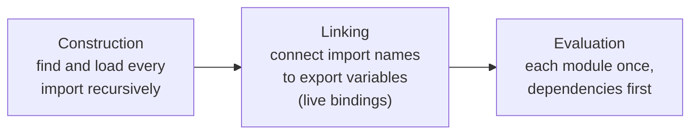

## What this lesson covers

All modern frontend code is made of modules: every file with `import` and `export` is a module. This lesson covers how ES modules differ from the older CommonJS of Node.js, what live bindings are, how dynamic `import()` works and why the module format affects bundle size.

## ES modules

ES modules load in three phases, which is why imports are known before any code runs:



ES modules (ESM) are the language standard. A module differs from a classic script in several ways:

- **its own scope:** module variables do not leak into the global scope; only exports are visible outside;
- **always strict mode**, and top-level `this` is `undefined`;
- **runs once:** no matter how many files import a module, its code runs once and everyone gets the same instance;
- **static structure:** `import` and `export` appear only at the top level and do not depend on conditions, so the dependency graph is known before running anything;
- **top-level `await`** is allowed.

```js run
console.log(typeof this)
console.log((function () { return typeof this })())
```

```output
undefined
undefined
```

## Live bindings

An ESM import is not a copy of a value but a binding to the variable in the source module. If the module changes an exported variable, the importing code sees the new value. Assigning to an imported variable is an error.

```js
// counter.js
export let count = 0
export function inc() {
  count++
}

// main.js
import { count, inc } from "./counter.js"
console.log(count) // 0
inc()
console.log(count) // 1: the binding is live
```

## Dynamic import()

`import("./module.js")` loads a module at runtime and returns a promise of the module object. Bundlers (Vite, webpack) put such modules into separate chunk files, so `import()` is the basis of route-based code splitting: `React.lazy(() => import("./Settings"))`.

In the browser, modules are loaded with `<script type="module">`. Such scripts are deferred by default (they do not block HTML parsing), run in strict mode and need proper CORS headers for files from other origins.

## CommonJS

CommonJS (CJS) is the module format Node.js used before ESM: `require()` and `module.exports`.

| | CommonJS | ES modules |
|---|---|---|
| Syntax | `require()`, `module.exports` | `import`, `export` |
| Loading | synchronous, `require` can be called anywhere | static structure, `import()` for dynamic loading |
| What the importer gets | the cached `module.exports` object; destructuring copies current values | live bindings |
| Top-level `this` | `module.exports` | `undefined` |
| Browser | only via a bundler | native |

In Node.js a `.mjs` file is always ESM, `.cjs` is always CommonJS, and `.js` is decided by the `"type"` field of the nearest `package.json`. Since Node.js 22.12 (and 20.19), `require()` can load ES modules that have no top-level `await`. CommonJS is not deprecated, but new libraries and frontend projects are written as ESM.

## Tree-shaking

Because the ESM structure is static, a bundler can see which exports are actually imported and drop the rest. This is called **tree-shaking**. It barely works with CommonJS: `require` can be called inside a condition, and `module.exports` can change at runtime.

For tree-shaking to work, import by name (`import { debounce } from "lodash-es"`, not the whole package) and keep modules free of side effects on import. Library authors tell bundlers which files are safe to drop with the `"sideEffects"` field in `package.json`.

## Key points

- A module has its own scope, is always strict and runs once; top-level `this` is `undefined`.
- An import is a live binding, not a copy; you cannot assign to it.
- `import()` returns a promise and splits code into chunks.
- In Node.js the `"type"` field in `package.json` decides what `.js` is; since 22.12 `require()` loads ESM without top-level `await`.
- Tree-shaking is possible thanks to the static structure of ESM.
