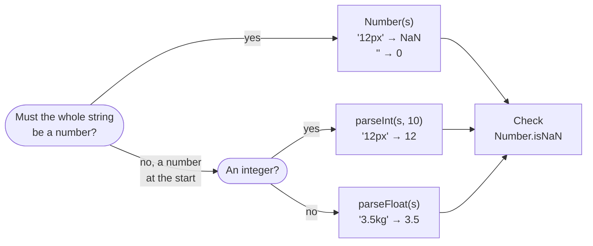
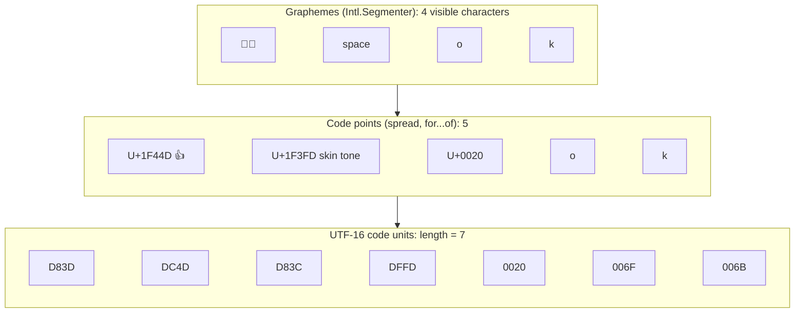
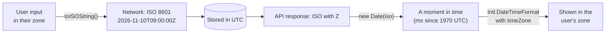

## What this lesson covers

Numbers, strings and dates: where JavaScript behaves unexpectedly and what interviews ask. Floating-point precision and `BigInt`, converting strings to numbers, the length of a string with emoji, `Date` pitfalls, formatting with `Intl` and the status of `Temporal`.

## Numbers: binary floating point

The `number` type is a 64-bit floating-point number (IEEE 754). Decimal fractions like 0.1 are infinite in binary and stored rounded:

```js run
console.log(0.1 + 0.2, 0.1 + 0.2 === 0.3)
console.log(Math.abs(0.1 + 0.2 - 0.3) < Number.EPSILON)
console.log((1.005).toFixed(2), Math.round(1.005 * 100) / 100)
console.log(Number.MAX_SAFE_INTEGER, 2 ** 53 === 2 ** 53 + 1)
console.log(9007199254740993n + 1n, typeof 1n)
try {
  1n + 1
} catch (e) {
  console.log(e.message)
}
```

```output
0.30000000000000004 false
true
1.00 1
9007199254740991 true
9007199254740994n bigint
Cannot mix BigInt and other types, use explicit conversions
```

- Compare with a tolerance (`Number.EPSILON` fits numbers around one; for large values use a relative tolerance).
- `1.005` is stored as `1.00499999…`, so `toFixed(2)` gives `"1.00"`. **Money** is counted in integer minor units (cents) or with a decimal library, and rounded for display with `Intl.NumberFormat`.
- Integers are exact up to `Number.MAX_SAFE_INTEGER` (2⁵³ − 1). IDs from 64-bit databases come as strings, otherwise `JSON.parse` loses precision.
- `BigInt` (`10n`) holds integers of any length but does not mix with `number` without an explicit `Number()` or `BigInt()`, does not work with `Math` and does not serialize to JSON by default.
- `NaN` is not equal to itself; check with `Number.isNaN`. The global `isNaN` first converts its argument to a number: `isNaN('abc')` is `true`.

## String to number

```js run
console.log(Number(''), Number(' 12 '), Number('12px'), Number(null), Number(undefined))
console.log(parseInt('12px'), parseFloat('3.5e2kg'), parseInt('0x1F'), parseInt('1e3'))
console.log(['1', '2', '3'].map(parseInt))
console.log(['1', '2', '3'].map(Number))
```

```output
0 12 NaN 0 NaN
12 350 31 1
[ 1, NaN, NaN ]
[ 1, 2, 3 ]
```

Which function to use for a string to number conversion:



- `Number()` and unary `+` require the whole string to be a number (surrounding spaces are fine), and an empty string becomes `0`.
- `parseInt` and `parseFloat` read a number from the start of the string and stop at the first extra character. Always call `parseInt` with a radix: `parseInt(s, 10)`.
- `['1','2','3'].map(parseInt)` is a classic: `map` passes `(value, index)`, and the index becomes the radix. `parseInt('2', 1)` and `parseInt('3', 2)` give `NaN`.

## Strings and Unicode

Strings are immutable: methods return a new string. Internally a string is a sequence of 16-bit UTF-16 code units, so characters outside the basic plane (emoji, some CJK characters) take two units.

```js run
const s = '👍🏽 ok'
console.log(s.length, [...s].length)
const family = '👨‍👩‍👧'
console.log(family.length, [...family].length, [...new Intl.Segmenter('en', { granularity: 'grapheme' }).segment(family)].length)
console.log('é' === 'é', 'é'.normalize() === 'é'.normalize())
console.log(['ёж', 'яблоко', 'еда'].sort(), ['ёж', 'яблоко', 'еда'].sort(new Intl.Collator('ru').compare))
```

```output
7 5
8 5 1
false true
[ 'еда', 'яблоко', 'ёж' ] [ 'еда', 'ёж', 'яблоко' ]
```

One string at three levels: UTF-16 code units (`length`), code points (spread, `for...of`) and graphemes, the visible characters (`Intl.Segmenter`):



- `length` counts code units. Spread and `for...of` walk code points, but a "visible character" (a grapheme) can consist of several points: a family emoji, flags, a letter with a diacritic. To count visible characters or truncate text, use `Intl.Segmenter`.
- The same letter can be written as different sequences; normalize strings with `normalize()` before comparing.
- `sort()` without a function compares code units, so Russian "ё" ends up after "я". User-facing lists need `localeCompare` or `Intl.Collator`.
- Template literals `` `Hello, ${name}` `` substitute expressions; tagged templates (`` html`...` ``, `String.raw`) pass the string parts and values to a function, which is how escaping libraries and CSS-in-JS work.

## Dates

`Date` stores a moment as a number of milliseconds since 1970-01-01 UTC, and methods without `UTC` in the name show it in the device time zone. The classic pitfalls:

```js run
const d = new Date(2026, 0, 31) // months are 0-based: January
d.setMonth(1) // February 31 does not exist
console.log(d.getMonth(), d.getDate())

console.log(new Date('2026-11-10').toISOString()) // date-only string: UTC midnight
console.log(new Date('2026-11-10T00:00').getHours()) // date-time without offset: local time

const start = new Date(2026, 10, 10)
const copy = start
copy.setDate(20) // Date is mutable: both variables see it
console.log(start.getDate())
```

```output
2 3
2026-11-10T00:00:00.000Z
0
20
```

- Months are 0-based, and non-existent dates "overflow" into the next month: February 31 became March 3.
- A date-only string is parsed as UTC, a date-time string without an offset as local time. A user west of Greenwich sees `new Date('2026-11-10')` as November 9.
- `Date` is mutable: pass it to a function and the function may change the caller's date.
- Over the network dates travel as ISO 8601 with `Z` or an offset, are stored in UTC and converted to local time only for display.

How a date goes through an application without time zone bugs:



## Intl: formatting for a language

`Intl` formats numbers, dates, lists and plurals by the rules of a language, without libraries:

```js run
const show = (s) => s.replace(/\s/g, ' ') // Intl uses non-breaking spaces
console.log(show(new Intl.NumberFormat('ru-RU', { style: 'currency', currency: 'RUB' }).format(1234.5)))
console.log(new Intl.NumberFormat('en-US', { notation: 'compact' }).format(1_250_000))
console.log(show(new Intl.DateTimeFormat('ru-RU', { dateStyle: 'long', timeZone: 'UTC' }).format(new Date('2026-11-10'))))
console.log(new Intl.RelativeTimeFormat('ru', { numeric: 'auto' }).format(-1, 'day'))
const rules = new Intl.PluralRules('ru')
console.log([1, 3, 5, 21].map((n) => rules.select(n)))
console.log(new Intl.ListFormat('en', { type: 'conjunction' }).format(['Ann', 'Bob', 'Eve']))
```

```output
1 234,50 ₽
1.3M
10 ноября 2026 г.
вчера
[ 'one', 'few', 'many', 'one' ]
Ann, Bob, and Eve
```

`Intl.PluralRules` returns a category (`one`, `few`, `many`, `other`), and the word for each category comes from the translation dictionary: in Russian "1 файл, 3 файла, 5 файлов, 21 файл". `Intl` objects are expensive to create, so create them once and reuse.

## Temporal

`Temporal` is the new built-in date and time API that fixes the flaws of `Date`: immutable objects, separate types for a date without time (`PlainDate`), a time, an exact moment (`Instant`) and a date with a time zone (`ZonedDateTime`), arithmetic aware of calendars and daylight saving changes. As of November 2026 it ships in Chrome 144+ and Firefox 139+, while Safari has it only in a preview, so production code uses a polyfill or waits for Baseline. Until then, `date-fns` or `Day.js` handle complex date work.

## Key points

- `0.1 + 0.2 !== 0.3`: compare numbers with a tolerance, count money in minor units.
- Integers are exact up to 2⁵³ − 1; larger ones go into `BigInt` or strings.
- `Number()` is strict, `parseInt` reads a prefix; always pass a radix to `parseInt`, `map(parseInt)` gives `NaN`.
- `length` counts UTF-16 units; `Intl.Segmenter` counts visible characters, `Intl.Collator` sorts by language rules.
- `Date`: 0-based months, date overflow, a date-only string is UTC, the object is mutable.
- `Intl` formats numbers, dates and plurals; `Temporal` is not in every browser yet.
