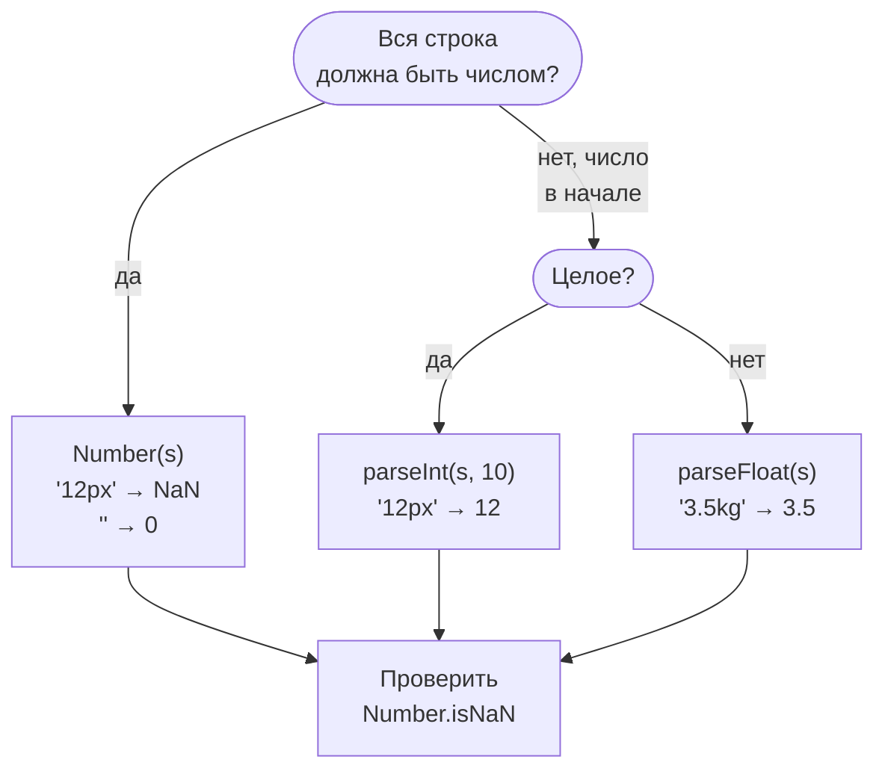
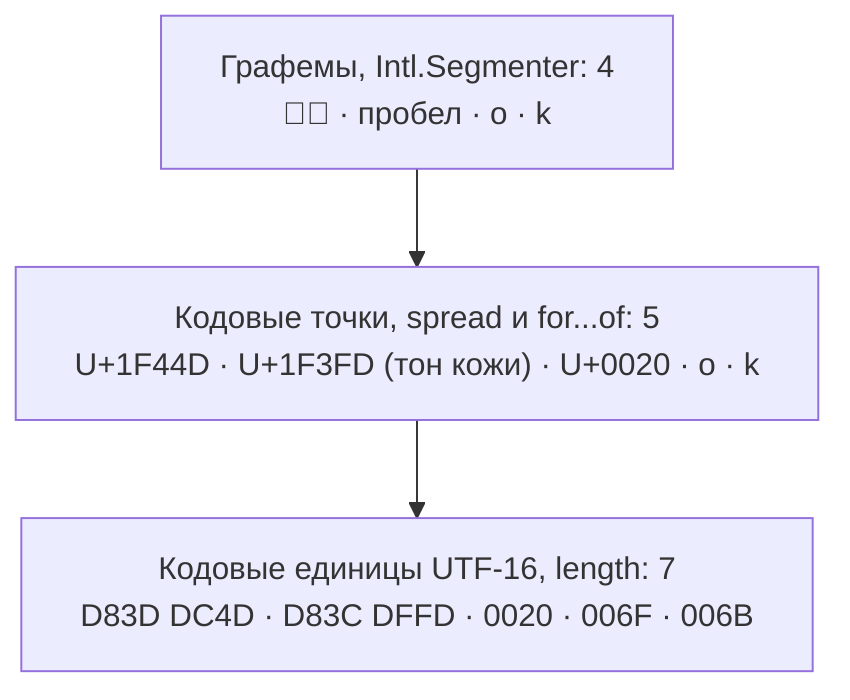
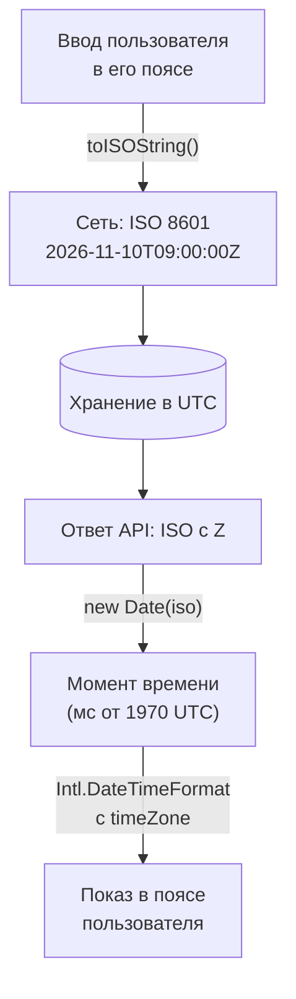

## О чём урок

Числа, строки и даты: где JavaScript ведёт себя неочевидно и что спрашивают на собеседованиях. Здесь точность чисел с плавающей точкой и `BigInt`, преобразование строк в числа, длина строки с эмодзи, ловушки `Date`, форматирование через `Intl` и статус `Temporal`.

## Числа: двоичная плавающая точка

Тип `number` это 64-битное число с плавающей точкой (IEEE 754). Десятичные дроби вроде 0.1 в двоичной системе бесконечны и хранятся с округлением:

```js run
console.log(0.1 + 0.2, 0.1 + 0.2 === 0.3)
console.log(Math.abs(0.1 + 0.2 - 0.3) < Number.EPSILON)
console.log((1.005).toFixed(2), Math.round(1.005 * 100) / 100)
console.log(Number.MAX_SAFE_INTEGER, 2 ** 53 === 2 ** 53 + 1)
console.log(9007199254740993n + 1n, typeof 1n)
try {
  1n + 1
} catch (e) {
  console.log(e.message)
}
```

```output
0.30000000000000004 false
true
1.00 1
9007199254740991 true
9007199254740994n bigint
Cannot mix BigInt and other types, use explicit conversions
```

- Сравнивают с допуском (`Number.EPSILON` годится для чисел около единицы, для больших значений допуск берут относительный).
- `1.005` хранится как `1.00499999…`, поэтому `toFixed(2)` даёт `"1.00"`. **Деньги** считают в целых минимальных единицах (копейки, центы) или десятичной библиотекой, а округляют для показа через `Intl.NumberFormat`.
- Целые числа точны до `Number.MAX_SAFE_INTEGER` (2⁵³ − 1). Идентификаторы из 64-битных баз данных приходят строками, иначе потеряют точность при `JSON.parse`.
- `BigInt` (`10n`) хранит целые любой длины, но не смешивается с `number` без явного `Number()` или `BigInt()`, не работает с `Math` и не сериализуется в JSON по умолчанию.
- `NaN` не равен сам себе; проверка через `Number.isNaN`. Глобальная `isNaN` сначала приводит аргумент к числу: `isNaN('abc')` даёт `true`.

## Строка в число

```js run
console.log(Number(''), Number(' 12 '), Number('12px'), Number(null), Number(undefined))
console.log(parseInt('12px'), parseFloat('3.5e2kg'), parseInt('0x1F'), parseInt('1e3'))
console.log(['1', '2', '3'].map(parseInt))
console.log(['1', '2', '3'].map(Number))
```

```output
0 12 NaN 0 NaN
12 350 31 1
[ 1, NaN, NaN ]
[ 1, 2, 3 ]
```

Строка в число, какую функцию выбрать:



- `Number()` и унарный `+` требуют, чтобы вся строка была числом (пробелы по краям допустимы), а пустая строка превращается в `0`.
- `parseInt` и `parseFloat` читают число с начала строки и останавливаются на первом лишнем символе. `parseInt` всегда вызывают с основанием: `parseInt(s, 10)`.
- `['1','2','3'].map(parseInt)` классический вопрос: `map` передаёт `(значение, индекс)`, и индекс становится основанием системы счисления. `parseInt('2', 1)` и `parseInt('3', 2)` дают `NaN`.

## Строки и Юникод

Строки неизменяемы: методы возвращают новую строку. Внутри это последовательность 16-битных кодовых единиц UTF-16, поэтому символы вне базовой плоскости (эмодзи, часть иероглифов) занимают две единицы.

```js run
const s = '👍🏽 ok'
console.log(s.length, [...s].length)
const family = '👨‍👩‍👧'
console.log(family.length, [...family].length, [...new Intl.Segmenter('en', { granularity: 'grapheme' }).segment(family)].length)
console.log('é' === 'é', 'é'.normalize() === 'é'.normalize())
console.log(['ёж', 'яблоко', 'еда'].sort(), ['ёж', 'яблоко', 'еда'].sort(new Intl.Collator('ru').compare))
```

```output
7 5
8 5 1
false true
[ 'еда', 'яблоко', 'ёж' ] [ 'еда', 'ёж', 'яблоко' ]
```

Одна строка на трёх уровнях: кодовые единицы UTF-16 (`length`), кодовые точки (spread, `for...of`) и графемы, то есть видимые символы (`Intl.Segmenter`):



- `length` считает кодовые единицы. Spread и `for...of` идут по кодовым точкам, но «видимый символ» (графема) может состоять из нескольких точек: эмодзи семьи, флаги, буква с диакритикой. Для подсчёта видимых символов и обрезки текста нужен `Intl.Segmenter`.
- Одна и та же буква может быть записана разными последовательностями; перед сравнением строки нормализуют `normalize()`.
- `sort()` без функции сравнивает кодовые единицы, поэтому «ё» оказывается после «я». Для пользовательских списков нужен `localeCompare` или `Intl.Collator`.
- Шаблонные строки `` `Hello, ${name}` `` подставляют выражения; тегированные шаблоны (`` html`...` ``, `String.raw`) передают части строки и значения в функцию, так работают библиотеки экранирования и CSS-in-JS.

## Даты

`Date` хранит момент времени как число миллисекунд от 1970-01-01 UTC, а методы без `UTC` в имени показывают его в часовом поясе устройства. Классические ловушки:

```js run
const d = new Date(2026, 0, 31) // months are 0-based: January
d.setMonth(1) // February 31 does not exist
console.log(d.getMonth(), d.getDate())

console.log(new Date('2026-11-10').toISOString()) // date-only string: UTC midnight
console.log(new Date('2026-11-10T00:00').getHours()) // date-time without offset: local time

const start = new Date(2026, 10, 10)
const copy = start
copy.setDate(20) // Date is mutable: both variables see it
console.log(start.getDate())
```

```output
2 3
2026-11-10T00:00:00.000Z
0
20
```

Как дата проходит через приложение без ошибок часовых поясов:



- Месяцы с нуля, а несуществующие даты «переливаются» в следующий месяц: 31 февраля стало 3 марта.
- Строка только с датой разбирается как UTC, строка с датой и временем без смещения как местное время. Пользователь западнее Гринвича увидит `new Date('2026-11-10')` как 9 ноября.
- `Date` изменяемый: передали в функцию, а она поменяла дату у вызывающего кода.
- По сети даты передают в ISO 8601 с `Z` или смещением, хранят в UTC, а в местное время переводят только при показе.

## Intl: форматирование под язык

`Intl` форматирует числа, даты, списки и множественное число по правилам языка, без библиотек:

```js run
const show = (s) => s.replace(/\s/g, ' ') // Intl uses non-breaking spaces
console.log(show(new Intl.NumberFormat('ru-RU', { style: 'currency', currency: 'RUB' }).format(1234.5)))
console.log(new Intl.NumberFormat('en-US', { notation: 'compact' }).format(1_250_000))
console.log(show(new Intl.DateTimeFormat('ru-RU', { dateStyle: 'long', timeZone: 'UTC' }).format(new Date('2026-11-10'))))
console.log(new Intl.RelativeTimeFormat('ru', { numeric: 'auto' }).format(-1, 'day'))
const rules = new Intl.PluralRules('ru')
console.log([1, 3, 5, 21].map((n) => rules.select(n)))
console.log(new Intl.ListFormat('en', { type: 'conjunction' }).format(['Ann', 'Bob', 'Eve']))
```

```output
1 234,50 ₽
1.3M
10 ноября 2026 г.
вчера
[ 'one', 'few', 'many', 'one' ]
Ann, Bob, and Eve
```

`Intl.PluralRules` возвращает категорию (`one`, `few`, `many`, `other`), а слово для каждой категории берут из словаря переводов: в русском «1 файл, 3 файла, 5 файлов, 21 файл». Объекты `Intl` дорого создавать, их создают один раз и переиспользуют.

## Temporal

`Temporal` это новый встроенный API дат и времени, который исправляет недостатки `Date`: неизменяемые объекты, отдельные типы для даты без времени (`PlainDate`), времени, момента (`Instant`) и даты с часовым поясом (`ZonedDateTime`), арифметика с учётом календаря и переходов на летнее время. На ноябрь 2026 он есть в Chrome 144+ и Firefox 139+, а в Safari только в предварительной версии, поэтому в продакшене его используют с полифилом или ждут Baseline. До этого для сложной работы с датами берут `date-fns` или `Day.js`.

## Главное

- `0.1 + 0.2 !== 0.3`: числа сравнивают с допуском, деньги считают в минимальных единицах.
- Целые точны до 2⁵³ − 1; больше хранят в `BigInt` или строках.
- `Number()` строгий, `parseInt` читает префикс; `parseInt` всегда с основанием, `map(parseInt)` даёт `NaN`.
- `length` считает единицы UTF-16; видимые символы считает `Intl.Segmenter`, сортирует по-русски `Intl.Collator`.
- `Date`: месяцы с нуля, переполнение дат, строка без времени это UTC, объект изменяемый.
- `Intl` форматирует числа, даты и множественное число; `Temporal` ещё не во всех браузерах.
