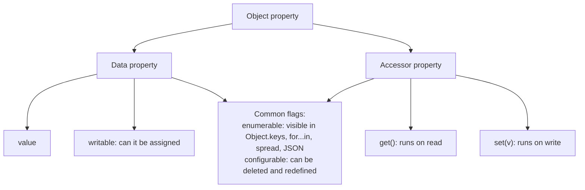
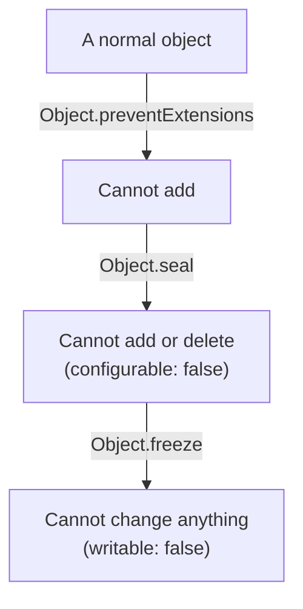
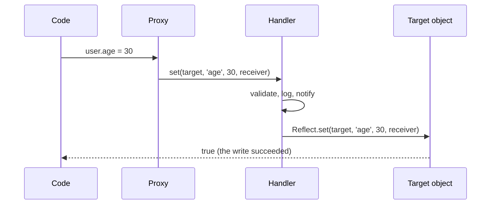

## What this lesson covers

What an object really stores: every property has a descriptor with flags, properties are either data or accessors (a getter and a setter), keys come in a defined order, and an object can be partly or fully protected from changes. At the end, `Symbol` keys and `Proxy` with `Reflect`, on which Vue and MobX reactivity is built.

## Property descriptors

A property is not just a "key: value" pair. It has a **descriptor** of one of two kinds:



Properties created by plain assignment or a literal get all flags `true`. With `Object.defineProperty` every flag defaults to `false`, and that is a common trap:

```js run
const user = { name: 'Ann' }
Object.defineProperty(user, 'id', { value: 7 }) // writable, enumerable, configurable: false

console.log(Object.getOwnPropertyDescriptor(user, 'name'))
console.log(Object.keys(user), JSON.stringify(user), user.id)
try {
  user.id = 8 // modules are strict: a silent failure becomes an error
} catch (e) {
  console.log(e.message)
}
```

```output
{ value: 'Ann', writable: true, enumerable: true, configurable: true }
[ 'name' ] {"name":"Ann"} 7
Cannot assign to read only property 'id' of object '#<Object>'
```

A non-enumerable (`enumerable: false`) property exists and can be read, but `Object.keys`, `for...in`, spread and `JSON.stringify` do not see it. Built-in methods work this way: an object has `toString`, but it is not in `Object.keys`. The full list of own keys, non-enumerable and symbol ones included, comes from `Reflect.ownKeys(obj)`.

## Getters and setters

An accessor looks like a normal property but calls functions on read and write. Use them for derived values and to validate writes:

```js run
const temp = {
  celsius: 20,
  get fahrenheit() {
    return this.celsius * 1.8 + 32
  },
  set fahrenheit(f) {
    if (typeof f !== 'number') throw new TypeError('number expected')
    this.celsius = (f - 32) / 1.8
  },
}
temp.fahrenheit = 212
console.log(temp.celsius, temp.fahrenheit)

const copy = { ...temp } // spread calls the getter and copies its value
console.log(Object.getOwnPropertyDescriptor(copy, 'fahrenheit'))
const clone = Object.defineProperties({}, Object.getOwnPropertyDescriptors(temp))
console.log(typeof Object.getOwnPropertyDescriptor(clone, 'fahrenheit').get)
```

```output
100 212
{ value: 212, writable: true, enumerable: true, configurable: true }
function
```

Spread and `Object.assign` copy **values**: the getter runs once, and the copy gets a plain property. To copy the accessors themselves (and non-enumerable properties), copy the descriptors: `Object.defineProperties({}, Object.getOwnPropertyDescriptors(obj))`, or with the prototype via `Object.create(Object.getPrototypeOf(obj), descriptors)`.

## Key order

The order is defined by the specification, and interviews ask about it:

```js run
const o = { b: 1, 2: 'two', a: 2, 1: 'one', [Symbol('s')]: 3, '-1': 'minus' }
console.log(Object.keys(o))
console.log(Reflect.ownKeys(o).length)
```

```output
[ '1', '2', 'b', 'a', '-1' ]
6
```

First index-like keys (non-negative integers as strings) in ascending order, then other strings in insertion order, then symbols. Numeric keys are always strings: `o[1]` and `o['1']` are the same. If you need insertion order for any keys, use a `Map`.

## Protecting an object



| Method | Add | Delete | Change a value | Check |
|---|---|---|---|---|
| `Object.preventExtensions` | no | yes | yes | `Object.isExtensible` |
| `Object.seal` | no | no | yes | `Object.isSealed` |
| `Object.freeze` | no | no | no | `Object.isFrozen` |

- All three work on one level. A deep freeze is written with recursion:

```js run
function deepFreeze(obj) {
  for (const key of Reflect.ownKeys(obj)) {
    const value = obj[key]
    if (value && typeof value === 'object' && !Object.isFrozen(value)) deepFreeze(value)
  }
  return Object.freeze(obj)
}
const config = deepFreeze({ api: { url: '/v1', retry: { count: 3 } } })
try {
  config.api.retry.count = 5
} catch (e) {
  console.log(e.constructor.name)
}
console.log(config.api.retry.count, Object.isFrozen(config.api.retry))
```

```output
TypeError
3 true
```

- In strict mode (modules, classes) a write to a protected object throws a `TypeError`; in sloppy mode it is silently ignored.
- `const` protects the variable, not the object; `freeze` protects the object, not the variable.
- Freezing does not make an object "faster"; it protects configuration, constants and state in development (Immer freezes its results this way). Immutable state updates use copies (`{ ...state, x }`, `toSorted`, `structuredClone`).

## Symbol keys

`Symbol()` creates a unique value. A symbol key never clashes with other properties and does not show up in `Object.keys`, `for...in` or JSON. `Symbol.for('app.id')` takes a symbol from the global registry: the same one for the same string.

**Well-known symbols** hook into the language: `Symbol.iterator` makes an object iterable (the iterators lesson), `Symbol.toPrimitive` controls conversion to a primitive, `Symbol.toStringTag` changes the output of `Object.prototype.toString`, `Symbol.asyncIterator` is needed for `for await`.

```js run
const money = {
  amount: 42,
  [Symbol.toPrimitive](hint) {
    return hint === 'number' ? this.amount : `${this.amount} USD`
  },
}
console.log(+money, `${money}`, money + 1)
console.log(Symbol('id') === Symbol('id'), Symbol.for('id') === Symbol.for('id'))
```

```output
42 42 USD 42 USD1
false true
```

`money + 1` converts with the `default` hint, so the string branch ran.

## Proxy and Reflect

A `Proxy` wraps an object and intercepts operations on it: reading, writing, `in`, `delete`, listing keys, calling a function. `Reflect` holds the same operations as functions and performs the default behavior.



```js run
function validated(target, rules) {
  return new Proxy(target, {
    set(obj, key, value, receiver) {
      const rule = rules[key]
      if (rule && !rule(value)) throw new TypeError(`invalid ${String(key)}: ${value}`)
      console.log(`set ${String(key)}`)
      return Reflect.set(obj, key, value, receiver) // default behavior
    },
    has: (obj, key) => !String(key).startsWith('_') && key in obj,
  })
}

const user = validated({ name: 'Ann', _secret: 1 }, { age: (v) => Number.isInteger(v) && v >= 0 })
user.age = 30
try {
  user.age = -1
} catch (e) {
  console.log(e.message)
}
console.log('_secret' in user, user.age)

class Counter {
  #n = 0
  inc() {
    return ++this.#n
  }
}
try {
  new Proxy(new Counter(), {}).inc()
} catch (e) {
  console.log(e.constructor.name)
}
```

```output
set age
invalid age: -1
false 30
TypeError
```

- Traps match internal operations: `get`, `set`, `has`, `deleteProperty`, `ownKeys`, `getOwnPropertyDescriptor`, `defineProperty`, `apply`, `construct` and others. Return results through `Reflect.*` with the same arguments: that keeps getters, inheritance and the `receiver` working.
- Where it is used: Vue 3 reactivity (`reactive` is a `Proxy`, the `get` trap records a dependency, `set` triggers an update), MobX 7, Immer (a draft of changes), validation and logging, mocks in tests.
- Limits: a proxy is a different object (`proxy !== target`), private `#x` fields are not reachable through a proxy (class methods throw a `TypeError`, as in the example), built-ins with internal slots (`Map`, `Date`) need methods bound to the original object. Every operation goes through a function, so a proxy is slower than a plain object on hot paths.

## Key points

- A property has a descriptor: a value with `writable` or an accessor with `get`/`set`, plus `enumerable` and `configurable`.
- `defineProperty` sets every flag to `false` by default; non-enumerable properties are invisible to `keys`, spread and JSON.
- Spread copies getter values; accessors are copied through `getOwnPropertyDescriptors`.
- Key order: indexes ascending, strings by insertion, then symbols.
- `preventExtensions` < `seal` < `freeze`, all shallow; write errors show up in strict mode.
- `Symbol` for unique keys and hooks into the language (`Symbol.iterator`, `Symbol.toPrimitive`).
- `Proxy` intercepts operations, `Reflect` performs the defaults; this is how Vue and MobX reactivity works.
