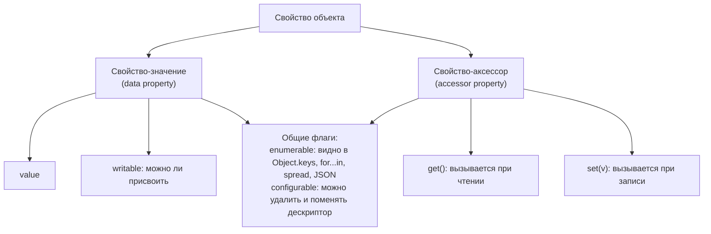
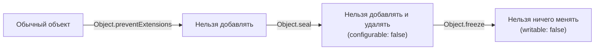
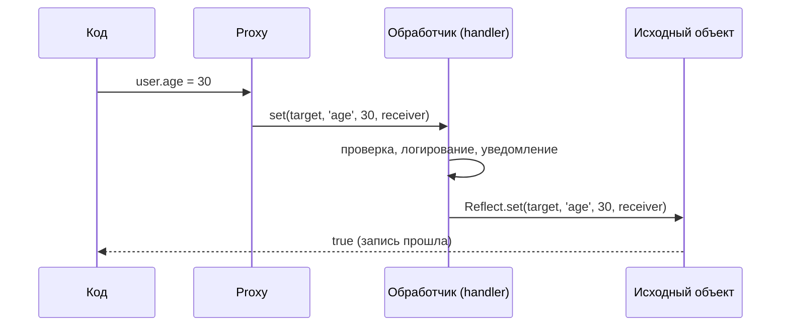

## О чём урок

Что на самом деле хранит объект: у каждого свойства есть дескриптор с флагами, свойства бывают значениями и аксессорами (геттер и сеттер), ключи идут в определённом порядке, а объект можно частично или полностью защитить от изменений. В конце `Symbol`-ключи и `Proxy` с `Reflect`, на которых построена реактивность Vue и MobX.

## Дескрипторы свойств

Свойство это не просто пара «ключ: значение». У него есть **дескриптор** одного из двух видов:



Свойства, созданные обычным присваиванием или литералом, получают все флаги `true`. У `Object.defineProperty` все флаги по умолчанию `false`, и это частая ловушка:

```js run
const user = { name: 'Ann' }
Object.defineProperty(user, 'id', { value: 7 }) // writable, enumerable, configurable: false

console.log(Object.getOwnPropertyDescriptor(user, 'name'))
console.log(Object.keys(user), JSON.stringify(user), user.id)
try {
  user.id = 8 // modules are strict: a silent failure becomes an error
} catch (e) {
  console.log(e.message)
}
```

```output
{ value: 'Ann', writable: true, enumerable: true, configurable: true }
[ 'name' ] {"name":"Ann"} 7
Cannot assign to read only property 'id' of object '#<Object>'
```

Несчётное (`enumerable: false`) свойство существует и читается, но его не видят `Object.keys`, `for...in`, spread и `JSON.stringify`. Так устроены встроенные методы: `toString` у объекта есть, но в `Object.keys` его нет. Полный список собственных ключей, включая несчётные и символьные, даёт `Reflect.ownKeys(obj)`.

## Геттеры и сеттеры

Аксессор выглядит как обычное свойство, но при чтении и записи вызывает функции. Им вычисляют производные значения и проверяют запись:

```js run
const temp = {
  celsius: 20,
  get fahrenheit() {
    return this.celsius * 1.8 + 32
  },
  set fahrenheit(f) {
    if (typeof f !== 'number') throw new TypeError('number expected')
    this.celsius = (f - 32) / 1.8
  },
}
temp.fahrenheit = 212
console.log(temp.celsius, temp.fahrenheit)

const copy = { ...temp } // spread calls the getter and copies its value
console.log(Object.getOwnPropertyDescriptor(copy, 'fahrenheit'))
const clone = Object.defineProperties({}, Object.getOwnPropertyDescriptors(temp))
console.log(typeof Object.getOwnPropertyDescriptor(clone, 'fahrenheit').get)
```

```output
100 212
{ value: 212, writable: true, enumerable: true, configurable: true }
function
```

Spread и `Object.assign` копируют **значения**: геттер вызывается один раз, и копия получает обычное свойство. Чтобы скопировать сами аксессоры (и несчётные свойства), копируют дескрипторы: `Object.defineProperties({}, Object.getOwnPropertyDescriptors(obj))` или с прототипом через `Object.create(Object.getPrototypeOf(obj), descriptors)`.

## Порядок ключей

Порядок определён спецификацией, и его спрашивают:

```js run
const o = { b: 1, 2: 'two', a: 2, 1: 'one', [Symbol('s')]: 3, '-1': 'minus' }
console.log(Object.keys(o))
console.log(Reflect.ownKeys(o).length)
```

```output
[ '1', '2', 'b', 'a', '-1' ]
6
```

Сначала ключи-индексы (целые неотрицательные числа в виде строк) по возрастанию, затем остальные строки в порядке добавления, затем символы. Числовые ключи всегда строки: `o[1]` и `o['1']` одно и то же. Если нужен порядок вставки для любых ключей, берут `Map`.

## Защита объекта



| Метод | Добавить | Удалить | Изменить значение | Проверка |
|---|---|---|---|---|
| `Object.preventExtensions` | нет | да | да | `Object.isExtensible` |
| `Object.seal` | нет | нет | да | `Object.isSealed` |
| `Object.freeze` | нет | нет | нет | `Object.isFrozen` |

- Все три работают на одном уровне. Глубокую заморозку пишут рекурсией:

```js run
function deepFreeze(obj) {
  for (const key of Reflect.ownKeys(obj)) {
    const value = obj[key]
    if (value && typeof value === 'object' && !Object.isFrozen(value)) deepFreeze(value)
  }
  return Object.freeze(obj)
}
const config = deepFreeze({ api: { url: '/v1', retry: { count: 3 } } })
try {
  config.api.retry.count = 5
} catch (e) {
  console.log(e.constructor.name)
}
console.log(config.api.retry.count, Object.isFrozen(config.api.retry))
```

```output
TypeError
3 true
```

- В строгом режиме (модули, классы) запись в защищённый объект бросает `TypeError`, в нестрогом молча игнорируется.
- `const` защищает переменную, а не объект; `freeze` защищает объект, а не переменную.
- Заморозка не делает объект «быстрее» и применяется для защиты конфигурации, констант и состояния в режиме разработки (так Immer замораживает результат). Для неизменяемых обновлений состояния используют копии (`{ ...state, x }`, `toSorted`, `structuredClone`).

## Symbol-ключи

`Symbol()` создаёт уникальное значение. Символьный ключ не пересечётся с чужими свойствами и не попадёт в `Object.keys`, `for...in` и JSON. `Symbol.for('app.id')` берёт символ из глобального реестра: один и тот же для одинаковой строки.

**Известные символы** (well-known symbols) позволяют встроиться в поведение языка: `Symbol.iterator` делает объект перебираемым (урок об итераторах), `Symbol.toPrimitive` управляет приведением к примитиву, `Symbol.toStringTag` меняет вывод `Object.prototype.toString`, `Symbol.asyncIterator` нужен для `for await`.

```js run
const money = {
  amount: 42,
  [Symbol.toPrimitive](hint) {
    return hint === 'number' ? this.amount : `${this.amount} USD`
  },
}
console.log(+money, `${money}`, money + 1)
console.log(Symbol('id') === Symbol('id'), Symbol.for('id') === Symbol.for('id'))
```

```output
42 42 USD 42 USD1
false true
```

`money + 1` вызывает приведение с подсказкой `default`, поэтому сработала строковая ветка.

## Proxy и Reflect

`Proxy` оборачивает объект и перехватывает операции над ним: чтение, запись, `in`, `delete`, перечисление ключей, вызов функции. `Reflect` содержит те же операции в виде функций и выполняет поведение по умолчанию.



```js run
function validated(target, rules) {
  return new Proxy(target, {
    set(obj, key, value, receiver) {
      const rule = rules[key]
      if (rule && !rule(value)) throw new TypeError(`invalid ${String(key)}: ${value}`)
      console.log(`set ${String(key)}`)
      return Reflect.set(obj, key, value, receiver) // default behavior
    },
    has: (obj, key) => !String(key).startsWith('_') && key in obj,
  })
}

const user = validated({ name: 'Ann', _secret: 1 }, { age: (v) => Number.isInteger(v) && v >= 0 })
user.age = 30
try {
  user.age = -1
} catch (e) {
  console.log(e.message)
}
console.log('_secret' in user, user.age)

class Counter {
  #n = 0
  inc() {
    return ++this.#n
  }
}
try {
  new Proxy(new Counter(), {}).inc()
} catch (e) {
  console.log(e.constructor.name)
}
```

```output
set age
invalid age: -1
false 30
TypeError
```

- Ловушки (traps) соответствуют внутренним операциям: `get`, `set`, `has`, `deleteProperty`, `ownKeys`, `getOwnPropertyDescriptor`, `defineProperty`, `apply`, `construct` и другие. Возвращать результат удобнее через `Reflect.*` с теми же аргументами: так сохраняются геттеры, наследование и `receiver`.
- Где используется: реактивность Vue 3 (`reactive` это `Proxy`, ловушка `get` запоминает зависимость, `set` запускает обновление), MobX 7, Immer (черновик изменений), валидация и логирование, моки в тестах.
- Ограничения: прокси это другой объект (`proxy !== target`), приватные поля `#x` через прокси недоступны (методы класса бросают `TypeError`, как в примере), встроенные объекты с внутренними слотами (`Map`, `Date`) требуют привязки методов к исходному объекту. Каждая операция идёт через функцию, поэтому прокси медленнее обычного объекта на горячих путях.

## Главное

- У свойства есть дескриптор: значение с `writable` или аксессор с `get`/`set`, плюс `enumerable` и `configurable`.
- `defineProperty` по умолчанию ставит все флаги в `false`; несчётные свойства не видны в `keys`, spread и JSON.
- Spread копирует значения геттеров; аксессоры копируют через `getOwnPropertyDescriptors`.
- Порядок ключей: индексы по возрастанию, строки по добавлению, символы.
- `preventExtensions` < `seal` < `freeze`, все поверхностные; ошибки записи видны в строгом режиме.
- `Symbol` для уникальных ключей и встраивания в язык (`Symbol.iterator`, `Symbol.toPrimitive`).
- `Proxy` перехватывает операции, `Reflect` выполняет их по умолчанию; так работает реактивность Vue и MobX.
