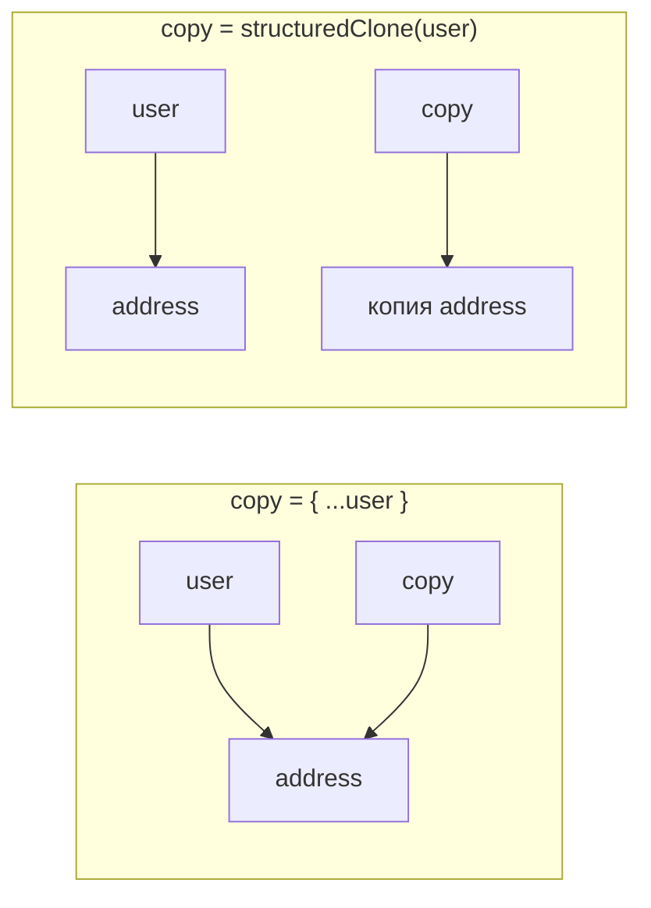

## О чём урок

В [первом уроке](/learn/js-types) мы выяснили, что объекты передаются по ссылке. Отсюда практические вопросы: как скопировать объект, как запретить его менять и когда брать `Map` вместо обычного объекта.

## Поверхностная копия

Поверхностная копия создаёт новый объект верхнего уровня, но вложенные объекты остаются общими; глубокая копирует всё дерево:



Spread (`{ ...obj }`, `[...arr]`) и `Object.assign()` копируют только верхний уровень. Вложенные объекты остаются общими: копируется ссылка на них.

```js run
const original = { name: "Ann", address: { city: "Paris" } }
const shallow = { ...original }
shallow.name = "Bob"
shallow.address.city = "Rome"
console.log(original.name, original.address.city)
```

```output
Ann Rome
```

Для неизменяемых обновлений состояния (React, Redux) этого обычно достаточно: вы копируете ровно те уровни, которые меняете, `{ ...state, address: { ...state.address, city: "Rome" } }`, а неизменённые части переиспользуются.

## Глубокая копия

Встроенный способ это `structuredClone()`. Он копирует вложенные объекты и массивы, `Date`, `RegExp`, `Map`, `Set`, типизированные массивы и даже циклические ссылки. Не копирует функции и DOM-узлы: на них бросает `DataCloneError`. У экземпляров классов теряется прототип, получается обычный объект.

Старый приём `JSON.parse(JSON.stringify(obj))` работает только для простых данных: даты превращаются в строки, `Map` и `Set` в пустые объекты, `undefined` и функции пропадают, а `BigInt` и циклические ссылки вызывают ошибку.

```js run
const event = { title: "Meetup", when: new Date(Date.UTC(2026, 0, 15)), tags: new Set(["js"]) }
const viaJson = JSON.parse(JSON.stringify(event))
const viaClone = structuredClone(event)
console.log(typeof viaJson.when, JSON.stringify(viaJson.tags))
console.log(viaClone.when instanceof Date, viaClone.tags.has("js"))
try {
  structuredClone({ run() {} })
} catch (e) {
  console.log(e.name)
}
```

```output
string {}
true true
DataCloneError
```

## Неизменяемость

`const` защищает только переменную: её нельзя переприсвоить, но объект по ссылке менять можно. Чтобы запретить изменения самого объекта, есть три уровня:

| Метод | Добавлять | Удалять | Менять значения |
|---|---|---|---|
| `Object.preventExtensions()` | нет | да | да |
| `Object.seal()` | нет | нет | да |
| `Object.freeze()` | нет | нет | нет |

Все три поверхностные: вложенные объекты остаются изменяемыми. В строгом режиме попытка изменить замороженный объект бросает `TypeError`, в нестрогом молча игнорируется.

```js run
const config = Object.freeze({ port: 80, db: { host: "a" } })
try {
  config.port = 8080
} catch (e) {
  console.log(e.name)
}
config.db.host = "b"
console.log(config.port, config.db.host, Object.isFrozen(config.db))
```

```output
TypeError
80 b false
```

## Map и Set вместо объекта

Обычный объект хорош как запись с заранее известными полями и для JSON. Для словаря, куда ключи добавляются во время работы, лучше подходит `Map`:

- ключом может быть любое значение, в том числе объект (ключи объекта всегда строки или символы);
- есть `size`, порядок обхода равен порядку вставки;
- нет унаследованных ключей: в обычном объекте `"toString" in {}` истинно, потому что `toString` есть в прототипе.

```js run
const visits = new Map()
const page = { url: "/home" }
visits.set(page, 3).set("total", 10)
console.log(visits.get(page), visits.size, visits.has("toString"))
const dict = {}
console.log("toString" in dict)
```

```output
3 2 false
true
```

`Set` хранит уникальные значения: `[...new Set(arr)]` убирает дубликаты из массива.

Как память освобождается и утекает, а также `WeakMap`, `WeakRef` и `FinalizationRegistry` разобраны в [уроке о памяти](/learn/js-memory).

## Главное

- Spread и `Object.assign` копируют один уровень; `structuredClone()` копирует глубоко, но без функций и прототипов.
- `JSON.parse(JSON.stringify())` теряет даты, `Map`, `Set`, `undefined` и падает на циклах и `BigInt`.
- `const` не делает объект неизменяемым; `Object.freeze()` делает, но только поверхностно.
- `Map` для словарей с динамическими ключами, обычный объект для записей и JSON.
