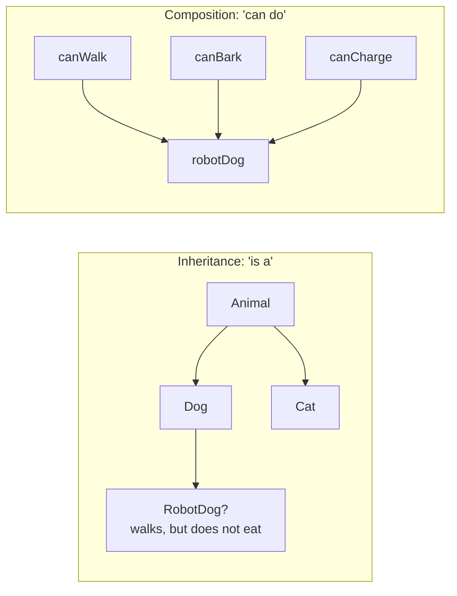
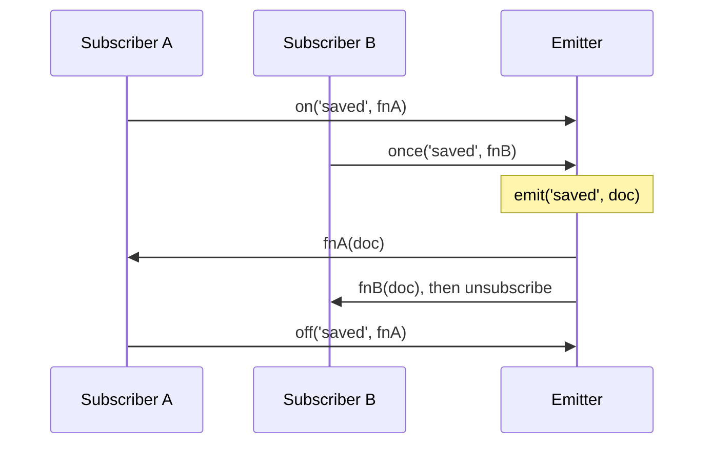

## What this lesson covers

Patterns found in every front-end project and asked about in interviews: mixins, the observer (EventEmitter and `EventTarget`), module and singleton, factory, decorator and strategy. For each: what problem it solves, what it looks like in modern JavaScript and where its limits are.

## Composition vs inheritance



A class hierarchy fixes "who is what" and breaks on the first object that does not fit the tree. Composition assembles an object from independent abilities. Mixins, React hooks and Vue composables are all composition.

## Mixins

A mixin adds a set of methods to an object or a class without inheritance. Two flavors:

```js run
// 1. Object mixin: copy methods into a prototype
const serializable = {
  toJSONString() {
    return JSON.stringify(this)
  },
}

// 2. Class mixin: a function from a base class to an extended class
const WithTimestamps = (Base) =>
  class extends Base {
    touch() {
      this.updatedAt = '2026-11-10'
      return this
    }
  }

class Model {
  constructor(id) {
    this.id = id
  }
}
class User extends WithTimestamps(Model) {}
Object.assign(User.prototype, serializable)

const u = new User(7).touch()
console.log(u.toJSONString(), u instanceof Model)

const withGetter = { get now() { return 'computed' } }
const copied = Object.assign({}, withGetter)
const desc = Object.getOwnPropertyDescriptor(copied, 'now')
console.log('getter kept:', typeof desc.get === 'function', '| value:', desc.value)
```

```output
{"id":7,"updatedAt":"2026-11-10"} true
getter kept: false | value: computed
```

- A class mixin (`WithTimestamps(Base)`) joins the prototype chain: `super`, `instanceof` of the base class and static methods work.
- `Object.assign` copies **values**: the getter runs once, and the copy gets a plain property (see the second output line). To keep getters, copy descriptors (the object properties lesson).
- Downsides: name clashes (the last mixin silently overwrites a method), unclear origin of methods, harder debugging. That is why Vue 3 replaced mixins with composables, and React dropped `mixins` long ago in favor of hooks: a function with an explicit return is visible as a whole.

## Observer: EventEmitter and EventTarget

The observer (pub/sub) lets an object notify subscribers without knowing them. It underlies DOM events, stores, RxJS and WebSocket clients.



```js run
class Emitter {
  #handlers = new Map() // event → Set of handlers

  on(event, handler) {
    if (!this.#handlers.has(event)) this.#handlers.set(event, new Set())
    this.#handlers.get(event).add(handler)
    return () => this.off(event, handler) // unsubscribe function
  }
  off(event, handler) {
    this.#handlers.get(event)?.delete(handler)
  }
  once(event, handler) {
    const off = this.on(event, (...args) => {
      off()
      handler(...args)
    })
    return off
  }
  emit(event, ...args) {
    for (const handler of [...(this.#handlers.get(event) ?? [])]) handler(...args) // copy: handlers may unsubscribe
  }
}

const bus = new Emitter()
const stop = bus.on('saved', (doc) => console.log('A got', doc))
bus.once('saved', (doc) => console.log('B got', doc))
bus.emit('saved', 1)
stop()
bus.emit('saved', 2)

const target = new EventTarget() // built in: browsers and Node.js
target.addEventListener('ping', (e) => console.log('EventTarget:', e.detail), { once: true })
target.dispatchEvent(new CustomEvent('ping', { detail: 'hi' }))
target.dispatchEvent(new CustomEvent('ping', { detail: 'again' }))
```

```output
A got 1
B got 1
EventTarget: hi
```

- `on` returns an unsubscribe function: convenient to return from `useEffect` or call in `onUnmounted`. A forgotten unsubscribe is a memory leak.
- `emit` walks a **copy** of the list: a subscriber may unsubscribe during the emit.
- The built-in `EventTarget` with `CustomEvent` exists in browsers and Node.js and supports `{ once, signal }`; a custom emitter is written when you need typed events or a synchronous return.
- A task with tests: [EventEmitter](/code/event-emitter).

## Module and singleton

An ES module runs once, and every import gets the same instance. So a singleton in JavaScript is just a module export:

```js
// api-client.js: one instance per JavaScript realm
export const api = createApiClient({ baseUrl: '/api' })
```

- Pros: no `getInstance()`, the state is hidden in the module's closure.
- Cons: global state gets in the way of tests (it must be reset between them) and is dangerous with SSR: a server serves many users in one process, and a module singleton becomes shared by all of them. That is why Pinia, Redux stores and the TanStack Query client are created per request, and frameworks use DI (Angular) or `provide`/context.

## Factory

A factory is a function that creates and returns an object. It hides creation details and gives real privacy through a closure, without `class` and `this`:

```js run
function createCounter({ step = 1 } = {}) {
  let value = 0 // private: reachable only through the returned methods
  return {
    increment: () => (value += step),
    get value() {
      return value
    },
  }
}
const c = createCounter({ step: 5 })
c.increment()
const { increment } = c // no `this`, so methods survive destructuring
increment()
console.log(c.value, 'value' in c, c.privateValue)
```

```output
10 true undefined
```

Factories create stores (`createStore`, `defineStore`), routers (`createRouter`), API clients. Classes win when there are very many objects (methods live in one prototype, not copied into each object) and when you need `instanceof`.

## Decorator

A decorator wraps a function and adds behavior without changing it: logging, caching, retries, rate limiting. `debounce`, `throttle`, `memoize`, `withRetry` and React HOCs are decorators.

```js run
function withLogging(fn) {
  return function (...args) {
    const result = fn.apply(this, args) // keep `this` and every argument
    console.log(`${fn.name}(${args.join(', ')}) = ${result}`)
    return result
  }
}
const add = withLogging(function add(a, b) {
  return a + b
})
add(2, 3)
```

```output
add(2, 3) = 5
```

As of November 2026 no browser supports the `@decorator` syntax for classes in JavaScript: the TC39 proposal is at stage 3. TypeScript compiles standard decorators since 5.0, and Angular uses its own experimental ones (`experimentalDecorators`).

## Strategy

A strategy picks an algorithm by key. In JavaScript it is an object or a `Map` of functions instead of a long `switch`:

```js run
const pricing = {
  regular: (sum) => sum,
  member: (sum) => sum * 0.9,
  blackFriday: (sum) => Math.max(sum - 50, 0),
}
const total = (sum, plan) => (pricing[plan] ?? pricing.regular)(sum)
console.log(total(200, 'member'), total(200, 'blackFriday'), total(200, 'unknown'))
```

```output
180 150 200
```

A new strategy is one more line, without touching the rest of the code. Form validators, action handlers in a reducer and routes work the same way.

## Key points

- Composing abilities is more flexible than a class hierarchy; mixins, hooks and composables are composition.
- A class mixin `(Base) => class extends Base` keeps `super` and `instanceof`; `Object.assign` loses getters. Name clashes are the main downside of mixins.
- Observer: `on` returns an unsubscribe, `emit` walks a copy; the built-in `EventTarget` with `CustomEvent`.
- A singleton is a module export; with SSR and in tests global state is dangerous.
- A factory gives privacy through a closure; a decorator wraps a function keeping `this` and the arguments; a strategy is a dictionary of functions.
