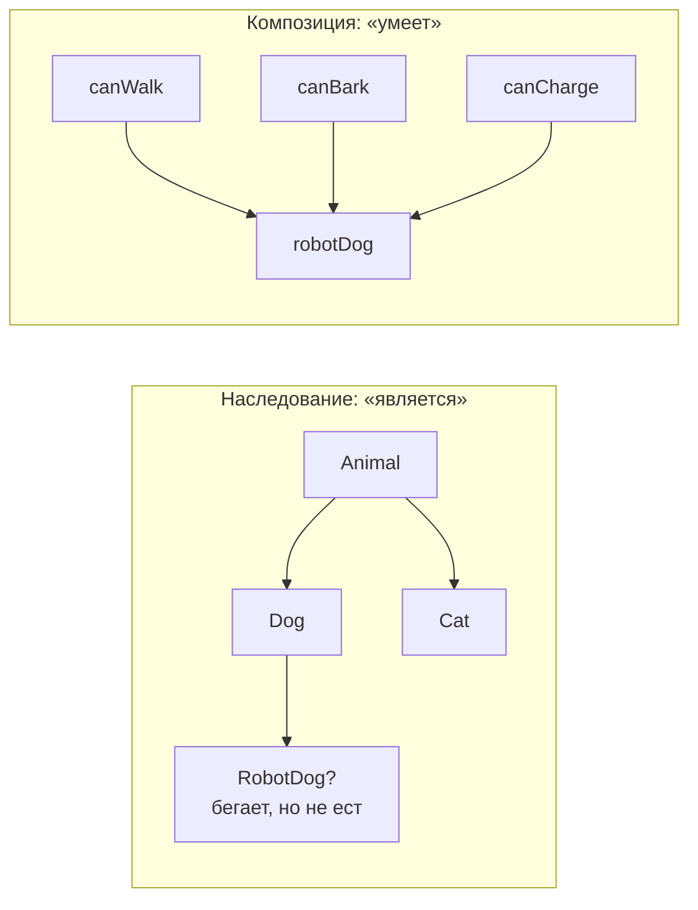
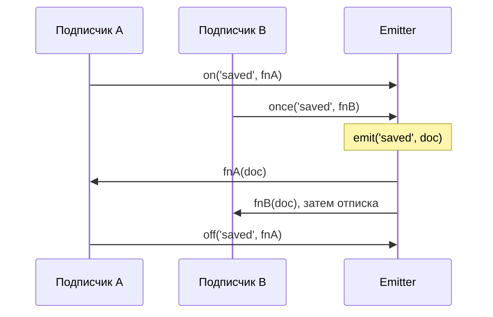

## О чём урок

Паттерны, которые встречаются в каждом фронтенд-проекте и о которых спрашивают на собеседованиях: миксины, наблюдатель (EventEmitter и `EventTarget`), модуль и синглтон, фабрика, декоратор и стратегия. Для каждого: какую задачу решает, как выглядит в современном JavaScript и где его ограничения.

## Композиция против наследования



Иерархия классов фиксирует, «кто есть кто», и ломается на первом объекте, который не вписывается в дерево. Композиция собирает объект из независимых умений. Миксины, хуки React и composables Vue это всё композиция.

## Миксины

Миксин добавляет набор методов в объект или класс без наследования. Два варианта:

```js run
// 1. Object mixin: copy methods into a prototype
const serializable = {
  toJSONString() {
    return JSON.stringify(this)
  },
}

// 2. Class mixin: a function from a base class to an extended class
const WithTimestamps = (Base) =>
  class extends Base {
    touch() {
      this.updatedAt = '2026-11-10'
      return this
    }
  }

class Model {
  constructor(id) {
    this.id = id
  }
}
class User extends WithTimestamps(Model) {}
Object.assign(User.prototype, serializable)

const u = new User(7).touch()
console.log(u.toJSONString(), u instanceof Model)

const withGetter = { get now() { return 'computed' } }
const copied = Object.assign({}, withGetter)
const desc = Object.getOwnPropertyDescriptor(copied, 'now')
console.log('getter kept:', typeof desc.get === 'function', '| value:', desc.value)
```

```output
{"id":7,"updatedAt":"2026-11-10"} true
getter kept: false | value: computed
```

- Миксин-класс (`WithTimestamps(Base)`) встраивается в цепочку прототипов: работают `super`, `instanceof` базового класса и статические методы.
- `Object.assign` копирует **значения**: геттер вызывается один раз, а копия получает обычное свойство (видно во второй строке вывода). Для геттеров копируют дескрипторы (урок о свойствах объектов).
- Минусы: конфликты имён (последний миксин молча перезаписывает метод), неявное происхождение методов, сложная отладка. Поэтому Vue 3 заменил миксины на composables, а React давно отказался от `mixins` в пользу хуков: функция с явным возвратом видна целиком.

## Наблюдатель: EventEmitter и EventTarget

Наблюдатель (observer, pub/sub) позволяет объекту оповещать подписчиков, не зная о них. Это основа событий DOM, сторов, RxJS и WebSocket-клиентов.



```js run
class Emitter {
  #handlers = new Map() // event → Set of handlers

  on(event, handler) {
    if (!this.#handlers.has(event)) this.#handlers.set(event, new Set())
    this.#handlers.get(event).add(handler)
    return () => this.off(event, handler) // unsubscribe function
  }
  off(event, handler) {
    this.#handlers.get(event)?.delete(handler)
  }
  once(event, handler) {
    const off = this.on(event, (...args) => {
      off()
      handler(...args)
    })
    return off
  }
  emit(event, ...args) {
    for (const handler of [...(this.#handlers.get(event) ?? [])]) handler(...args) // copy: handlers may unsubscribe
  }
}

const bus = new Emitter()
const stop = bus.on('saved', (doc) => console.log('A got', doc))
bus.once('saved', (doc) => console.log('B got', doc))
bus.emit('saved', 1)
stop()
bus.emit('saved', 2)

const target = new EventTarget() // built in: browsers and Node.js
target.addEventListener('ping', (e) => console.log('EventTarget:', e.detail), { once: true })
target.dispatchEvent(new CustomEvent('ping', { detail: 'hi' }))
target.dispatchEvent(new CustomEvent('ping', { detail: 'again' }))
```

```output
A got 1
B got 1
EventTarget: hi
```

- `on` возвращает функцию отписки: её удобно вернуть из `useEffect` или вызвать в `onUnmounted`. Забытая отписка это утечка памяти.
- `emit` обходит **копию** списка: подписчик может отписаться во время рассылки.
- Встроенный `EventTarget` с `CustomEvent` есть в браузерах и Node.js и умеет `{ once, signal }`; свой emitter пишут, когда нужны типизированные события или синхронный возврат.
- Задача с тестами: [EventEmitter](/code/event-emitter).

## Модуль и синглтон

ES-модуль выполняется один раз, и все импорты получают один и тот же экземпляр. Поэтому синглтон в JavaScript это просто экспорт из модуля:

```js
// api-client.js: one instance per JavaScript realm
export const api = createApiClient({ baseUrl: '/api' })
```

- Плюсы: никакого `getInstance()`, состояние спрятано в замыкании модуля.
- Минусы: глобальное состояние мешает тестам (его надо сбрасывать между ними) и опасно при SSR: сервер обслуживает много пользователей в одном процессе, и модульный синглтон станет общим для всех. Поэтому сторы Pinia, Redux и клиент TanStack Query создают на запрос, а во фреймворках используют DI (Angular) или `provide`/контекст.

## Фабрика

Фабрика это функция, которая создаёт и возвращает объект. Она прячет детали создания и даёт настоящую приватность через замыкание, без `class` и `this`:

```js run
function createCounter({ step = 1 } = {}) {
  let value = 0 // private: reachable only through the returned methods
  return {
    increment: () => (value += step),
    get value() {
      return value
    },
  }
}
const c = createCounter({ step: 5 })
c.increment()
const { increment } = c // no `this`, so methods survive destructuring
increment()
console.log(c.value, 'value' in c, c.privateValue)
```

```output
10 true undefined
```

Фабрики создают хранилища (`createStore`, `defineStore`), роутеры (`createRouter`), клиенты API. Классы выгоднее, когда объектов очень много (методы в одном прототипе, а не копия в каждом объекте) и нужен `instanceof`.

## Декоратор

Декоратор оборачивает функцию и добавляет поведение, не меняя её: логирование, кэш, повтор, ограничение частоты. `debounce`, `throttle`, `memoize`, `withRetry`, HOC в React это декораторы.

```js run
function withLogging(fn) {
  return function (...args) {
    const result = fn.apply(this, args) // keep `this` and every argument
    console.log(`${fn.name}(${args.join(', ')}) = ${result}`)
    return result
  }
}
const add = withLogging(function add(a, b) {
  return a + b
})
add(2, 3)
```

```output
add(2, 3) = 5
```

Синтаксис `@decorator` для классов в JavaScript на ноябрь 2026 не поддерживается ни одним браузером: предложение TC39 на стадии 3. TypeScript компилирует стандартные декораторы с версии 5.0, а Angular использует свои экспериментальные (`experimentalDecorators`).

## Стратегия

Стратегия выбирает алгоритм по ключу. В JavaScript это объект или `Map` функций вместо длинного `switch`:

```js run
const pricing = {
  regular: (sum) => sum,
  member: (sum) => sum * 0.9,
  blackFriday: (sum) => Math.max(sum - 50, 0),
}
const total = (sum, plan) => (pricing[plan] ?? pricing.regular)(sum)
console.log(total(200, 'member'), total(200, 'blackFriday'), total(200, 'unknown'))
```

```output
180 150 200
```

Новая стратегия добавляется одной строкой без правки остального кода. Так же устроены валидаторы форм, обработчики действий в редьюсере и маршруты.

## Главное

- Композиция умений гибче иерархии классов; миксины, хуки и composables это композиция.
- Миксин-класс `(Base) => class extends Base` сохраняет `super` и `instanceof`; `Object.assign` теряет геттеры. Конфликты имён главный минус миксинов.
- Наблюдатель: `on` возвращает отписку, `emit` обходит копию; встроенный `EventTarget` с `CustomEvent`.
- Синглтон это экспорт из модуля; при SSR и в тестах глобальное состояние опасно.
- Фабрика даёт приватность через замыкание; декоратор оборачивает функцию, сохраняя `this` и аргументы; стратегия это словарь функций.
