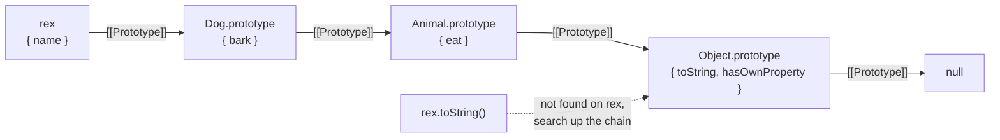

## What this lesson covers

In the [this lesson](/learn/js-this) methods read data from the object they were called on. But where does an empty object get `toString`, or an array get `map`? From the prototype. We will see how the prototype chain works, what `new` does and why `class` in JavaScript is a convenient notation for the same mechanism.

## The prototype chain

The chain for `const rex = new Dog()`, where `class Dog extends Animal`:



Every object has a hidden `[[Prototype]]` link to another object or to `null`. When you read a property the object does not have, the engine looks in the prototype, then in the prototype's prototype, and so on until `null`. If the property is found nowhere, the result is `undefined`, not an error.

```js run
const animal = {
  eats: true,
  describe() {
    return `eats: ${this.eats}`
  },
}
const rabbit = Object.create(animal)
rabbit.jumps = true
console.log(rabbit.jumps, rabbit.eats, rabbit.flies)
console.log(Object.hasOwn(rabbit, "eats"), "eats" in rabbit)
rabbit.eats = false
console.log(rabbit.describe(), animal.describe())
```

```output
true true undefined
false true
eats: false eats: true
```

Three rules show up here.

1. **Reads walk up the chain.** `rabbit.eats` was found on `animal`. The `in` operator checks the whole chain, `Object.hasOwn()` only own properties.
2. **Writes do not walk up.** `rabbit.eats = false` created an own property on `rabbit`, and `animal` did not change. The own property shadows the prototype's property of the same name. The exception: if the prototype has a setter, the setter is called.
3. **`this` in an inherited method is the object the method was called on**, not the object where the method lives. So `rabbit.describe()` reads `eats` from `rabbit`.

## prototype vs [[Prototype]]

The names are easy to mix up. Every object has `[[Prototype]]`: the link used for lookup. Constructor functions (and classes) have a `prototype` property: the object that becomes `[[Prototype]]` of instances created with `new`.

```js run
function User(name) {
  this.name = name
}
User.prototype.hi = function () {
  return `Hi, ${this.name}`
}
const u = new User("Ann")
console.log(Object.getPrototypeOf(u) === User.prototype, u.hi())
console.log(Object.getPrototypeOf(User.prototype) === Object.prototype)
```

```output
true Hi, Ann
true
```

`new User("Ann")` takes four steps: it creates an empty object, sets its `[[Prototype]]` to `User.prototype`, calls `User` with `this` set to that object, and returns the object (unless the function itself returns another object). The `hi` method is stored once on `User.prototype` and shared by all instances.

Read and set prototypes with `Object.getPrototypeOf()` and `Object.create()`. The `__proto__` property is deprecated and kept only for compatibility. `Object.setPrototypeOf()` on an existing object works, but MDN warns it is slow and breaks engine optimizations.

## Classes

`class` builds exactly the same prototype chain, just more conveniently and safely:

- class methods go to `Class.prototype`;
- `extends` links both the instances' prototypes and the constructors themselves (for static methods);
- `super(...)` calls the parent constructor, `super.method()` a parent method;
- `#` fields are truly private: they cannot be accessed outside the class;
- a class body is always strict, and the class sits in the dead zone before its declaration, like `let`.

```js run
class Animal {
  #sound
  constructor(sound) {
    this.#sound = sound
  }
  speak() {
    return this.#sound
  }
}
class Dog extends Animal {
  constructor() {
    super("woof")
  }
}
const d = new Dog()
console.log(d.speak(), typeof Dog, Object.getPrototypeOf(Dog.prototype) === Animal.prototype)
```

```output
woof function true
```

`typeof Dog` is `"function"`: a class is a constructor function that cannot be called without `new`.

## What not to do

- Do not extend built-in prototypes (`Array.prototype.myMethod = ...`). If the language later adds a method with the same name, your code breaks. This once forced the planned `Array.prototype.flatten` to be renamed `flat`, because an old library already added its own `flatten`.
- Do not build deep inheritance hierarchies. Modern frontend code prefers composition: functions, hooks, plain objects with the fields you need.

## Key points

- Property reads follow the `[[Prototype]]` chain until `null`; not found means `undefined`.
- Writes create an own property that shadows the prototype; `this` in a method is the object it was called on.
- A constructor's `prototype` becomes the `[[Prototype]]` of instances created with `new`.
- `class` is the same prototype model: methods on `prototype`, `#fields` are private, `typeof` a class is `"function"`.
- Use `Object.getPrototypeOf` and `Object.create`, not `__proto__`; leave built-in prototypes alone.
