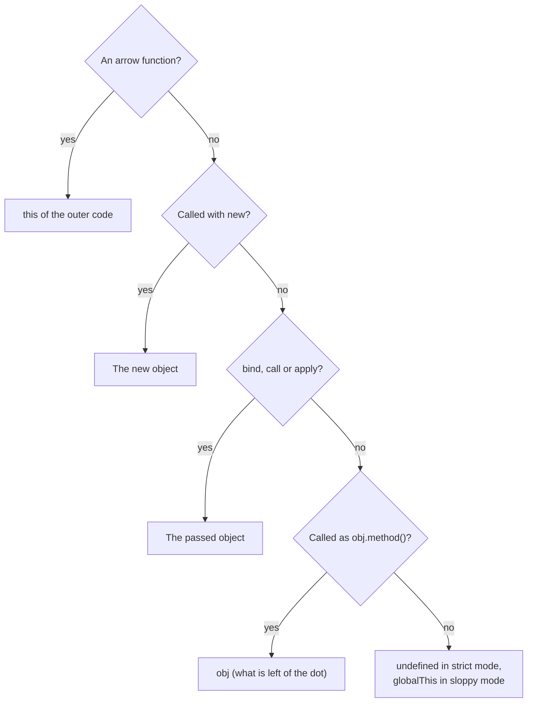

## What this lesson covers

In the [scope lesson](/learn/js-scope-closures) a variable's meaning depended on where the code was written. `this` is the opposite: for a regular function it is decided by **how** the function is called. That is why `this` gets "lost" when you pass a method as a callback, and it is one of the most common "what does this print" topics.

The examples in this lesson run as ES modules, which means strict mode. Modules and classes are always strict, and most frontend code today is made of modules.

## The rules

How to find `this` in a regular function, checking the rules in order:



| How the function is called | What `this` is |
|---|---|
| `obj.method()` | `obj`, the object left of the dot |
| `fn()` | `undefined` in strict mode, the global object in sloppy mode |
| `new Fn()` | the new object being created |
| `fn.call(ctx)`, `fn.apply(ctx)`, `fn.bind(ctx)()` | `ctx` |
| arrow function | `this` of the outer function where the arrow was created; the call style does not matter |
| regular function in `addEventListener` | the element the listener is attached to |

The rules are checked top to bottom with one caveat: `new` beats `bind`. If you call a bound function with `new`, `this` is the new object.

## Losing the context

A method does not "belong" to an object. If you take a reference to the function and call it on its own, there is no dot on the left anymore, and `this` is not the object.

```js run
const user = {
  name: "Ann",
  hi() {
    return this?.name
  },
}
const hi = user.hi
console.log(user.hi(), hi())
```

```output
Ann undefined
```

The same happens when a method is passed as a callback: `setTimeout(user.hi, 100)`, `button.addEventListener("click", user.hi)`, `array.map(user.hi)`. Inside, a bare function is called, with no object.

## Arrow functions

An arrow function has no `this` of its own: it takes it from the outer function at creation time, like any other variable from a closure. That makes arrows handy for callbacks inside methods.

```js run
const timer = {
  label: "T",
  regular() {
    return [1].map(function () {
      return this?.label
    })[0]
  },
  arrow() {
    return [1].map(() => this.label)[0]
  },
}
console.log(timer.regular(), timer.arrow())
```

```output
undefined T
```

The reverse trap: do not make an arrow an object method if it needs that object. An object literal does not create its own `this`, so the arrow takes `this` from the surrounding code (`undefined` in a module).

```js
const counter = {
  count: 5,
  get: () => this.count, // this is not counter here
}
```

Nothing changes an arrow's `this`: not `call`, not `bind`, not `new` (an arrow cannot be called with `new` at all).

## call, apply and bind

- `call(ctx, a, b)` calls the function immediately with the given `this` and arguments as a list.
- `apply(ctx, [a, b])` does the same with arguments as an array.
- `bind(ctx, a)` does not call the function; it returns a new one with `this` (and, if given, the leading arguments) fixed forever.

```js run
function greet(greeting, mark) {
  return `${greeting}, ${this.name}${mark}`
}
const ann = { name: "Ann" }
console.log(greet.call(ann, "Hi", "!"))
console.log(greet.apply(ann, ["Hello", "?"]))
const bound = greet.bind(ann, "Hey")
console.log(bound("."), bound.call({ name: "Bob" }, "."))
```

```output
Hi, Ann!
Hello, Ann?
Hey, Ann. Hey, Ann.
```

Calling `bind` or `call` again on a bound function does not change `this`: the first binding wins.

## this in classes

Class bodies are always strict, so a method passed on its own gets `this === undefined` and fails when it reads a field. Two usual fixes: bind the method in the constructor with `bind`, or declare it as an arrow function in a class field. The arrow field is created for each instance and takes `this` from the constructor.

```js run
class Button {
  label = "Save"
  handleRegular() {
    return this?.label
  }
  handleArrow = () => this.label
}
const b = new Button()
const { handleRegular, handleArrow } = b
console.log(handleRegular(), handleArrow())
```

```output
undefined Save
```

The cost of an arrow field: it is not on the prototype, so every instance stores its own copy of the function, and a subclass cannot override it via `super`.

## Key points

- A regular function's `this` is decided by how it is called, not where it is declared.
- A method reference without an object on the left loses `this`; in strict mode it becomes `undefined`.
- Arrows take `this` from the outer function, and it cannot be changed.
- `call` and `apply` call right away, `bind` returns a new function; the first binding wins, but `new` beats `bind`.
- In classes, bind methods used as callbacks or declare them as arrow fields.
