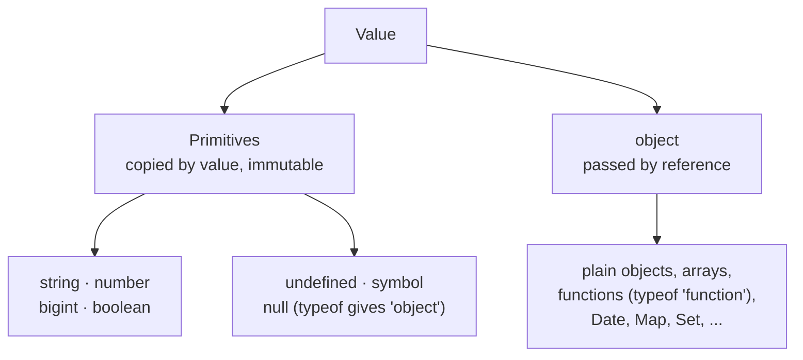
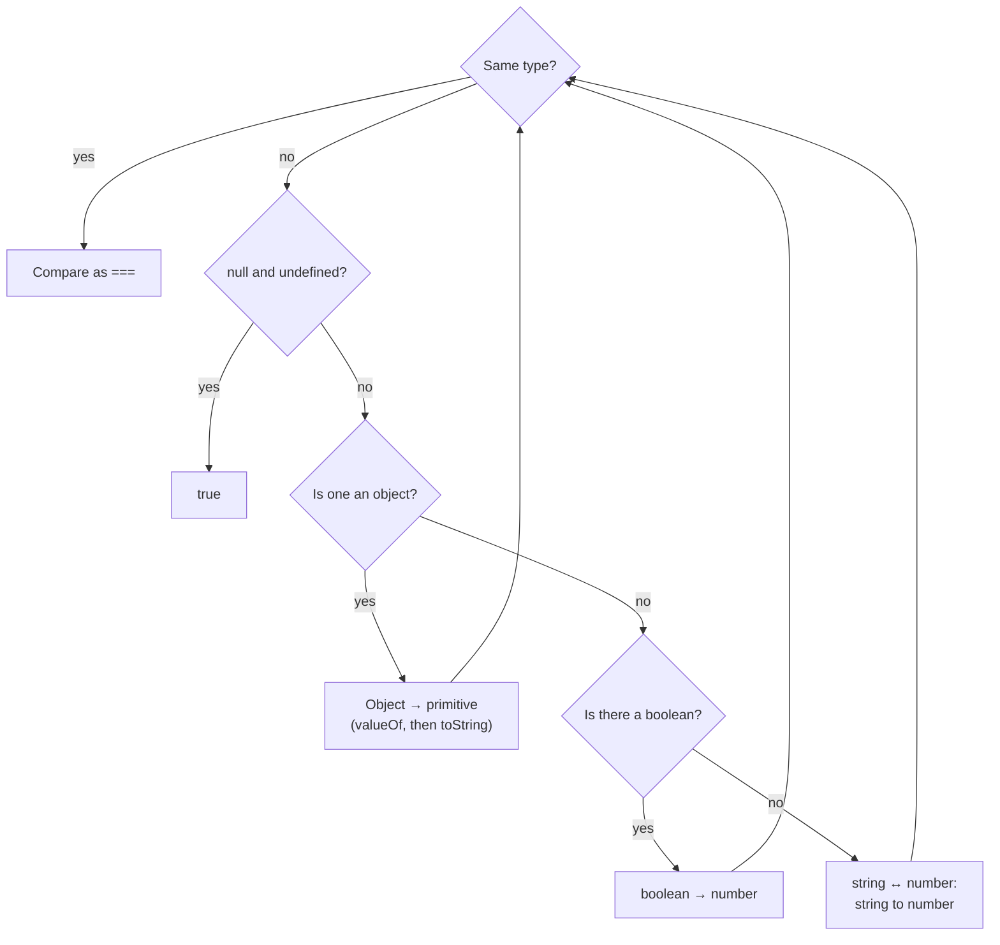

## What this lesson covers

Almost every "what does this code print" question starts with types: what `typeof` returns, what a string turns into when you add to it, why `[] == 0` is true. We will go through the types JavaScript has, how coercion works and how `==` differs from `===`.

Every example with an "Output" block in this lesson is actually executed by the content checks, so the results are exact.

## Eight types

The eight types split into seven primitives and objects:



JavaScript has seven primitive types and one object type:

| Type | Example | `typeof` |
|---|---|---|
| number | `42`, `3.14`, `NaN` | `"number"` |
| bigint | `10n` | `"bigint"` |
| string | `"hi"` | `"string"` |
| boolean | `true` | `"boolean"` |
| undefined | `undefined` | `"undefined"` |
| symbol | `Symbol("id")` | `"symbol"` |
| null | `null` | `"object"` |
| object | `{}`, `[]`, functions, `Date` | `"object"` or `"function"` |

```js run
console.log(typeof 42, typeof 10n, typeof "hi", typeof true)
console.log(typeof undefined, typeof Symbol("id"), typeof null)
console.log(typeof {}, typeof [], typeof function () {})
```

```output
number bigint string boolean
undefined symbol object
object object function
```

Two quirks come up constantly. `typeof null` returns `"object"`: a bug from the very first version of the language, kept so old websites keep working. Functions are objects too, but `typeof` returns `"function"` for them. `typeof` cannot tell an array from an object; use `Array.isArray()` for that.

## Value and reference

Primitives are immutable and copied by value. A variable holds an object as a reference: assignment copies the reference, not the object, so both variables point to the same thing.

```js run
let a = 1
let b = a
b++
const x = { n: 1 }
const y = x
y.n++
console.log(a, x.n)
console.log({ n: 1 } === { n: 1 }, x === y)
```

```output
1 2
false true
```

That is why two objects with the same content are not equal: `===` compares references for objects. The same rule explains why React and Redux forbid mutating state in place: the library compares references and will not notice the change.

## Type coercion

When an operation needs a value of another type, JavaScript converts it automatically. There are three rules.

> **To string.** The `+` operator concatenates when at least one operand is a string.
>
> **To number.** Other arithmetic operators (`-`, `*`, `/`), unary plus and `Number()` convert the value to a number. An empty or whitespace-only string becomes `0`, a string with other characters becomes `NaN`.
>
> **To boolean.** In conditions and with `!`, a value becomes `true` or `false`.

```js run
console.log("5" + 1, "5" - 1, "5" * "2")
console.log(Number(""), Number(" 42 "), Number("4px"))
console.log(Boolean("0"), Boolean([]), Boolean(""))
```

```output
51 4 10
0 42 NaN
true true false
```

There are exactly eight falsy values: `false`, `0`, `-0`, `0n`, `""`, `null`, `undefined` and `NaN`. Everything else is truthy, including the string `"0"`, an empty array and an empty object.

## NaN and Object.is

`NaN` ("not a number") comes from a failed number conversion and is not equal to anything, not even itself. Check for it with `Number.isNaN()`. The global `isNaN()` converts its argument to a number first, so `isNaN("abc")` also returns `true`.

`Object.is()` compares like `===` with two differences: it treats `NaN` as equal to `NaN` and tells `0` from `-0`. React uses it to decide whether state changed.

```js run
console.log(NaN === NaN, Number.isNaN(NaN), Object.is(NaN, NaN))
console.log(0 === -0, Object.is(0, -0))
```

```output
false true true
true false
```

## == and ===

How `==` compares values of different types (simplified from the spec):



`===` (strict equality) compares without coercion: different types mean "not equal". `==` (loose equality) first converts types following the algorithm in the spec:

1. If the types are the same, it compares like `===`.
2. `null` and `undefined` are equal to each other and to nothing else.
3. String and number: the string becomes a number.
4. A boolean becomes a number: `true` to `1`, `false` to `0`.
5. Object and primitive: the object becomes a primitive. `valueOf()` is called first, and if it returns a non-primitive (as arrays do), `toString()` is called.

```js run
console.log(null == undefined, null == 0, undefined == false)
console.log("1" == 1, true == 1, "" == 0)
console.log([] == 0, [1] == "1", [1, 2] == "1,2")
```

```output
true false false
true true true
true true true
```

Let us walk through `[] == 0`. The array is converted to a primitive: `valueOf()` returns the array itself, so `toString()` is called and gives `""`. The empty string becomes the number `0`, and `0 == 0` is true.

In practice always write `===`. The one common exception: `value == null` catches both `null` and `undefined` in a single check.

## null and undefined

`undefined` means there is no value because none was set: a variable without a value, a parameter without an argument, a missing property, a function without `return`. `null` is set explicitly to say "intentionally empty".

An important subtlety: a property whose value is `undefined` exists, which is different from a missing property.

```js run
const user = { name: undefined }
console.log("name" in user, Object.hasOwn(user, "name"), JSON.stringify(Object.keys(user)))
console.log(JSON.stringify({ a: undefined, b: null }))
```

```output
true true ["name"]
{"b":null}
```

`JSON.stringify` drops properties whose value is `undefined` and keeps `null`. This matters when sending data to a server: an `undefined` field simply disappears from the request body.

## Key points

- Seven primitives plus objects; `typeof null` is `"object"` because of a historical bug.
- Primitives compare by value, objects by reference.
- `+` with a string concatenates, other arithmetic converts to number; there are eight falsy values.
- Check `NaN` with `Number.isNaN()`; `Object.is()` tells `0` from `-0`.
- Write `===`; `value == null` is fine as a combined check for `null` and `undefined`.
