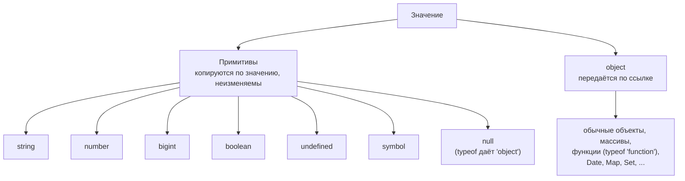
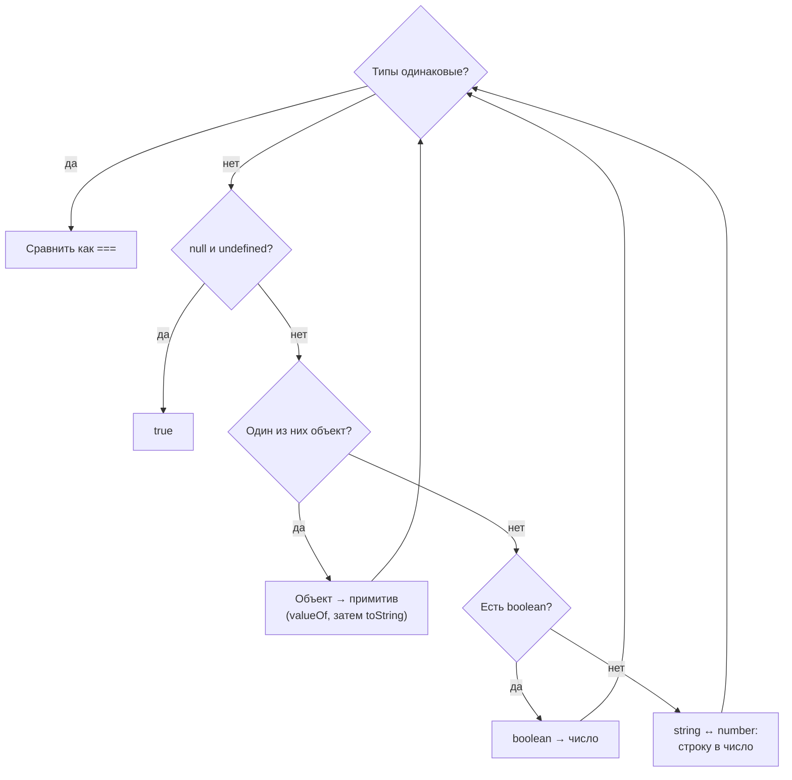

## О чём урок

Почти любой вопрос «что выведет код» начинается с типов: что вернёт `typeof`, во что превратится строка при сложении, почему `[] == 0` истинно. Разберём, какие типы есть в JavaScript, как работает приведение и чем `==` отличается от `===`.

Все примеры с блоком «Вывод» в этом уроке реально выполняются при проверке контента, поэтому результат в них точный.

## Восемь типов

Восемь типов делятся на семь примитивов и объекты:



В JavaScript семь примитивных типов и один объектный:

| Тип | Пример | `typeof` |
|---|---|---|
| number | `42`, `3.14`, `NaN` | `"number"` |
| bigint | `10n` | `"bigint"` |
| string | `"hi"` | `"string"` |
| boolean | `true` | `"boolean"` |
| undefined | `undefined` | `"undefined"` |
| symbol | `Symbol("id")` | `"symbol"` |
| null | `null` | `"object"` |
| object | `{}`, `[]`, функции, `Date` | `"object"` или `"function"` |

```js run
console.log(typeof 42, typeof 10n, typeof "hi", typeof true)
console.log(typeof undefined, typeof Symbol("id"), typeof null)
console.log(typeof {}, typeof [], typeof function () {})
```

```output
number bigint string boolean
undefined symbol object
object object function
```

Две особенности, которые спрашивают постоянно. `typeof null` возвращает `"object"`: это ошибка из первой версии языка, её не исправляют, чтобы не сломать старые сайты. Функции тоже объекты, но `typeof` для них возвращает `"function"`. Массив `typeof` от объекта не отличает, для этого есть `Array.isArray()`.

## Значение и ссылка

Примитивы неизменяемы и копируются по значению. Объект хранится в переменной как ссылка: при присваивании копируется ссылка, а не сам объект, и две переменные указывают на одно и то же.

```js run
let a = 1
let b = a
b++
const x = { n: 1 }
const y = x
y.n++
console.log(a, x.n)
console.log({ n: 1 } === { n: 1 }, x === y)
```

```output
1 2
false true
```

Поэтому два одинаковых по содержимому объекта не равны: `===` для объектов сравнивает ссылки. Это же правило объясняет, почему в React и Redux нельзя менять состояние на месте: библиотека сравнивает ссылки и не заметит изменения.

## Приведение типов

Когда операции нужен значение другого типа, JavaScript приводит его сам. Правил три.

> **К строке.** Оператор `+`, у которого хотя бы один операнд строка, склеивает строки.
>
> **К числу.** Остальные арифметические операторы (`-`, `*`, `/`), унарный плюс и `Number()` превращают значение в число. Пустая строка и строка из пробелов дают `0`, а строка с посторонними символами даёт `NaN`.
>
> **К логическому типу.** В условиях и при `!` значение превращается в `true` или `false`.

```js run
console.log("5" + 1, "5" - 1, "5" * "2")
console.log(Number(""), Number(" 42 "), Number("4px"))
console.log(Boolean("0"), Boolean([]), Boolean(""))
```

```output
51 4 10
0 42 NaN
true true false
```

Ложных значений ровно восемь: `false`, `0`, `-0`, `0n`, `""`, `null`, `undefined` и `NaN`. Всё остальное истинно, включая строку `"0"`, пустой массив и пустой объект.

## NaN и Object.is

`NaN` («не число») получается при неудачном превращении в число и не равен ничему, даже самому себе. Проверяют его через `Number.isNaN()`. Глобальная `isNaN()` сначала приводит аргумент к числу, поэтому `isNaN("abc")` тоже вернёт `true`.

`Object.is()` сравнивает как `===`, но с двумя отличиями: считает `NaN` равным `NaN` и различает `0` и `-0`. Так сравнивает значения React, когда решает, изменилось ли состояние.

```js run
console.log(NaN === NaN, Number.isNaN(NaN), Object.is(NaN, NaN))
console.log(0 === -0, Object.is(0, -0))
```

```output
false true true
true false
```

## == и ===

Как `==` сравнивает значения разных типов (упрощённо по спецификации):



`===` (строгое равенство) сравнивает без приведения: разные типы значат «не равно». `==` (нестрогое) сначала приводит типы по алгоритму из спецификации:

1. Если типы одинаковые, сравнение идёт как `===`.
2. `null` и `undefined` равны друг другу и не равны ничему другому.
3. Строка и число: строка превращается в число.
4. Логическое значение превращается в число: `true` в `1`, `false` в `0`.
5. Объект и примитив: объект превращается в примитив. Сначала вызывается `valueOf()`, и если он вернул не примитив (как у массивов), то `toString()`.

```js run
console.log(null == undefined, null == 0, undefined == false)
console.log("1" == 1, true == 1, "" == 0)
console.log([] == 0, [1] == "1", [1, 2] == "1,2")
```

```output
true false false
true true true
true true true
```

Разберём `[] == 0`. Массив превращается в примитив: `valueOf()` возвращает сам массив, поэтому вызывается `toString()`, и получается `""`. Пустая строка превращается в число `0`, а `0 == 0` истинно.

На практике всегда пишите `===`. Единственное распространённое исключение: `value == null` одной проверкой ловит и `null`, и `undefined`.

## null и undefined

`undefined` означает, что значения нет, потому что его не задали: переменная без значения, параметр без аргумента, несуществующее свойство, функция без `return`. `null` ставят явно, чтобы сказать «здесь намеренно пусто».

Важная тонкость: свойство со значением `undefined` существует, и это отличается от отсутствующего свойства.

```js run
const user = { name: undefined }
console.log("name" in user, Object.hasOwn(user, "name"), JSON.stringify(Object.keys(user)))
console.log(JSON.stringify({ a: undefined, b: null }))
```

```output
true true ["name"]
{"b":null}
```

`JSON.stringify` выбрасывает свойства со значением `undefined`, а `null` сохраняет. Это важно, когда вы отправляете данные на сервер: `undefined` в теле запроса просто пропадёт.

## Главное

- Семь примитивов и объекты; `typeof null` равен `"object"` по исторической ошибке.
- Примитивы сравниваются по значению, объекты по ссылке.
- `+` со строкой склеивает, остальная арифметика приводит к числу; ложных значений восемь.
- `NaN` проверяют через `Number.isNaN()`, а `Object.is()` различает `0` и `-0`.
- Пишите `===`; `value == null` допустимо как проверка на `null` и `undefined` сразу.
