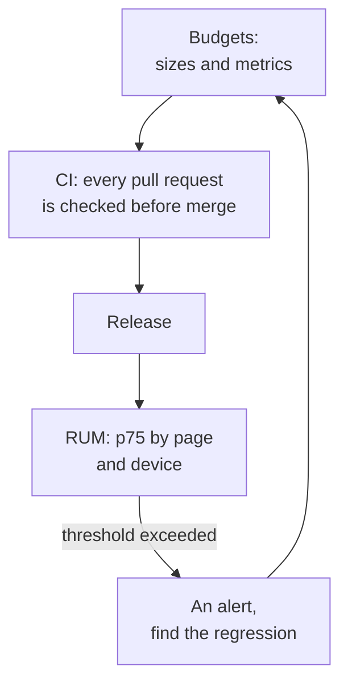

## What this lesson covers

How to keep a site fast, not just make it fast once: performance budgets and their kinds, checks in CI (bundle size, Lighthouse CI), field monitoring and alerts, and the order of answering the common interview question "the page is slow, what will you do". The example runs in Node.js.

## Speed degrades quietly

Every release adds a little: a new library, an analytics tag, a widget, an image without dimensions. Individually the changes are unnoticeable; together, in half a year LCP grows by a second. That is why speed is protected the same way as functionality: with **budgets** and automated checks.



## Kinds of budgets

| Kind | Examples | Where to check |
|---|---|---|
| Quantity-based | JS on a page after compression, CSS, the LCP image's weight, the number of requests, third-party code | CI on every pull request |
| Lab metrics | LCP, TBT, CLS in Lighthouse with phone emulation | CI (Lighthouse CI), several runs |
| Field metrics | p75 LCP, INP, CLS by page template and device | RUM, CrUX, alerts |

Set budgets from a goal, not "just because": the Core Web Vitals thresholds, competitors' data, current field values with a margin. Quantity budgets are convenient because they are checked quickly and reliably, while metrics are closer to the user but noisier.

```ts run
// Budgets checked in CI: sizes from the build, metrics from field data (p75 over the last 28 days).
type Budget = { name: string; actual: number; limit: number; unit: string }
const budgets: Budget[] = [
  { name: 'JS on the home page (gzip)', actual: 182, limit: 170, unit: 'KB' },
  { name: 'CSS on the home page (gzip)', actual: 24, limit: 50, unit: 'KB' },
  { name: 'Largest image on the home page', actual: 95, limit: 200, unit: 'KB' },
  { name: 'LCP p75 (mobile)', actual: 2300, limit: 2500, unit: 'ms' },
  { name: 'INP p75 (mobile)', actual: 260, limit: 200, unit: 'ms' },
  { name: 'CLS p75', actual: 0.04, limit: 0.1, unit: '' },
]
let failed = 0
for (const b of budgets) {
  const over = b.actual > b.limit
  if (over) failed++
  const pct = Math.round((b.actual / b.limit) * 100)
  console.log(`${over ? 'FAIL' : 'ok  '} ${b.name.padEnd(32)} ${b.actual}${b.unit} of ${b.limit}${b.unit} (${pct}%)`)
}
console.log(failed ? `${failed} budget(s) exceeded: the pull request is blocked` : 'all budgets met')
```

```output
FAIL JS on the home page (gzip)       182KB of 170KB (107%)
ok   CSS on the home page (gzip)      24KB of 50KB (48%)
ok   Largest image on the home page   95KB of 200KB (48%)
ok   LCP p75 (mobile)                 2300ms of 2500ms (92%)
FAIL INP p75 (mobile)                 260ms of 200ms (130%)
ok   CLS p75                          0.04 of 0.1 (40%)
2 budget(s) exceeded: the pull request is blocked
```

## Checks in CI

```js
// lighthouserc.js (Lighthouse CI): several runs, assertions on the median
module.exports = {
  ci: {
    collect: { url: ['http://localhost:4173/', 'http://localhost:4173/products/7'], numberOfRuns: 5 },
    assert: {
      assertions: {
        'largest-contentful-paint': ['error', { maxNumericValue: 2500 }],
        'total-blocking-time': ['error', { maxNumericValue: 200 }],
        'cumulative-layout-shift': ['error', { maxNumericValue: 0.1 }],
      },
    },
  },
}
```

- **Bundle size** is checked on every pull request (`size-limit`, the bundler's report): the size change shows up in a comment, and exceeding the budget blocks the merge. This is the most reliable protection against gradual growth.
- **Lighthouse CI** runs pages several times and compares the median against thresholds. Noise is unavoidable, so thresholds get a margin and conditions (machine, network) are fixed.
- Lab checks do not catch INP (nobody clicks in them) or real-device problems, so field monitoring is needed too.

## Field monitoring

- RUM data (`web-vitals` from the `perf-measure` lesson) is collected with the release version: a regression is visible by the release after which p75 went up.
- Alert on the p75 of a specific page template and device type, not on a site-wide average.
- CrUX and Search Console show what Google sees, but with a 28-day lag.

## "The page is slow, what will you do?"

1. **Clarify "slow"**: which metric (loading, responding to clicks, jumping), on which page, for whom (phones, a country, a network). Look at field data: CrUX, Search Console, your own RUM.
2. **Reproduce in the lab**: DevTools with CPU and network throttling matching the affected users; find the LCP element, the slow interaction, the shifts.
3. **Break the metric down**: LCP into four parts, INP into three phases, CLS into windows and elements; find the biggest part rather than optimizing everything.
4. **Fix the cause**: for LCP, HTML caching and a CDN, the image in the HTML with `fetchpriority`, format and size; for INP, split long tasks, move work to a Worker, remove extra JS and third-party scripts; for CLS, dimensions and reserved space.
5. **Verify**: in the lab before release, in the field after; lock it in with a budget so it does not come back.

The answer shows a method: first measure and find the bottleneck, then fix, then protect with a budget. A list of techniques without measurement looks like guessing.

## Key points

- Speed degrades a little with every release; it is protected with budgets and automated checks.
- Budgets: quantity-based (JS, CSS and image sizes, third-party code), lab metrics (Lighthouse CI), field metrics (p75 in RUM).
- In CI, check bundle size on every pull request and run Lighthouse CI with several runs; INP and real devices are visible only in the field.
- RUM tagged with the release version, and alerts on the p75 of a page template and device.
- The "page is slow" answer: clarify and look at the field → reproduce in the lab → break down the metric → fix the cause → verify and lock in with a budget.
