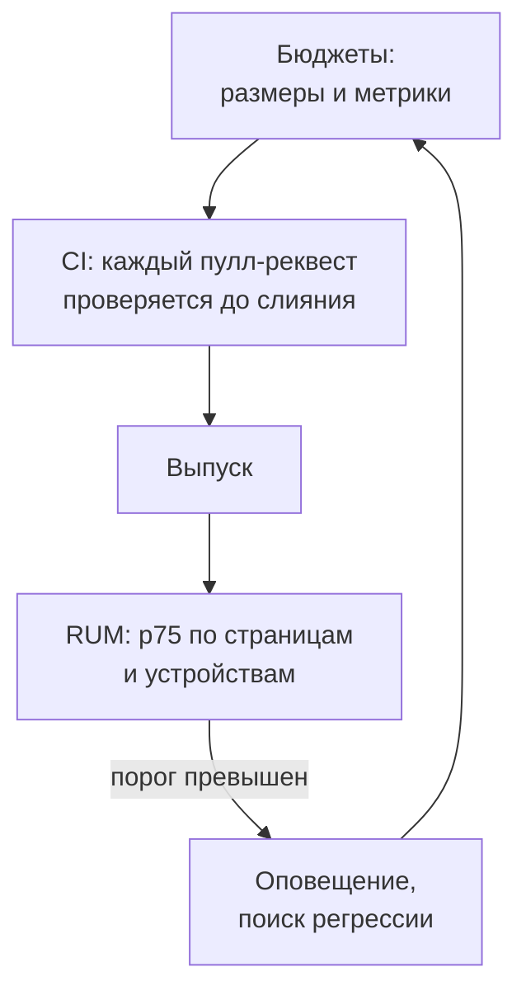

## О чём урок

Как удержать скорость, а не только один раз её улучшить: бюджеты производительности и их виды, проверки в CI (размер бандла, Lighthouse CI), мониторинг полевых данных и оповещения, а также порядок ответа на частый вопрос собеседования «страница медленная, что будете делать». Пример выполняется в Node.js.

## Скорость деградирует незаметно

Каждый выпуск добавляет немного: новую библиотеку, тег аналитики, виджет, картинку без размеров. По отдельности изменения незаметны, вместе за полгода LCP вырастает на секунду. Поэтому скорость защищают так же, как функциональность: **бюджетами** и автоматическими проверками.



## Виды бюджетов

| Вид | Примеры | Где проверять |
|---|---|---|
| Количественные | JS на странице после сжатия, CSS, вес картинки LCP, число запросов, сторонний код | CI на каждом пулл-реквесте |
| Метрики в лаборатории | LCP, TBT, CLS в Lighthouse с эмуляцией телефона | CI (Lighthouse CI), несколько прогонов |
| Метрики в поле | p75 LCP, INP, CLS по шаблонам страниц и устройствам | RUM, CrUX, оповещения |

Бюджет задают от цели, а не «чтобы было»: пороги Core Web Vitals, данные конкурентов, текущие полевые значения с запасом. Количественные бюджеты удобны тем, что проверяются быстро и стабильно, а метрики ближе к пользователю, но шумнее.

```ts run
// Budgets checked in CI: sizes from the build, metrics from field data (p75 over the last 28 days).
type Budget = { name: string; actual: number; limit: number; unit: string }
const budgets: Budget[] = [
  { name: 'JS on the home page (gzip)', actual: 182, limit: 170, unit: 'KB' },
  { name: 'CSS on the home page (gzip)', actual: 24, limit: 50, unit: 'KB' },
  { name: 'Largest image on the home page', actual: 95, limit: 200, unit: 'KB' },
  { name: 'LCP p75 (mobile)', actual: 2300, limit: 2500, unit: 'ms' },
  { name: 'INP p75 (mobile)', actual: 260, limit: 200, unit: 'ms' },
  { name: 'CLS p75', actual: 0.04, limit: 0.1, unit: '' },
]
let failed = 0
for (const b of budgets) {
  const over = b.actual > b.limit
  if (over) failed++
  const pct = Math.round((b.actual / b.limit) * 100)
  console.log(`${over ? 'FAIL' : 'ok  '} ${b.name.padEnd(32)} ${b.actual}${b.unit} of ${b.limit}${b.unit} (${pct}%)`)
}
console.log(failed ? `${failed} budget(s) exceeded: the pull request is blocked` : 'all budgets met')
```

```output
FAIL JS on the home page (gzip)       182KB of 170KB (107%)
ok   CSS on the home page (gzip)      24KB of 50KB (48%)
ok   Largest image on the home page   95KB of 200KB (48%)
ok   LCP p75 (mobile)                 2300ms of 2500ms (92%)
FAIL INP p75 (mobile)                 260ms of 200ms (130%)
ok   CLS p75                          0.04 of 0.1 (40%)
2 budget(s) exceeded: the pull request is blocked
```

## Проверки в CI

```js
// lighthouserc.js (Lighthouse CI): several runs, assertions on the median
module.exports = {
  ci: {
    collect: { url: ['http://localhost:4173/', 'http://localhost:4173/products/7'], numberOfRuns: 5 },
    assert: {
      assertions: {
        'largest-contentful-paint': ['error', { maxNumericValue: 2500 }],
        'total-blocking-time': ['error', { maxNumericValue: 200 }],
        'cumulative-layout-shift': ['error', { maxNumericValue: 0.1 }],
      },
    },
  },
}
```

- **Размер бандла** проверяют на каждом пулл-реквесте (`size-limit`, отчёт сборщика): изменение размера видно в комментарии, превышение блокирует слияние. Это самая надёжная защита от постепенного роста.
- **Lighthouse CI** гоняет страницы несколько раз и сравнивает медиану с порогами. Шум неизбежен, поэтому пороги ставят с запасом, а условия (машина, сеть) фиксируют.
- Лабораторные проверки не ловят INP (в них никто не кликает) и проблемы реальных устройств, поэтому нужен ещё мониторинг поля.

## Мониторинг поля

- RUM-данные (`web-vitals` из урока `perf-measure`) собирают с версией выпуска: регрессию видно по выпуску, после которого p75 вырос.
- Оповещение по p75 конкретного шаблона страницы и типа устройства, а не по среднему по сайту.
- CrUX и Search Console показывают то же, что видит Google, но с задержкой в 28 дней.

## «Страница медленная, что будете делать?»

1. **Уточнить «медленная»**: какая метрика (загрузка, отклик на клики, прыжки), на какой странице, у кого (телефоны, страна, сеть). Посмотреть полевые данные: CrUX, Search Console, свой RUM.
2. **Воспроизвести в лаборатории**: DevTools с замедлением процессора и сети, как у пострадавших пользователей; найти элемент LCP, медленное взаимодействие, сдвиги.
3. **Разложить метрику**: LCP на четыре части, INP на три фазы, CLS на окна и элементы; найти самую большую часть, а не оптимизировать всё подряд.
4. **Исправить причину**: для LCP кэш HTML и CDN, картинка в HTML с `fetchpriority`, формат и размер; для INP разбить долгие задачи, вынести в Worker, убрать лишний JS и сторонние скрипты; для CLS размеры и зарезервированное место.
5. **Проверить**: в лаборатории до выпуска, в поле после; закрепить бюджетом, чтобы не вернулось.

Ответ показывает метод: сначала измерить и найти узкое место, потом исправлять, потом защитить бюджетом. Список приёмов без измерения выглядит как гадание.

## Главное

- Скорость деградирует понемногу с каждым выпуском; её защищают бюджетами и автоматическими проверками.
- Бюджеты: количественные (размеры JS, CSS, картинок, сторонний код), лабораторные метрики (Lighthouse CI), полевые метрики (p75 в RUM).
- В CI проверяют размер бандла на каждом пулл-реквесте и Lighthouse CI с несколькими прогонами; INP и реальные устройства видны только в поле.
- RUM с версией выпуска и оповещения по p75 шаблона страницы и устройства.
- Ответ «страница медленная»: уточнить и посмотреть поле → воспроизвести в лаборатории → разложить метрику → исправить причину → проверить и закрепить бюджетом.
