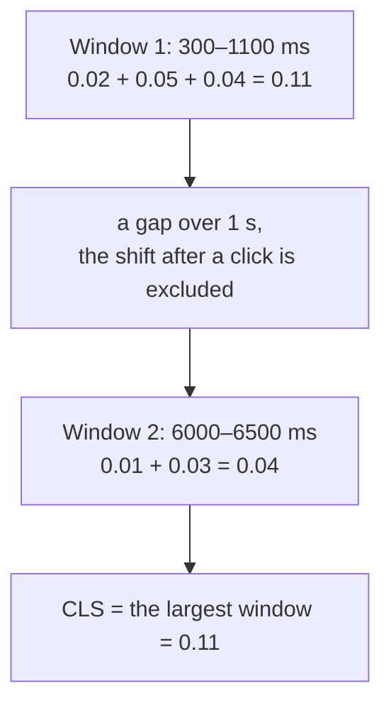

## What this lesson covers

How CLS is calculated and how to fix it systematically: what a layout shift is and how it is scored, which shifts do not count, session windows (why CLS is not the sum of all shifts), causes by type with a fix for each, and shifts in single-page apps. A short list of causes is in the `browser-layout-paint` lesson. The example runs in Node.js.

## What counts as a shift

A layout shift is a change in the **starting position** of a visible element between two frames. The score of one shift:

```text
layout shift score = impact fraction × distance fraction

impact fraction:   the share of the viewport covered by the shifted elements (before and after, combined)
distance fraction: the largest distance an element moved, as a share of the viewport's larger side
```

A block filled the top half of the screen and moved down by a quarter of the height: before and after it covers 75% of the screen, the distance is 25% → `0.75 × 0.25 ≈ 0.19`. One such shift is enough to leave the "good" zone (0.1).

- Shifts that start within **500 ms after user input** (a click, a tap, a key) are expected and do not count toward CLS: expanding an accordion on click is fine.
- Not shifts: animation through `transform` (the element does not change its layout position), a new element appearing while the others do not move, scrolling.

## Session windows

```ts run
// layout-shift entries as PerformanceObserver gives them: time (ms), score, and whether input preceded it.
type Shift = { startTime: number; value: number; hadRecentInput: boolean }
const shifts: Shift[] = [
  { startTime: 300, value: 0.02, hadRecentInput: false }, // a web font swapped in
  { startTime: 700, value: 0.05, hadRecentInput: false }, // an image without width and height
  { startTime: 1100, value: 0.04, hadRecentInput: false }, // an ad slot expanded
  { startTime: 2400, value: 0.3, hadRecentInput: true }, // the user opened an accordion: not counted
  { startTime: 6000, value: 0.01, hadRecentInput: false },
  { startTime: 6500, value: 0.03, hadRecentInput: false }, // a late banner pushes the content
]

// CLS = the largest "session window": shifts less than 1 s apart, a window lasts at most 5 s.
function cls(entries: Shift[]) {
  let best = 0
  let current = 0
  let first = 0
  let last = 0
  for (const e of entries) {
    if (e.hadRecentInput) continue // shifts within 500 ms after a tap or keypress are expected
    if (current > 0 && (e.startTime - last >= 1000 || e.startTime - first >= 5000)) current = 0
    if (current === 0) first = e.startTime
    current += e.value
    last = e.startTime
    best = Math.max(best, current)
  }
  return Number(best.toFixed(3))
}
const total = Number(shifts.filter((s) => !s.hadRecentInput).reduce((a, s) => a + s.value, 0).toFixed(3))
console.log('sum of all shifts:', total, '| CLS (largest window):', cls(shifts), '| good is <= 0.1')
```

```output
sum of all shifts: 0.15 | CLS (largest window): 0.11 | good is <= 0.1
```



- Shifts are grouped into **windows**: shifts less than 1 s apart fall into one window, and a window lasts at most 5 s. CLS is the **largest** window, not the sum of all shifts in the visit.
- This way long-lived pages (a feed, an SPA where the user spends an hour) are not penalized for small shifts spread over time, while a burst of shifts during load counts fully.
- In the example, the "needs improvement" score comes from the burst during load: a font, an image without dimensions and an ad slot. That is what needs fixing.

## Causes and fixes

| Cause | Fix |
|---|---|
| An image, video or `iframe` without dimensions | The `width` and `height` attributes (the browser derives `aspect-ratio` itself) or CSS `aspect-ratio`; `height: auto` for responsive images |
| Ads, embedded widgets, cookie consent banners | Reserved space (`min-height` for the most common size); banners over the content (`position: fixed`), not above it |
| Content loaded after an API response | A skeleton the same size as the content; new elements below the visible area or on user action |
| Web fonts | A fallback font with adjusted metrics (`size-adjust`, `ascent-override`) and `font-display: swap` or `optional`; preloading the main font (the `perf-resources` lesson) |
| Animating `top`, `left`, `width`, `height`, `margin` | Animate `transform` and `opacity` (the `browser-layout-paint` lesson) |
| Streaming SSR and Suspense | A placeholder with the content's dimensions (the `render-streaming` lesson) |
| A hydration mismatch | The same server and client render (the `render-hydration` lesson) |

```css
img,
video {
  max-width: 100%;
  height: auto; /* keeps the ratio from the width and height attributes */
}

.ad-slot {
  min-height: 250px; /* the most common creative height: no jump when it arrives */
}

/* A fallback font adjusted to the web font's metrics: the swap barely moves the text */
@font-face {
  font-family: 'Inter Fallback';
  src: local('Arial');
  size-adjust: 107%;
  ascent-override: 90%;
}
body {
  font-family: 'Inter', 'Inter Fallback', sans-serif;
}
```

Fallback font metrics are tuned with tools (Fontaine; `next/font` does it automatically), not by eye.

## How to find a shift

- In the Performance panel the Layout shifts track shows every shift and the elements that moved; the "Layout shift culprits" insight names the cause (a font, an image without dimensions, an inserted element).
- In the field, `web-vitals/attribution` gives the selector of the largest shifted element and the time of the shift: you can see that "the recommendations block jumps 2 s after load".
- In an SPA, shifts after a route change used to accumulate into the first page's CLS; with soft navigations they belong to the new "page".

## Key points

- A shift is a change in a visible element's starting position; score = impacted area fraction × distance fraction.
- Shifts within 500 ms after input do not count; animations through `transform` are not shifts.
- CLS = the largest session window: shifts less than 1 s apart, a window no longer than 5 s; it is not the sum over the whole visit.
- Fixes: dimensions on media, reserved space for ads and dynamic content, skeletons of the right size, banners on top, a fallback font with `size-adjust`, animations through `transform`.
- The cause is shown by the Layout shifts track and insight in DevTools, and in the field by `web-vitals/attribution`.
