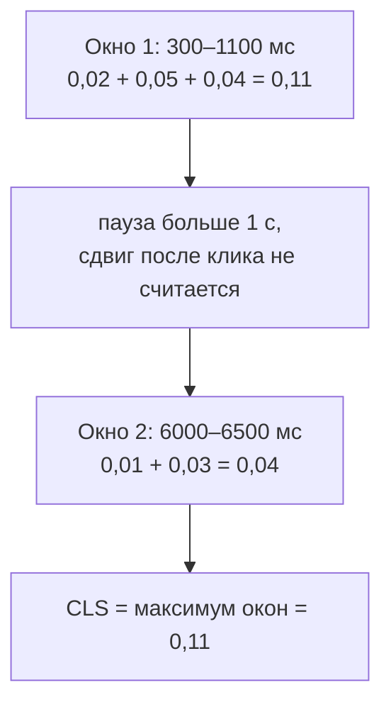

## О чём урок

Как считается CLS и как его исправлять системно: что такое сдвиг вёрстки и его оценка, какие сдвиги не учитываются, окна сессий (почему CLS это не сумма всех сдвигов), причины по типам и исправления для каждой, а также сдвиги в одностраничных приложениях. Короткий список причин есть в уроке `browser-layout-paint`. Пример выполняется в Node.js.

## Что считается сдвигом

Сдвиг вёрстки это изменение **начальной позиции** видимого элемента между двумя кадрами. Оценка одного сдвига:

```text
layout shift score = impact fraction × distance fraction

impact fraction:   the share of the viewport covered by the shifted elements (before and after, combined)
distance fraction: the largest distance an element moved, as a share of the viewport's larger side
```

Блок занимал верхнюю половину экрана и сдвинулся вниз на четверть высоты: до и после он покрывает 75 % экрана, расстояние 25 % → `0,75 × 0,25 ≈ 0,19`. Одного такого сдвига хватает, чтобы выйти из зоны «хорошо» (0,1).

- Сдвиги, начавшиеся в течение **500 мс после ввода** пользователя (клик, касание, клавиша), считаются ожидаемыми и не входят в CLS: раскрыть аккордеон по клику можно.
- Не сдвиги: анимация через `transform` (элемент не меняет положение в вёрстке), появление нового элемента, если остальные не двигаются, прокрутка.

## Окна сессий

```ts run
// layout-shift entries as PerformanceObserver gives them: time (ms), score, and whether input preceded it.
type Shift = { startTime: number; value: number; hadRecentInput: boolean }
const shifts: Shift[] = [
  { startTime: 300, value: 0.02, hadRecentInput: false }, // a web font swapped in
  { startTime: 700, value: 0.05, hadRecentInput: false }, // an image without width and height
  { startTime: 1100, value: 0.04, hadRecentInput: false }, // an ad slot expanded
  { startTime: 2400, value: 0.3, hadRecentInput: true }, // the user opened an accordion: not counted
  { startTime: 6000, value: 0.01, hadRecentInput: false },
  { startTime: 6500, value: 0.03, hadRecentInput: false }, // a late banner pushes the content
]

// CLS = the largest "session window": shifts less than 1 s apart, a window lasts at most 5 s.
function cls(entries: Shift[]) {
  let best = 0
  let current = 0
  let first = 0
  let last = 0
  for (const e of entries) {
    if (e.hadRecentInput) continue // shifts within 500 ms after a tap or keypress are expected
    if (current > 0 && (e.startTime - last >= 1000 || e.startTime - first >= 5000)) current = 0
    if (current === 0) first = e.startTime
    current += e.value
    last = e.startTime
    best = Math.max(best, current)
  }
  return Number(best.toFixed(3))
}
const total = Number(shifts.filter((s) => !s.hadRecentInput).reduce((a, s) => a + s.value, 0).toFixed(3))
console.log('sum of all shifts:', total, '| CLS (largest window):', cls(shifts), '| good is <= 0.1')
```

```output
sum of all shifts: 0.15 | CLS (largest window): 0.11 | good is <= 0.1
```



- Сдвиги группируются в **окна**: в одно окно попадают сдвиги с промежутком меньше 1 с, и окно длится не больше 5 с. CLS это **наибольшее** окно, а не сумма всех сдвигов за визит.
- Так долгоживущие страницы (лента, SPA, где пользователь проводит час) не наказываются за мелкие сдвиги, разбросанные по времени, а серия сдвигов при загрузке учитывается полностью.
- В примере оценку «нужно улучшить» даёт серия при загрузке: шрифт, картинка без размеров и рекламный блок. Это и нужно исправлять.

## Причины и исправления

| Причина | Исправление |
|---|---|
| Картинка, видео, `iframe` без размеров | Атрибуты `width` и `height` (браузер сам вычислит `aspect-ratio`) или CSS `aspect-ratio`; для адаптивных картинок `height: auto` |
| Реклама, встраиваемые виджеты, баннеры согласия на cookie | Заранее отведённое место (`min-height` по самому частому размеру); баннеры поверх контента (`position: fixed`), а не над ним |
| Контент, догружаемый после ответа API | Скелетон того же размера, что контент; новые элементы ниже видимой области или по действию пользователя |
| Веб-шрифты | Запасной шрифт с подогнанными метриками (`size-adjust`, `ascent-override`) и `font-display: swap` или `optional`; предзагрузка основного шрифта (урок `perf-resources`) |
| Анимация `top`, `left`, `width`, `height`, `margin` | Анимировать `transform` и `opacity` (урок `browser-layout-paint`) |
| Стриминг SSR и `Suspense` | Заглушка с размерами контента (урок `render-streaming`) |
| Несовпадение при гидратации | Одинаковый серверный и клиентский рендер (урок `render-hydration`) |

```css
img,
video {
  max-width: 100%;
  height: auto; /* keeps the ratio from the width and height attributes */
}

.ad-slot {
  min-height: 250px; /* the most common creative height: no jump when it arrives */
}

/* A fallback font adjusted to the web font's metrics: the swap barely moves the text */
@font-face {
  font-family: 'Inter Fallback';
  src: local('Arial');
  size-adjust: 107%;
  ascent-override: 90%;
}
body {
  font-family: 'Inter', 'Inter Fallback', sans-serif;
}
```

Метрики запасного шрифта подбирают инструментами (Fontaine, `next/font` делает это автоматически), а не на глаз.

## Как найти сдвиг

- В панели Performance дорожка Layout shifts показывает каждый сдвиг и элементы, которые сдвинулись; insight «Layout shift culprits» называет причину (шрифт, картинка без размеров, вставленный элемент).
- В поле `web-vitals/attribution` отдаёт для CLS селектор самого большого сдвинувшегося элемента и время сдвига: так видно, что «прыгает блок рекомендаций через 2 с после загрузки».
- В SPA сдвиги после перехода по роутеру раньше копились в CLS первой страницы; с soft navigations они относятся к новой «странице».

## Главное

- Сдвиг это смена начальной позиции видимого элемента; оценка = доля затронутой области × доля расстояния.
- Сдвиги в течение 500 мс после ввода не считаются; анимации через `transform` не сдвиги.
- CLS = наибольшее окно сессии: сдвиги с промежутком меньше 1 с, окно не длиннее 5 с; это не сумма за весь визит.
- Исправления: размеры у медиа, место под рекламу и динамический контент, скелетоны по размеру, баннеры поверх, запасной шрифт с `size-adjust`, анимации через `transform`.
- Причину показывают дорожка Layout shifts и insight в DevTools, в поле `web-vitals/attribution`.
