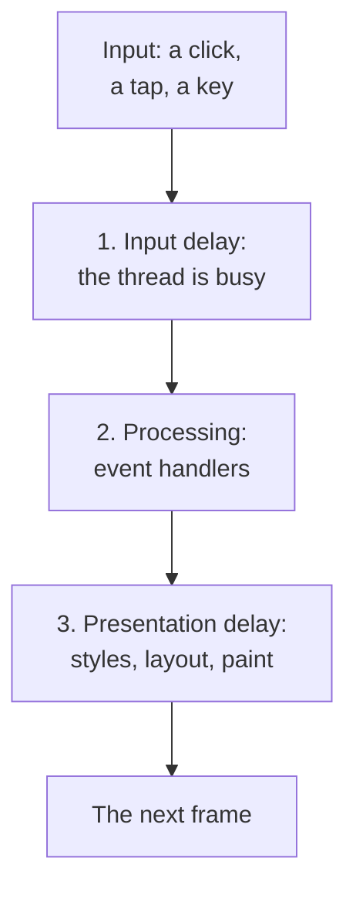
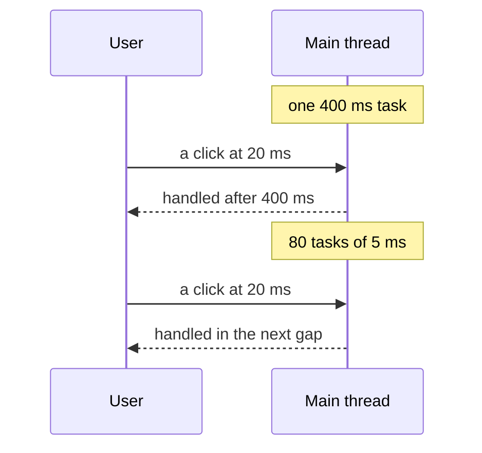

## What this lesson covers

How to make a page respond quickly to clicks and input: the three phases an interaction is made of, why long main-thread tasks ruin INP, how to split work and hand control back to the browser (`scheduler.yield()` and its fallback), what to postpone until after the paint, when to move work into a Web Worker, and what frameworks offer. The example runs in Node.js with a real event loop.

## The three phases of an interaction



| Phase | What happens | Common cause |
|---|---|---|
| Input delay | The event waits until the main thread finishes its current task | Long tasks: loading and running scripts, hydration, timers, third-party code |
| Processing | All handlers of this interaction run (`pointerdown`, `pointerup`, `click`, `keydown`...) | Heavy logic in a handler, a synchronous re-render of a large tree |
| Presentation delay | Style recalculation, layout, painting the next frame | A huge DOM, forced synchronous layout, heavy CSS effects |

INP is the time from input to the next frame, that is, the sum of all three phases. A **long task** is anything that holds the main thread for more than 50 ms: during it the browser neither handles input nor paints.

## A long task versus split work

```ts run
// A click arrives while the page is busy. How long does it wait before its handler runs (input delay)?
const work = (ms: number) => {
  const end = performance.now() + ms
  while (performance.now() < end) {} // stands for parsing JSON, rendering a big list, etc.
}
const yieldToMain = () => new Promise<void>((resolve) => setTimeout(resolve)) // or scheduler.yield() where supported

async function run(label: string, doWork: () => Promise<void> | void) {
  const clickAt = performance.now() + 20
  const delay = new Promise<number>((resolve) => setTimeout(() => resolve(performance.now() - clickAt), 20)) // the "click"
  await doWork()
  return [label, await delay] as const
}

const [, blocked] = await run('one long task', () => work(400))
const [, chunked] = await run('400 ms in 5 ms chunks', async () => {
  for (let i = 0; i < 80; i++) {
    work(5)
    await yieldToMain() // let the browser handle input and paint between chunks
  }
})
console.log('long task: the click waited at least 300 ms:', blocked >= 300)
console.log('chunked work: the click waited far less:', chunked < blocked / 3)
```

```output
long task: the click waited at least 300 ms: true
chunked work: the click waited far less: true
```



The amount of work is the same, but in the second case there are gaps between the chunks in which the browser can handle input and paint a frame.

## How to hand control back to the browser

```ts
// scheduler.yield() continues your work with high priority after pending input and rendering;
// where it is missing (Safari), a timer is the fallback.
const yieldToMain = () =>
  globalThis.scheduler?.yield ? scheduler.yield() : new Promise((resolve) => setTimeout(resolve, 0))

async function processAll(items) {
  let lastYield = performance.now()
  for (const item of items) {
    process(item)
    if (performance.now() - lastYield > 50) {
      await yieldToMain()
      lastYield = performance.now()
    }
  }
}
```

- `scheduler.yield()` is in Chrome and Edge since version 129 and in Firefox since 142, not in Safari, so a fallback is needed. Unlike `setTimeout`, the continuation after `yield` goes to the front of the queue rather than the back, so other tasks do not wedge in for long.
- Yielding after every item is costly; yielding by time (about every 50 ms) is more convenient, as above.

## Paint first, everything else later

A handler often does both what the user is waiting to see and what can wait: analytics, saving to `localStorage`, recomputing secondary blocks.

```ts
button.addEventListener('click', async () => {
  button.classList.add('is-loading') // what the user needs to see right now
  await yieldToMain() // let the browser paint this frame
  sendAnalytics('add-to-cart') // everything else after the paint
  saveCartToStorage()
  updateRecommendations()
})
```

INP measures the time to the **next frame**, so whatever is done after it does not affect the metric, and the user sees a response at once.

## Split or move the work

| Technique | When |
|---|---|
| Split into chunks with `yieldToMain` | A big loop on the main thread: processing a list, rendering a table in parts |
| Input debounce | Search as you type: do not recompute on every letter (implementation in the `async-patterns` lesson) |
| Web Worker | Heavy computation without DOM access: parsing a large JSON or CSV, filtering tens of thousands of rows, crypto, image compression |
| Less work at paint time | A smaller DOM, `content-visibility: auto` for off-screen blocks, no forced layout (the `perf-runtime` and `browser-layout-paint` lessons) |
| Defer third-party scripts | Analytics, chats and ads often cause long tasks (the `perf-resources` lesson) |

In frameworks: in React, `startTransition` and `useDeferredValue` make a re-render interruptible, so input is handled between its parts, but **they do not split synchronous work inside a handler**: a heavy loop in `onClick` stays a long task. In Angular without Zone.js and with `OnPush` there are fewer needless checks; in Vue, `computed` and stable props remove needless re-renders (the framework track lessons).

## Key points

- INP = input delay + processing + presentation delay up to the next frame; a long task (over 50 ms) blocks both input and painting.
- The same amount of work split into short chunks that yield lets a click be handled almost at once.
- `scheduler.yield()` (Chrome and Edge 129+, Firefox 142+, not Safari) with a `setTimeout` fallback; yield roughly every 50 ms.
- In a handler: the visible response first, then `yield`, then the secondary work.
- Heavy DOM-free computation goes to a Web Worker; debounce input; a smaller DOM and no forced layout.
- `startTransition` makes a React re-render interruptible, but not synchronous work inside a handler.
