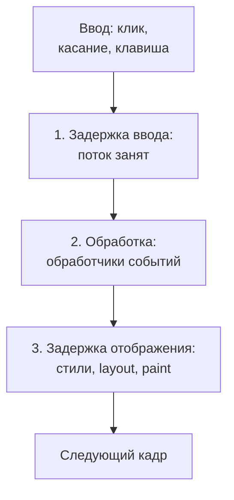
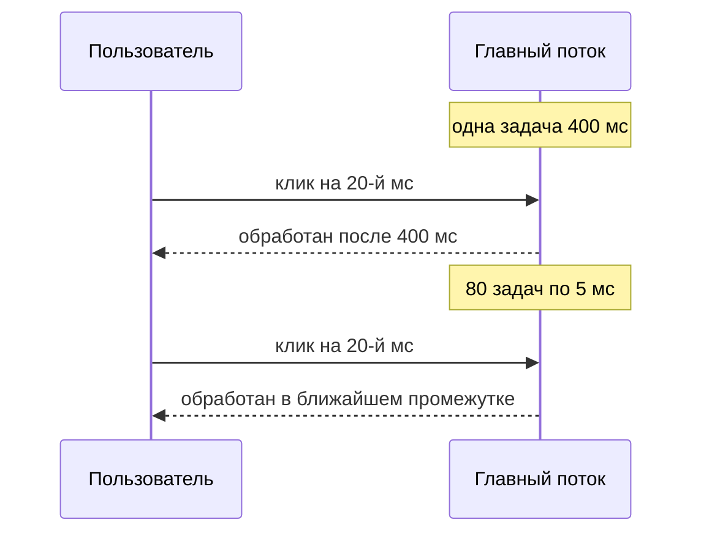

## О чём урок

Как сделать так, чтобы страница быстро отвечала на клики и ввод: из каких трёх фаз складывается взаимодействие, почему долгие задачи главного потока портят INP, как разбивать работу и возвращать управление браузеру (`scheduler.yield()` и запасной вариант), что откладывать после отрисовки, когда выносить работу в Web Worker, и что дают фреймворки. Пример выполняется в Node.js с настоящим циклом событий.

## Три фазы взаимодействия



| Фаза | Что происходит | Частая причина |
|---|---|---|
| Задержка ввода | Событие ждёт, пока главный поток закончит текущую задачу | Долгие задачи: загрузка и выполнение скриптов, гидратация, таймеры, сторонний код |
| Обработка | Выполняются все обработчики этого взаимодействия (`pointerdown`, `pointerup`, `click`, `keydown`...) | Тяжёлая логика в обработчике, синхронный ре-рендер большого дерева |
| Задержка отображения | Пересчёт стилей, layout, отрисовка следующего кадра | Огромный DOM, принудительный синхронный layout, тяжёлые CSS-эффекты |

INP это время от ввода до следующего кадра, то есть сумма всех трёх фаз. **Долгой задачей** называют всё, что занимает главный поток дольше 50 мс: в это время браузер не обрабатывает ввод и не рисует.

## Долгая задача против разбитой

```ts run
// A click arrives while the page is busy. How long does it wait before its handler runs (input delay)?
const work = (ms: number) => {
  const end = performance.now() + ms
  while (performance.now() < end) {} // stands for parsing JSON, rendering a big list, etc.
}
const yieldToMain = () => new Promise<void>((resolve) => setTimeout(resolve)) // or scheduler.yield() where supported

async function run(label: string, doWork: () => Promise<void> | void) {
  const clickAt = performance.now() + 20
  const delay = new Promise<number>((resolve) => setTimeout(() => resolve(performance.now() - clickAt), 20)) // the "click"
  await doWork()
  return [label, await delay] as const
}

const [, blocked] = await run('one long task', () => work(400))
const [, chunked] = await run('400 ms in 5 ms chunks', async () => {
  for (let i = 0; i < 80; i++) {
    work(5)
    await yieldToMain() // let the browser handle input and paint between chunks
  }
})
console.log('long task: the click waited at least 300 ms:', blocked >= 300)
console.log('chunked work: the click waited far less:', chunked < blocked / 3)
```

```output
long task: the click waited at least 300 ms: true
chunked work: the click waited far less: true
```



Объём работы одинаковый, но во втором случае между кусками есть промежутки, в которые браузер успевает обработать ввод и нарисовать кадр.

## Как вернуть управление браузеру

```ts
// scheduler.yield() continues your work with high priority after pending input and rendering;
// where it is missing (Safari), a timer is the fallback.
const yieldToMain = () =>
  globalThis.scheduler?.yield ? scheduler.yield() : new Promise((resolve) => setTimeout(resolve, 0))

async function processAll(items) {
  let lastYield = performance.now()
  for (const item of items) {
    process(item)
    if (performance.now() - lastYield > 50) {
      await yieldToMain()
      lastYield = performance.now()
    }
  }
}
```

- `scheduler.yield()` есть в Chrome и Edge с версии 129 и в Firefox с версии 142, в Safari нет, поэтому нужен запасной вариант. В отличие от `setTimeout`, продолжение после `yield` встаёт в начало очереди, а не в конец, и другие задачи не вклиниваются надолго.
- Возвращать управление после каждого элемента дорого; удобнее по времени (раз в ~50 мс), как в примере выше.

## Сначала отрисовать, потом остальное

Обработчик часто делает и то, что пользователь ждёт увидеть, и то, что может подождать: аналитику, сохранение в `localStorage`, пересчёт второстепенных блоков.

```ts
button.addEventListener('click', async () => {
  button.classList.add('is-loading') // what the user needs to see right now
  await yieldToMain() // let the browser paint this frame
  sendAnalytics('add-to-cart') // everything else after the paint
  saveCartToStorage()
  updateRecommendations()
})
```

INP измеряет время до **следующего кадра**, поэтому всё, что сделано после него, на метрику не влияет, а пользователь сразу видит отклик.

## Разбить или вынести работу

| Приём | Когда |
|---|---|
| Разбить на куски с `yieldToMain` | Большой цикл в главном потоке: обработка списка, рендер таблицы частями |
| Задержка ввода (debounce) | Поиск по мере ввода: не пересчитывать на каждую букву (реализация в уроке `async-patterns`) |
| Web Worker | Тяжёлые вычисления без доступа к DOM: разбор большого JSON или CSV, фильтрация десятков тысяч строк, криптография, сжатие картинок |
| Меньше работы при отрисовке | Меньше DOM, `content-visibility: auto` для невидимых блоков, без принудительного layout (уроки `perf-runtime`, `browser-layout-paint`) |
| Отложить сторонние скрипты | Аналитика, чаты, реклама часто дают долгие задачи (урок `perf-resources`) |

Во фреймворках: в React `startTransition` и `useDeferredValue` делают ре-рендер прерываемым, и ввод обрабатывается между его частями, но **синхронную работу внутри обработчика они не разбивают**: тяжёлый цикл в `onClick` останется долгой задачей. В Angular без Zone.js и с `OnPush` меньше лишних проверок; во Vue лишние перерисовки убирают `computed` и стабильные пропсы (уроки треков фреймворков).

## Главное

- INP = задержка ввода + обработка + задержка отображения до следующего кадра; долгая задача (больше 50 мс) блокирует и ввод, и отрисовку.
- Одинаковый объём работы, разбитый на короткие куски с возвратом управления, позволяет обработать клик почти сразу.
- `scheduler.yield()` (Chrome и Edge 129+, Firefox 142+, не Safari) с запасным вариантом `setTimeout`; возвращать управление примерно раз в 50 мс.
- В обработчике сначала видимый отклик, затем `yield`, затем второстепенная работа.
- Тяжёлые вычисления без DOM в Web Worker; ввод с задержкой; меньше DOM и без принудительного layout.
- `startTransition` делает прерываемым ре-рендер React, но не синхронную работу в обработчике.
