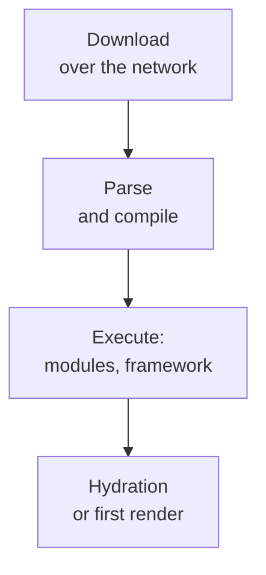

## What this lesson covers

Why JavaScript is the most expensive resource on a page and how to reduce it: finding what bloats the bundle, splitting code by route and by heavy component, tree shaking and why CommonJS gets in its way, replacing heavy libraries, a build target without "differential serving", caching hashed files, and compression. The examples run in Node.js on the real `rolldown` bundler (the one inside Vite 8).

## The cost of JavaScript



A 200 KB image is only decoded and painted after it downloads. 200 KB of JavaScript also has to be parsed, compiled and executed on the main thread, and on a weak phone that is several times slower than on a developer's laptop. That is why extra JavaScript hurts not only LCP (download and execution before display) but also INP (long tasks while the user is already clicking).

## What bloats the bundle

- **A bundle analyzer**: `rollup-plugin-visualizer` for Vite, the Turbopack Bundle Analyzer in Next.js, `source-map-explorer` for any bundle with a source map. They show how much each module and library takes.
- **The Coverage tab** in DevTools: how much of the loaded code did not run during page load. A large unused share in the main bundle is a candidate for splitting.
- **Size at import time**: editor extensions and sites like bundlephobia show a package's weight before you install it.
- Look at both the **compressed size** (what goes over the network) and the **uncompressed size** (what the browser parses and executes).

## Code splitting

```ts run
import { rolldown } from 'rolldown'

const files: Record<string, string> = {
  'main.js': `
    import { renderHome } from './home.js'
    renderHome()
    document.querySelector('#edit').addEventListener('click', async () => {
      const { openEditor } = await import('./editor.js') // loaded only when needed
      openEditor()
    })`,
  'home.js': `export const renderHome = () => console.log('home')`,
  'editor.js': `import { highlight } from './highlighter.js'
    export const openEditor = () => highlight('a heavy editor with syntax highlighting')`,
  'highlighter.js': `export const highlight = (s) => s.replace(/a/g, 'A')`,
}
const virtual = { name: 'virtual', resolveId: (id: string) => id.replace('./', ''), load: (id: string) => files[id] }

const bundle = await rolldown({ input: 'main.js', plugins: [virtual], logLevel: 'silent' })
const { output } = await bundle.generate({ entryFileNames: '[name]-[hash].js', chunkFileNames: '[name]-[hash].js' })
for (const chunk of output) {
  if (chunk.type !== 'chunk') continue
  const name = chunk.fileName.replace(/-[\w-]{8,}\.js$/, '-<hash>.js')
  console.log(name.padEnd(18), chunk.isEntry ? 'entry  ' : 'dynamic', 'modules:', Object.keys(chunk.modules).join(', '))
}
```

```output
main-<hash>.js     entry   modules: home.js, main.js
editor-<hash>.js   dynamic modules: highlighter.js, editor.js
```

- A dynamic `import()` creates a separate chunk: the editor and its syntax highlighting load only on click, and the home page does not carry them.
- Split by **route** (each page its own chunk; meta-frameworks do this themselves) and by **heavy components** that are not on the first screen: an editor, charts, a map, modals, an admin area.
- **Do not make the first screen lazy**: `React.lazy` for first-screen content adds another request before the content shows.
- Load a lazy chunk **ahead of time** when navigation is likely: on hovering a link, when a link scrolls into view, during idle time (`<link rel="modulepreload">`, router `prefetch`, Speculation Rules).

## Tree shaking

```ts run
import { rolldown } from 'rolldown'

// Two versions of the same utility library: ES modules and CommonJS.
const files: Record<string, string> = {
  'utils-esm.js': `
    export const formatPrice = (n) => n.toFixed(2) + ' EUR'
    export const parseCsv = (text) => text.split('\\n').map((line) => line.split(','))
    export const deepClone = (v) => JSON.parse(JSON.stringify(v))`,
  'utils-cjs.js': `
    module.exports = {
      formatPrice: (n) => n.toFixed(2) + ' EUR',
      parseCsv: (text) => text.split('\\n').map((line) => line.split(',')),
      deepClone: (v) => JSON.parse(JSON.stringify(v)),
    }`,
  'app-esm.js': `import { formatPrice } from './utils-esm.js'; console.log(formatPrice(9))`,
  'app-cjs.js': `import { formatPrice } from './utils-cjs.js'; console.log(formatPrice(9))`,
}
// A tiny plugin: modules come from the object above instead of the disk.
const virtual = {
  name: 'virtual',
  resolveId: (id: string) => id.replace('./', ''),
  load: (id: string) => files[id],
}

for (const entry of ['app-esm.js', 'app-cjs.js']) {
  const bundle = await rolldown({ input: entry, plugins: [virtual], logLevel: 'silent' })
  const { output } = await bundle.generate({ minify: true })
  const code = output[0].code
  const kept = ['parseCsv', 'deepClone', 'JSON.parse'].filter((name) => code.includes(name))
  console.log(entry.padEnd(11), `${code.length} bytes | unused code kept: ${kept.join(', ') || 'none'}`)
}
```

```output
app-esm.js  41 bytes | unused code kept: none
app-cjs.js  285 bytes | unused code kept: parseCsv, deepClone, JSON.parse
```

- Tree shaking removes exports nobody imports. For that the bundler needs **ES modules**: `import` and `export` are static and visible at build time.
- In CommonJS, `module.exports` is an ordinary object built at runtime: the bundler cannot know which properties will be needed and keeps all of them, plus a module wrapper. Some bundlers can drop individual `exports.x = ...` assignments, but they leave a whole object alone.
- The `"sideEffects": false` field in a library's `package.json` allows dropping whole unused modules; files imported for a side effect (`import './polyfill.js'`, global styles) must be listed in that field.

The lodash example from the notes, measured on version 4.17.21:

| File | Uncompressed | gzip | Brotli |
|---|---|---|---|
| `lodash.js` (all of it, not minified) | 544 KB | 96 KB | 74 KB |
| `lodash.min.js` (all of it, minified) | 73 KB | 26 KB | 23 KB |

`import _ from 'lodash'` (CommonJS) adds the whole library: about 26 KB after gzip, not 70 as the notes say (70 KB is the minified size). `import { debounce } from 'lodash-es'` or a standalone function adds only what is needed. Often no library is needed at all: `structuredClone` instead of `cloneDeep`, `Intl.DateTimeFormat` and `Intl.RelativeTimeFormat` instead of date-formatting libraries, `Object.groupBy` instead of `groupBy`.

## The bundler and the build target

- **The build target** determines which syntax remains: by default Vite builds for Baseline Widely Available browsers (Chrome and Edge 111+, Firefox 114+, Safari 16.4+). The old scheme of "a modern bundle for new browsers, ES5 with polyfills for old ones" through `type="module"` and `nomodule` is no longer needed: all supported browsers run ES modules.
- Add polyfills only for what the target browsers lack, not "just in case".
- The choice of bundler (Vite with Rolldown, Turbopack in Next.js 16, esbuild in Angular, webpack 5 or Rspack) affects **build speed** more than bundle size: tree shaking and code splitting are everywhere. The claim "webpack is dead" is wrong: it is maintained and runs many projects.

## Caching and compression

```text
Cache-Control: public, max-age=31536000, immutable   # main-3f9a1c2b.js: the name changes with the content
Cache-Control: no-cache                              # index.html: always revalidate, it points to the new hashes
```

- Files with a content hash in the name are cached for a year with `immutable`: a new version changes the name, and the browser downloads only the changed chunks. HTML is cached briefly or with revalidation, otherwise the user never learns the new names (the `net-caching` lesson).
- Do not mix frequently changing code with rarely changing code: libraries in a separate chunk stay cached between releases.
- Brotli is usually 10–25% smaller than gzip (in the table above 23 versus 26 KB and 74 versus 96 KB); static files are compressed at build time at the maximum level, not on the fly (the `net-loading` lesson).

## Key points

- JavaScript costs more than an image of the same size: it is parsed, compiled and executed on the main thread; extra JS hurts LCP and INP.
- Find the excess: a bundle analyzer, the Coverage tab, a package's size before installing; look at both compressed and uncompressed size.
- Code splitting: `import()` by route and heavy component; the first screen is not lazy; preload lazy chunks when navigation is likely.
- Tree shaking works with ES modules; CommonJS `module.exports` comes in whole; `"sideEffects": false` allows dropping modules.
- All of lodash is about 26 KB gzip; often `structuredClone`, `Intl` or `Object.groupBy` replace a library.
- A Baseline build target, no `nomodule`; hashed files `immutable` for a year, HTML revalidated; Brotli at build time.
