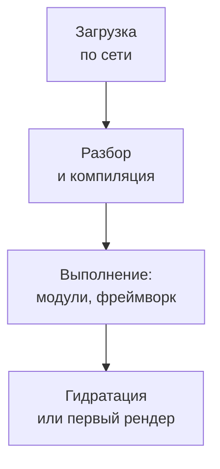

## О чём урок

Почему JavaScript самый дорогой ресурс страницы и как его уменьшать: как найти, что раздувает бандл, разбиение кода по маршрутам и тяжёлым компонентам, tree shaking и почему CommonJS ему мешает, замена тяжёлых библиотек, цель сборки без «дифференциальной раздачи», кэш файлов с хэшем и сжатие. Примеры выполняются в Node.js на настоящем сборщике `rolldown` (он же внутри Vite 8).

## Цена JavaScript



Картинка весом 200 КБ после загрузки только декодируется и рисуется. 200 КБ JavaScript нужно ещё разобрать, скомпилировать и выполнить в главном потоке, а на слабом телефоне это в несколько раз медленнее, чем на ноутбуке разработчика. Поэтому лишний JavaScript ухудшает не только LCP (загрузка и выполнение до показа), но и INP (долгие задачи, пока пользователь уже кликает).

## Что раздувает бандл

- **Анализатор бандла**: `rollup-plugin-visualizer` для Vite, Turbopack Bundle Analyzer в Next.js, `source-map-explorer` для любого бандла с source map. Показывают, какие модули и библиотеки сколько занимают.
- **Вкладка Coverage** в DevTools: сколько загруженного кода не выполнилось при загрузке страницы. Большая доля неиспользованного кода в главном бандле это кандидат на разбиение.
- **Размер при импорте**: расширения редактора и сайты вроде bundlephobia показывают вес пакета до установки.
- Смотрят **размер после сжатия** (то, что идёт по сети) и **размер без сжатия** (то, что браузер разбирает и выполняет).

## Разбиение кода

```ts run
import { rolldown } from 'rolldown'

const files: Record<string, string> = {
  'main.js': `
    import { renderHome } from './home.js'
    renderHome()
    document.querySelector('#edit').addEventListener('click', async () => {
      const { openEditor } = await import('./editor.js') // loaded only when needed
      openEditor()
    })`,
  'home.js': `export const renderHome = () => console.log('home')`,
  'editor.js': `import { highlight } from './highlighter.js'
    export const openEditor = () => highlight('a heavy editor with syntax highlighting')`,
  'highlighter.js': `export const highlight = (s) => s.replace(/a/g, 'A')`,
}
const virtual = { name: 'virtual', resolveId: (id: string) => id.replace('./', ''), load: (id: string) => files[id] }

const bundle = await rolldown({ input: 'main.js', plugins: [virtual], logLevel: 'silent' })
const { output } = await bundle.generate({ entryFileNames: '[name]-[hash].js', chunkFileNames: '[name]-[hash].js' })
for (const chunk of output) {
  if (chunk.type !== 'chunk') continue
  const name = chunk.fileName.replace(/-[\w-]{8,}\.js$/, '-<hash>.js')
  console.log(name.padEnd(18), chunk.isEntry ? 'entry  ' : 'dynamic', 'modules:', Object.keys(chunk.modules).join(', '))
}
```

```output
main-<hash>.js     entry   modules: home.js, main.js
editor-<hash>.js   dynamic modules: highlighter.js, editor.js
```

- Динамический `import()` создаёт отдельный чанк: редактор и его подсветка синтаксиса загрузятся только при клике, а на главной их нет.
- Делят по **маршрутам** (каждая страница свой чанк; метафреймворки делают это сами) и по **тяжёлым компонентам**, которых нет на первом экране: редактор, графики, карта, модальные окна, админка.
- **Первый экран не делают ленивым**: `React.lazy` для содержимого первого экрана добавляет ещё один запрос перед показом контента.
- Ленивый чанк загружают **заранее**, когда переход вероятен: при наведении на ссылку, при появлении ссылки в видимой области, в простое (`<link rel="modulepreload">`, `prefetch` роутера, Speculation Rules).

## Tree shaking

```ts run
import { rolldown } from 'rolldown'

// Two versions of the same utility library: ES modules and CommonJS.
const files: Record<string, string> = {
  'utils-esm.js': `
    export const formatPrice = (n) => n.toFixed(2) + ' EUR'
    export const parseCsv = (text) => text.split('\\n').map((line) => line.split(','))
    export const deepClone = (v) => JSON.parse(JSON.stringify(v))`,
  'utils-cjs.js': `
    module.exports = {
      formatPrice: (n) => n.toFixed(2) + ' EUR',
      parseCsv: (text) => text.split('\\n').map((line) => line.split(',')),
      deepClone: (v) => JSON.parse(JSON.stringify(v)),
    }`,
  'app-esm.js': `import { formatPrice } from './utils-esm.js'; console.log(formatPrice(9))`,
  'app-cjs.js': `import { formatPrice } from './utils-cjs.js'; console.log(formatPrice(9))`,
}
// A tiny plugin: modules come from the object above instead of the disk.
const virtual = {
  name: 'virtual',
  resolveId: (id: string) => id.replace('./', ''),
  load: (id: string) => files[id],
}

for (const entry of ['app-esm.js', 'app-cjs.js']) {
  const bundle = await rolldown({ input: entry, plugins: [virtual], logLevel: 'silent' })
  const { output } = await bundle.generate({ minify: true })
  const code = output[0].code
  const kept = ['parseCsv', 'deepClone', 'JSON.parse'].filter((name) => code.includes(name))
  console.log(entry.padEnd(11), `${code.length} bytes | unused code kept: ${kept.join(', ') || 'none'}`)
}
```

```output
app-esm.js  41 bytes | unused code kept: none
app-cjs.js  285 bytes | unused code kept: parseCsv, deepClone, JSON.parse
```

- Tree shaking удаляет экспорты, которые никто не импортирует. Для этого сборщику нужны **ES-модули**: `import` и `export` статичны, их видно при сборке.
- В CommonJS `module.exports` это обычный объект, собранный во время выполнения: сборщик не знает, какие свойства понадобятся, и оставляет всё, плюс обёртку модуля. Часть сборщиков умеет выкидывать отдельные присваивания `exports.x = ...`, но объект целиком не трогает.
- Поле `"sideEffects": false` в `package.json` библиотеки разрешает выкидывать целые неиспользуемые модули; импорт файла ради побочного эффекта (`import './polyfill.js'`, глобальные стили) нужно перечислить в этом поле.

Пример из заметок с lodash, измеренный на версии 4.17.21:

| Файл | Без сжатия | gzip | Brotli |
|---|---|---|---|
| `lodash.js` (весь, без минификации) | 544 КБ | 96 КБ | 74 КБ |
| `lodash.min.js` (весь, минифицированный) | 73 КБ | 26 КБ | 23 КБ |

`import _ from 'lodash'` (CommonJS) добавляет всю библиотеку: около 26 КБ после gzip, а не 70, как в заметках (70 КБ это минифицированный размер). `import { debounce } from 'lodash-es'` или отдельная функция добавят только нужное. Часто библиотека не нужна вовсе: `structuredClone` вместо `cloneDeep`, `Intl.DateTimeFormat` и `Intl.RelativeTimeFormat` вместо библиотек форматирования дат, `Object.groupBy` вместо `groupBy`.

## Сборщик и цель сборки

- **Цель сборки** определяет, какой синтаксис останется: Vite по умолчанию собирает под браузеры уровня Baseline Widely Available (Chrome и Edge 111+, Firefox 114+, Safari 16.4+). Старые схемы «современный бандл для новых браузеров, ES5 с полифилами для старых» через `type="module"` и `nomodule` больше не нужны: все поддерживаемые браузеры выполняют ES-модули.
- Полифилы добавляют только для того, чего нет у целевых браузеров, а не «на всякий случай».
- Выбор сборщика (Vite с Rolldown, Turbopack в Next.js 16, esbuild в Angular, webpack 5 или Rspack) сильнее влияет на **скорость сборки**, чем на размер бандла: tree shaking и разбиение кода есть у всех. Утверждение «webpack мёртв» неверно: он поддерживается и работает во многих проектах.

## Кэш и сжатие

```text
Cache-Control: public, max-age=31536000, immutable   # main-3f9a1c2b.js: the name changes with the content
Cache-Control: no-cache                              # index.html: always revalidate, it points to the new hashes
```

- Файлы с хэшем содержимого в имени кэшируют на год с `immutable`: при новой версии меняется имя, и браузер загружает только изменившиеся чанки. HTML кэшируют коротко или с проверкой, иначе пользователь не узнает о новых именах (урок `net-caching`).
- Не смешивайте часто меняющийся код с редко меняющимся: библиотеки в отдельном чанке живут в кэше между выпусками.
- Сжатие Brotli обычно на 10–25 % меньше gzip (в таблице выше 23 против 26 КБ и 74 против 96 КБ); статические файлы сжимают при сборке с максимальным уровнем, а не на лету (урок `net-loading`).

## Главное

- JavaScript дороже картинок того же веса: его разбирают, компилируют и выполняют в главном потоке; лишний JS ухудшает LCP и INP.
- Найти лишнее: анализатор бандла, вкладка Coverage, размер пакета до установки; смотреть размер и сжатый, и без сжатия.
- Разбиение кода: `import()` по маршрутам и тяжёлым компонентам; первый экран не ленивый; ленивые чанки предзагружать при вероятном переходе.
- Tree shaking работает с ES-модулями; `module.exports` в CommonJS попадает целиком; `"sideEffects": false` разрешает выкидывать модули.
- lodash целиком около 26 КБ gzip; часто вместо библиотеки хватает `structuredClone`, `Intl`, `Object.groupBy`.
- Цель сборки Baseline, без `nomodule`; файлы с хэшем `immutable` на год, HTML с проверкой; Brotli при сборке.
