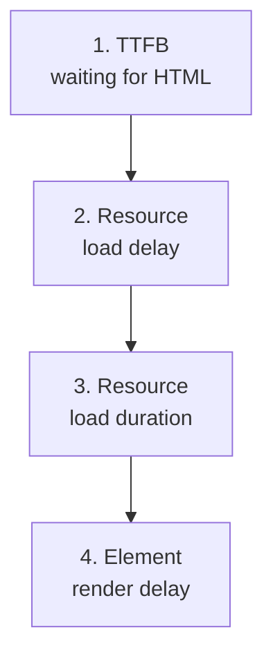

## What this lesson covers

How to make the main content appear sooner: what the browser counts as the LCP element, how to split LCP into four parts and find the biggest, which techniques work for each part, and the typical mistakes (lazy-loading the first-screen image, an image in CSS or in JavaScript, client-side rendering). The example runs in Node.js.

## What the LCP element is

LCP marks the moment the **largest visible element of the first screen** is painted. Candidates: ``, `<image>` inside SVG, the `<video>` poster (and the first video frame), an element with a `background-image: url(...)`, a text block. While the page loads, the candidate can change: first a heading, then a large image. Measurement stops on the user's first input or scroll. Which element became the LCP is shown by the Performance panel and `web-vitals/attribution`.

## The four parts of LCP



| Part | From and to | Ideal share |
|---|---|---|
| TTFB | Navigation start → the first byte of HTML | about 40% |
| Resource load delay | The first byte → the LCP image starts loading | under 10% |
| Resource load duration | Start → end of the image download | about 40% |
| Element render delay | Download end → the image on screen | under 10% |

If the LCP element is text, the second and third parts are absent. Optimizing blindly is pointless: first find out which part is the biggest.

```ts run
// LCP split into four parts, from Navigation Timing and Resource Timing of the LCP image (ms).
type Page = { name: string; ttfb: number; requestStart: number; responseEnd: number; lcp: number }
const pages: Page[] = [
  { name: 'slow server', ttfb: 1900, requestStart: 2000, responseEnd: 2300, lcp: 2400 },
  { name: 'image found late', ttfb: 300, requestStart: 1900, responseEnd: 2300, lcp: 2400 },
  { name: 'heavy image', ttfb: 300, requestStart: 400, responseEnd: 2300, lcp: 2400 },
  { name: 'render blocked', ttfb: 300, requestStart: 400, responseEnd: 800, lcp: 2400 },
]
const advice = {
  'time to first byte': 'CDN, cache HTML, faster backend, stream the shell',
  'resource load delay': 'image in the HTML, preload, fetchpriority="high", no loading="lazy"',
  'resource load duration': 'AVIF or WebP, srcset with the right size, compression, CDN',
  'element render delay': 'less render-blocking CSS and JS, do not wait for client rendering',
}
for (const p of pages) {
  const parts = {
    'time to first byte': p.ttfb,
    'resource load delay': p.requestStart - p.ttfb,
    'resource load duration': p.responseEnd - p.requestStart,
    'element render delay': p.lcp - p.responseEnd,
  }
  const [worst] = Object.entries(parts).sort((a, b) => b[1] - a[1])
  console.log(`${p.name.padEnd(17)} LCP ${p.lcp} ms: ${Object.values(parts).join(' + ')}`)
  console.log(`  biggest: ${worst[0]} -> ${advice[worst[0] as keyof typeof advice]}`)
}
```

```output
slow server       LCP 2400 ms: 1900 + 100 + 300 + 100
  biggest: time to first byte -> CDN, cache HTML, faster backend, stream the shell
image found late  LCP 2400 ms: 300 + 1600 + 400 + 100
  biggest: resource load delay -> image in the HTML, preload, fetchpriority="high", no loading="lazy"
heavy image       LCP 2400 ms: 300 + 100 + 1900 + 100
  biggest: resource load duration -> AVIF or WebP, srcset with the right size, compression, CDN
render blocked    LCP 2400 ms: 300 + 100 + 400 + 1600
  biggest: element render delay -> less render-blocking CSS and JS, do not wait for client rendering
```

Four pages with the same 2.4 s LCP need different fixes. The parts are computed from Navigation Timing (`responseStart`) and the image's Resource Timing (`requestStart`, `responseEnd`); `web-vitals/attribution` provides them ready-made.

## TTFB

- Cache HTML on a CDN (`s-maxage`, `stale-while-revalidate`) or serve static files (the `render-static` lesson).
- No sequential database queries during render; stream the shell (the `render-streaming` lesson).
- Remove extra redirects (`http` → `https` → `www` → `/en/` is three extra round trips).
- The fastest navigation is one served from the **bfcache** (the Back and Forward buttons) or **prerendered** by Speculation Rules (the `net-loading` lesson): LCP is nearly zero.

## Resource load delay

The browser must **discover** the LCP image as early as possible. The preload scanner (the `browser-rendering` lesson) finds only what is in the original HTML.

```html
<!-- Discovered at once, high priority, not lazy -->


<!-- A CSS background or an image chosen by JavaScript: tell the browser in advance -->
<link rel="preload" as="image" href="/hero-800.avif"
      imagesrcset="/hero-400.avif 400w, /hero-800.avif 800w" imagesizes="100vw" fetchpriority="high">
```

| Mistake | Why it hurts |
|---|---|
| `loading="lazy"` on a first-screen image | A lazy image waits for layout, so its download starts late |
| The image as a `background-image` in an external CSS file | The browser learns about it only after the CSS is downloaded and parsed |
| JavaScript inserts the image (client rendering, a slider) | First JS loads and runs, then data is fetched, and only then the image |
| Low priority | Without `fetchpriority="high"` images load at low priority until layout shows they are on screen |

## Resource load duration

- Format: AVIF or WebP instead of JPEG and PNG is noticeably lighter at the same quality.
- Size: `srcset` and `sizes` give a phone an image for its screen, not 2000 pixels for a 400-pixel column.
- Compression and a CDN close to the user; one domain for HTML and images saves a connection setup (or use `preconnect`).
- Responsive images are covered in detail in the `html-media-seo` lesson.

## Element render delay

The image has loaded but is not painted:

- Render-blocking CSS and synchronous scripts in `<head>` are still loading: inline the critical CSS, load the rest asynchronously, scripts with `defer` or `type="module"`.
- The element is hidden until JavaScript runs: an A/B test with "anti-flicker" that hides the page, a slider that shows the first slide after initialization.
- Long main-thread tasks push back the frame.
- For a text LCP: the font is still loading and the text is invisible (`font-display`, the `perf-resources` lesson).

## Key points

- The LCP element is the largest visible first-screen element: an image, a poster, a `url()` background or a text block; DevTools and `web-vitals/attribution` show which one.
- LCP = TTFB + resource load delay + resource load duration + element render delay; find the biggest part first.
- TTFB: HTML cached on a CDN, no sequential queries, streaming, no extra redirects; the bfcache and Speculation Rules give a near-instant LCP.
- Load delay: the image in the original HTML with `fetchpriority="high"`, no `loading="lazy"`; for backgrounds and images from JS, `<link rel="preload" as="image">`.
- Load duration: AVIF and WebP, `srcset` and `sizes`, a CDN. Render delay: less render-blocking CSS and JS, do not hide content until scripts run.
