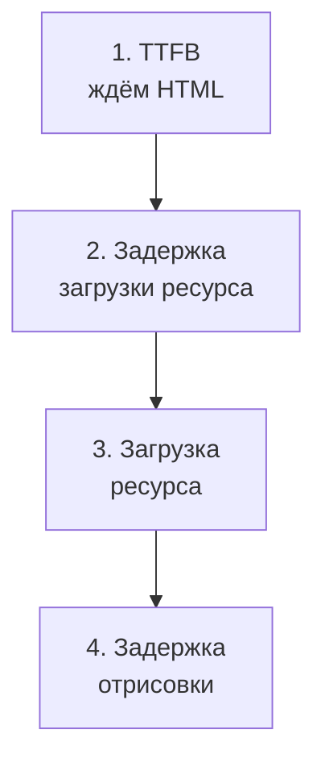

## О чём урок

Как ускорить появление главного контента: что браузер считает элементом LCP, как разложить LCP на четыре части и найти самую большую, какие приёмы работают для каждой части, и типичные ошибки (ленивая загрузка картинки первого экрана, картинка в CSS или в JavaScript, клиентский рендер). Пример выполняется в Node.js.

## Что такое элемент LCP

LCP отмечает момент, когда отрисован **самый крупный видимый элемент первого экрана**. Кандидаты: ``, `<image>` внутри SVG, постер `<video>` (и первый кадр видео), элемент с фоном `background-image: url(...)`, блок текста. Пока страница грузится, кандидат может меняться: сначала заголовок, потом крупная картинка. Измерение останавливается при первом вводе пользователя или прокрутке. Какой элемент оказался LCP, показывают панель Performance и `web-vitals/attribution`.

## Четыре части LCP



| Часть | От и до | Идеальная доля |
|---|---|---|
| TTFB | Начало навигации → первый байт HTML | около 40 % |
| Задержка загрузки ресурса | Первый байт → начало загрузки картинки LCP | меньше 10 % |
| Загрузка ресурса | Начало → конец загрузки картинки | около 40 % |
| Задержка отрисовки | Конец загрузки → картинка на экране | меньше 10 % |

Если элемент LCP это текст, второй и третьей частей нет. Оптимизировать вслепую бессмысленно: сначала нужно узнать, какая часть больше.

```ts run
// LCP split into four parts, from Navigation Timing and Resource Timing of the LCP image (ms).
type Page = { name: string; ttfb: number; requestStart: number; responseEnd: number; lcp: number }
const pages: Page[] = [
  { name: 'slow server', ttfb: 1900, requestStart: 2000, responseEnd: 2300, lcp: 2400 },
  { name: 'image found late', ttfb: 300, requestStart: 1900, responseEnd: 2300, lcp: 2400 },
  { name: 'heavy image', ttfb: 300, requestStart: 400, responseEnd: 2300, lcp: 2400 },
  { name: 'render blocked', ttfb: 300, requestStart: 400, responseEnd: 800, lcp: 2400 },
]
const advice = {
  'time to first byte': 'CDN, cache HTML, faster backend, stream the shell',
  'resource load delay': 'image in the HTML, preload, fetchpriority="high", no loading="lazy"',
  'resource load duration': 'AVIF or WebP, srcset with the right size, compression, CDN',
  'element render delay': 'less render-blocking CSS and JS, do not wait for client rendering',
}
for (const p of pages) {
  const parts = {
    'time to first byte': p.ttfb,
    'resource load delay': p.requestStart - p.ttfb,
    'resource load duration': p.responseEnd - p.requestStart,
    'element render delay': p.lcp - p.responseEnd,
  }
  const [worst] = Object.entries(parts).sort((a, b) => b[1] - a[1])
  console.log(`${p.name.padEnd(17)} LCP ${p.lcp} ms: ${Object.values(parts).join(' + ')}`)
  console.log(`  biggest: ${worst[0]} -> ${advice[worst[0] as keyof typeof advice]}`)
}
```

```output
slow server       LCP 2400 ms: 1900 + 100 + 300 + 100
  biggest: time to first byte -> CDN, cache HTML, faster backend, stream the shell
image found late  LCP 2400 ms: 300 + 1600 + 400 + 100
  biggest: resource load delay -> image in the HTML, preload, fetchpriority="high", no loading="lazy"
heavy image       LCP 2400 ms: 300 + 100 + 1900 + 100
  biggest: resource load duration -> AVIF or WebP, srcset with the right size, compression, CDN
render blocked    LCP 2400 ms: 300 + 100 + 400 + 1600
  biggest: element render delay -> less render-blocking CSS and JS, do not wait for client rendering
```

Четыре страницы с одинаковым LCP 2,4 с требуют разных исправлений. Части считают из Navigation Timing (`responseStart`) и Resource Timing картинки (`requestStart`, `responseEnd`); `web-vitals/attribution` отдаёт их готовыми.

## TTFB

- Кэшировать HTML на CDN (`s-maxage`, `stale-while-revalidate`) или отдавать статику (урок `render-static`).
- Не делать последовательных запросов к базе при рендере; стримить оболочку (урок `render-streaming`).
- Убрать лишние редиректы (`http` → `https` → `www` → `/ru/` это три лишних похода).
- Самый быстрый переход тот, что берётся из **bfcache** (кнопки «Назад» и «Вперёд») или **предзагрузки** Speculation Rules (урок `net-loading`): LCP почти нулевой.

## Задержка загрузки ресурса

Браузер должен **узнать** о картинке LCP как можно раньше. Сканер предзагрузки (урок `browser-rendering`) находит только то, что есть в исходном HTML.

```html
<!-- Discovered at once, high priority, not lazy -->


<!-- A CSS background or an image chosen by JavaScript: tell the browser in advance -->
<link rel="preload" as="image" href="/hero-800.avif"
      imagesrcset="/hero-400.avif 400w, /hero-800.avif 800w" imagesizes="100vw" fetchpriority="high">
```

| Ошибка | Почему вредит |
|---|---|
| `loading="lazy"` у картинки первого экрана | Ленивая картинка ждёт расчёта вёрстки, её загрузка начинается поздно |
| Картинка в `background-image` внешнего CSS | Браузер узнаёт о ней только после загрузки и разбора CSS |
| Картинку вставляет JavaScript (клиентский рендер, слайдер) | Сначала загрузка и выполнение JS, затем запрос данных, и только потом картинка |
| Низкий приоритет | Без `fetchpriority="high"` картинки грузятся с низким приоритетом, пока вёрстка не покажет, что они на экране |

## Загрузка ресурса

- Формат: AVIF или WebP вместо JPEG и PNG при том же качестве заметно легче.
- Размер: `srcset` и `sizes` отдают телефону картинку под его экран, а не 2000 пикселей для колонки в 400.
- Сжатие и CDN рядом с пользователем; один домен для HTML и картинок экономит установку соединения (или `preconnect`).
- Подробно об адаптивных изображениях в уроке `html-media-seo`.

## Задержка отрисовки

Картинка загружена, но не нарисована:

- Блокирующие CSS и синхронные скрипты в `<head>` ещё грузятся: инлайнить критический CSS, остальное грузить асинхронно, скрипты с `defer` или `type="module"`.
- Элемент скрыт, пока не выполнится JavaScript: A/B-тест с «анти-мерцанием», который прячет страницу, слайдер, который показывает первый слайд после инициализации.
- Длинные задачи главного потока отодвигают отрисовку кадра.
- Для текстового LCP: шрифт ещё грузится и текст невидим (`font-display`, урок `perf-resources`).

## Главное

- Элемент LCP это самый крупный видимый элемент первого экрана: картинка, постер, фон с `url()` или блок текста; его показывают DevTools и `web-vitals/attribution`.
- LCP = TTFB + задержка загрузки ресурса + загрузка ресурса + задержка отрисовки; сначала находят самую большую часть.
- TTFB: кэш HTML на CDN, без последовательных запросов, стриминг, без лишних редиректов; bfcache и Speculation Rules дают почти мгновенный LCP.
- Задержка загрузки: картинка в исходном HTML с `fetchpriority="high"`, без `loading="lazy"`; для фона и картинок из JS `<link rel="preload" as="image">`.
- Загрузка: AVIF и WebP, `srcset` и `sizes`, CDN. Отрисовка: меньше блокирующего CSS и JS, не прятать контент до выполнения скриптов.
