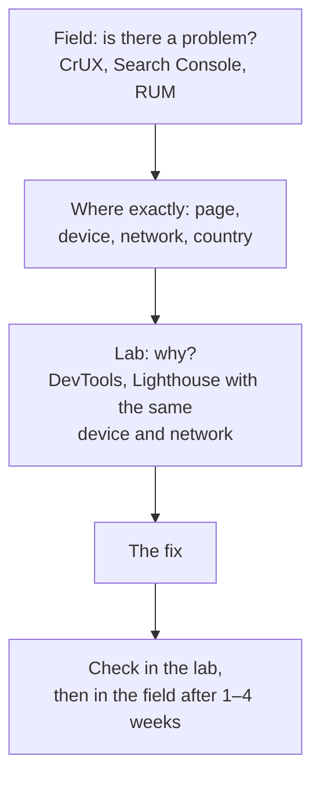

## What this lesson covers

What to measure performance with, and how: the Performance panel in DevTools and how to read its recording, Lighthouse and what its score is made of, PageSpeed Insights and CrUX, collecting metrics from real users with the `web-vitals` library, your own User Timing marks, Long Animation Frames, and how to slice the data to find a problem. The example runs in Node.js, which has the same Performance API.

## The workflow



Start with field data, not Lighthouse: optimizing what does not bother users is pointless. CrUX averages 28 days, so a fix shows up there gradually, while your own RUM shows it almost at once.

## The Performance panel in DevTools

- **Live metrics** when the panel opens: LCP, CLS and INP of the current page as you use it, with the LCP element and the INP interaction. Next to them, CrUX data for this URL, to compare your machine with real users.
- **The recording**: the Network track (the request waterfall), Main (main-thread tasks as a "flame": the caller on top, callees below), Frames, Timings (FCP, LCP), Interactions (each interaction broken into phases).
- **Long tasks** are marked with a red corner: anything over 50 ms blocks input. Clicking a task shows which functions took the time and links to the source.
- **Insights** in the sidebar explain the findings: the LCP breakdown, render-blocking requests, shift culprits, third-party code, a large DOM. Since Lighthouse 13 the same insights are in the Lighthouse report.
- **Throttling**: CPU 4x or 6x and "Slow 4G" networking, otherwise a powerful developer laptop hides the problems of weak phones. Frameworks have their own tracks (React Performance Tracks), and your User Timing marks appear in the Timings track.

## Lighthouse

Lighthouse loads the page once under set conditions (an emulated mid-range phone and a slow network) and computes a score from 0 to 100 as a weighted average:

| Metric | Weight |
|---|---|
| TBT, Total Blocking Time | 30% |
| LCP | 25% |
| CLS | 25% |
| FCP | 10% |
| Speed Index | 10% |

- The score varies between runs: browser extensions, machine load, the network. Compare the median of several runs, and for regressions in CI use Lighthouse CI with identical conditions.
- A score of 100 does not mean good field metrics, and vice versa. PageSpeed Insights shows both side by side: CrUX field data for the URL and the whole site at the top, a lab Lighthouse run below.

## Real-user data

```ts
import { onCLS, onINP, onLCP } from 'web-vitals/attribution'

function send(metric) {
  const body = JSON.stringify({
    name: metric.name, // 'LCP' | 'INP' | 'CLS'
    value: metric.value,
    rating: metric.rating, // 'good' | 'needs-improvement' | 'poor'
    navigationType: metric.navigationType, // 'navigate', 'back-forward-cache', 'soft-navigation', ...
    // what caused it: the LCP element, the slow interaction's target and phases, the element that shifted
    attribution: metric.attribution,
    page: location.pathname,
    connection: navigator.connection?.effectiveType,
  })
  // sendBeacon survives the page being closed; fall back to fetch with keepalive
  if (!navigator.sendBeacon?.('/rum', body)) fetch('/rum', { body, method: 'POST', keepalive: true })
}

onLCP(send)
onINP(send)
onCLS(send)
```

- The `web-vitals` library computes the metrics the same way Chrome does for CrUX and handles the subtleties: CLS session windows, dropping INP outliers, restores from the bfcache, background tabs, soft navigations in SPAs (version 6).
- The `web-vitals/attribution` build adds the **cause**: the LCP element and the breakdown into parts, the element and phases of the slowest interaction, the element that shifted. Without it, RUM says "bad" but not why.
- Data is sent when the page is hidden (`visibilitychange`), not on load: INP and CLS accumulate over the whole visit. The library calls the callback at the right moment itself.
- Slices matter more than the overall number: by page or route template, device type, network, country, release version. The problem "INP of 400 ms on search pages on Android phones" is solvable; "an average INP of 260 ms across the site" is not.

## Your own marks

```ts run
// User Timing: your own marks and measures, visible in DevTools and collectable in production.
const measures = new Map<string, number>()
const observer = new PerformanceObserver((list) => {
  for (const entry of list.getEntries()) measures.set(entry.name, entry.duration) // e.g. send to RUM
})
observer.observe({ type: 'measure' })

const busy = (ms: number) => {
  const end = performance.now() + ms
  while (performance.now() < end) {}
}

performance.mark('search:start')
busy(5) // filter 10 000 products
performance.mark('search:filtered')
busy(50) // render the results
performance.mark('search:rendered')

performance.measure('filter', 'search:start', 'search:filtered')
performance.measure('render', 'search:filtered', 'search:rendered')
performance.measure('search total', 'search:start', 'search:rendered')

await new Promise((r) => setTimeout(r)) // observer callbacks are delivered asynchronously
console.log('measures:', [...measures.keys()].sort().join(', '))
console.log('render is the bottleneck:', measures.get('render')! > measures.get('filter')!)
console.log('total = filter + render:', Math.abs(measures.get('search total')! - measures.get('filter')! - measures.get('render')!) < 0.01)
console.log('marks:', performance.getEntriesByType('mark').map((m) => m.name).join(', '))
observer.disconnect()
```

```output
measures: filter, render, search total
render is the bottleneck: true
total = filter + render: true
marks: search:start, search:filtered, search:rendered
```

- `performance.mark` sets a named point in time, `performance.measure` measures the span between points. They show up in the Timings track of the Performance panel and can be collected in RUM with the same `PerformanceObserver`.
- This is how you measure what standard metrics know nothing about: search time, opening an editor, drawing a chart after the data loads.
- `PerformanceObserver` receives other entries too: `largest-contentful-paint`, `layout-shift`, `event`, `long-animation-frame`, `resource`, `navigation` (the `browser-observers` lesson).

## Long Animation Frames

The Long Tasks API only reported that a task took longer than 50 ms. **Long Animation Frames** (LoAF) reports a frame delayed by more than 50 ms and lists the **scripts** in it: the file, the function, the time, the invoker type (an event handler, a timer, a promise). It answers "whose code ruined INP" directly, third-party scripts included. The API is still experimental and Chromium-only; `web-vitals/attribution` uses it for INP breakdowns when available.

## Key points

- The order: field (is there a problem and for whom) → slice (page, device, network) → lab (why) → fix → check in the lab and the field.
- The Performance panel: live metrics and CrUX data, the Network and Main tracks, long tasks, insights; record with CPU and network throttling.
- Lighthouse: one emulated run, a score made of TBT 30%, LCP 25%, CLS 25%, FCP 10%, Speed Index 10%; unstable, use Lighthouse CI for regressions.
- RUM: `web-vitals/attribution` sending through `sendBeacon`; without attribution the causes are invisible; slice the data by page, device and network.
- `performance.mark` and `measure` for your own scenarios; Long Animation Frames shows the scripts of a long frame (Chromium, experimental).
