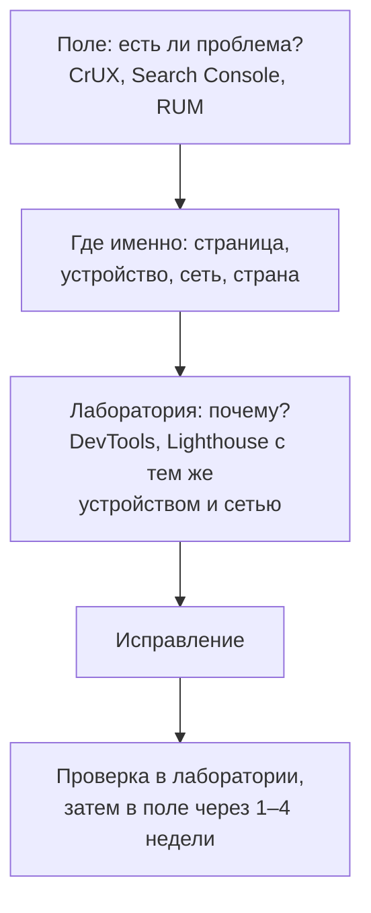

## О чём урок

Чем и как измерять производительность: панель Performance в DevTools и как читать её запись, Lighthouse и из чего складывается его оценка, PageSpeed Insights и CrUX, сбор метрик с реальных пользователей библиотекой `web-vitals`, свои метки User Timing, Long Animation Frames и как разрезать данные, чтобы найти проблему. Пример выполняется в Node.js, где есть тот же Performance API.

## Порядок работы



Начинают с полевых данных, а не с Lighthouse: оптимизировать то, что не беспокоит пользователей, бессмысленно. CrUX усредняет 28 дней, поэтому эффект исправления в нём виден не сразу, а в своём RUM почти сразу.

## Панель Performance в DevTools

- **Живые метрики** при открытии панели: LCP, CLS и INP текущей страницы по мере того, как вы с ней работаете, с указанием элемента LCP и взаимодействия INP. Рядом данные CrUX для этого адреса, чтобы сравнить свою машину с реальными пользователями.
- **Запись**: дорожка Network (водопад запросов), Main (задачи главного потока в виде «пламени»: сверху вызывающая функция, ниже вызываемые), Frames, Timings (FCP, LCP), Interactions (каждое взаимодействие с разбивкой на фазы).
- **Долгие задачи** отмечены красным углом: всё, что дольше 50 мс, блокирует ввод. Щелчок по задаче показывает, какие функции заняли время, и ссылку на исходный код.
- **Insights** сбоку объясняют найденное: разбивку LCP, блокирующие запросы, причины сдвигов, сторонний код, большой DOM. С Lighthouse 13 те же insights в отчёте Lighthouse.
- **Замедление**: процессор в 4 или 6 раз и сеть «Slow 4G», иначе мощный ноутбук разработчика скрывает проблемы слабых телефонов. Для фреймворков есть свои дорожки (React Performance Tracks), а свои метки User Timing появляются в дорожке Timings.

## Lighthouse

Lighthouse загружает страницу один раз в заданных условиях (эмуляция среднего телефона и медленной сети) и считает оценку от 0 до 100 как взвешенное среднее:

| Метрика | Вес |
|---|---|
| TBT, Total Blocking Time | 30 % |
| LCP | 25 % |
| CLS | 25 % |
| FCP | 10 % |
| Speed Index | 10 % |

- Оценка нестабильна от прогона к прогону: расширения браузера, нагрузка на машину, сеть. Сравнивают медиану нескольких прогонов, а для регрессий в CI используют Lighthouse CI с одинаковыми условиями.
- Оценка 100 не означает хороших полевых метрик, и наоборот. PageSpeed Insights показывает рядом оба: сверху полевые данные CrUX для адреса и всего сайта, ниже лабораторный прогон Lighthouse.

## Данные реальных пользователей

```ts
import { onCLS, onINP, onLCP } from 'web-vitals/attribution'

function send(metric) {
  const body = JSON.stringify({
    name: metric.name, // 'LCP' | 'INP' | 'CLS'
    value: metric.value,
    rating: metric.rating, // 'good' | 'needs-improvement' | 'poor'
    navigationType: metric.navigationType, // 'navigate', 'back-forward-cache', 'soft-navigation', ...
    // what caused it: the LCP element, the slow interaction's target and phases, the element that shifted
    attribution: metric.attribution,
    page: location.pathname,
    connection: navigator.connection?.effectiveType,
  })
  // sendBeacon survives the page being closed; fall back to fetch with keepalive
  if (!navigator.sendBeacon?.('/rum', body)) fetch('/rum', { body, method: 'POST', keepalive: true })
}

onLCP(send)
onINP(send)
onCLS(send)
```

- Библиотека `web-vitals` считает метрики так же, как Chrome для CrUX, и учитывает тонкости: окна сессий CLS, отбрасывание выбросов INP, восстановление из bfcache, фоновые вкладки, soft navigations в SPA (версия 6).
- Сборка `web-vitals/attribution` добавляет **причину**: элемент LCP и разбивку на части, элемент и фазы самого медленного взаимодействия, элемент, который сдвинулся. Без этого RUM говорит «плохо», но не говорит почему.
- Данные отправляют, когда страница скрывается (`visibilitychange`), а не при загрузке: INP и CLS копятся весь визит. Библиотека сама вызывает колбэк в нужный момент.
- Разрезы важнее общего числа: по странице или шаблону маршрута, типу устройства, сети, стране, версии выпуска. Проблема «INP 400 мс на страницах поиска у Android-телефонов» решаема, «INP 260 мс в среднем по сайту» нет.

## Свои метки

```ts run
// User Timing: your own marks and measures, visible in DevTools and collectable in production.
const measures = new Map<string, number>()
const observer = new PerformanceObserver((list) => {
  for (const entry of list.getEntries()) measures.set(entry.name, entry.duration) // e.g. send to RUM
})
observer.observe({ type: 'measure' })

const busy = (ms: number) => {
  const end = performance.now() + ms
  while (performance.now() < end) {}
}

performance.mark('search:start')
busy(5) // filter 10 000 products
performance.mark('search:filtered')
busy(50) // render the results
performance.mark('search:rendered')

performance.measure('filter', 'search:start', 'search:filtered')
performance.measure('render', 'search:filtered', 'search:rendered')
performance.measure('search total', 'search:start', 'search:rendered')

while (measures.size < 3) await new Promise((r) => setTimeout(r)) // observer callbacks are delivered asynchronously
console.log('measures:', [...measures.keys()].sort().join(', '))
console.log('render is the bottleneck:', measures.get('render')! > measures.get('filter')!)
console.log('total = filter + render:', Math.abs(measures.get('search total')! - measures.get('filter')! - measures.get('render')!) < 0.01)
console.log('marks:', performance.getEntriesByType('mark').map((m) => m.name).join(', '))
observer.disconnect()
```

```output
measures: filter, render, search total
render is the bottleneck: true
total = filter + render: true
marks: search:start, search:filtered, search:rendered
```

- `performance.mark` ставит именованную точку во времени, `performance.measure` измеряет отрезок между точками. Их видно в дорожке Timings панели Performance, и их можно собирать в RUM тем же `PerformanceObserver`.
- Так измеряют то, о чём стандартные метрики не знают: время поиска, открытия редактора, отрисовки графика после загрузки данных.
- `PerformanceObserver` получает и другие записи: `largest-contentful-paint`, `layout-shift`, `event`, `long-animation-frame`, `resource`, `navigation` (урок `browser-observers`).

## Long Animation Frames

Long Tasks API сообщал только, что задача длилась больше 50 мс. **Long Animation Frames** (LoAF) сообщает о кадре, который задержался больше чем на 50 мс, и перечисляет **скрипты** в нём: файл, функцию, время, тип вызова (обработчик события, таймер, промис). Это прямой ответ на вопрос «чей код испортил INP», включая сторонние скрипты. API пока экспериментальный и есть только в Chromium; `web-vitals/attribution` использует его для разбора INP, если он доступен.

## Главное

- Порядок: поле (есть ли проблема и у кого) → разрез (страница, устройство, сеть) → лаборатория (почему) → исправление → проверка в лаборатории и поле.
- Панель Performance: живые метрики и данные CrUX, дорожки Network и Main, долгие задачи, insights; запись с замедлением процессора и сети.
- Lighthouse: один прогон в эмуляции, оценка из TBT 30 %, LCP 25 %, CLS 25 %, FCP 10 %, Speed Index 10 %; нестабилен, для регрессий Lighthouse CI.
- RUM: `web-vitals/attribution` с отправкой через `sendBeacon`; без атрибуции не видно причин; данные режут по страницам, устройствам и сетям.
- `performance.mark` и `measure` для своих сценариев; Long Animation Frames показывает скрипты долгого кадра (Chromium, экспериментально).
