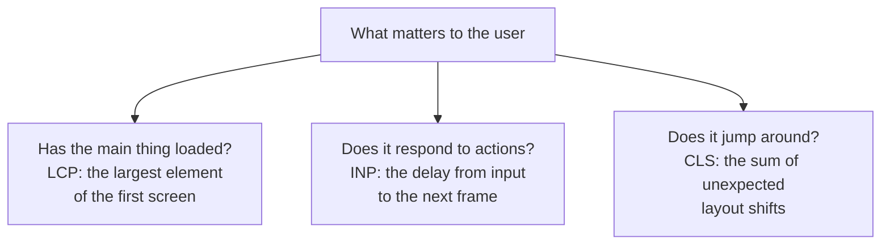
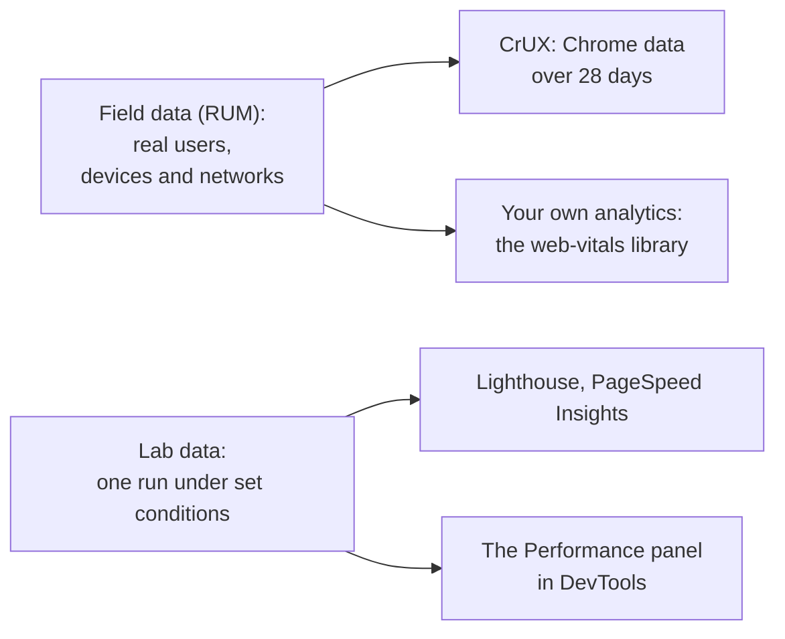

## What this lesson covers

How site speed is measured today and what interviews ask about it: the three Core Web Vitals (LCP, INP, CLS) and their thresholds, supporting metrics (TTFB, FCP, TBT), why the 75th percentile is used rather than the average, how real-user data differs from lab data, what happened to FMP, TTI and FID, and how metrics are counted in single-page apps. Techniques for improving each metric are covered in separate lessons of this track. The example runs in Node.js.

## The three main metrics



| Metric | What it measures | Good | Needs improvement | Poor |
|---|---|---|---|---|
| **LCP**, Largest Contentful Paint | When the largest element of the first screen is painted (an image, a text block, a video poster) | ≤ 2.5 s | ≤ 4 s | > 4 s |
| **INP**, Interaction to Next Paint | The delay from a click, tap or keypress to the frame with the result, for the worst interaction of the visit | ≤ 200 ms | ≤ 500 ms | > 500 ms |
| **CLS**, Cumulative Layout Shift | How much content shifts unexpectedly, by the largest "window" of shifts | ≤ 0.1 | ≤ 0.25 | > 0.25 |

Supporting metrics help find the cause:

- **TTFB** (Time to First Byte): when the first byte of the response arrived. Part of LCP: without HTML there is nothing to paint.
- **FCP** (First Contentful Paint): the first paint of any content.
- **TBT** (Total Blocking Time): the sum of the "excess" time of long tasks (everything beyond 50 ms) after FCP while the page loads. It is the lab stand-in for INP: in Lighthouse there is no user who clicks.

## Percentiles, not averages

```ts run
// Field data (RUM): LCP of 20 page views in milliseconds, sorted for readability.
const lcp = [900, 1100, 1200, 1300, 1400, 1500, 1500, 1600, 1700, 1800, 1900, 2000, 2100, 2200, 2400, 2600, 3900, 4800, 6200, 9000]

const percentile = (values: number[], p: number) => {
  const sorted = [...values].sort((a, b) => a - b)
  return sorted[Math.ceil((p / 100) * sorted.length) - 1]
}
const thresholds = { LCP: [2500, 4000], INP: [200, 500], CLS: [0.1, 0.25] } as const
const rate = (metric: keyof typeof thresholds, value: number) =>
  value <= thresholds[metric][0] ? 'good' : value <= thresholds[metric][1] ? 'needs improvement' : 'poor'

const average = Math.round(lcp.reduce((a, b) => a + b, 0) / lcp.length)
console.log('median:', percentile(lcp, 50), '| average:', average, '| p75:', percentile(lcp, 75), '->', rate('LCP', percentile(lcp, 75)))
console.log('share of good page views:', lcp.filter((v) => v <= 2500).length / lcp.length)

// INP of one page view: the worst interaction, but one outlier is dropped for every 50 interactions.
function inp(durations: number[]) {
  const sorted = [...durations].sort((a, b) => b - a)
  return sorted[Math.min(Math.floor(durations.length / 50), sorted.length - 1)]
}
const fewClicks = [40, 64, 120, 88]
const manyClicks = [...Array.from({ length: 118 }, (_, i) => 30 + (i % 9) * 10), 640, 310] // 120 interactions
console.log('INP with 4 interactions:', inp(fewClicks), '->', rate('INP', inp(fewClicks)))
console.log('INP with 120 interactions:', inp(manyClicks), '->', rate('INP', inp(manyClicks)), '(640 and 310 are skipped as outliers)')
```

```output
median: 1800 | average: 2555 | p75: 2400 -> good
share of good page views: 0.75
INP with 4 interactions: 120 -> good
INP with 120 interactions: 110 -> good (640 and 310 are skipped as outliers)
```

- A page is rated by the **75th percentile** of visits, separately for phones and desktops: "good" means at least 75% of visits have the metric in the green zone.
- The average is distorted by rare very slow visits: here it is above the threshold, although three quarters of users see the main content in under 2.5 s. The median, on the other hand, hides the tail. p75 is a compromise: it reflects the majority and does not depend on single outliers.
- **INP of one visit** is the slowest interaction, but for every 50 interactions the single worst one is dropped. On a page with a hundred clicks a random long task does not spoil the score, while on a page with four clicks the worst one is the INP.

## Field and lab



| | Field data | Lab data |
|---|---|---|
| Where from | Real users' browsers | One run on one machine with a set network and CPU |
| What it shows | How things really are, across devices and networks | Why: the request waterfall, long tasks, recommendations |
| INP | Yes | No: nobody clicks; TBT instead |
| When needed | To decide whether there is a problem and for whom | To find the cause and check a fix before release |
| Source | CrUX (Google rates the site in Search by it), RUM | Lighthouse, DevTools, WebPageTest |

A common interview situation: "Lighthouse gives 95, but Search Console shows poor LCP". The answer: Lighthouse emulates one device with an empty cache, while real users come from weak phones, slow networks and other pages; the field is what counts, and the lab is for finding the cause.

## What changed

| Was | Now |
|---|---|
| FMP (First Meaningful Paint) | Removed from Lighthouse: the result was unstable; LCP replaces it |
| TTI (Time to Interactive) | Removed in Lighthouse 10; TBT in the lab, INP in the field |
| FID (First Input Delay) | Replaced by INP in March 2024: FID counted only the delay of the first input, INP the whole handling of any interaction |
| Separate Lighthouse audits | In Lighthouse 13 replaced by "insights", as in the Performance panel; the scoring formula did not change |

## Single-page apps

Core Web Vitals were originally counted per document load. In an SPA a client-side route change does not load a new document, so the LCP of the new "page" was not measured, while CLS and INP accumulated over the whole visit. **Soft navigations** solve this: the browser recognizes the navigation (a user action, a URL change through the History API, a DOM change) and starts new measurements. They are on by default since Chrome 151, the `web-vitals` 6 library supports them, and in CrUX the soft navigation metrics are still experimental (they become stable in May 2027).

## Key points

- Core Web Vitals: LCP ≤ 2.5 s, INP ≤ 200 ms, CLS ≤ 0.1; supporting TTFB, FCP and the lab TBT.
- The rating is by the 75th percentile of visits, separately for phones and desktops; the average is distorted by outliers.
- A visit's INP is the worst interaction, dropping one worst interaction for every 50.
- The field (CrUX, RUM through `web-vitals`) shows whether there is a problem; the lab (Lighthouse, DevTools) explains the cause. There is no INP in the lab, TBT instead.
- FMP and TTI were removed, FID was replaced by INP in March 2024; Lighthouse 13 moved to insights.
- In SPAs, navigations are measured as soft navigations (on by default since Chrome 151, `web-vitals` 6).
