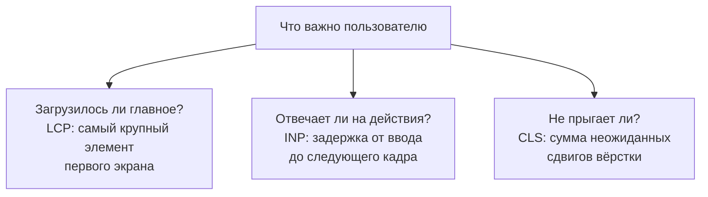
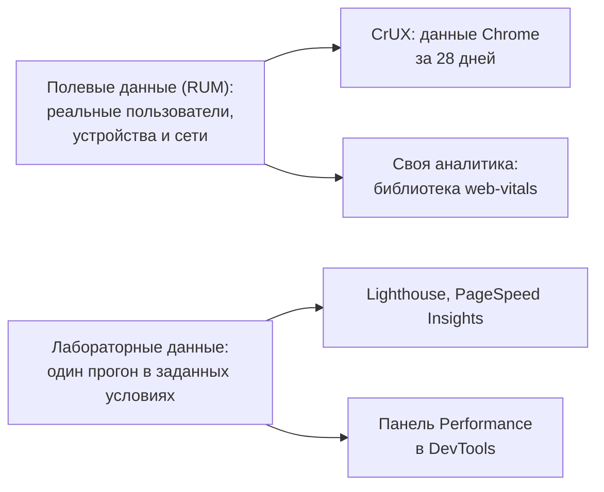

## О чём урок

Как сейчас измеряют скорость сайта и о чём спрашивают на собеседовании: три метрики Core Web Vitals (LCP, INP, CLS) и их пороги, вспомогательные метрики (TTFB, FCP, TBT), почему оценивают 75-й перцентиль, а не среднее, чем данные с реальных пользователей отличаются от лабораторных, что стало с FMP, TTI и FID, и как метрики считаются в одностраничных приложениях. Приёмы улучшения каждой метрики разобраны в отдельных уроках трека. Пример выполняется в Node.js.

## Три главные метрики



| Метрика | Что измеряет | Хорошо | Нужно улучшить | Плохо |
|---|---|---|---|---|
| **LCP**, Largest Contentful Paint | Когда отрисован самый крупный элемент первого экрана (картинка, блок текста, постер видео) | ≤ 2,5 с | ≤ 4 с | > 4 с |
| **INP**, Interaction to Next Paint | Задержку от клика, касания или нажатия клавиши до кадра с результатом, по худшему взаимодействию за визит | ≤ 200 мс | ≤ 500 мс | > 500 мс |
| **CLS**, Cumulative Layout Shift | Насколько содержимое неожиданно сдвигается, по самому большому «окну» сдвигов | ≤ 0,1 | ≤ 0,25 | > 0,25 |

Вспомогательные метрики помогают найти причину:

- **TTFB** (Time to First Byte): когда пришёл первый байт ответа. Часть LCP: пока нет HTML, нечего рисовать.
- **FCP** (First Contentful Paint): первая отрисовка любого контента.
- **TBT** (Total Blocking Time): сумма «лишнего» времени долгих задач (всё, что дольше 50 мс) после FCP, пока страница загружается. Это лабораторная замена INP: в Lighthouse нет пользователя, который кликает.

## Перцентили, а не среднее

```ts run
// Field data (RUM): LCP of 20 page views in milliseconds, sorted for readability.
const lcp = [900, 1100, 1200, 1300, 1400, 1500, 1500, 1600, 1700, 1800, 1900, 2000, 2100, 2200, 2400, 2600, 3900, 4800, 6200, 9000]

const percentile = (values: number[], p: number) => {
  const sorted = [...values].sort((a, b) => a - b)
  return sorted[Math.ceil((p / 100) * sorted.length) - 1]
}
const thresholds = { LCP: [2500, 4000], INP: [200, 500], CLS: [0.1, 0.25] } as const
const rate = (metric: keyof typeof thresholds, value: number) =>
  value <= thresholds[metric][0] ? 'good' : value <= thresholds[metric][1] ? 'needs improvement' : 'poor'

const average = Math.round(lcp.reduce((a, b) => a + b, 0) / lcp.length)
console.log('median:', percentile(lcp, 50), '| average:', average, '| p75:', percentile(lcp, 75), '->', rate('LCP', percentile(lcp, 75)))
console.log('share of good page views:', lcp.filter((v) => v <= 2500).length / lcp.length)

// INP of one page view: the worst interaction, but one outlier is dropped for every 50 interactions.
function inp(durations: number[]) {
  const sorted = [...durations].sort((a, b) => b - a)
  return sorted[Math.min(Math.floor(durations.length / 50), sorted.length - 1)]
}
const fewClicks = [40, 64, 120, 88]
const manyClicks = [...Array.from({ length: 118 }, (_, i) => 30 + (i % 9) * 10), 640, 310] // 120 interactions
console.log('INP with 4 interactions:', inp(fewClicks), '->', rate('INP', inp(fewClicks)))
console.log('INP with 120 interactions:', inp(manyClicks), '->', rate('INP', inp(manyClicks)), '(640 and 310 are skipped as outliers)')
```

```output
median: 1800 | average: 2555 | p75: 2400 -> good
share of good page views: 0.75
INP with 4 interactions: 120 -> good
INP with 120 interactions: 110 -> good (640 and 310 are skipped as outliers)
```

- Страницу оценивают по **75-му перцентилю** визитов, отдельно для телефонов и компьютеров: «хорошо» значит, что хотя бы у 75 % визитов метрика в зелёной зоне.
- Среднее искажают редкие очень медленные визиты: здесь оно выше порога, хотя три четверти пользователей видят главный контент быстрее 2,5 с. Медиана, наоборот, скрывает хвост. p75 это компромисс: учитывает большинство и не зависит от единичных выбросов.
- **INP одного визита** это самое медленное взаимодействие, но на каждые 50 взаимодействий одно худшее отбрасывается. На странице с сотней кликов случайная долгая задача не испортит оценку, а на странице с четырьмя кликами худший и будет INP.

## Поле и лаборатория



| | Полевые данные | Лабораторные данные |
|---|---|---|
| Откуда | Браузеры реальных пользователей | Один прогон на одной машине с заданной сетью и процессором |
| Что показывают | Как есть на самом деле, у разных устройств и сетей | Почему так: водопад запросов, долгие задачи, рекомендации |
| INP | Есть | Нет: никто не кликает; вместо него TBT |
| Когда нужны | Решить, есть ли проблема и у кого | Найти причину и проверить исправление до выпуска |
| Источник | CrUX (по нему Google оценивает сайт в поиске), RUM | Lighthouse, DevTools, WebPageTest |

Частая ситуация на собеседовании: «Lighthouse даёт 95, а Search Console показывает плохой LCP». Ответ: Lighthouse эмулирует одно устройство и пустой кэш, а реальные пользователи приходят со слабых телефонов, медленных сетей и других страниц; судят по полю, лабораторию используют для поиска причины.

## Что изменилось

| Было | Стало |
|---|---|
| FMP (First Meaningful Paint) | Удалён из Lighthouse: результат был нестабилен; вместо него LCP |
| TTI (Time to Interactive) | Удалён из Lighthouse 10; в лаборатории TBT, в поле INP |
| FID (First Input Delay) | С марта 2024 заменён INP: FID учитывал только задержку первого ввода, а INP всю обработку любого взаимодействия |
| Отдельные аудиты Lighthouse | В Lighthouse 13 заменены «insights», как в панели Performance; формула оценки не менялась |

## Одностраничные приложения

Core Web Vitals изначально считались на загрузку документа. В SPA переход по клиентскому роутеру не загружает новый документ, поэтому LCP новой «страницы» не измерялся, а CLS и INP копились на весь визит. **Soft navigations** решают это: браузер распознаёт переход (действие пользователя, смена адреса через History API, изменение DOM) и начинает новые измерения. Они включены по умолчанию с Chrome 151, библиотека `web-vitals` 6 их поддерживает, а в CrUX метрики по soft navigations пока экспериментальные (стабильными станут с мая 2027 года).

## Главное

- Core Web Vitals: LCP ≤ 2,5 с, INP ≤ 200 мс, CLS ≤ 0,1; вспомогательные TTFB, FCP и лабораторная TBT.
- Оценка по 75-му перцентилю визитов отдельно для телефонов и компьютеров; среднее искажают выбросы.
- INP визита это худшее взаимодействие, с отбрасыванием одного худшего на каждые 50.
- Поле (CrUX, RUM через `web-vitals`) показывает, есть ли проблема; лаборатория (Lighthouse, DevTools) объясняет причину. В лаборатории нет INP, вместо него TBT.
- FMP и TTI удалены, FID заменён INP в марте 2024; Lighthouse 13 перешёл на insights.
- В SPA переходы измеряются как soft navigations (по умолчанию с Chrome 151, `web-vitals` 6).
