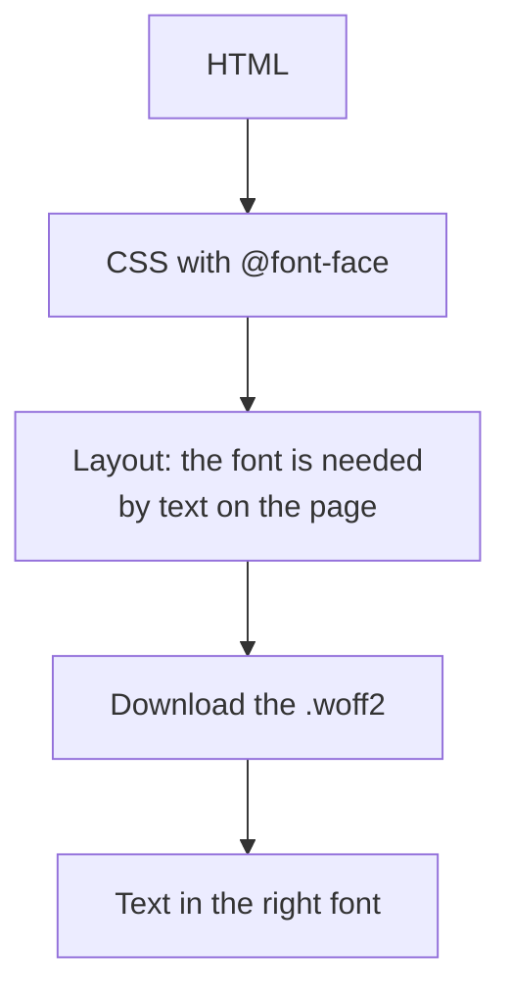
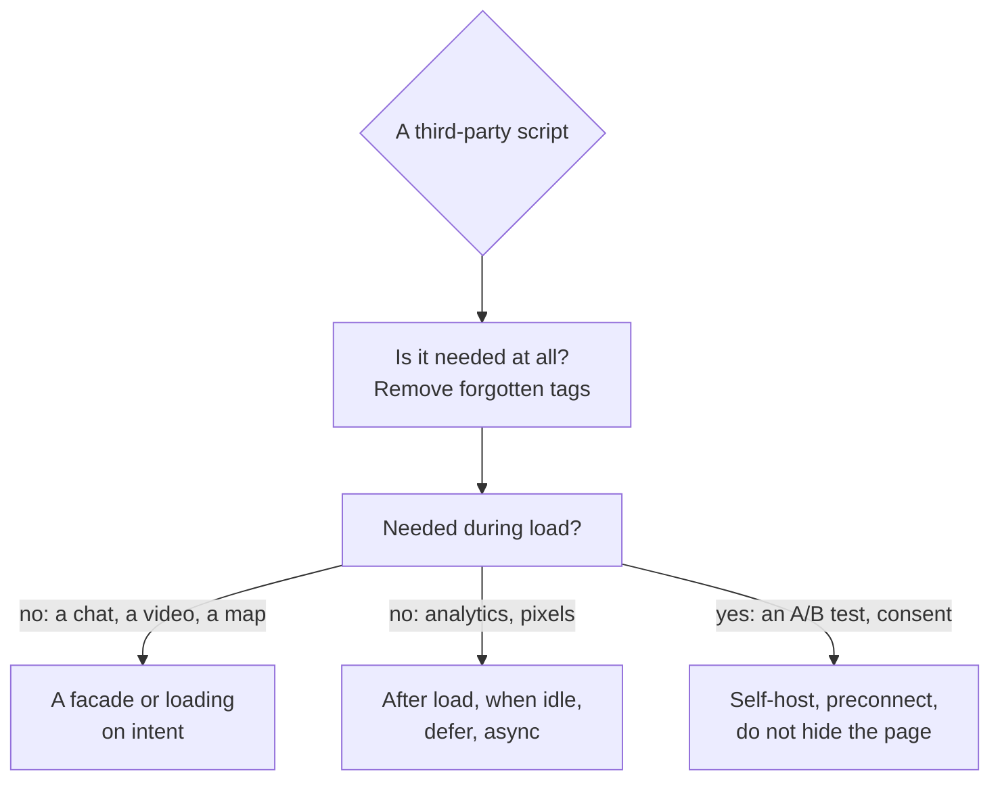

## What this lesson covers

The resources that slow a page down most often besides your own JavaScript: web fonts (how they load, `font-display`, subsets, preloading, self-hosting), images (a short summary, details in the `html-media-seo` lesson) and third-party scripts (analytics, chats, ads, A/B tests) with techniques such as a facade and loading on intent. The example runs in jsdom.

## Fonts



The browser learns about a font file late: after the CSS loads, and only once layout shows that the font is used. While the file downloads, the text is either invisible or shown in a fallback font, depending on `font-display`:

| `font-display` | Invisible text | Swap to the web font | When |
|---|---|---|---|
| `block` | up to ~3 s | after it loads | Icon fonts, where a fallback font is meaningless |
| `swap` | almost none (~100 ms) | at any time | Headings and branding: the web font is required, but text shows at once |
| `fallback` | ~100 ms | only within the first ~3 s | Body text: if the font is late, the fallback stays |
| `optional` | ~100 ms | only if it arrived almost at once | Minimal shifts: on a slow network the page stays on the fallback font |

```html
<!-- Discover the main font early: it is needed for the LCP heading -->
<link rel="preload" href="/fonts/inter-latin-var.woff2" as="font" type="font/woff2" crossorigin>
<style>
  @font-face {
    font-family: 'Inter';
    src: url('/fonts/inter-latin-var.woff2') format('woff2'); /* one variable file instead of 4 weights */
    font-weight: 100 900;
    font-display: swap;
    unicode-range: U+0000-00FF, U+2000-206F; /* the Latin subset only; Cyrillic in a separate file */
  }
</style>
```

- **WOFF2 only**: the best compression, supported by all browsers.
- **Subsets** (`unicode-range`): the browser downloads the Cyrillic file only for pages that contain Cyrillic.
- **A variable font**: one file instead of separate weights.
- **Preload** only one or two first-screen fonts: every extra preload takes bandwidth from LCP. `crossorigin` is required even on your own domain: fonts are fetched in CORS mode.
- **Self-host** instead of Google Fonts: with the HTTP cache partitioned by site (Chrome 86+) there is no shared cache across sites anymore, and a third-party domain needs a separate connection.
- Against shifts on swap: a fallback font with adjusted metrics (`size-adjust`, the `perf-cls` lesson); a system font stack needs no download at all.

## Images

| Technique | Why |
|---|---|
| AVIF or WebP, `<picture>` with a JPEG fallback | Less weight at the same quality |
| `srcset` and `sizes` | A phone gets an image for its screen |
| `width` and `height` | No layout shifts |
| `loading="lazy"` below the first screen | Do not spend bandwidth on what is not visible |
| `fetchpriority="high"` and no `lazy` for the LCP image | The main image loads first |
| An image service on a CDN | Format and size chosen per request (`Accept`, the width in the URL) |

Details are in the `html-media-seo` lesson, priorities and LCP in the `perf-lcp` lesson.

## Third-party scripts

Analytics, tag managers, support chats, social widgets, players, ads and A/B tests often weigh more than your own code and run on the main thread, and their long tasks ruin INP. The "Third parties" insight in the Performance panel shows how much time and traffic each domain takes.

```js dom
// A facade: a light placeholder instead of a heavy third-party embed (video player, chat, map).
// The real iframe and its scripts load only when the user shows intent.
function videoFacade(container, videoId, title) {
  const button = document.createElement('button')
  button.className = 'video-facade'
  button.setAttribute('aria-label', `Play video: ${title}`)
  button.style.backgroundImage = `url(/thumbnails/${videoId}.avif)` // one small image instead of a player
  container.append(button)

  // Warm up the connection when the user is likely to click.
  button.addEventListener('pointerenter', () => {
    if (document.querySelector('link[rel=preconnect]')) return
    document.head.append(Object.assign(document.createElement('link'), { rel: 'preconnect', href: 'https://www.youtube-nocookie.com' }))
  }, { once: true })

  button.addEventListener('click', () => {
    const iframe = document.createElement('iframe')
    iframe.src = `https://www.youtube-nocookie.com/embed/${videoId}?autoplay=1`
    iframe.title = title
    iframe.allow = 'autoplay; encrypted-media'
    button.replaceWith(iframe)
  }, { once: true })
}

const box = document.createElement('div')
document.body.append(box)
videoFacade(box, 'abc123', 'Product tour')
const state = () => `iframes: ${document.querySelectorAll('iframe').length}, preconnect: ${document.querySelectorAll('link[rel=preconnect]').length}`

console.log('page loaded   ->', state())
box.querySelector('button').dispatchEvent(new Event('pointerenter'))
console.log('pointer enter ->', state())
box.querySelector('button').click()
console.log('click         ->', state(), '| src:', box.querySelector('iframe').src.split('?')[0])
```

```output
page loaded   -> iframes: 0, preconnect: 0
pointer enter -> iframes: 0, preconnect: 1
click         -> iframes: 1, preconnect: 1 | src: https://www.youtube-nocookie.com/embed/abc123
```



- **A facade**: instead of a player, a chat or a map, a light placeholder (an image and a button), and the real widget with its scripts loads on click. In the example there is no `iframe` before the click, the connection opens on hover (`preconnect`), and the player is inserted on click.
- **Loading on intent or when idle**: a chat after the first scroll or through `requestIdleCallback`, analytics with `async` after the `load` event.
- **`async` and `defer`** for all third-party tags; no synchronous `<script src>` in `<head>`.
- **Client-side A/B tests** often hide the page until they load ("anti-flicker"), which directly hurts LCP. It is better to decide the experiment on the server or at the edge.
- **A tag manager** is convenient for marketing but turns into a storehouse of forgotten tags: audit regularly and budget third-party code.
- Moving third-party scripts into a Web Worker (Partytown) is possible but does not work for every script: they expect synchronous DOM access.

## Key points

- Fonts are discovered late: WOFF2, `unicode-range` subsets, a variable file, preloading one or two first-screen fonts with `crossorigin`, self-hosting.
- `font-display`: `swap` for a required font, `fallback` and `optional` for body text and minimal shifts; a fallback font with `size-adjust`.
- Images: AVIF and WebP, `srcset` and `sizes`, dimensions, `lazy` below the first screen, `fetchpriority="high"` for LCP.
- Third-party scripts: remove what is unneeded, facades for heavy widgets, loading on intent and when idle, `async` and `defer`, no page hiding for A/B tests.
- The "Third parties" insight in DevTools shows the cost of each third-party domain.
