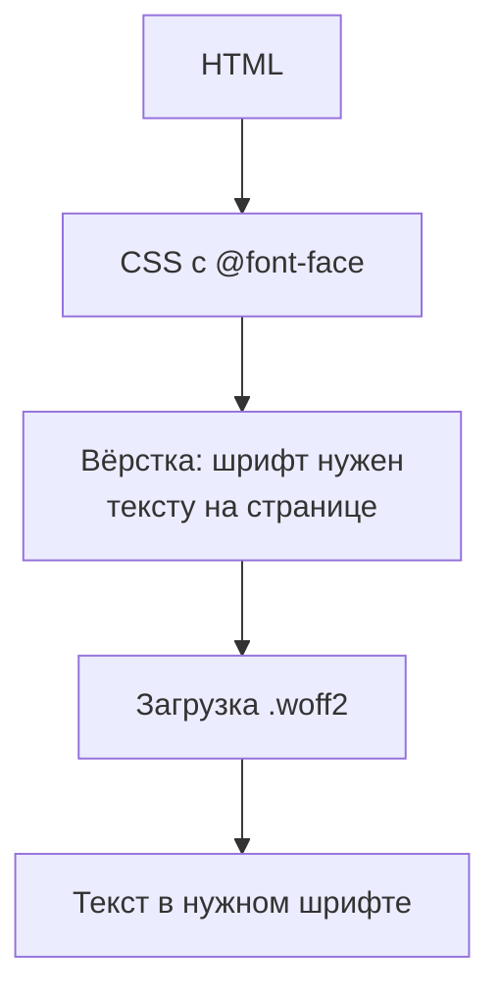
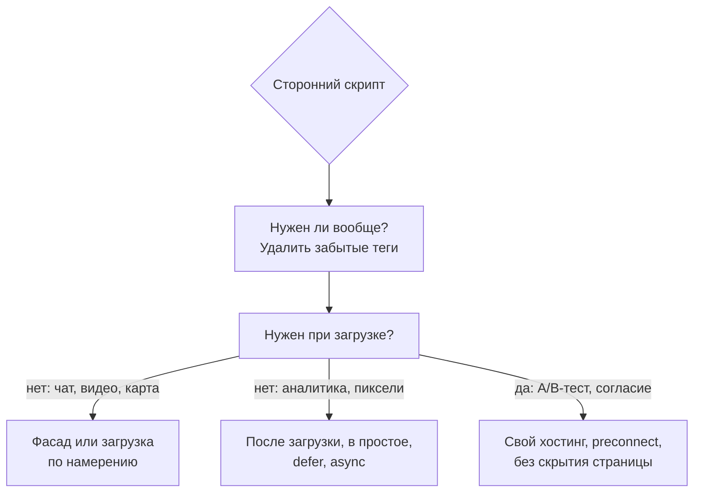

## О чём урок

Ресурсы, которые чаще всего тормозят страницу помимо собственного JavaScript: веб-шрифты (как они грузятся, `font-display`, подмножества, предзагрузка, свой хостинг), изображения (краткая сводка, подробности в уроке `html-media-seo`) и сторонние скрипты (аналитика, чаты, реклама, A/B-тесты) с приёмами вроде фасада и загрузки по намерению. Пример выполняется в jsdom.

## Шрифты



Браузер узнаёт о файле шрифта поздно: после загрузки CSS и только когда вёрстка показала, что шрифт используется. Пока файл грузится, текст либо невидим, либо показан запасным шрифтом, в зависимости от `font-display`:

| `font-display` | Невидимый текст | Замена на веб-шрифт | Когда |
|---|---|---|---|
| `block` | до ~3 с | после загрузки | Иконочные шрифты, где запасной шрифт бессмыслен |
| `swap` | почти нет (~100 мс) | в любой момент | Заголовки и бренд: веб-шрифт обязателен, но текст сразу виден |
| `fallback` | ~100 мс | только в первые ~3 с | Основной текст: если шрифт опоздал, остаётся запасной |
| `optional` | ~100 мс | только если успел почти сразу | Минимум сдвигов: на медленной сети страница остаётся на запасном шрифте |

```html
<!-- Discover the main font early: it is needed for the LCP heading -->
<link rel="preload" href="/fonts/inter-latin-var.woff2" as="font" type="font/woff2" crossorigin>
<style>
  @font-face {
    font-family: 'Inter';
    src: url('/fonts/inter-latin-var.woff2') format('woff2'); /* one variable file instead of 4 weights */
    font-weight: 100 900;
    font-display: swap;
    unicode-range: U+0000-00FF, U+2000-206F; /* the Latin subset only; Cyrillic in a separate file */
  }
</style>
```

- **Только WOFF2**: лучшее сжатие, поддерживается всеми браузерами.
- **Подмножества** (`unicode-range`): браузер загрузит файл с кириллицей только для страниц, где она есть.
- **Вариативный шрифт**: один файл вместо отдельных начертаний.
- **Предзагрузка** только для одного-двух шрифтов первого экрана: каждая лишняя предзагрузка отнимает полосу у LCP. `crossorigin` обязателен даже для своего домена: шрифты загружаются в режиме CORS.
- **Свой хостинг** вместо Google Fonts: с разделением HTTP-кэша по сайтам (Chrome 86+) общего кэша между сайтами больше нет, а сторонний домен требует отдельного соединения.
- Против сдвигов при замене: запасной шрифт с подогнанными метриками (`size-adjust`, урок `perf-cls`); системный стек шрифтов вообще без загрузки.

## Изображения

| Приём | Зачем |
|---|---|
| AVIF или WebP, `<picture>` с запасным JPEG | Меньше вес при том же качестве |
| `srcset` и `sizes` | Телефон получает картинку под свой экран |
| `width` и `height` | Нет сдвигов вёрстки |
| `loading="lazy"` ниже первого экрана | Не тратить полосу на невидимое |
| `fetchpriority="high"` и без `lazy` для картинки LCP | Главная картинка грузится первой |
| Сервис изображений на CDN | Формат и размер выбираются по запросу (`Accept`, ширина в адресе) |

Подробно в уроке `html-media-seo`, приоритеты и LCP в уроке `perf-lcp`.

## Сторонние скрипты

Аналитика, менеджеры тегов, чаты поддержки, виджеты соцсетей, плееры, реклама, A/B-тесты часто весят больше собственного кода и выполняются в главном потоке, а их долгие задачи портят INP. Insight «Third parties» в панели Performance показывает, сколько времени и трафика занимает каждый домен.

```js dom
// A facade: a light placeholder instead of a heavy third-party embed (video player, chat, map).
// The real iframe and its scripts load only when the user shows intent.
function videoFacade(container, videoId, title) {
  const button = document.createElement('button')
  button.className = 'video-facade'
  button.setAttribute('aria-label', `Play video: ${title}`)
  button.style.backgroundImage = `url(/thumbnails/${videoId}.avif)` // one small image instead of a player
  container.append(button)

  // Warm up the connection when the user is likely to click.
  button.addEventListener('pointerenter', () => {
    if (document.querySelector('link[rel=preconnect]')) return
    document.head.append(Object.assign(document.createElement('link'), { rel: 'preconnect', href: 'https://www.youtube-nocookie.com' }))
  }, { once: true })

  button.addEventListener('click', () => {
    const iframe = document.createElement('iframe')
    iframe.src = `https://www.youtube-nocookie.com/embed/${videoId}?autoplay=1`
    iframe.title = title
    iframe.allow = 'autoplay; encrypted-media'
    button.replaceWith(iframe)
  }, { once: true })
}

const box = document.createElement('div')
document.body.append(box)
videoFacade(box, 'abc123', 'Product tour')
const state = () => `iframes: ${document.querySelectorAll('iframe').length}, preconnect: ${document.querySelectorAll('link[rel=preconnect]').length}`

console.log('page loaded   ->', state())
box.querySelector('button').dispatchEvent(new Event('pointerenter'))
console.log('pointer enter ->', state())
box.querySelector('button').click()
console.log('click         ->', state(), '| src:', box.querySelector('iframe').src.split('?')[0])
```

```output
page loaded   -> iframes: 0, preconnect: 0
pointer enter -> iframes: 0, preconnect: 1
click         -> iframes: 1, preconnect: 1 | src: https://www.youtube-nocookie.com/embed/abc123
```



- **Фасад**: вместо плеера, чата или карты лёгкий заполнитель (картинка и кнопка), а настоящий виджет с его скриптами загружается при клике. В примере до клика ни одного `iframe`, при наведении открывается соединение (`preconnect`), при клике вставляется плеер.
- **Загрузка по намерению или в простое**: чат после первого скролла или через `requestIdleCallback`, аналитика с `async` после события `load`.
- **`async` и `defer`** для всех сторонних тегов; никаких синхронных `<script src>` в `<head>`.
- **A/B-тесты на клиенте** часто прячут страницу до своей загрузки («анти-мерцание»), что прямо ухудшает LCP. Лучше решать эксперимент на сервере или на edge.
- **Менеджер тегов** удобен маркетингу, но превращается в склад забытых тегов: регулярный аудит и бюджет на сторонний код.
- Вынос сторонних скриптов в Web Worker (Partytown) возможен, но не у всех скриптов работает: они ждут синхронного доступа к DOM.

## Главное

- Шрифт обнаруживается поздно: WOFF2, подмножества `unicode-range`, вариативный файл, предзагрузка одного-двух шрифтов первого экрана с `crossorigin`, свой хостинг.
- `font-display`: `swap` для обязательного шрифта, `fallback` и `optional` для основного текста и минимума сдвигов; запасной шрифт с `size-adjust`.
- Изображения: AVIF и WebP, `srcset` и `sizes`, размеры, `lazy` ниже первого экрана, `fetchpriority="high"` для LCP.
- Сторонние скрипты: удалить ненужное, фасады для тяжёлых виджетов, загрузка по намерению и в простое, `async` и `defer`, без скрытия страницы ради A/B-тестов.
- Insight «Third parties» в DevTools показывает цену каждого стороннего домена.
