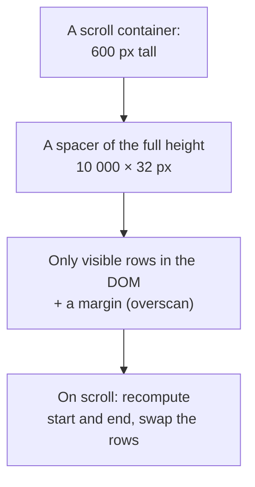
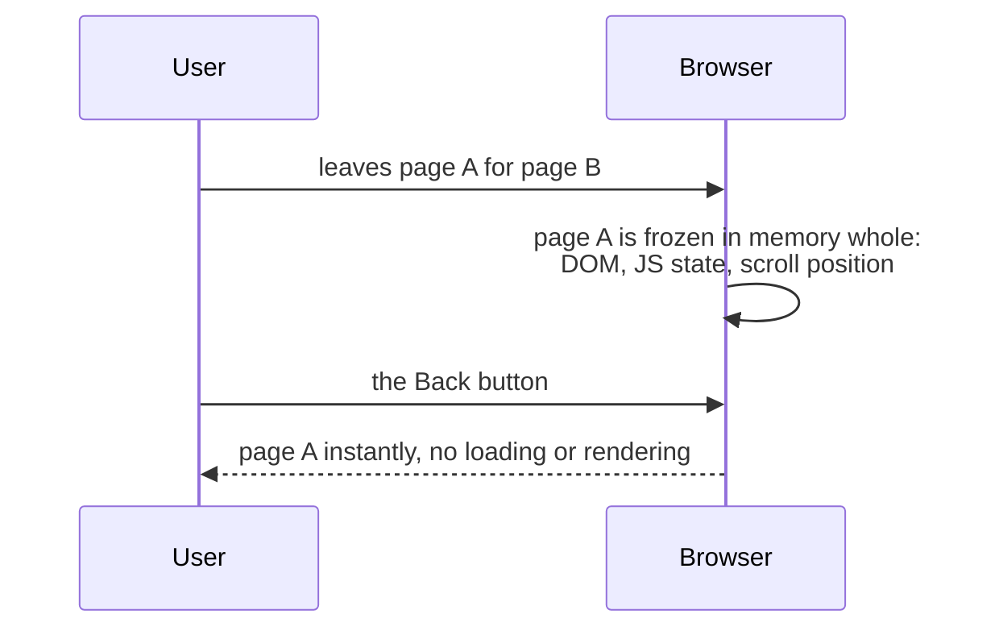

## What this lesson covers

Page performance after loading: long lists and virtualization, DOM size and `content-visibility`, memory leaks and how to find them, event delegation, and the back/forward cache that makes "Back" navigations instant. Forced layout and animations are covered in the `browser-layout-paint` lesson, garbage collection in `js-memory`. The example runs in jsdom.

## Long lists

```js dom
const rows = Array.from({ length: 10_000 }, (_, i) => `Order #${i + 1}`)

// Naive: every row is a DOM node.
const naive = document.createElement('ul')
naive.append(...rows.map((text) => Object.assign(document.createElement('li'), { textContent: text })))

// Windowing: only the rows in the viewport plus a few extra ("overscan") are in the DOM.
function visibleRange({ scrollTop, viewportHeight, rowHeight, count, overscan = 3 }) {
  const start = Math.max(0, Math.floor(scrollTop / rowHeight) - overscan)
  const end = Math.min(count, Math.ceil((scrollTop + viewportHeight) / rowHeight) + overscan)
  return { start, end }
}
function renderWindow(container, scrollTop) {
  const rowHeight = 32
  const { start, end } = visibleRange({ scrollTop, viewportHeight: 600, rowHeight, count: rows.length })
  // A tall spacer keeps the scrollbar honest; the rows are moved to their real position.
  container.style.height = `${rows.length * rowHeight}px`
  container.replaceChildren(
    ...rows.slice(start, end).map((text, i) =>
      Object.assign(document.createElement('li'), { textContent: text, style: `position:absolute;top:${(start + i) * rowHeight}px` }),
    ),
  )
  return { start, end }
}
const windowed = document.createElement('ul')
console.log('naive DOM rows:', naive.children.length)
for (const scrollTop of [0, 160_000]) {
  const { start, end } = renderWindow(windowed, scrollTop)
  console.log(`scrollTop ${scrollTop}: rows ${start}..${end - 1} rendered, DOM rows: ${windowed.children.length}, first: ${windowed.firstChild.textContent}`)
}
```

```output
naive DOM rows: 10000
scrollTop 0: rows 0..21 rendered, DOM rows: 22, first: Order #1
scrollTop 160000: rows 4997..5021 rendered, DOM rows: 25, first: Order #4998
```



- **Virtualization** keeps only the rows in view plus a few spare ones in the DOM: 22–25 nodes instead of 10,000. A spacer of the right height keeps the scrollbar correct, and rows are placed at their positions.
- What is expensive is not the node itself but the work proportional to the number of nodes: style recalculation, layout and painting on every change, memory for the tree, the first render time. Figures from the notes like "300–800 MB for 10,000 `div`s" are not confirmed, but the "Optimize DOM size" insight in DevTools does flag large trees.
- Ready-made solutions: TanStack Virtual (React, Vue, Angular, Solid, Svelte), react-window, Virtuoso, `cdk-virtual-scroll-viewport` in the Angular CDK. The difficulties: rows of different heights (measure and cache heights), find-in-page and anchors (invisible rows are not in the DOM), accessibility (`aria-rowcount`, `aria-rowindex`).
- Alternatives without virtualization: pagination, "show more", infinite loading with a cap on the number of items.

## content-visibility

```css
.feed-item {
  content-visibility: auto; /* skip style, layout and paint while off-screen */
  contain-intrinsic-size: auto 400px; /* a placeholder size, then the last rendered size */
}
```

`content-visibility: auto` lets the browser skip style, layout and paint for off-screen blocks until they are scrolled to. The nodes stay in the DOM: find-in-page, anchors and accessibility work, unlike with virtualization. It fits long articles, feeds and documentation. `contain-intrinsic-size` sets an estimated size, otherwise the scrollbar jumps.

## Memory

A frontend memory leak is objects that are no longer needed but remain reachable. The page gets slower and slower, and on a phone the system reloads the tab.

| Source | Example | Fix |
|---|---|---|
| Handlers on global objects | `window.addEventListener('resize', ...)` in a component without removal | Remove on unmount, `AbortController` with a `signal` |
| Timers and subscriptions | `setInterval`, WebSocket, `IntersectionObserver` outlive the page | Cleanup in `useEffect`, `onUnmounted`, `DestroyRef` |
| Detached DOM nodes | A node removed from the page is kept in an array or a closure | Do not keep node references in long-lived structures, `WeakMap` |
| Growing caches | Memoization without a size limit | An LRU with a limit, a `WeakMap` keyed by object |

How to find them: in DevTools, the Memory panel → a heap snapshot before an action and after repeating the action several times → compare the snapshots. The "Detached" filter shows DOM nodes removed from the page but still held in memory, and the Retainers chain answers who holds them. Leak types and garbage collection are covered in detail in the `js-memory` lesson.

**Event delegation** from the notes saves both memory and time: one handler on the list's parent instead of a thousand on the rows, and new rows work without attaching anything (the `browser-events` lesson).

## Back/forward cache



The **bfcache** keeps the whole page, and a "Back" or "Forward" navigation shows it instantly: LCP is nearly zero, nothing is reloaded. Such navigations are a noticeable share of all navigations, so pages that do not get into the bfcache miss an easy win.

- **What blocks it**: an `unload` handler (use `pagehide` or `visibilitychange`), open connections at the moment of leaving (close the WebSocket in `pagehide`, reconnect in `pageshow`), `Cache-Control: no-store` on the HTML in some browsers.
- **After a restore** the page may show stale data: the `pageshow` event with `event.persisted === true` says the page was restored from the bfcache, and the data can be refreshed.
- **Checking**: DevTools → Application → Back/forward cache shows whether the page gets cached and what blocks it; in the field, the `notRestoredReasons` API in Navigation Timing.

```ts
addEventListener('pagehide', () => socket.close()) // instead of unload: keeps bfcache available
addEventListener('pageshow', (event) => {
  if (event.persisted) {
    reconnectSocket() // restored from bfcache: the page was frozen, not reloaded
    refreshCartBadge()
  }
})
```

## Key points

- Virtualization keeps only visible rows plus a margin in the DOM; a spacer keeps the scrollbar right; the difficulties: varying heights, find-in-page, accessibility.
- What costs is not the node but the work proportional to the node count; `content-visibility: auto` with `contain-intrinsic-size` skips rendering off-screen blocks without removing them from the DOM.
- Leaks: handlers on `window`, timers and subscriptions without cleanup, detached DOM nodes, unbounded caches; find them with heap snapshots and the "Detached" filter.
- Event delegation: one handler on the parent instead of thousands.
- The bfcache makes "Back" instant; avoid `unload`, close connections in `pagehide`, refresh data in `pageshow` when `persisted`; check in DevTools Application.
