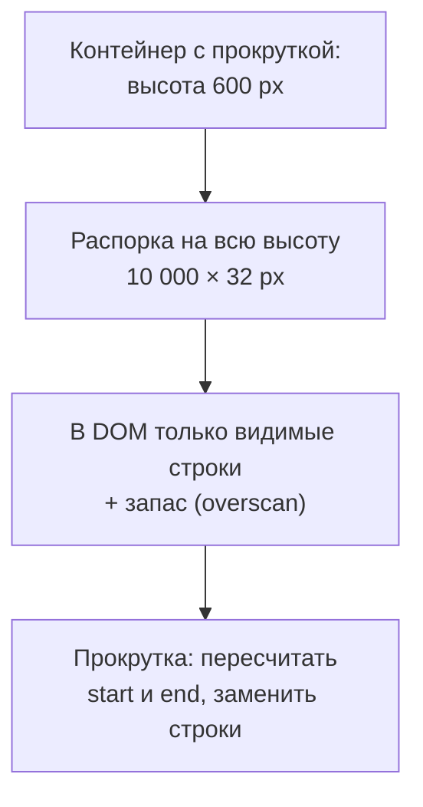
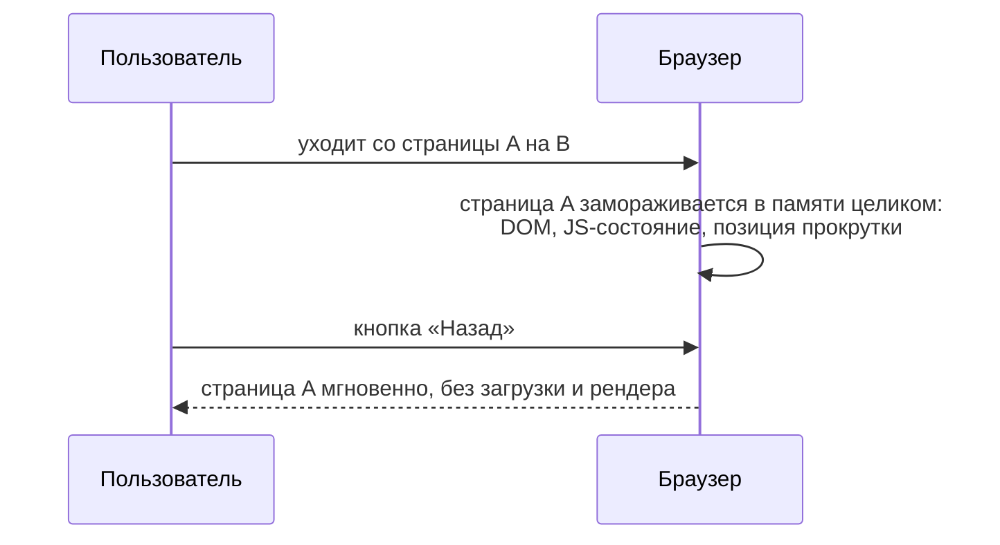

## О чём урок

Производительность страницы после загрузки: длинные списки и виртуализация, размер DOM и `content-visibility`, утечки памяти и как их искать, делегирование событий и back/forward cache, который делает переходы «Назад» мгновенными. Принудительный layout и анимации разобраны в уроке `browser-layout-paint`, сборка мусора в `js-memory`. Пример выполняется в jsdom.

## Длинные списки

```js dom
const rows = Array.from({ length: 10_000 }, (_, i) => `Order #${i + 1}`)

// Naive: every row is a DOM node.
const naive = document.createElement('ul')
naive.append(...rows.map((text) => Object.assign(document.createElement('li'), { textContent: text })))

// Windowing: only the rows in the viewport plus a few extra ("overscan") are in the DOM.
function visibleRange({ scrollTop, viewportHeight, rowHeight, count, overscan = 3 }) {
  const start = Math.max(0, Math.floor(scrollTop / rowHeight) - overscan)
  const end = Math.min(count, Math.ceil((scrollTop + viewportHeight) / rowHeight) + overscan)
  return { start, end }
}
function renderWindow(container, scrollTop) {
  const rowHeight = 32
  const { start, end } = visibleRange({ scrollTop, viewportHeight: 600, rowHeight, count: rows.length })
  // A tall spacer keeps the scrollbar honest; the rows are moved to their real position.
  container.style.height = `${rows.length * rowHeight}px`
  container.replaceChildren(
    ...rows.slice(start, end).map((text, i) =>
      Object.assign(document.createElement('li'), { textContent: text, style: `position:absolute;top:${(start + i) * rowHeight}px` }),
    ),
  )
  return { start, end }
}
const windowed = document.createElement('ul')
console.log('naive DOM rows:', naive.children.length)
for (const scrollTop of [0, 160_000]) {
  const { start, end } = renderWindow(windowed, scrollTop)
  console.log(`scrollTop ${scrollTop}: rows ${start}..${end - 1} rendered, DOM rows: ${windowed.children.length}, first: ${windowed.firstChild.textContent}`)
}
```

```output
naive DOM rows: 10000
scrollTop 0: rows 0..21 rendered, DOM rows: 22, first: Order #1
scrollTop 160000: rows 4997..5021 rendered, DOM rows: 25, first: Order #4998
```



- **Виртуализация** держит в DOM только строки в области видимости и несколько в запас: 22–25 узлов вместо 10 000. Распорка нужной высоты сохраняет правильную полосу прокрутки, строки ставятся на свою позицию.
- Дорог не сам узел, а работа, пропорциональная числу узлов: пересчёт стилей, layout и отрисовка при каждом изменении, память под дерево, время первого рендера. Цифры из заметок вроде «300–800 МБ на 10 000 `div`» не подтверждаются, но insight «Optimize DOM size» в DevTools действительно отмечает большие деревья.
- Готовые решения: TanStack Virtual (React, Vue, Angular, Solid, Svelte), react-window, Virtuoso, `cdk-virtual-scroll-viewport` в Angular CDK. Сложности: строки разной высоты (измерять и кэшировать высоты), поиск по странице и якоря (невидимых строк нет в DOM), доступность (`aria-rowcount`, `aria-rowindex`).
- Альтернативы без виртуализации: пагинация, «показать ещё», бесконечная загрузка с ограничением числа элементов.

## content-visibility

```css
.feed-item {
  content-visibility: auto; /* skip style, layout and paint while off-screen */
  contain-intrinsic-size: auto 400px; /* a placeholder size, then the last rendered size */
}
```

`content-visibility: auto` позволяет браузеру не считать стили, layout и отрисовку блоков вне экрана, пока к ним не прокрутили. Узлы остаются в DOM: поиск по странице, якоря и доступность работают, в отличие от виртуализации. Подходит для длинных статей, лент, документации. `contain-intrinsic-size` задаёт предполагаемый размер, иначе полоса прокрутки прыгает.

## Память

Утечка памяти во фронтенде это объекты, которые больше не нужны, но остаются достижимыми. Страница становится всё медленнее, а на телефоне вкладку перезагружает система.

| Источник | Пример | Исправление |
|---|---|---|
| Обработчики на глобальных объектах | `window.addEventListener('resize', ...)` в компоненте без снятия | Снимать при размонтировании, `AbortController` с `signal` |
| Таймеры и подписки | `setInterval`, WebSocket, `IntersectionObserver` живут после ухода со страницы | Очистка в `useEffect`, `onUnmounted`, `DestroyRef` |
| Отсоединённые DOM-узлы | Удалённый из страницы узел хранится в массиве или замыкании | Не держать ссылки на узлы в долгоживущих структурах, `WeakMap` |
| Растущие кэши | Мемоизация без ограничения размера | LRU с пределом, `WeakMap` по объекту-ключу |

Как искать: в DevTools панель Memory → снимок кучи до действия и после повторения действия несколько раз → сравнение снимков. Фильтр «Detached» показывает DOM-узлы, удалённые со страницы, но удерживаемые в памяти, а цепочка Retainers отвечает, кто их держит. Типы утечек и сборка мусора подробно в уроке `js-memory`.

**Делегирование событий** из заметок экономит и память, и время: один обработчик на родителе списка вместо тысячи на строках, и новые строки работают без навешивания (урок `browser-events`).

## Back/forward cache



**bfcache** хранит страницу целиком, и переход «Назад» или «Вперёд» показывает её мгновенно: LCP почти нулевой, нет повторной загрузки. Такие переходы составляют заметную долю всех навигаций, поэтому страницы, которые не попадают в bfcache, теряют лёгкую победу.

- **Мешает**: обработчик `unload` (используйте `pagehide` или `visibilitychange`), открытые соединения в момент ухода (закрывайте WebSocket в `pagehide`, переподключайтесь в `pageshow`), `Cache-Control: no-store` у HTML в части браузеров.
- **После восстановления** страница может показывать устаревшие данные: событие `pageshow` с `event.persisted === true` сообщает, что страницу восстановили из bfcache, и можно обновить данные.
- **Проверка**: DevTools → Application → Back/forward cache показывает, попадает ли страница в кэш и что мешает; в поле API `notRestoredReasons` в Navigation Timing.

```ts
addEventListener('pagehide', () => socket.close()) // instead of unload: keeps bfcache available
addEventListener('pageshow', (event) => {
  if (event.persisted) {
    reconnectSocket() // restored from bfcache: the page was frozen, not reloaded
    refreshCartBadge()
  }
})
```

## Главное

- Виртуализация держит в DOM только видимые строки и запас; распорка сохраняет полосу прокрутки; сложности: разная высота, поиск по странице, доступность.
- Дорог не узел, а работа, пропорциональная числу узлов; `content-visibility: auto` с `contain-intrinsic-size` пропускает отрисовку невидимых блоков без удаления из DOM.
- Утечки: обработчики на `window`, таймеры и подписки без очистки, отсоединённые DOM-узлы, кэши без предела; искать снимками кучи и фильтром «Detached».
- Делегирование событий: один обработчик на родителе вместо тысяч.
- bfcache делает «Назад» мгновенным; не использовать `unload`, закрывать соединения в `pagehide`, обновлять данные в `pageshow` при `persisted`; проверка в DevTools Application.
