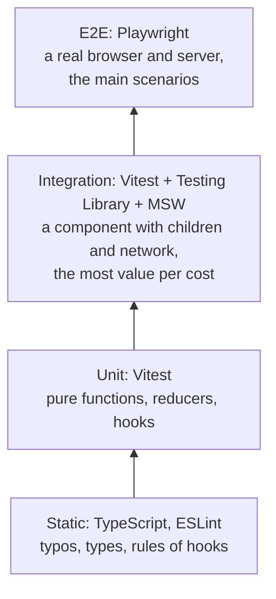

## What this lesson covers

Two topics closely tied together in React: accessibility (a component works with a keyboard and a screen reader) and testing (a test uses the component the way a user does). Common accessibility mistakes in JSX, focus management, live regions, then test levels, Testing Library and its query priority, `user-event`, testing hooks, MSW and Playwright.

## Accessibility in JSX

Almost all accessibility comes from the right HTML elements (the HTML track covers them in depth). In React the same mistakes repeat:

| Mistake | Why it is bad | The right way |
|---|---|---|
| `<div onClick={open}>` | Not focusable with the keyboard, does not respond to `Enter`/`Space`, a screen reader does not know it is a button | `<button type="button" onClick={open}>` |
| `<a onClick={go}>` without `href` | Not a link for the browser or a screen reader | `<Link to>` or `<a href>`; an action without navigation is a button |
| A field with only a `placeholder` | The hint disappears while typing, a screen reader does not read it as a label | `<label htmlFor={id}>` with `useId()` |
| An icon button without text | A screen reader says just "button" | `aria-label="Close"` or visually hidden text |
| `` without `alt` | The file name gets read | `alt="description"`, `alt=""` for decorative images |
| A message after loading appears silently | A blind user never learns about it | A live region `role="status"` or `aria-live="polite"` |

**Focus in a single-page app.** The browser does not move focus on client-side navigation, when a modal opens, or after the focused element is removed. Code does it through a `ref`: after navigation focus goes to the new page heading, a modal takes focus inside on open (or use the native `<dialog>`), and on close focus returns to the button that opened it.

Checks: `eslint-plugin-jsx-a11y` in the linter, `axe-core` in tests and as a browser extension, manual keyboard testing (Tab, Shift+Tab, Enter, Space, Escape) and a screen reader.

## Test levels



**Integration** tests of components give the most confidence for a reasonable price: render the real tree (no mocked children), replace the network with MSW, act like a user. E2E tests are slower and more brittle, so they cover key paths (login, payment). Markup snapshots catch any change rather than a bug, so keep them small.

## Testing Library: test like a user

Testing Library gives no access to component state or instances: a test finds elements the way a user does and checks what they see. The query priority:

1. `getByRole('button', { name: 'Save' })`: role and accessible name; checks accessibility along the way;
2. `getByLabelText('Email')`: form fields by their label;
3. `getByPlaceholderText`, `getByText`, `getByDisplayValue`: when there is no role;
4. `getByAltText`, `getByTitle`;
5. `getByTestId`: the last resort, when nothing else works.

Variants: `getBy` throws if the element is missing; `queryBy` returns `null` (to check absence); `findBy` waits for it to appear (async data).

```jsx dom
import { cleanup, render, screen } from '@testing-library/react'
import userEvent from '@testing-library/user-event'
import { useId, useState } from 'react'

function Subscribe({ onSubscribe }) {
  const id = useId()
  const [email, setEmail] = useState('')
  const [done, setDone] = useState(false)
  return (
    <form
      onSubmit={async (e) => {
        e.preventDefault()
        await onSubscribe(email)
        setDone(true)
      }}
    >
      <label htmlFor={id}>Email</label>
      <input id={id} type="email" value={email} onChange={(e) => setEmail(e.target.value)} />
      <button>Subscribe</button>
      <div onClick={() => {}}>Fake button</div>
      {done && <p role="status">Thanks, {email}!</p>}
    </form>
  )
}

const calls = []
const user = userEvent.setup()
render(<Subscribe onSubscribe={async (email) => calls.push(email)} />)

await user.type(screen.getByLabelText('Email'), 'ann@example.com')
await user.click(screen.getByRole('button', { name: 'Subscribe' }))
console.log((await screen.findByRole('status')).textContent, calls)
console.log('fake button found by role:', screen.queryByRole('button', { name: 'Fake button' }) !== null)
cleanup()
```

```output
Thanks, ann@example.com! [ 'ann@example.com' ]
fake button found by role: false
```

`<div onClick>` was not found by the button role: a test written by the query priority immediately reveals the accessibility problem.

- **`user-event`** simulates whole interactions: typing goes character by character with `keydown`, `input`, `keyup`, a click fires `pointerdown`, `mousedown`, focus, `click`. `fireEvent` dispatches a single event and fits only what a user does not do directly.
- Wait with `findBy` or `waitFor`, not with a `setTimeout` in the test.
- The warning "not wrapped in act(...)" means state updated after the test ended or without waiting: wait for the result (`await findBy...`).

## Testing a hook and the network

A hook without UI is tested with `renderHook`; updates are wrapped in `act`:

```jsx dom
import { act, renderHook } from '@testing-library/react'
import { useState } from 'react'

function useCounter(initial = 0) {
  const [count, setCount] = useState(initial)
  return { count, increment: () => setCount((c) => c + 1) }
}

const { result } = renderHook(() => useCounter(5))
act(() => result.current.increment())
act(() => result.current.increment())
console.log(result.current.count)
```

```output
7
```

- The network in component tests is replaced by **MSW** (the data lesson): the component makes a real `fetch`, the handlers answer, and for a single test the response is swapped for an error to check that the user sees a message.
- Components that need providers (a router, a query client, a theme) are rendered through your own `renderWithProviders(ui)` with the `wrapper` option; for the router, `createMemoryRouter`.
- The environment: Vitest with `jsdom` or `happy-dom`; Vitest Browser Mode runs the same tests in a real browser through Playwright when layout and real events matter.

## E2E with Playwright

Playwright drives Chromium, Firefox and WebKit, waits by itself until an element is visible and actionable, and uses the same role queries: `page.getByRole('button', { name: 'Subscribe' })`. The network can be stubbed with `page.route`, and the trace shows every step with the DOM and a screenshot. E2E tests check the user's whole path: the page, the server, the database.

## Key points

- Buttons are `<button>`, links are `<a href>`, fields have visible labels through `htmlFor` and `useId`, icons have `aria-label`, async messages go into `role="status"`.
- Move focus yourself through a `ref` on navigation and when a modal opens and closes.
- Component integration tests give the most value: Testing Library, `user-event`, MSW.
- Query by priority: role and name, label, text; `getBy`, `queryBy`, `findBy`; a test id last.
- Hooks are tested with `renderHook` and `act`; wait for async work with `findBy` and `waitFor`.
- E2E with Playwright for the main scenarios in a real browser.
