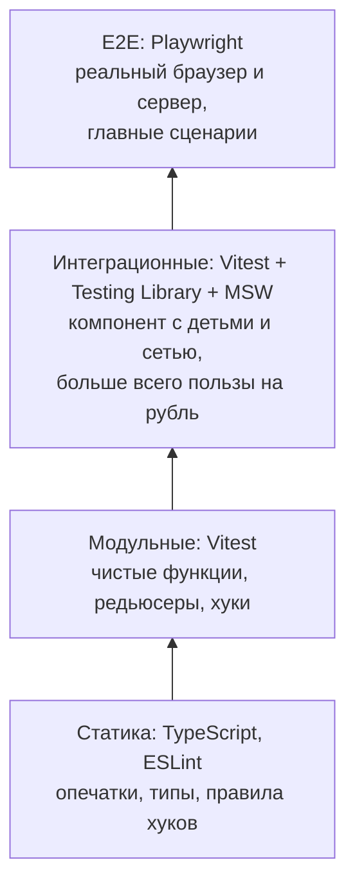

## О чём урок

Две темы, которые в React тесно связаны: доступность (компонент удобен с клавиатуры и скринридером) и тестирование (тест работает с компонентом так, как пользователь). Здесь частые ошибки доступности в JSX, управление фокусом, живые регионы, а также уровни тестов, Testing Library и её приоритет запросов, `user-event`, тесты хуков, MSW и Playwright.

## Доступность в JSX

Почти вся доступность даётся правильными HTML-элементами (трек HTML разбирает их подробно). В React ошибаются в одних и тех же местах:

| Ошибка | Почему плохо | Как правильно |
|---|---|---|
| `<div onClick={open}>` | Не получает фокус с клавиатуры, не нажимается `Enter`/`Space`, скринридер не знает, что это кнопка | `<button type="button" onClick={open}>` |
| `<a onClick={go}>` без `href` | Не ссылка для браузера и скринридера | `<Link to>` или `<a href>`; действие без перехода это кнопка |
| Поле без подписи, только `placeholder` | Подпись пропадает при вводе, скринридер её не читает | `<label htmlFor={id}>` с `useId()` |
| Иконка-кнопка без текста | Скринридер читает «кнопка» | `aria-label="Закрыть"` или скрытый текст |
| `` без `alt` | Читается имя файла | `alt="описание"`, для декоративных `alt=""` |
| Сообщение после загрузки появляется молча | Незрячий пользователь не узнает | Живой регион `role="status"` или `aria-live="polite"` |

**Фокус в одностраничном приложении.** Браузер не переносит фокус при клиентской навигации, при открытии модалки и после удаления элемента, на котором стоял фокус. Это делают в коде через `ref`: после перехода фокус на заголовок новой страницы, при открытии модалки внутрь (или нативный `<dialog>`), при закрытии обратно на кнопку, которая её открыла.

Проверки: `eslint-plugin-jsx-a11y` в линтере, `axe-core` в тестах и в браузерном расширении, ручная проверка с клавиатуры (Tab, Shift+Tab, Enter, Space, Escape) и скринридером.

## Уровни тестов



Больше всего уверенности за разумные деньги дают **интеграционные** тесты компонентов: рендер настоящего дерева (без моков дочерних компонентов), сеть подменена MSW, действия как у пользователя. E2E медленнее и хрупче, ими покрывают ключевые пути (вход, оплата). Снимки разметки (snapshot) ловят любое изменение, а не ошибку, и их стоит держать маленькими.

## Testing Library: тестировать как пользователь

Testing Library не даёт доступа к состоянию и экземплярам компонентов: тест ищет элементы так, как их находит пользователь, и проверяет то, что он видит. Приоритет запросов:

1. `getByRole('button', { name: 'Сохранить' })`: роль и доступное имя; заодно проверяет доступность;
2. `getByLabelText('Email')`: поля форм по подписи;
3. `getByPlaceholderText`, `getByText`, `getByDisplayValue`: когда роли нет;
4. `getByAltText`, `getByTitle`;
5. `getByTestId`: последний вариант, когда остальное невозможно.

Варианты: `getBy` бросает, если элемента нет; `queryBy` возвращает `null` (проверить отсутствие); `findBy` ждёт появления (асинхронные данные).

```jsx dom
import { cleanup, render, screen } from '@testing-library/react'
import userEvent from '@testing-library/user-event'
import { useId, useState } from 'react'

function Subscribe({ onSubscribe }) {
  const id = useId()
  const [email, setEmail] = useState('')
  const [done, setDone] = useState(false)
  return (
    <form
      onSubmit={async (e) => {
        e.preventDefault()
        await onSubscribe(email)
        setDone(true)
      }}
    >
      <label htmlFor={id}>Email</label>
      <input id={id} type="email" value={email} onChange={(e) => setEmail(e.target.value)} />
      <button>Subscribe</button>
      <div onClick={() => {}}>Fake button</div>
      {done && <p role="status">Thanks, {email}!</p>}
    </form>
  )
}

const calls = []
const user = userEvent.setup()
render(<Subscribe onSubscribe={async (email) => calls.push(email)} />)

await user.type(screen.getByLabelText('Email'), 'ann@example.com')
await user.click(screen.getByRole('button', { name: 'Subscribe' }))
console.log((await screen.findByRole('status')).textContent, calls)
console.log('fake button found by role:', screen.queryByRole('button', { name: 'Fake button' }) !== null)
cleanup()
```

```output
Thanks, ann@example.com! [ 'ann@example.com' ]
fake button found by role: false
```

`<div onClick>` не нашёлся по роли кнопки: тест, написанный по приоритету запросов, сразу показывает проблему доступности.

- **`user-event`** имитирует действия целиком: ввод печатает по символу с `keydown`, `input`, `keyup`, клик вызывает `pointerdown`, `mousedown`, фокус, `click`. `fireEvent` отправляет одно событие и годится только для того, чего пользователь не делает напрямую.
- Ожидание делают через `findBy` или `waitFor`, а не через `setTimeout` в тесте.
- Предупреждение «not wrapped in act(...)» означает, что состояние обновилось после окончания теста или без ожидания: нужно дождаться результата (`await findBy...`).

## Тест хука и сеть

Хук без интерфейса проверяют через `renderHook`; обновления оборачивают в `act`:

```jsx dom
import { act, renderHook } from '@testing-library/react'
import { useState } from 'react'

function useCounter(initial = 0) {
  const [count, setCount] = useState(initial)
  return { count, increment: () => setCount((c) => c + 1) }
}

const { result } = renderHook(() => useCounter(5))
act(() => result.current.increment())
act(() => result.current.increment())
console.log(result.current.count)
```

```output
7
```

- Сеть в тестах компонентов подменяют **MSW** (урок о данных): компонент делает настоящий `fetch`, обработчики отвечают, а для отдельного теста ответ меняют на ошибку и проверяют, что пользователь видит сообщение.
- Компоненты, которым нужны провайдеры (роутер, клиент запросов, тема), рендерят через свою функцию `renderWithProviders(ui)` с опцией `wrapper`; для роутера `createMemoryRouter`.
- Окружение: Vitest с `jsdom` или `happy-dom`; Vitest Browser Mode запускает те же тесты в настоящем браузере через Playwright, если нужны раскладка и реальные события.

## E2E на Playwright

Playwright управляет Chromium, Firefox и WebKit, сам ждёт, пока элемент станет видимым и доступным для действия, и использует те же запросы по ролям: `page.getByRole('button', { name: 'Subscribe' })`. Сеть можно подменить через `page.route`, трассировка показывает каждый шаг с DOM и скриншотом. E2E проверяют путь пользователя целиком: страница, сервер, база.

## Главное

- Кнопки это `<button>`, ссылки это `<a href>`, у полей видимые подписи через `htmlFor` и `useId`, у иконок `aria-label`, асинхронные сообщения в `role="status"`.
- Фокус при навигации, открытии и закрытии модалки переносят сами через `ref`.
- Больше всего пользы от интеграционных тестов компонентов: Testing Library, `user-event`, MSW.
- Запросы по приоритету: роль и имя, подпись, текст; `getBy`, `queryBy`, `findBy`; test id в последнюю очередь.
- Хуки тестируют `renderHook` и `act`; асинхронность ждут `findBy` и `waitFor`.
- E2E на Playwright для главных сценариев в реальном браузере.
